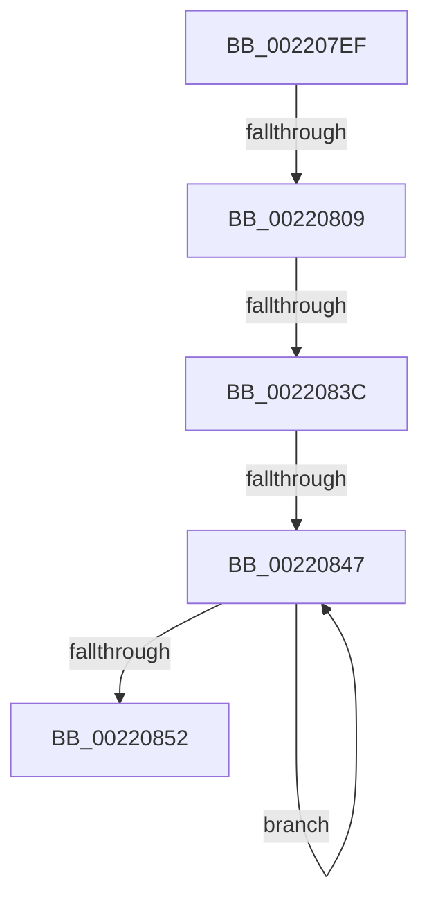

# sub_002207EF

- RVA: `0x002207EF`–`0x00220854` (길이 `101` bytes)
- VA: `0x00000001402207EF`
- 실행 섹션: `.text`
- PDB 이름 있음: `아니요`; PDB Function 태그: `아니요`
- unwind 정보 RVA: `0x0005F420`
- 디코드: `26`개 명령, `101/101` bytes 표시
- 미해석 바이트: `0` (있으면 어셈블리에 `.byte`로 보존)

> 이 문서는 커널 이미지의 기계어와 PDB 기호를 분석해 생성했습니다. 4번과 5번은 함수 원형과 자료형을 바이너리 사용 방식에서 추정한 C 해석이며 원본 소스 복구 결과는 아닙니다.

## 1. Dependencies

- 직접 호출 지점: **1**; 고유 호출 대상: **1**
- 직접 호출자로 확인된 함수: **0**
- RIP 상대 이미지 참조: **0**

### Outgoing calls
- `0x00220827` → [KiAbSetMinimumThreadPriority](../21/KiAbSetMinimumThreadPriority_function_0021F190.md) (function, `0x0021F190`)

### Direct callers
- 이 함수 시작 RVA로 연결되는 직접 call은 확인되지 않았습니다. 간접 호출은 완전히 역산할 수 없습니다.

### Static image references
- 디코드된 RIP-relative 메모리 참조가 없습니다.

## 2. Other-region calls and transfers

- 다른 실행 섹션으로 향하는 call: **0**
- call이 아닌 외부 분기/꼬리 이동: **4**
  - `0x00220803` → [sub_00220881 + 0x25](Unknown_function_00220881.md) (`tail-transfer`)
  - `0x0022083A` → [sub_00220881](Unknown_function_00220881.md) (`tail-transfer`)
  - `0x00220845` → [sub_00220881 + 0x1C](Unknown_function_00220881.md) (`tail-transfer`)
  - `0x00220852` → [sub_00220881 + 0x1C](Unknown_function_00220881.md) (`tail-transfer`)

## 3. Assembly (complete function range)

```asm
002207EF  48 8B BC 24 C0 00 00 00         mov rdi, qword ptr [rsp + 0xc0]
002207F7  4C 8B BC 24 D0 00 00 00         mov r15, qword ptr [rsp + 0xd0]
002207FF  40 38 6B 18                     cmp byte ptr [rbx + 0x18], bpl
00220803  0F 8D 9D 00 00 00               jge 0x1402208a6
00220809  48 8D 44 24 54                  lea rax, [rsp + 0x54]
0022080E  4D 8B CD                        mov r9, r13
00220811  48 89 44 24 28                  mov qword ptr [rsp + 0x28], rax
00220816  48 8D 54 24 58                  lea rdx, [rsp + 0x58]
0022081B  4C 8B C7                        mov r8, rdi
0022081E  4C 89 7C 24 20                  mov qword ptr [rsp + 0x20], r15
00220823  48 8D 4B F0                     lea rcx, [rbx - 0x10]
00220827  E8 64 E9 FF FF                  call 0x14021f190
0022082C  40 88 6B 18                     mov byte ptr [rbx + 0x18], bpl
00220830  48 8B CB                        mov rcx, rbx
00220833  48 8B 43 08                     mov rax, qword ptr [rbx + 8]
00220837  48 85 C0                        test rax, rax
0022083A  74 45                           je 0x140220881
0022083C  48 8B D8                        mov rbx, rax
0022083F  48 8B 00                        mov rax, qword ptr [rax]
00220842  48 85 C0                        test rax, rax
00220845  74 56                           je 0x14022089d
00220847  48 8B D8                        mov rbx, rax
0022084A  48 8B 00                        mov rax, qword ptr [rax]
0022084D  48 85 C0                        test rax, rax
00220850  75 F5                           jne 0x140220847
00220852  EB 49                           jmp 0x14022089d
```

## 4. C-style interpretation (structured pseudocode)

```c
__int64 __fastcall sub_002207EF(__int64 a1, __int64 a2, __int64 a3, __int64 a4, __int64 a5, __int64 a6, __int64 a7, __int64 a8, __int64 a9, __int64 a10, __int64 a11, __int64 a12, __int64 a13, __int64 a14, __int64 a15, __int64 a16, __int64 a17, __int64 a18, __int64 a19, __int64 a20, __int64 a21, __int64 a22, __int64 a23, __int64 a24, __int64 a25, __int64 a26)
{
    __int64 result;
    unsigned __int64 v_stack_p20;
    unsigned __int64 v_stack_p28;
    unsigned __int64 v_stack_p54;

    v_stack_p28 = v_stack_p54;
    v_stack_p20 = a26;
    result = KiAbSetMinimumThreadPriority(v_rbx - 16, a11, a24, v_r13);
    *(unsigned __int8 *)(v_rbx + 24) = (unsigned __int8)(v_rbp);
loc_00220847:
    if (*(unsigned __int64 *)(*(unsigned __int64 *)(*(unsigned __int64 *)(v_rbx + 8))) != 0) goto loc_00220847;
}
```

## 5. (Beta) C Style

```c
int64_t sub_002207EF(int64_t Arg1, int64_t Arg2, int64_t Arg3, int64_t Arg4, uint64_t Arg5, uint64_t Arg6, uint64_t Arg7, uint64_t Arg8, uint64_t Arg9, uint64_t Arg10, int64_t Arg11, uint64_t Arg12, uint64_t Arg13, uint64_t Arg14, uint64_t Arg15, uint64_t Arg16, uint64_t Arg17, uint64_t Arg18, uint64_t Arg19, uint64_t Arg20, uint64_t Arg21, uint64_t Arg22, uint64_t Arg23, int64_t Arg24, uint64_t Arg25, int64_t Arg26)
{
    int64_t result;
    uint64_t v_stack_p20;
    uint64_t v_stack_p28;
    uint64_t v_stack_p54;

    v_stack_p28 = v_stack_p54;
    v_stack_p20 = Arg26;
    result = KiAbSetMinimumThreadPriority(local_rbx - 16, Arg11, Arg24, local_r13);
    *(uint8_t *)(local_rbx + 0x18) = (uint8_t)(local_rbp);
loc_00220847:
    if (*(uint64_t *)(*(uint64_t *)(*(uint64_t *)(local_rbx + 0x8))) != 0) goto loc_00220847;
}
```

## 6. Execution-region graph

[열기: 2D/3D 그래프와 함수 탐색 컨트롤 패널](../../../control-panel.html?section=text&rva=0x002207EF&view=graph)

- 2D 그래프는 위에서 아래로 흐르고, 3D 그래프는 빈 공간을 드래그해 회전합니다. Shift+드래그는 이동, 휠은 확대·축소, 함수 노드 선택은 대상 보고서 이동입니다.

### Static fallback


