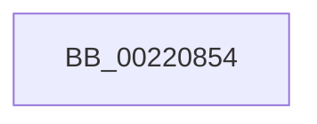

# sub_00220854

- RVA: `0x00220854`–`0x00220881` (길이 `45` bytes)
- VA: `0x0000000140220854`
- 실행 섹션: `.text`
- PDB 이름 있음: `아니요`; PDB Function 태그: `아니요`
- unwind 정보 RVA: `0x0005F430`
- 디코드: `12`개 명령, `45/45` bytes 표시
- 미해석 바이트: `0` (있으면 어셈블리에 `.byte`로 보존)

> 이 문서는 커널 이미지의 기계어와 PDB 기호를 분석해 생성했습니다. 4번과 5번은 함수 원형과 자료형을 바이너리 사용 방식에서 추정한 C 해석이며 원본 소스 복구 결과는 아닙니다.

## 1. Dependencies

- 직접 호출 지점: **0**; 고유 호출 대상: **0**
- 직접 호출자로 확인된 함수: **0**
- RIP 상대 이미지 참조: **0**

### Outgoing calls
- 직접 디코드된 call 명령이 없습니다.

### Direct callers
- 이 함수 시작 RVA로 연결되는 직접 call은 확인되지 않았습니다. 간접 호출은 완전히 역산할 수 없습니다.

### Static image references
- 디코드된 RIP-relative 메모리 참조가 없습니다.

## 2. Other-region calls and transfers

- 다른 실행 섹션으로 향하는 call: **0**
- call이 아닌 외부 분기/꼬리 이동: **1**
  - `0x0022087C` → [sub_002206D0 + 0x7F](Unknown_function_002206D0.md) (`tail-transfer`)

## 3. Assembly (complete function range)

```asm
00220854  0F B6 46 08                     movzx eax, byte ptr [rsi + 8]
00220858  BA 1E 00 00 00                  mov edx, 0x1e
0022085D  83 E0 3F                        and eax, 0x3f
00220860  48 6B C8 58                     imul rcx, rax, 0x58
00220864  48 8B C6                        mov rax, rsi
00220867  48 2B C1                        sub rax, rcx
0022086A  48 8B 40 F0                     mov rax, qword ptr [rax - 0x10]
0022086E  0F B6 88 C3 00 00 00            movzx ecx, byte ptr [rax + 0xc3]
00220875  3A CA                           cmp cl, dl
00220877  8B C1                           mov eax, ecx
00220879  0F 4F C2                        cmovg eax, edx
0022087C  E9 CE FE FF FF                  jmp 0x14022074f
```

## 4. C-style interpretation (structured pseudocode)

```c
__int64 __fastcall sub_00220854(void)
{
    __int64 result;

    result = (unsigned int)((*(unsigned __int8 *)(v_rsi + 8)) & (63));
    a1 = (a1) * (result);
    result = (v_rsi) - (a1);
    result = (unsigned int)((unsigned int)(*(unsigned __int8 *)(*(unsigned __int64 *)(result - 16) + 195)));
    if (((unsigned __int8)(*(unsigned __int8 *)(*(unsigned __int64 *)(result - 16) + 195))) > 30) { result = 30; }
}
```

## 5. (Beta) C Style

```c
void sub_00220854(void)
{
    int64_t result;

    result = (uint32_t)((*(uint8_t *)(local_rsi + 0x8)) & (63));
    a1 = (a1) * (result);
    result = (local_rsi) - (a1);
    result = (uint32_t)((uint32_t)(*(uint8_t *)(*(uint64_t *)(result - 0x10) + 0xC3)));
    if (((uint8_t)(*(uint8_t *)(*(uint64_t *)(result - 0x10) + 0xC3))) > 30) { result = 30; }
}
```

## 6. Execution-region graph

[열기: 2D/3D 그래프와 함수 탐색 컨트롤 패널](../../../control-panel.html?section=text&rva=0x00220854&view=graph)

- 2D 그래프는 위에서 아래로 흐르고, 3D 그래프는 빈 공간을 드래그해 회전합니다. Shift+드래그는 이동, 휠은 확대·축소, 함수 노드 선택은 대상 보고서 이동입니다.

### Static fallback


