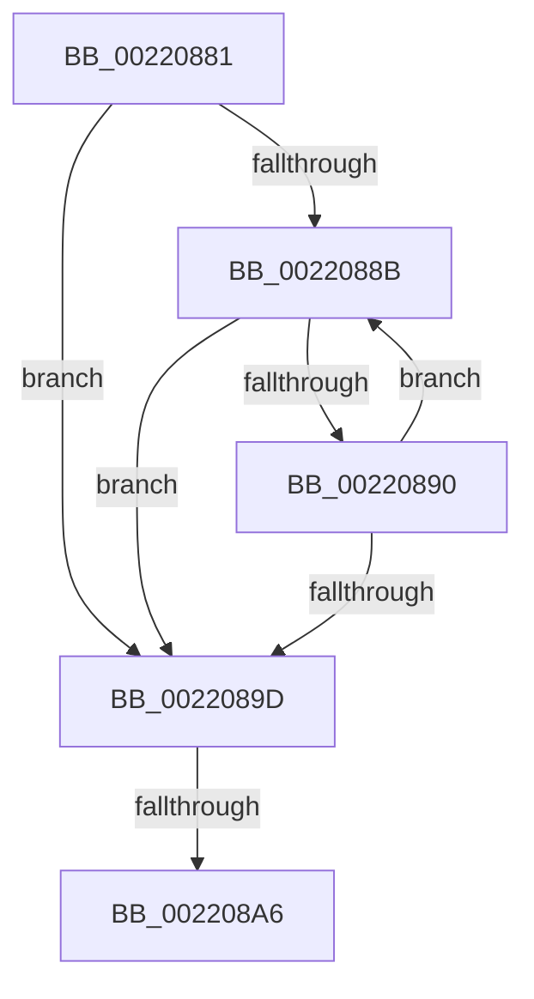

# sub_00220881

- RVA: `0x00220881`–`0x002208AD` (길이 `44` bytes)
- VA: `0x0000000140220881`
- 실행 섹션: `.text`
- PDB 이름 있음: `아니요`; PDB Function 태그: `아니요`
- unwind 정보 RVA: `0x0005F444`
- 디코드: `13`개 명령, `44/44` bytes 표시
- 미해석 바이트: `0` (있으면 어셈블리에 `.byte`로 보존)

> 이 문서는 커널 이미지의 기계어와 PDB 기호를 분석해 생성했습니다. 4번과 5번은 함수 원형과 자료형을 바이너리 사용 방식에서 추정한 C 해석이며 원본 소스 복구 결과는 아닙니다.

## 1. Dependencies

- 직접 호출 지점: **0**; 고유 호출 대상: **0**
- 직접 호출자로 확인된 함수: **0**
- RIP 상대 이미지 참조: **0**

### Outgoing calls
- 직접 디코드된 call 명령이 없습니다.

### Direct callers
- 이 함수 시작 RVA로 연결되는 직접 call은 확인되지 않았습니다. 간접 호출은 완전히 역산할 수 없습니다.

### Static image references
- 디코드된 RIP-relative 메모리 참조가 없습니다.

## 2. Other-region calls and transfers

- 다른 실행 섹션으로 향하는 call: **0**
- call이 아닌 외부 분기/꼬리 이동: **2**
  - `0x002208A0` → [sub_002207EF + 0x10](Unknown_function_002207EF.md) (`tail-transfer`)
  - `0x002208A8` → [KiAbCpuBoostOwners + 0x3C](KiAbCpuBoostOwners_function_00220680.md) (`tail-transfer`)

## 3. Assembly (complete function range)

```asm
00220881  48 8B 5B 10                     mov rbx, qword ptr [rbx + 0x10]
00220885  48 83 E3 FC                     and rbx, 0xfffffffffffffffc
00220889  74 12                           je 0x14022089d
0022088B  48 39 0B                        cmp qword ptr [rbx], rcx
0022088E  74 0D                           je 0x14022089d
00220890  48 8B CB                        mov rcx, rbx
00220893  48 8B 5B 10                     mov rbx, qword ptr [rbx + 0x10]
00220897  48 83 E3 FC                     and rbx, 0xfffffffffffffffc
0022089B  75 EE                           jne 0x14022088b
0022089D  48 85 DB                        test rbx, rbx
002208A0  0F 85 59 FF FF FF               jne 0x1402207ff
002208A6  33 FF                           xor edi, edi
002208A8  E9 0F FE FF FF                  jmp 0x1402206bc
```

## 4. C-style interpretation (structured pseudocode)

```c
void __fastcall sub_00220881(__int64 a1)
{
    __int64 v_rbx;
    __int64 v_rdi;

    v_rbx = (*(unsigned __int64 *)(v_rbx + 16)) & (-4);
    if (condition_is_equal) goto loc_0022089D;
loc_0022088B:
    if ((*(unsigned __int64 *)(v_rbx)) == a1) goto loc_0022089D;
    v_rbx = (*(unsigned __int64 *)(v_rbx + 16)) & (-4);
    if (condition_is_not_equal) goto loc_0022088B;
loc_0022089D:
    v_rdi = 0;
}
```

## 5. (Beta) C Style

```c
void sub_00220881(int64_t Arg1)
{
    int64_t local_rbx;
    int64_t local_rdi;

    local_rbx = (*(uint64_t *)(local_rbx + 0x10)) & (-4);
    if (condition_is_equal) goto loc_0022089D;
loc_0022088B:
    if ((*(uint64_t *)(local_rbx)) == Arg1) goto loc_0022089D;
    local_rbx = (*(uint64_t *)(local_rbx + 0x10)) & (-4);
    if (condition_is_not_equal) goto loc_0022088B;
loc_0022089D:
    local_rdi = 0;
}
```

## 6. Execution-region graph

[열기: 2D/3D 그래프와 함수 탐색 컨트롤 패널](../../../control-panel.html?section=text&rva=0x00220881&view=graph)

- 2D 그래프는 위에서 아래로 흐르고, 3D 그래프는 빈 공간을 드래그해 회전합니다. Shift+드래그는 이동, 휠은 확대·축소, 함수 노드 선택은 대상 보고서 이동입니다.

### Static fallback


