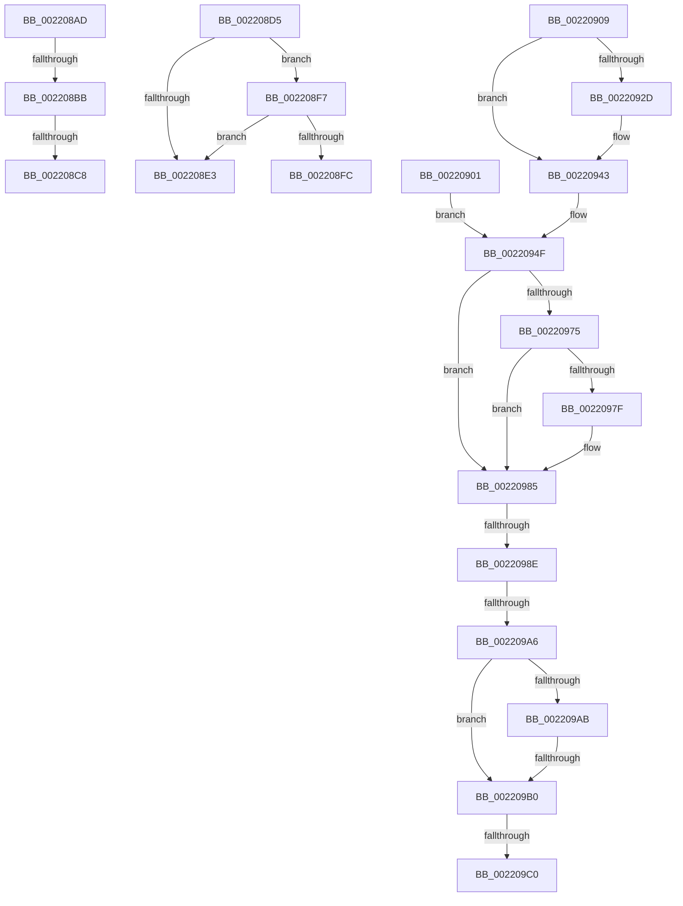

# sub_002208AD

- RVA: `0x002208AD`–`0x002209C5` (길이 `280` bytes)
- VA: `0x00000001402208AD`
- 실행 섹션: `.text`
- PDB 이름 있음: `아니요`; PDB Function 태그: `아니요`
- unwind 정보 RVA: `0x0005F454`
- 디코드: `64`개 명령, `280/280` bytes 표시
- 미해석 바이트: `0` (있으면 어셈블리에 `.byte`로 보존)

> 이 문서는 커널 이미지의 기계어와 PDB 기호를 분석해 생성했습니다. 4번과 5번은 함수 원형과 자료형을 바이너리 사용 방식에서 추정한 C 해석이며 원본 소스 복구 결과는 아닙니다.

## 1. Dependencies

- 직접 호출 지점: **3**; 고유 호출 대상: **3**
- 직접 호출자로 확인된 함수: **0**
- RIP 상대 이미지 참조: **2**

### Outgoing calls
- `0x002208BB` → [KiCheckVpBackingLongSpinWaitHypercall](../30/KiCheckVpBackingLongSpinWaitHypercall_function_0030F490.md) (function, `0x0030F490`)
- `0x002208CB` → [HvlNotifyLongSpinWait](../30/HvlNotifyLongSpinWait_function_0030F460.md) (function, `0x0030F460`)
- `0x00220938` → [KiSetPriorityThread](KiSetPriorityThread_function_00220E78.md) (function, `0x00220E78`)

### Direct callers
- 이 함수 시작 RVA로 연결되는 직접 call은 확인되지 않았습니다. 간접 호출은 완전히 역산할 수 없습니다.

### Static image references
- `0x002208AD` → RVA `0x00FC6AB8` (`ALMOSTRO`; read)
- `0x002209B0` → RVA `0x00FC6B14` (`ALMOSTRO`; read)

## 2. Other-region calls and transfers

- 다른 실행 섹션으로 향하는 call: **0**
- call이 아닌 외부 분기/꼬리 이동: **9**
  - `0x002208B5` → [sub_002206D0 + 0xD0](Unknown_function_002206D0.md) (`tail-transfer`)
  - `0x002208C2` → [sub_002206D0 + 0xD0](Unknown_function_002206D0.md) (`tail-transfer`)
  - `0x002208D0` → [sub_002206D0 + 0xD2](Unknown_function_002206D0.md) (`tail-transfer`)
  - `0x002208F2` → [sub_002206D0 + 0x51](Unknown_function_002206D0.md) (`tail-transfer`)
  - `0x002208FC` → [sub_002206D0 + 0x51](Unknown_function_002206D0.md) (`tail-transfer`)
  - `0x0022098C` → [sub_002209D5 + 0x1F](Unknown_function_002209D5.md) (`tail-transfer`)
  - `0x002209A0` → [sub_002209D5 + 0x78](Unknown_function_002209D5.md) (`tail-transfer`)
  - `0x002209AE` → [sub_002209D5](Unknown_function_002209D5.md) (`tail-transfer`)
  - `0x002209BA` → [sub_002209D5 + 0x140](Unknown_function_002209D5.md) (`tail-transfer`)

## 3. Assembly (complete function range)

```asm
002208AD  8B 05 05 62 DA 00               mov eax, dword ptr [rip + 0xda6205]
002208B3  A8 40                           test al, 0x40
002208B5  0F 84 E5 FE FF FF               je 0x1402207a0
002208BB  E8 D0 EB 0E 00                  call 0x14030f490
002208C0  84 C0                           test al, al
002208C2  0F 84 D8 FE FF FF               je 0x1402207a0
002208C8  41 8B CE                        mov ecx, r14d
002208CB  E8 90 EB 0E 00                  call 0x14030f460
002208D0  E9 CD FE FF FF                  jmp 0x1402207a2
002208D5  65 48 8B 04 25 88 01 00 00      mov rax, qword ptr gs:[0x188]
002208DE  48 3B D8                        cmp rbx, rax
002208E1  75 14                           jne 0x1402208f7
002208E3  83 BB E0 05 00 00 00            cmp dword ptr [rbx + 0x5e0], 0
002208EA  B8 02 00 00 00                  mov eax, 2
002208EF  0F 45 E8                        cmovne ebp, eax
002208F2  E9 2A FE FF FF                  jmp 0x140220721
002208F7  83 FD 02                        cmp ebp, 2
002208FA  7C E7                           jl 0x1402208e3
002208FC  E9 20 FE FF FF                  jmp 0x140220721
00220901  44 0F B6 64 24 50               movzx r12d, byte ptr [rsp + 0x50]
00220907  EB 46                           jmp 0x14022094f
00220909  FE C0                           inc al
0022090B  88 81 38 03 00 00               mov byte ptr [rcx + 0x338], al
00220911  8B 83 58 03 00 00               mov eax, dword ptr [rbx + 0x358]
00220917  44 0F AB E0                     bts eax, r12d
0022091B  89 83 58 03 00 00               mov dword ptr [rbx + 0x358], eax
00220921  0F BE 83 C3 00 00 00            movsx eax, byte ptr [rbx + 0xc3]
00220928  41 3B C4                        cmp eax, r12d
0022092B  7D 16                           jge 0x140220943
0022092D  48 8B 94 24 C0 00 00 00         mov rdx, qword ptr [rsp + 0xc0]
00220935  48 8B CB                        mov rcx, rbx
00220938  E8 3B 05 00 00                  call 0x140220e78
0022093D  41 BF 01 00 00 00               mov r15d, 1
00220943  4C 8B AC 24 C8 00 00 00         mov r13, qword ptr [rsp + 0xc8]
0022094B  48 89 7B 40                     mov qword ptr [rbx + 0x40], rdi
0022094F  48 8B 83 20 02 00 00            mov rax, qword ptr [rbx + 0x220]
00220956  4C 8D 4E 50                     lea r9, [rsi + 0x50]
0022095A  8B 8B A0 05 00 00               mov ecx, dword ptr [rbx + 0x5a0]
00220960  4D 8B F1                        mov r14, r9
00220963  C1 E9 09                        shr ecx, 9
00220966  83 E1 07                        and ecx, 7
00220969  48 8B 90 A0 02 00 00            mov rdx, qword ptr [rax + 0x2a0]
00220970  48 85 D2                        test rdx, rdx
00220973  74 10                           je 0x140220985
00220975  8B 82 3C 04 00 00               mov eax, dword ptr [rdx + 0x43c]
0022097B  3B C8                           cmp ecx, eax
0022097D  7C 06                           jl 0x140220985
0022097F  8B C8                           mov ecx, eax
00220981  4C 8D 76 50                     lea r14, [rsi + 0x50]
00220985  0F BE 44 24 59                  movsx eax, byte ptr [rsp + 0x59]
0022098A  3B C8                           cmp ecx, eax
0022098C  7C 66                           jl 0x1402209f4
0022098E  83 BB E8 05 00 00 00            cmp dword ptr [rbx + 0x5e8], 0
00220995  0F BE 44 24 5A                  movsx eax, byte ptr [rsp + 0x5a]
0022099A  40 0F 94 C7                     sete dil
0022099E  3B F8                           cmp edi, eax
002209A0  0F 8C A7 00 00 00               jl 0x140220a4d
002209A6  4D 85 ED                        test r13, r13
002209A9  74 05                           je 0x1402209b0
002209AB  45 85 FF                        test r15d, r15d
002209AE  75 25                           jne 0x1402209d5
002209B0  F7 05 5A 61 DA 00 00 10 00 00   test dword ptr [rip + 0xda615a], 0x1000
002209BA  0F 85 55 01 00 00               jne 0x140220b15
002209C0  4C 8B 64 24 68                  mov r12, qword ptr [rsp + 0x68]
```

## 4. C-style interpretation (structured pseudocode)

```c
__int64 __fastcall sub_002208AD(void)
{
    __int64 result;
    unsigned __int8 v_stack_p50;
    unsigned __int8 v_stack_p59;
    unsigned __int8 v_stack_p5A;
    unsigned __int64 v_stack_p68;
    unsigned __int64 v_stack_pC0;
    unsigned __int64 v_stack_pC8;

    result = KiCheckVpBackingLongSpinWaitHypercall(a1, a2, a3, a4);
    result = HvlNotifyLongSpinWait((unsigned int)((unsigned int)(v_r14)), a2, a3, a4);
}
```

## 5. (Beta) C Style

```c
void sub_002208AD(void)
{
    int64_t result;
    uint8_t v_stack_p50;
    uint8_t v_stack_p59;
    uint8_t v_stack_p5A;
    uint64_t v_stack_p68;
    uint64_t v_stack_pC0;
    uint64_t v_stack_pC8;

    result = KiCheckVpBackingLongSpinWaitHypercall(a1, a2, a3, a4);
    result = HvlNotifyLongSpinWait((uint32_t)((uint32_t)(local_r14)), a2, a3, a4);
}
```

## 6. Execution-region graph

[열기: 2D/3D 그래프와 함수 탐색 컨트롤 패널](../../../control-panel.html?section=text&rva=0x002208AD&view=graph)

- 2D 그래프는 위에서 아래로 흐르고, 3D 그래프는 빈 공간을 드래그해 회전합니다. Shift+드래그는 이동, 휠은 확대·축소, 함수 노드 선택은 대상 보고서 이동입니다.

### Static fallback


