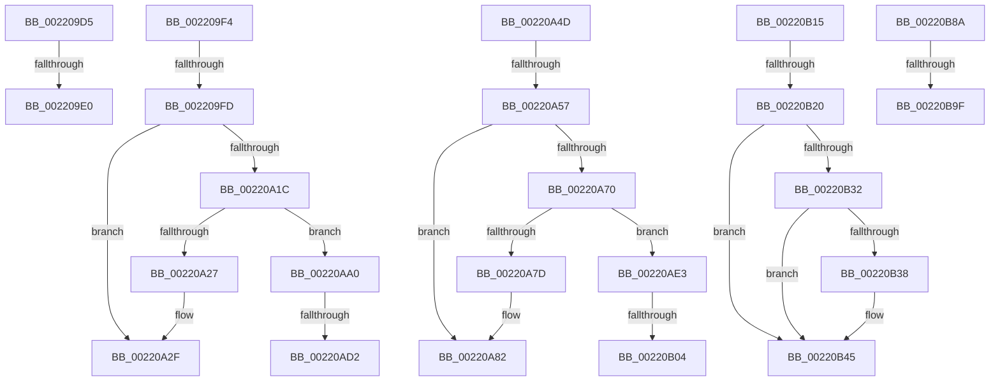

# sub_002209D5

- RVA: `0x002209D5`–`0x00220BA4` (길이 `463` bytes)
- VA: `0x00000001402209D5`
- 실행 섹션: `.text`
- PDB 이름 있음: `아니요`; PDB Function 태그: `아니요`
- unwind 정보 RVA: `0x0005F47C`
- 디코드: `98`개 명령, `463/463` bytes 표시
- 미해석 바이트: `0` (있으면 어셈블리에 `.byte`로 보존)

> 이 문서는 커널 이미지의 기계어와 PDB 기호를 분석해 생성했습니다. 4번과 5번은 함수 원형과 자료형을 바이너리 사용 방식에서 추정한 C 해석이며 원본 소스 복구 결과는 아닙니다.

## 1. Dependencies

- 직접 호출 지점: **9**; 고유 호출 대상: **5**
- 직접 호출자로 확인된 함수: **0**
- RIP 상대 이미지 참조: **0**

### Outgoing calls
- `0x002209ED` → [KiAbThreadInsertList](../21/KiAbThreadInsertList_function_0021F0E0.md) (function, `0x0021F0E0`)
- `0x00220A08` → [PsBoostThreadIoEx](../39/PsBoostThreadIoEx_function_00392C00.md) (function, `0x00392C00`)
- `0x00220A5C` → [PsBoostThreadIoQoS](../21/PsBoostThreadIoQoS_function_0021EFC0.md) (function, `0x0021EFC0`)
- `0x00220AAB` → [PsBoostThreadIoEx](../39/PsBoostThreadIoEx_function_00392C00.md) (function, `0x00392C00`)
- `0x00220AC5` → [KiAbThreadInsertList](../21/KiAbThreadInsertList_function_0021F0E0.md) (function, `0x0021F0E0`)
- `0x00220AD9` → [KiAbQueueAutoBoostDpc](../20/KiAbQueueAutoBoostDpc_function_002074D0.md) (function, `0x002074D0`)
- `0x00220AF7` → [KiAbThreadInsertList](../21/KiAbThreadInsertList_function_0021F0E0.md) (function, `0x0021F0E0`)
- `0x00220B0B` → [KiAbQueueAutoBoostDpc](../20/KiAbQueueAutoBoostDpc_function_002074D0.md) (function, `0x002074D0`)
- `0x00220B80` → [EtwTraceAutoBoostSetFloor](EtwTraceAutoBoostSetFloor_function_00222EF0.md) (function, `0x00222EF0`)

### Direct callers
- 이 함수 시작 RVA로 연결되는 직접 call은 확인되지 않았습니다. 간접 호출은 완전히 역산할 수 없습니다.

### Static image references
- 디코드된 RIP-relative 메모리 참조가 없습니다.

## 2. Other-region calls and transfers

- 다른 실행 섹션으로 향하는 call: **0**
- call이 아닌 외부 분기/꼬리 이동: **14**
  - `0x002209DE` → [sub_002208AD + 0x103](Unknown_function_002208AD.md) (`tail-transfer`)
  - `0x002209F2` → [sub_002208AD + 0x103](Unknown_function_002208AD.md) (`tail-transfer`)
  - `0x002209FB` → [sub_002208AD + 0xE1](Unknown_function_002208AD.md) (`tail-transfer`)
  - `0x00220A48` → [sub_002208AD + 0xE1](Unknown_function_002208AD.md) (`tail-transfer`)
  - `0x00220A51` → [sub_002208AD + 0xF9](Unknown_function_002208AD.md) (`tail-transfer`)
  - `0x00220A9B` → [sub_002208AD + 0xF9](Unknown_function_002208AD.md) (`tail-transfer`)
  - `0x00220ACC` → [sub_002208AD + 0xE1](Unknown_function_002208AD.md) (`tail-transfer`)
  - `0x00220ADE` → [sub_002208AD + 0xE1](Unknown_function_002208AD.md) (`tail-transfer`)
  - `0x00220AFE` → [sub_002208AD + 0xF9](Unknown_function_002208AD.md) (`tail-transfer`)
  - `0x00220B10` → [sub_002208AD + 0xF9](Unknown_function_002208AD.md) (`tail-transfer`)
  - `0x00220B1A` → [sub_002208AD + 0x113](Unknown_function_002208AD.md) (`tail-transfer`)
  - `0x00220B85` → [sub_002208AD + 0x113](Unknown_function_002208AD.md) (`tail-transfer`)
  - `0x00220B99` → [sub_002206D0 + 0x66](Unknown_function_002206D0.md) (`tail-transfer`)
  - `0x00220B9F` → [sub_002206D0 + 0x5E](Unknown_function_002206D0.md) (`tail-transfer`)

## 3. Assembly (complete function range)

```asm
002209D5  0F B6 83 18 03 00 00            movzx eax, byte ptr [rbx + 0x318]
002209DC  84 C0                           test al, al
002209DE  74 D0                           je 0x1402209b0
002209E0  4C 8D 83 28 03 00 00            lea r8, [rbx + 0x328]
002209E7  49 8B D5                        mov rdx, r13
002209EA  48 8B CB                        mov rcx, rbx
002209ED  E8 EE E6 FF FF                  call 0x14021f0e0
002209F2  EB BC                           jmp 0x1402209b0
002209F4  41 F7 01 00 00 00 40            test dword ptr [r9], 0x40000000
002209FB  75 91                           jne 0x14022098e
002209FD  45 33 C9                        xor r9d, r9d
00220A00  45 33 C0                        xor r8d, r8d
00220A03  33 D2                           xor edx, edx
00220A05  48 8B CB                        mov rcx, rbx
00220A08  E8 F3 21 17 00                  call 0x140392c00
00220A0D  F0 83 0C 24 00                  lock or dword ptr [rsp], 0
00220A12  8B 83 5C 03 00 00               mov eax, dword ptr [rbx + 0x35c]
00220A18  85 C0                           test eax, eax
00220A1A  75 13                           jne 0x140220a2f
00220A1C  48 83 BC 24 D0 00 00 00 00      cmp qword ptr [rsp + 0xd0], 0
00220A25  75 79                           jne 0x140220aa0
00220A27  C7 44 24 54 01 00 00 00         mov dword ptr [rsp + 0x54], 1
00220A2F  F0 FF 83 5C 03 00 00            lock inc dword ptr [rbx + 0x35c]
00220A36  41 81 0E 00 00 00 40            or dword ptr [r14], 0x40000000
00220A3D  41 BF 01 00 00 00               mov r15d, 1
00220A43  C6 44 24 51 02                  mov byte ptr [rsp + 0x51], 2
00220A48  E9 41 FF FF FF                  jmp 0x14022098e
00220A4D  83 7E 50 00                     cmp dword ptr [rsi + 0x50], 0
00220A51  0F 8C 4F FF FF FF               jl 0x1402209a6
00220A57  33 D2                           xor edx, edx
00220A59  48 8B CB                        mov rcx, rbx
00220A5C  E8 5F E5 FF FF                  call 0x14021efc0
00220A61  F0 83 0C 24 00                  lock or dword ptr [rsp], 0
00220A66  8B 83 60 03 00 00               mov eax, dword ptr [rbx + 0x360]
00220A6C  85 C0                           test eax, eax
00220A6E  75 12                           jne 0x140220a82
00220A70  48 8B BC 24 D0 00 00 00         mov rdi, qword ptr [rsp + 0xd0]
00220A78  48 85 FF                        test rdi, rdi
00220A7B  75 66                           jne 0x140220ae3
00220A7D  83 4C 24 54 02                  or dword ptr [rsp + 0x54], 2
00220A82  F0 FF 83 60 03 00 00            lock inc dword ptr [rbx + 0x360]
00220A89  81 4E 50 00 00 00 80            or dword ptr [rsi + 0x50], 0x80000000
00220A90  41 BF 01 00 00 00               mov r15d, 1
00220A96  44 88 7C 24 52                  mov byte ptr [rsp + 0x52], r15b
00220A9B  E9 06 FF FF FF                  jmp 0x1402209a6
00220AA0  45 33 C9                        xor r9d, r9d
00220AA3  45 33 C0                        xor r8d, r8d
00220AA6  B2 01                           mov dl, 1
00220AA8  48 8B CB                        mov rcx, rbx
00220AAB  E8 50 21 17 00                  call 0x140392c00
00220AB0  4C 8B B4 24 D0 00 00 00         mov r14, qword ptr [rsp + 0xd0]
00220AB8  4C 8D 83 30 03 00 00            lea r8, [rbx + 0x330]
00220ABF  49 8B D6                        mov rdx, r14
00220AC2  48 8B CB                        mov rcx, rbx
00220AC5  E8 16 E6 FF FF                  call 0x14021f0e0
00220ACA  85 C0                           test eax, eax
00220ACC  0F 84 BC FE FF FF               je 0x14022098e
00220AD2  49 8D 8E 90 6E FF FF            lea rcx, [r14 - 0x9170]
00220AD9  E8 F2 69 FE FF                  call 0x1402074d0
00220ADE  E9 AB FE FF FF                  jmp 0x14022098e
00220AE3  F0 FF 8B E4 05 00 00            lock dec dword ptr [rbx + 0x5e4]
00220AEA  4C 8D 83 30 03 00 00            lea r8, [rbx + 0x330]
00220AF1  48 8B D7                        mov rdx, rdi
00220AF4  48 8B CB                        mov rcx, rbx
00220AF7  E8 E4 E5 FF FF                  call 0x14021f0e0
00220AFC  85 C0                           test eax, eax
00220AFE  0F 84 A2 FE FF FF               je 0x1402209a6
00220B04  48 8D 8F 90 6E FF FF            lea rcx, [rdi - 0x9170]
00220B0B  E8 C0 69 FE FF                  call 0x1402074d0
00220B10  E9 91 FE FF FF                  jmp 0x1402209a6
00220B15  83 7C 24 50 00                  cmp dword ptr [rsp + 0x50], 0
00220B1A  0F 84 A0 FE FF FF               je 0x1402209c0
00220B20  48 8B 16                        mov rdx, qword ptr [rsi]
00220B23  48 B8 FC FF FF FF FF FF FF 7F   movabs rax, 0x7ffffffffffffffc
00220B2D  48 23 D0                        and rdx, rax
00220B30  74 13                           je 0x140220b45
00220B32  80 7E 08 00                     cmp byte ptr [rsi + 8], 0
00220B36  7C 0D                           jl 0x140220b45
00220B38  48 B8 00 00 00 00 00 00 00 80   movabs rax, 0x8000000000000000
00220B42  48 0B D0                        or rdx, rax
00220B45  8B 44 24 54                     mov eax, dword ptr [rsp + 0x54]
00220B49  45 0F B6 C4                     movzx r8d, r12b
00220B4D  44 0F B6 4C 24 51               movzx r9d, byte ptr [rsp + 0x51]
00220B53  48 8B CB                        mov rcx, rbx
00220B56  89 44 24 48                     mov dword ptr [rsp + 0x48], eax
00220B5A  0F B6 84 24 B8 00 00 00         movzx eax, byte ptr [rsp + 0xb8]
00220B62  88 44 24 38                     mov byte ptr [rsp + 0x38], al
00220B66  0F B6 84 24 B0 00 00 00         movzx eax, byte ptr [rsp + 0xb0]
00220B6E  40 88 6C 24 30                  mov byte ptr [rsp + 0x30], bpl
00220B73  88 44 24 28                     mov byte ptr [rsp + 0x28], al
00220B77  0F B6 44 24 52                  movzx eax, byte ptr [rsp + 0x52]
00220B7C  88 44 24 20                     mov byte ptr [rsp + 0x20], al
00220B80  E8 6B 23 00 00                  call 0x140222ef0
00220B85  E9 36 FE FF FF                  jmp 0x1402209c0
00220B8A  83 BB E4 05 00 00 00            cmp dword ptr [rbx + 0x5e4], 0
00220B91  C6 84 24 B8 00 00 00 00         mov byte ptr [rsp + 0xb8], 0
00220B99  0F 84 97 FB FF FF               je 0x140220736
00220B9F  E9 8A FB FF FF                  jmp 0x14022072e
```

## 4. C-style interpretation (structured pseudocode)

```c
__int64 __fastcall sub_002209D5(__int64 a1, __int64 a2, __int64 a3, __int64 a4)
{
    __int64 result;
    unsigned int v_stack_p0;
    unsigned __int8 v_stack_p20;
    unsigned __int8 v_stack_p28;
    unsigned __int8 v_stack_p30;
    unsigned __int8 v_stack_p38;
    unsigned int v_stack_p48;
    unsigned int v_stack_p50;
    unsigned __int8 v_stack_p51;
    unsigned __int8 v_stack_p52;
    unsigned int v_stack_p54;
    unsigned __int8 v_stack_pB0;
    unsigned __int8 v_stack_pB8;
    unsigned __int64 v_stack_pD0;

    result = KiAbThreadInsertList(v_rbx, v_r13, v_rbx + 808, a4);
}
```

## 5. (Beta) C Style

```c
int64_t sub_002209D5(int64_t Arg1, int64_t Arg2, int64_t Arg3, int64_t Arg4)
{
    int64_t result;
    uint32_t v_stack_p0;
    uint8_t v_stack_p20;
    uint8_t v_stack_p28;
    uint8_t v_stack_p30;
    uint8_t v_stack_p38;
    uint32_t v_stack_p48;
    uint32_t v_stack_p50;
    uint8_t v_stack_p51;
    uint8_t v_stack_p52;
    uint32_t v_stack_p54;
    uint8_t v_stack_pB0;
    uint8_t v_stack_pB8;
    uint64_t v_stack_pD0;

    result = KiAbThreadInsertList(local_rbx, local_r13, local_rbx + 808, Arg4);
}
```

## 6. Execution-region graph

[열기: 2D/3D 그래프와 함수 탐색 컨트롤 패널](../../../control-panel.html?section=text&rva=0x002209D5&view=graph)

- 2D 그래프는 위에서 아래로 흐르고, 3D 그래프는 빈 공간을 드래그해 회전합니다. Shift+드래그는 이동, 휠은 확대·축소, 함수 노드 선택은 대상 보고서 이동입니다.

### Static fallback


