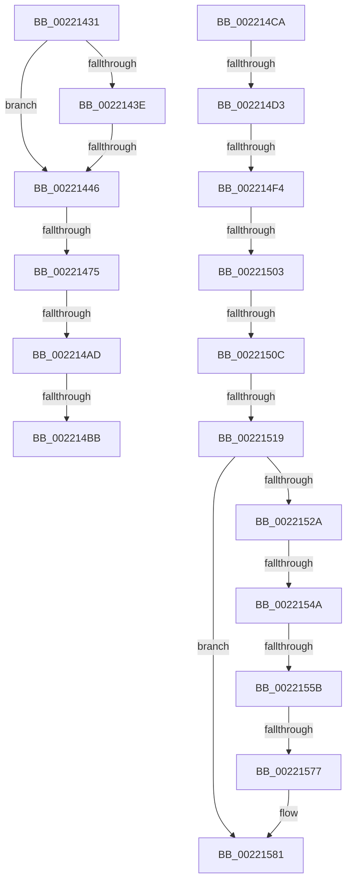

# sub_00221431

- RVA: `0x00221431`–`0x0022159D` (길이 `364` bytes)
- VA: `0x0000000140221431`
- 실행 섹션: `.text`
- PDB 이름 있음: `아니요`; PDB Function 태그: `아니요`
- unwind 정보 RVA: `0x0005F4E4`
- 디코드: `80`개 명령, `364/364` bytes 표시
- 미해석 바이트: `0` (있으면 어셈블리에 `.byte`로 보존)

> 이 문서는 커널 이미지의 기계어와 PDB 기호를 분석해 생성했습니다. 4번과 5번은 함수 원형과 자료형을 바이너리 사용 방식에서 추정한 C 해석이며 원본 소스 복구 결과는 아닙니다.

## 1. Dependencies

- 직접 호출 지점: **3**; 고유 호출 대상: **2**
- 직접 호출자로 확인된 함수: **0**
- RIP 상대 이미지 참조: **3**

### Outgoing calls
- `0x002214C0` → [ExpAcquireSpinLockSharedAtDpcLevelInstrumented](../27/ExpAcquireSpinLockSharedAtDpcLevelInstrumented_function_0027CD20.md) (function, `0x0027CD20`)
- `0x00221560` → [KeReleaseInStackQueuedSpinLockFromDpcLevel](../21/KeReleaseInStackQueuedSpinLockFromDpcLevel_function_002171B0.md) (function, `0x002171B0`)
- `0x0022157A` → [KeReleaseInStackQueuedSpinLockFromDpcLevel](../21/KeReleaseInStackQueuedSpinLockFromDpcLevel_function_002171B0.md) (function, `0x002171B0`)

### Direct callers
- 이 함수 시작 RVA로 연결되는 직접 call은 확인되지 않았습니다. 간접 호출은 완전히 역산할 수 없습니다.

### Static image references
- `0x0022147C` → RVA `0x00E17100` (`.data`; read)
- `0x002214A0` → RVA `0x00FC6B06` (`ALMOSTRO`; read)
- `0x002214AD` → RVA `0x00F0DE58` (`.data`; read)

## 2. Other-region calls and transfers

- 다른 실행 섹션으로 향하는 call: **0**
- call이 아닌 외부 분기/꼬리 이동: **13**
  - `0x00221440` → [sub_00221B3B](Unknown_function_00221B3B.md) (`tail-transfer`)
  - `0x0022146F` → [sub_00221675](Unknown_function_00221675.md) (`tail-transfer`)
  - `0x002214A7` → [sub_002215AA](Unknown_function_002215AA.md) (`tail-transfer`)
  - `0x002214B5` → [sub_002215AA](Unknown_function_002215AA.md) (`tail-transfer`)
  - `0x002214C5` → [sub_002215AA + 0x19](Unknown_function_002215AA.md) (`tail-transfer`)
  - `0x002214CD` → [sub_00221B4E + 0x91](Unknown_function_00221B4E.md) (`tail-transfer`)
  - `0x002214EE` → [sub_0022178C + 0x156](Unknown_function_0022178C.md) (`tail-transfer`)
  - `0x002214FD` → [sub_002219E9 + 0x7C](Unknown_function_002219E9.md) (`tail-transfer`)
  - `0x00221506` → [sub_0022178C + 0x128](Unknown_function_0022178C.md) (`tail-transfer`)
  - `0x00221513` → [sub_00221B4E + 0x31](Unknown_function_00221B4E.md) (`tail-transfer`)
  - `0x00221544` → [sub_0022178C + 0x1A2](Unknown_function_0022178C.md) (`tail-transfer`)
  - `0x00221555` → [sub_002219E9 + 0x89](Unknown_function_002219E9.md) (`tail-transfer`)
  - `0x00221571` → [sub_0022178C + 0x210](Unknown_function_0022178C.md) (`tail-transfer`)

## 3. Assembly (complete function range)

```asm
00221431  48 89 5C 24 70                  mov qword ptr [rsp + 0x70], rbx
00221436  48 8B 1E                        mov rbx, qword ptr [rsi]
00221439  48 85 DB                        test rbx, rbx
0022143C  78 08                           js 0x140221446
0022143E  85 FF                           test edi, edi
00221440  0F 84 F5 06 00 00               je 0x140221b3b
00221446  0F B6 46 08                     movzx eax, byte ptr [rsi + 8]
0022144A  48 89 6C 24 78                  mov qword ptr [rsp + 0x78], rbp
0022144F  4C 89 6C 24 48                  mov qword ptr [rsp + 0x48], r13
00221454  49 BD FC FF FF FF FF FF FF 7F   movabs r13, 0x7ffffffffffffffc
0022145E  49 23 DD                        and rbx, r13
00221461  4C 89 7C 24 40                  mov qword ptr [rsp + 0x40], r15
00221466  4C 8B CB                        mov r9, rbx
00221469  49 C1 E9 04                     shr r9, 4
0022146D  84 C0                           test al, al
0022146F  0F 88 00 02 00 00               js 0x140221675
00221475  41 81 E1 FF 03 00 00            and r9d, 0x3ff
0022147C  48 8D 0D 7D 5C BF 00            lea rcx, [rip + 0xbf5c7d]
00221483  41 8B C1                        mov eax, r9d
00221486  4C 8D 79 10                     lea r15, [rcx + 0x10]
0022148A  48 C1 E0 06                     shl rax, 6
0022148E  4C 03 F8                        add r15, rax
00221491  48 8D 2C 08                     lea rbp, [rax + rcx]
00221495  4C 89 A4 24 80 00 00 00         mov qword ptr [rsp + 0x80], r12
0022149D  0F 1F 00                        nop dword ptr [rax]
002214A0  F6 05 5F 56 DA 00 21            test byte ptr [rip + 0xda565f], 0x21
002214A7  0F 84 FD 00 00 00               je 0x1402215aa
002214AD  8B 05 A5 C9 CE 00               mov eax, dword ptr [rip + 0xcec9a5]
002214B3  85 C0                           test eax, eax
002214B5  0F 85 EF 00 00 00               jne 0x1402215aa
002214BB  B2 FF                           mov dl, 0xff
002214BD  49 8B CF                        mov rcx, r15
002214C0  E8 5B B8 05 00                  call 0x14027cd20
002214C5  E9 F9 00 00 00                  jmp 0x1402215c3
002214CA  48 85 C9                        test rcx, rcx
002214CD  0F 84 0C 07 00 00               je 0x140221bdf
002214D3  49 C7 06 00 00 00 00            mov qword ptr [r14], 0
002214DA  48 8D 79 F0                     lea rdi, [rcx - 0x10]
002214DE  48 8D 4F 48                     lea rcx, [rdi + 0x48]
002214E2  49 89 4E 08                     mov qword ptr [r14 + 8], rcx
002214E6  90                              nop
002214E7  F6 05 18 56 DA 00 21            test byte ptr [rip + 0xda5618], 0x21
002214EE  0F 85 EE 03 00 00               jne 0x1402218e2
002214F4  49 8B D6                        mov rdx, r14
002214F7  48 87 11                        xchg qword ptr [rcx], rdx
002214FA  48 85 D2                        test rdx, rdx
002214FD  0F 85 62 05 00 00               jne 0x140221a65
00221503  45 85 E4                        test r12d, r12d
00221506  0F 85 A8 03 00 00               jne 0x1402218b4
0022150C  F6 05 F3 55 DA 00 01            test byte ptr [rip + 0xda55f3], 1
00221513  0F 85 66 06 00 00               jne 0x140221b7f
00221519  F0 41 81 27 FF FF FF BF         lock and dword ptr [r15], 0xbfffffff
00221521  F0 41 FF 0F                     lock dec dword ptr [r15]
00221525  48 3B F7                        cmp rsi, rdi
00221528  74 57                           je 0x140221581
0022152A  48 8D 4E 48                     lea rcx, [rsi + 0x48]
0022152E  48 C7 44 24 20 00 00 00 00      mov qword ptr [rsp + 0x20], 0
00221537  48 89 4C 24 28                  mov qword ptr [rsp + 0x28], rcx
0022153C  90                              nop
0022153D  F6 05 C2 55 DA 00 21            test byte ptr [rip + 0xda55c2], 0x21
00221544  0F 85 E4 03 00 00               jne 0x14022192e
0022154A  48 8D 54 24 20                  lea rdx, [rsp + 0x20]
0022154F  48 87 11                        xchg qword ptr [rcx], rdx
00221552  48 85 D2                        test rdx, rdx
00221555  0F 85 17 05 00 00               jne 0x140221a72
0022155B  48 8D 4C 24 20                  lea rcx, [rsp + 0x20]
00221560  E8 4B 5C FF FF                  call 0x1402171b0
00221565  48 8B 06                        mov rax, qword ptr [rsi]
00221568  48 8B C8                        mov rcx, rax
0022156B  49 23 CD                        and rcx, r13
0022156E  48 3B D9                        cmp rbx, rcx
00221571  0F 84 25 04 00 00               je 0x14022199c
00221577  49 8B CE                        mov rcx, r14
0022157A  E8 31 5C FF FF                  call 0x1402171b0
0022157F  33 FF                           xor edi, edi
00221581  4C 8B A4 24 80 00 00 00         mov r12, qword ptr [rsp + 0x80]
00221589  4C 8B 6C 24 48                  mov r13, qword ptr [rsp + 0x48]
0022158E  48 8B 6C 24 78                  mov rbp, qword ptr [rsp + 0x78]
00221593  4C 8B 7C 24 40                  mov r15, qword ptr [rsp + 0x40]
00221598  48 8B 5C 24 70                  mov rbx, qword ptr [rsp + 0x70]
```

## 4. C-style interpretation (structured pseudocode)

```c
__int64 __fastcall sub_00221431(void)
{
    __int64 result;
    __int64 v_r15;
    __int64 v_rbx;
    unsigned __int64 v_stack_p20;
    unsigned __int64 v_stack_p28;
    unsigned __int64 v_stack_p40;
    unsigned __int64 v_stack_p48;
    unsigned __int64 v_stack_p70;
    unsigned __int64 v_stack_p78;
    unsigned __int64 v_stack_p80;

    v_stack_p70 = v_rbx;
    if (sign_flag) goto loc_00221446;
loc_00221446:
    v_stack_p78 = v_rbp;
    v_stack_p48 = v_r13;
    v_rbx = (*(unsigned __int64 *)(v_rsi)) & (v_r13);
    v_stack_p40 = v_r15;
    a4 = (v_rbx) >> (4);
    a4 = (unsigned int)((a4) & (0x3FFULL));
    result = ((unsigned int)((unsigned int)(a4))) << (6);
    v_r15 = (v_rip + 12541053 + 16) + (result);
    v_stack_p80 = v_r12;
    result = ExpAcquireSpinLockSharedAtDpcLevelInstrumented(v_r15, 255, a3, a4);
}
```

## 5. (Beta) C Style

```c
void sub_00221431(void)
{
    int64_t result;
    int64_t local_r15;
    int64_t local_rbx;
    uint64_t v_stack_p20;
    uint64_t v_stack_p28;
    uint64_t v_stack_p40;
    uint64_t v_stack_p48;
    uint64_t v_stack_p70;
    uint64_t v_stack_p78;
    uint64_t v_stack_p80;

    v_stack_p70 = local_rbx;
    if (sign_flag) goto loc_00221446;
loc_00221446:
    v_stack_p78 = local_rbp;
    v_stack_p48 = local_r13;
    local_rbx = (*(uint64_t *)(local_rsi)) & (local_r13);
    v_stack_p40 = local_r15;
    a4 = (local_rbx) >> (4);
    a4 = (uint32_t)((a4) & (0x3FFULL));
    result = ((uint32_t)((uint32_t)(a4))) << (6);
    local_r15 = (v_rip + 12541053 + 16) + (result);
    v_stack_p80 = local_r12;
    result = ExpAcquireSpinLockSharedAtDpcLevelInstrumented(local_r15, 255, a3, a4);
}
```

## 6. Execution-region graph

[열기: 2D/3D 그래프와 함수 탐색 컨트롤 패널](../../../control-panel.html?section=text&rva=0x00221431&view=graph)

- 2D 그래프는 위에서 아래로 흐르고, 3D 그래프는 빈 공간을 드래그해 회전합니다. Shift+드래그는 이동, 휠은 확대·축소, 함수 노드 선택은 대상 보고서 이동입니다.

### Static fallback


