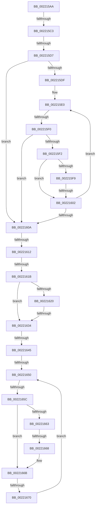

# sub_002215AA

- RVA: `0x002215AA`–`0x00221675` (길이 `203` bytes)
- VA: `0x00000001402215AA`
- 실행 섹션: `.text`
- PDB 이름 있음: `아니요`; PDB Function 태그: `아니요`
- unwind 정보 RVA: `0x0005F51C`
- 디코드: `61`개 명령, `203/203` bytes 표시
- 미해석 바이트: `0` (있으면 어셈블리에 `.byte`로 보존)

> 이 문서는 커널 이미지의 기계어와 PDB 기호를 분석해 생성했습니다. 4번과 5번은 함수 원형과 자료형을 바이너리 사용 방식에서 추정한 C 해석이며 원본 소스 복구 결과는 아닙니다.

## 1. Dependencies

- 직접 호출 지점: **1**; 고유 호출 대상: **1**
- 직접 호출자로 확인된 함수: **0**
- RIP 상대 이미지 참조: **0**

### Outgoing calls
- `0x00221627` → [ExTryConvertSharedSpinLockExclusive](../2E/ExTryConvertSharedSpinLockExclusive_function_002EF4C0.md) (function, `0x002EF4C0`)

### Direct callers
- 이 함수 시작 RVA로 연결되는 직접 call은 확인되지 않았습니다. 간접 호출은 완전히 역산할 수 없습니다.

### Static image references
- 디코드된 RIP-relative 메모리 참조가 없습니다.

## 2. Other-region calls and transfers

- 다른 실행 섹션으로 향하는 call: **0**
- call이 아닌 외부 분기/꼬리 이동: **12**
  - `0x002215BD` → [sub_0022178C + 0x1E0](Unknown_function_0022178C.md) (`tail-transfer`)
  - `0x002215D1` → [sub_002219E9 + 0xD8](Unknown_function_002219E9.md) (`tail-transfer`)
  - `0x002215EA` → [sub_0022178C + 0x185](Unknown_function_0022178C.md) (`tail-transfer`)
  - `0x002215FC` → [sub_0022178C + 0x19A](Unknown_function_0022178C.md) (`tail-transfer`)
  - `0x0022160C` → [sub_00221431 + 0x99](Unknown_function_00221431.md) (`tail-transfer`)
  - `0x00221615` → [sub_0022178C + 0xC](Unknown_function_0022178C.md) (`tail-transfer`)
  - `0x0022162E` → [sub_002219E9 + 0xA5](Unknown_function_002219E9.md) (`tail-transfer`)
  - `0x0022163F` → [sub_002219E9 + 0xE9](Unknown_function_002219E9.md) (`tail-transfer`)
  - `0x0022164E` → [sub_002216AB + 0x18](Unknown_function_002216AB.md) (`tail-transfer`)
  - `0x0022165A` → [sub_002216AB](Unknown_function_002216AB.md) (`tail-transfer`)
  - `0x00221666` → [sub_002216AB + 0x18](Unknown_function_002216AB.md) (`tail-transfer`)
  - `0x0022166E` → [sub_002216AB + 0x18](Unknown_function_002216AB.md) (`tail-transfer`)

## 3. Assembly (complete function range)

```asm
002215AA  41 0F 0D 0F                     prefetchw byte ptr [r15]
002215AE  41 8B 07                        mov eax, dword ptr [r15]
002215B1  0F BA F0 1F                     btr eax, 0x1f
002215B5  8D 48 01                        lea ecx, [rax + 1]
002215B8  F0 41 0F B1 0F                  lock cmpxchg dword ptr [r15], ecx
002215BD  0F 85 A9 03 00 00               jne 0x14022196c
002215C3  45 33 E4                        xor r12d, r12d
002215C6  48 8B 55 08                     mov rdx, qword ptr [rbp + 8]
002215CA  48 8B 4D 00                     mov rcx, qword ptr [rbp]
002215CE  F6 C2 01                        test dl, 1
002215D1  0F 85 EA 04 00 00               jne 0x140221ac1
002215D7  83 E2 01                        and edx, 1
002215DA  48 85 C9                        test rcx, rcx
002215DD  74 2B                           je 0x14022160a
002215DF  90                              nop
002215E0  48 8B 41 F0                     mov rax, qword ptr [rcx - 0x10]
002215E4  49 23 C5                        and rax, r13
002215E7  48 3B C3                        cmp rax, rbx
002215EA  0F 82 21 03 00 00               jb 0x140221911
002215F0  76 18                           jbe 0x14022160a
002215F2  48 8B 01                        mov rax, qword ptr [rcx]
002215F5  85 D2                           test edx, edx
002215F7  74 09                           je 0x140221602
002215F9  48 85 C0                        test rax, rax
002215FC  0F 85 24 03 00 00               jne 0x140221926
00221602  48 8B C8                        mov rcx, rax
00221605  48 85 C9                        test rcx, rcx
00221608  75 D6                           jne 0x1402215e0
0022160A  85 FF                           test edi, edi
0022160C  0F 84 B8 FE FF FF               je 0x1402214ca
00221612  48 85 C9                        test rcx, rcx
00221615  0F 85 7D 01 00 00               jne 0x140221798
0022161B  45 85 E4                        test r12d, r12d
0022161E  75 14                           jne 0x140221634
00221620  44 8D 61 01                     lea r12d, [rcx + 1]
00221624  49 8B CF                        mov rcx, r15
00221627  E8 94 DE 0C 00                  call 0x1402ef4c0
0022162C  85 C0                           test eax, eax
0022162E  0F 84 5A 04 00 00               je 0x140221a8e
00221634  48 8B 4D 08                     mov rcx, qword ptr [rbp + 8]
00221638  48 8B 55 00                     mov rdx, qword ptr [rbp]
0022163C  F6 C1 01                        test cl, 1
0022163F  0F 85 8D 04 00 00               jne 0x140221ad2
00221645  83 E1 01                        and ecx, 1
00221648  45 32 C0                        xor r8b, r8b
0022164B  48 85 D2                        test rdx, rdx
0022164E  74 73                           je 0x1402216c3
00221650  48 8B 42 F0                     mov rax, qword ptr [rdx - 0x10]
00221654  49 23 C5                        and rax, r13
00221657  48 3B C3                        cmp rax, rbx
0022165A  76 4F                           jbe 0x1402216ab
0022165C  48 8B 02                        mov rax, qword ptr [rdx]
0022165F  85 C9                           test ecx, ecx
00221661  74 08                           je 0x14022166b
00221663  48 85 C0                        test rax, rax
00221666  74 5B                           je 0x1402216c3
00221668  48 33 C2                        xor rax, rdx
0022166B  48 85 C0                        test rax, rax
0022166E  74 53                           je 0x1402216c3
00221670  48 8B D0                        mov rdx, rax
00221673  EB DB                           jmp 0x140221650
```

## 4. C-style interpretation (structured pseudocode)

```c
__int64 __fastcall sub_002215AA(__int64 a1, __int64 a2, unsigned __int8 a3)
{
    __int64 result;
    __int64 v_r12;

    v_r12 = 0;
    a2 = (unsigned int)((*(unsigned __int64 *)(v_rbp + 8)) & (1));
    if (*(unsigned __int64 *)(v_rbp) == 0) goto loc_0022160A;
loc_002215E0:
    result = (*(unsigned __int64 *)(*(unsigned __int64 *)(v_rbp) - 16)) & (v_r13);
    if (result <= v_rbx) goto loc_0022160A;
    if ((unsigned int)(a2) == 0) goto loc_00221602;
loc_00221602:
    if (*(unsigned __int64 *)(*(unsigned __int64 *)(v_rbp)) != 0) goto loc_002215E0;
loc_0022160A:
    if (0 != 0) goto loc_00221634;
    result = ExTryConvertSharedSpinLockExclusive(v_r15, a2, a3, a4);
loc_00221634:
    a1 = (unsigned int)((*(unsigned __int64 *)(v_rbp + 8)) & (1));
    a3 = 0;
loc_00221650:
    result = (*(unsigned __int64 *)(*(unsigned __int64 *)(v_rbp) - 16)) & (v_r13);
    if ((unsigned int)(a1) == 0) goto loc_0022166B;
    result = (*(unsigned __int64 *)(*(unsigned __int64 *)(v_rbp))) ^ (*(unsigned __int64 *)(v_rbp));
loc_0022166B:
    goto loc_00221650;
}
```

## 5. (Beta) C Style

```c
int64_t sub_002215AA(int64_t Arg1, int64_t Arg2, uint8_t Arg3)
{
    int64_t result;
    int64_t local_r12;

    local_r12 = 0;
    Arg2 = (uint32_t)((*(uint64_t *)(local_rbp + 0x8)) & (1));
    if (*(uint64_t *)(local_rbp) == 0) goto loc_0022160A;
loc_002215E0:
    result = (*(uint64_t *)(*(uint64_t *)(local_rbp) - 0x10)) & (local_r13);
    if (result <= local_rbx) goto loc_0022160A;
    if ((uint32_t)(Arg2) == 0) goto loc_00221602;
loc_00221602:
    if (*(uint64_t *)(*(uint64_t *)(local_rbp)) != 0) goto loc_002215E0;
loc_0022160A:
    if (0 != 0) goto loc_00221634;
    result = ExTryConvertSharedSpinLockExclusive(local_r15, Arg2, Arg3, a4);
loc_00221634:
    Arg1 = (uint32_t)((*(uint64_t *)(local_rbp + 0x8)) & (1));
    Arg3 = 0;
loc_00221650:
    result = (*(uint64_t *)(*(uint64_t *)(local_rbp) - 0x10)) & (local_r13);
    if ((uint32_t)(Arg1) == 0) goto loc_0022166B;
    result = (*(uint64_t *)(*(uint64_t *)(local_rbp))) ^ (*(uint64_t *)(local_rbp));
loc_0022166B:
    goto loc_00221650;
}
```

## 6. Execution-region graph

[열기: 2D/3D 그래프와 함수 탐색 컨트롤 패널](../../../control-panel.html?section=text&rva=0x002215AA&view=graph)

- 2D 그래프는 위에서 아래로 흐르고, 3D 그래프는 빈 공간을 드래그해 회전합니다. Shift+드래그는 이동, 휠은 확대·축소, 함수 노드 선택은 대상 보고서 이동입니다.

### Static fallback


