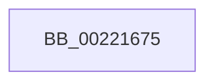

# sub_00221675

- RVA: `0x00221675`–`0x002216AB` (길이 `54` bytes)
- VA: `0x0000000140221675`
- 실행 섹션: `.text`
- PDB 이름 있음: `아니요`; PDB Function 태그: `아니요`
- unwind 정보 RVA: `0x0005F540`
- 디코드: `14`개 명령, `54/54` bytes 표시
- 미해석 바이트: `0` (있으면 어셈블리에 `.byte`로 보존)

> 이 문서는 커널 이미지의 기계어와 PDB 기호를 분석해 생성했습니다. 4번과 5번은 함수 원형과 자료형을 바이너리 사용 방식에서 추정한 C 해석이며 원본 소스 복구 결과는 아닙니다.

## 1. Dependencies

- 직접 호출 지점: **0**; 고유 호출 대상: **0**
- 직접 호출자로 확인된 함수: **0**
- RIP 상대 이미지 참조: **0**

### Outgoing calls
- 직접 디코드된 call 명령이 없습니다.

### Direct callers
- 이 함수 시작 RVA로 연결되는 직접 call은 확인되지 않았습니다. 간접 호출은 완전히 역산할 수 없습니다.

### Static image references
- 디코드된 RIP-relative 메모리 참조가 없습니다.

## 2. Other-region calls and transfers

- 다른 실행 섹션으로 향하는 call: **0**
- call이 아닌 외부 분기/꼬리 이동: **1**
  - `0x002216A6` → [sub_00221431 + 0x64](Unknown_function_00221431.md) (`tail-transfer`)

## 3. Assembly (complete function range)

```asm
00221675  83 E0 3F                        and eax, 0x3f
00221678  33 D2                           xor edx, edx
0022167A  48 6B C0 58                     imul rax, rax, 0x58
0022167E  48 8B CE                        mov rcx, rsi
00221681  48 2B C8                        sub rcx, rax
00221684  48 8B 41 F0                     mov rax, qword ptr [rcx - 0x10]
00221688  4C 8B 80 20 02 00 00            mov r8, qword ptr [rax + 0x220]
0022168F  41 8B C1                        mov eax, r9d
00221692  41 F7 70 60                     div dword ptr [r8 + 0x60]
00221696  49 8B 40 58                     mov rax, qword ptr [r8 + 0x58]
0022169A  48 8D 0C 52                     lea rcx, [rdx + rdx*2]
0022169E  48 8D 2C C8                     lea rbp, [rax + rcx*8]
002216A2  4C 8D 7D 10                     lea r15, [rbp + 0x10]
002216A6  E9 EA FD FF FF                  jmp 0x140221495
```

## 4. C-style interpretation (structured pseudocode)

```c
__int64 __fastcall sub_00221675(__int64 a1, int a2, __int64 a3, int a4)
{
    __int64 result;

    result = (unsigned int)((result) & (63));
    a2 = 0;
    result = (result) * (result);
    a1 = (v_rsi) - (result);
}
```

## 5. (Beta) C Style

```c
int64_t sub_00221675(int64_t Arg1, int32_t Arg2, int64_t Arg3, int32_t Arg4)
{
    int64_t result;

    result = (uint32_t)((result) & (63));
    Arg2 = 0;
    result = (result) * (result);
    Arg1 = (local_rsi) - (result);
}
```

## 6. Execution-region graph

[열기: 2D/3D 그래프와 함수 탐색 컨트롤 패널](../../../control-panel.html?section=text&rva=0x00221675&view=graph)

- 2D 그래프는 위에서 아래로 흐르고, 3D 그래프는 빈 공간을 드래그해 회전합니다. Shift+드래그는 이동, 휠은 확대·축소, 함수 노드 선택은 대상 보고서 이동입니다.

### Static fallback


