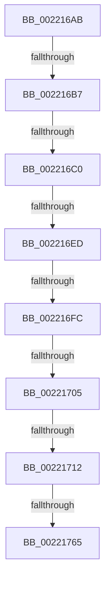

# sub_002216AB

- RVA: `0x002216AB`–`0x00221771` (길이 `198` bytes)
- VA: `0x00000001402216AB`
- 실행 섹션: `.text`
- PDB 이름 있음: `아니요`; PDB Function 태그: `아니요`
- unwind 정보 RVA: `0x0005F560`
- 디코드: `49`개 명령, `198/198` bytes 표시
- 미해석 바이트: `0` (있으면 어셈블리에 `.byte`로 보존)

> 이 문서는 커널 이미지의 기계어와 PDB 기호를 분석해 생성했습니다. 4번과 5번은 함수 원형과 자료형을 바이너리 사용 방식에서 추정한 C 해석이며 원본 소스 복구 결과는 아닙니다.

## 1. Dependencies

- 직접 호출 지점: **1**; 고유 호출 대상: **1**
- 직접 호출자로 확인된 함수: **0**
- RIP 상대 이미지 참조: **1**

### Outgoing calls
- `0x002216CA` → [RtlRbInsertNodeEx](../2E/RtlRbInsertNodeEx_function_002E4570.md) (function, `0x002E4570`)

### Direct callers
- 이 함수 시작 RVA로 연결되는 직접 call은 확인되지 않았습니다. 간접 호출은 완전히 역산할 수 없습니다.

### Static image references
- `0x002216E0` → RVA `0x00FC6B06` (`ALMOSTRO`; read)

## 2. Other-region calls and transfers

- 다른 실행 섹션으로 향하는 call: **0**
- call이 아닌 외부 분기/꼬리 이동: **8**
  - `0x002216B1` → [sub_0022178C + 0x177](Unknown_function_0022178C.md) (`tail-transfer`)
  - `0x002216BA` → [sub_0022178C + 0x174](Unknown_function_0022178C.md) (`tail-transfer`)
  - `0x002216E7` → [sub_0022178C + 0x1C2](Unknown_function_0022178C.md) (`tail-transfer`)
  - `0x002216F6` → [sub_002219E9 + 0x98](Unknown_function_002219E9.md) (`tail-transfer`)
  - `0x002216FF` → [sub_0022178C + 0x141](Unknown_function_0022178C.md) (`tail-transfer`)
  - `0x0022170C` → [sub_00221B4E + 0x51](Unknown_function_00221B4E.md) (`tail-transfer`)
  - `0x00221763` → [sub_0022178C](Unknown_function_0022178C.md) (`tail-transfer`)
  - `0x0022176C` → [sub_00221431 + 0x150](Unknown_function_00221431.md) (`tail-transfer`)

## 3. Assembly (complete function range)

```asm
002216AB  48 8B 42 08                     mov rax, qword ptr [rdx + 8]
002216AF  85 C9                           test ecx, ecx
002216B1  0F 84 4C 02 00 00               je 0x140221903
002216B7  48 85 C0                        test rax, rax
002216BA  0F 85 40 02 00 00               jne 0x140221900
002216C0  41 B0 01                        mov r8b, 1
002216C3  4C 8D 4E 10                     lea r9, [rsi + 0x10]
002216C7  48 8B CD                        mov rcx, rbp
002216CA  E8 A1 2E 0C 00                  call 0x1402e4570
002216CF  33 DB                           xor ebx, ebx
002216D1  48 8D 4E 48                     lea rcx, [rsi + 0x48]
002216D5  49 89 4E 08                     mov qword ptr [r14 + 8], rcx
002216D9  48 8B FE                        mov rdi, rsi
002216DC  49 89 1E                        mov qword ptr [r14], rbx
002216DF  90                              nop
002216E0  F6 05 1F 54 DA 00 21            test byte ptr [rip + 0xda541f], 0x21
002216E7  0F 85 61 02 00 00               jne 0x14022194e
002216ED  49 8B D6                        mov rdx, r14
002216F0  48 87 11                        xchg qword ptr [rcx], rdx
002216F3  48 85 D2                        test rdx, rdx
002216F6  0F 85 85 03 00 00               jne 0x140221a81
002216FC  45 85 E4                        test r12d, r12d
002216FF  0F 85 C8 01 00 00               jne 0x1402218cd
00221705  F6 05 FA 53 DA 00 01            test byte ptr [rip + 0xda53fa], 1
0022170C  0F 85 8D 04 00 00               jne 0x140221b9f
00221712  F0 41 81 27 FF FF FF BF         lock and dword ptr [r15], 0xbfffffff
0022171A  F0 41 FF 0F                     lock dec dword ptr [r15]
0022171E  0F B6 46 07                     movzx eax, byte ptr [rsi + 7]
00221722  0C 80                           or al, 0x80
00221724  88 46 07                        mov byte ptr [rsi + 7], al
00221727  0F B6 46 0B                     movzx eax, byte ptr [rsi + 0xb]
0022172B  0C 01                           or al, 1
0022172D  88 46 0B                        mov byte ptr [rsi + 0xb], al
00221730  48 89 5E 28                     mov qword ptr [rsi + 0x28], rbx
00221734  48 89 5E 30                     mov qword ptr [rsi + 0x30], rbx
00221738  48 89 5E 38                     mov qword ptr [rsi + 0x38], rbx
0022173C  48 89 5E 40                     mov qword ptr [rsi + 0x40], rbx
00221740  88 5E 54                        mov byte ptr [rsi + 0x54], bl
00221743  81 66 54 FF 80 FF FF            and dword ptr [rsi + 0x54], 0xffff80ff
0022174A  0F B6 46 08                     movzx eax, byte ptr [rsi + 8]
0022174E  83 E0 3F                        and eax, 0x3f
00221751  48 6B C8 58                     imul rcx, rax, 0x58
00221755  48 8B C6                        mov rax, rsi
00221758  48 2B C1                        sub rax, rcx
0022175B  80 7E 09 00                     cmp byte ptr [rsi + 9], 0
0022175F  48 8B 48 F0                     mov rcx, qword ptr [rax - 0x10]
00221763  75 27                           jne 0x14022178c
00221765  F0 FE 81 19 03 00 00            lock inc byte ptr [rcx + 0x319]
0022176C  E9 10 FE FF FF                  jmp 0x140221581
```

## 4. C-style interpretation (structured pseudocode)

```c
__int64 __fastcall sub_002216AB(int a1, __int64 a2)
{
    __int64 result;
    __int64 v_rbx;

    result = RtlRbInsertNodeEx(v_rbp, a2, 1, v_rsi + 16);
    v_rbx = 0;
    *(unsigned __int64 *)(v_r14 + 8) = v_rsi + 72;
    *(unsigned __int64 *)(v_r14) = 0;
    result = (unsigned __int8)((*(unsigned __int8 *)(v_rsi + 7)) | (128));
    *(unsigned __int8 *)(v_rsi + 7) = (unsigned __int8)(result);
    result = (unsigned __int8)((*(unsigned __int8 *)(v_rsi + 11)) | (1));
    *(unsigned __int8 *)(v_rsi + 11) = (unsigned __int8)(result);
    *(unsigned __int64 *)(v_rsi + 40) = 0;
    *(unsigned __int64 *)(v_rsi + 48) = 0;
    *(unsigned __int64 *)(v_rsi + 56) = 0;
    *(unsigned __int64 *)(v_rsi + 64) = 0;
    *(unsigned __int8 *)(v_rsi + 84) = 0;
    result = (unsigned int)((*(unsigned __int8 *)(v_rsi + 8)) & (63));
    a1 = (v_rsi + 72) * (result);
    result = (v_rsi) - (a1);
}
```

## 5. (Beta) C Style

```c
int64_t sub_002216AB(int32_t Arg1, void *Arg2)
{
    uint8_t *arg2 = (uint8_t *)Arg2;

    int64_t result;
    int64_t local_rbx;

    result = RtlRbInsertNodeEx(local_rbp, Arg2, 1, local_rsi + 16);
    local_rbx = 0;
    *(uint64_t *)(local_r14 + 0x8) = local_rsi + 72;
    *(uint64_t *)(local_r14) = 0;
    result = (uint8_t)((*(uint8_t *)(local_rsi + 0x7)) | (128));
    *(uint8_t *)(local_rsi + 0x7) = (uint8_t)(result);
    result = (uint8_t)((*(uint8_t *)(local_rsi + 0xB)) | (1));
    *(uint8_t *)(local_rsi + 0xB) = (uint8_t)(result);
    *(uint64_t *)(local_rsi + 0x28) = 0;
    *(uint64_t *)(local_rsi + 0x30) = 0;
    *(uint64_t *)(local_rsi + 0x38) = 0;
    *(uint64_t *)(local_rsi + 0x40) = 0;
    *(uint8_t *)(local_rsi + 0x54) = 0;
    result = (uint32_t)((*(uint8_t *)(local_rsi + 0x8)) & (63));
    Arg1 = (local_rsi + 72) * (result);
    result = (local_rsi) - (Arg1);
}
```

### 관측된 메모리 오프셋

구조체 형식이 확인되지 않은 접근은 인자 기준의 오프셋으로만 기록했습니다.

| 기준 인자 | 오프셋 표현 | 폭 (bit) | 접근 |
|---|---:|---:|---|
| `Arg2` | `+ 0x8` | `64` | `R` |

## 6. Execution-region graph

[열기: 2D/3D 그래프와 함수 탐색 컨트롤 패널](../../../control-panel.html?section=text&rva=0x002216AB&view=graph)

- 2D 그래프는 위에서 아래로 흐르고, 3D 그래프는 빈 공간을 드래그해 회전합니다. Shift+드래그는 이동, 휠은 확대·축소, 함수 노드 선택은 대상 보고서 이동입니다.

### Static fallback


