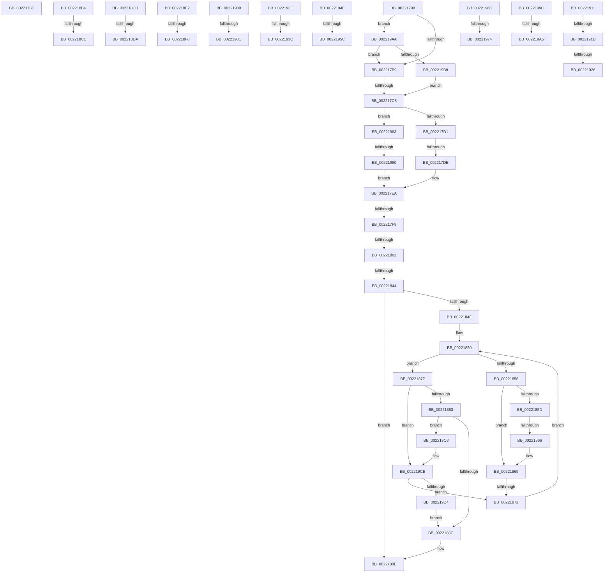

# sub_0022178C

- RVA: `0x0022178C`–`0x002219D9` (길이 `589` bytes)
- VA: `0x000000014022178C`
- 실행 섹션: `.text`
- PDB 이름 있음: `아니요`; PDB Function 태그: `아니요`
- unwind 정보 RVA: `0x0005F594`
- 디코드: `139`개 명령, `589/589` bytes 표시
- 미해석 바이트: `0` (있으면 어셈블리에 `.byte`로 보존)

> 이 문서는 커널 이미지의 기계어와 PDB 기호를 분석해 생성했습니다. 4번과 5번은 함수 원형과 자료형을 바이너리 사용 방식에서 추정한 C 해석이며 원본 소스 복구 결과는 아닙니다.

## 1. Dependencies

- 직접 호출 지점: **6**; 고유 호출 대상: **3**
- 직접 호출자로 확인된 함수: **0**
- RIP 상대 이미지 참조: **2**

### Outgoing calls
- `0x002218A1` → [RtlRbInsertNodeEx](../2E/RtlRbInsertNodeEx_function_002E4570.md) (function, `0x002E4570`)
- `0x002218F6` → [KiAcquireQueuedSpinLockInstrumented](../27/KiAcquireQueuedSpinLockInstrumented_function_00275850.md) (function, `0x00275850`)
- `0x00221944` → [KiAcquireQueuedSpinLockInstrumented](../27/KiAcquireQueuedSpinLockInstrumented_function_00275850.md) (function, `0x00275850`)
- `0x00221962` → [KiAcquireQueuedSpinLockInstrumented](../27/KiAcquireQueuedSpinLockInstrumented_function_00275850.md) (function, `0x00275850`)
- `0x00221979` → [ExpWaitForSpinLockSharedAndAcquire](../36/ExpWaitForSpinLockSharedAndAcquire_function_00362380.md) (function, `0x00362380`)
- `0x002219BE` → [KiAcquireQueuedSpinLockInstrumented](../27/KiAcquireQueuedSpinLockInstrumented_function_00275850.md) (function, `0x00275850`)

### Direct callers
- 이 함수 시작 RVA로 연결되는 직접 call은 확인되지 않았습니다. 간접 호출은 완전히 역산할 수 없습니다.

### Static image references
- `0x002217AC` → RVA `0x00FC6B06` (`ALMOSTRO`; read)
- `0x002218E2` → RVA `0x00F0DE58` (`.data`; read)

## 2. Other-region calls and transfers

- 다른 실행 섹션으로 향하는 call: **0**
- call이 아닌 외부 분기/꼬리 이동: **29**
  - `0x00221793` → [sub_00221431 + 0x150](Unknown_function_00221431.md) (`tail-transfer`)
  - `0x002217C2` → [sub_002219E9 + 0xCB](Unknown_function_002219E9.md) (`tail-transfer`)
  - `0x002217D8` → [sub_00221B4E + 0x71](Unknown_function_00221B4E.md) (`tail-transfer`)
  - `0x002217F3` → [sub_00221431 + 0x150](Unknown_function_00221431.md) (`tail-transfer`)
  - `0x002217FC` → [sub_002219E9](Unknown_function_002219E9.md) (`tail-transfer`)
  - `0x0022183E` → [sub_002219E9 + 0xF6](Unknown_function_002219E9.md) (`tail-transfer`)
  - `0x00221860` → [sub_002219E9 + 0xFB](Unknown_function_002219E9.md) (`tail-transfer`)
  - `0x0022186C` → [sub_002219E9 + 0xFB](Unknown_function_002219E9.md) (`tail-transfer`)
  - `0x002218AF` → [sub_002216AB + 0x9F](Unknown_function_002216AB.md) (`tail-transfer`)
  - `0x002218BB` → [sub_002219E9 + 0x112](Unknown_function_002219E9.md) (`tail-transfer`)
  - `0x002218C8` → [sub_00221431 + 0xF4](Unknown_function_00221431.md) (`tail-transfer`)
  - `0x002218D4` → [sub_002219E9 + 0x132](Unknown_function_002219E9.md) (`tail-transfer`)
  - `0x002218DD` → [sub_002216AB + 0x73](Unknown_function_002216AB.md) (`tail-transfer`)
  - `0x002218EA` → [sub_00221431 + 0xC3](Unknown_function_00221431.md) (`tail-transfer`)
  - `0x002218FB` → [sub_00221431 + 0xD2](Unknown_function_00221431.md) (`tail-transfer`)
  - `0x00221906` → [sub_002215AA + 0xC6](Unknown_function_002215AA.md) (`tail-transfer`)
  - `0x0022190C` → [sub_002216AB + 0x15](Unknown_function_002216AB.md) (`tail-transfer`)
  - `0x00221917` → [sub_002215AA + 0x58](Unknown_function_002215AA.md) (`tail-transfer`)
  - `0x00221920` → [sub_002215AA + 0x58](Unknown_function_002215AA.md) (`tail-transfer`)
  - `0x00221929` → [sub_002215AA + 0x5B](Unknown_function_002215AA.md) (`tail-transfer`)
  - `0x00221936` → [sub_00221431 + 0x119](Unknown_function_00221431.md) (`tail-transfer`)
  - `0x00221949` → [sub_00221431 + 0x12A](Unknown_function_00221431.md) (`tail-transfer`)
  - `0x00221956` → [sub_002216AB + 0x42](Unknown_function_002216AB.md) (`tail-transfer`)
  - `0x00221967` → [sub_002216AB + 0x51](Unknown_function_002216AB.md) (`tail-transfer`)
  - `0x0022196E` → [sub_002215AA + 0xB](Unknown_function_002215AA.md) (`tail-transfer`)
  - `0x0022197E` → [sub_002215AA + 0x19](Unknown_function_002215AA.md) (`tail-transfer`)
  - `0x0022198A` → [sub_00221B4E](Unknown_function_00221B4E.md) (`tail-transfer`)
  - `0x0022199F` → [sub_00221431 + 0x146](Unknown_function_00221431.md) (`tail-transfer`)
  - `0x002219A5` → [sub_00221431 + 0x150](Unknown_function_00221431.md) (`tail-transfer`)

## 3. Assembly (complete function range)

```asm
0022178C  F0 FE 81 18 03 00 00            lock inc byte ptr [rcx + 0x318]
00221793  E9 E9 FD FF FF                  jmp 0x140221581
00221798  49 C7 06 00 00 00 00            mov qword ptr [r14], 0
0022179F  48 8D 79 F0                     lea rdi, [rcx - 0x10]
002217A3  48 8D 4F 48                     lea rcx, [rdi + 0x48]
002217A7  49 89 4E 08                     mov qword ptr [r14 + 8], rcx
002217AB  90                              nop
002217AC  F6 05 53 53 DA 00 21            test byte ptr [rip + 0xda5353], 0x21
002217B3  0F 85 F1 01 00 00               jne 0x1402219aa
002217B9  49 8B D6                        mov rdx, r14
002217BC  48 87 11                        xchg qword ptr [rcx], rdx
002217BF  48 85 D2                        test rdx, rdx
002217C2  0F 85 EC 02 00 00               jne 0x140221ab4
002217C8  45 85 E4                        test r12d, r12d
002217CB  0F 85 B2 01 00 00               jne 0x140221983
002217D1  F6 05 2E 53 DA 00 01            test byte ptr [rip + 0xda532e], 1
002217D8  0F 85 E1 03 00 00               jne 0x140221bbf
002217DE  F0 41 81 27 FF FF FF BF         lock and dword ptr [r15], 0xbfffffff
002217E6  F0 41 FF 0F                     lock dec dword ptr [r15]
002217EA  48 8B 06                        mov rax, qword ptr [rsi]
002217ED  48 C1 E8 3F                     shr rax, 0x3f
002217F1  84 C0                           test al, al
002217F3  0F 85 88 FD FF FF               jne 0x140221581
002217F9  38 46 09                        cmp byte ptr [rsi + 9], al
002217FC  0F 84 E7 01 00 00               je 0x1402219e9
00221802  0F B6 46 08                     movzx eax, byte ptr [rsi + 8]
00221806  4C 8D 57 38                     lea r10, [rdi + 0x38]
0022180A  83 E0 3F                        and eax, 0x3f
0022180D  48 6B C8 58                     imul rcx, rax, 0x58
00221811  48 8B C6                        mov rax, rsi
00221814  48 2B C1                        sub rax, rcx
00221817  48 8B 40 F0                     mov rax, qword ptr [rax - 0x10]
0022181B  0F B6 88 C3 00 00 00            movzx ecx, byte ptr [rax + 0xc3]
00221822  B8 1E 00 00 00                  mov eax, 0x1e
00221827  3A C8                           cmp cl, al
00221829  44 8B C1                        mov r8d, ecx
0022182C  44 0F 4F C0                     cmovg r8d, eax
00221830  44 88 46 28                     mov byte ptr [rsi + 0x28], r8b
00221834  49 8B 4A 08                     mov rcx, qword ptr [r10 + 8]
00221838  49 8B 12                        mov rdx, qword ptr [r10]
0022183B  F6 C1 01                        test cl, 1
0022183E  0F 85 9B 02 00 00               jne 0x140221adf
00221844  83 E1 01                        and ecx, 1
00221847  32 C0                           xor al, al
00221849  48 85 D2                        test rdx, rdx
0022184C  74 40                           je 0x14022188e
0022184E  66 90                           nop
00221850  44 38 42 18                     cmp byte ptr [rdx + 0x18], r8b
00221854  7D 21                           jge 0x140221877
00221856  48 8B 02                        mov rax, qword ptr [rdx]
00221859  85 C9                           test ecx, ecx
0022185B  74 0C                           je 0x140221869
0022185D  48 85 C0                        test rax, rax
00221860  0F 84 7E 02 00 00               je 0x140221ae4
00221866  48 33 C2                        xor rax, rdx
00221869  48 85 C0                        test rax, rax
0022186C  0F 84 72 02 00 00               je 0x140221ae4
00221872  48 8B D0                        mov rdx, rax
00221875  EB D9                           jmp 0x140221850
00221877  48 8B 42 08                     mov rax, qword ptr [rdx + 8]
0022187B  85 C9                           test ecx, ecx
0022187D  0F 84 48 01 00 00               je 0x1402219cb
00221883  48 85 C0                        test rax, rax
00221886  0F 85 3C 01 00 00               jne 0x1402219c8
0022188C  B0 01                           mov al, 1
0022188E  B9 10 00 00 00                  mov ecx, 0x10
00221893  4C 8B C6                        mov r8, rsi
00221896  44 0F B6 C0                     movzx r8d, al
0022189A  4C 8D 0C 0E                     lea r9, [rsi + rcx]
0022189E  49 8B CA                        mov rcx, r10
002218A1  E8 CA 2C 0C 00                  call 0x1402e4570
002218A6  0F B6 46 07                     movzx eax, byte ptr [rsi + 7]
002218AA  0C 80                           or al, 0x80
002218AC  88 46 07                        mov byte ptr [rsi + 7], al
002218AF  E9 96 FE FF FF                  jmp 0x14022174a
002218B4  F6 05 4B 52 DA 00 01            test byte ptr [rip + 0xda524b], 1
002218BB  0F 85 3A 02 00 00               jne 0x140221afb
002218C1  41 C7 07 00 00 00 00            mov dword ptr [r15], 0
002218C8  E9 58 FC FF FF                  jmp 0x140221525
002218CD  F6 05 32 52 DA 00 01            test byte ptr [rip + 0xda5232], 1
002218D4  0F 85 41 02 00 00               jne 0x140221b1b
002218DA  41 89 1F                        mov dword ptr [r15], ebx
002218DD  E9 3C FE FF FF                  jmp 0x14022171e
002218E2  8B 05 70 C5 CE 00               mov eax, dword ptr [rip + 0xcec570]
002218E8  85 C0                           test eax, eax
002218EA  0F 85 04 FC FF FF               jne 0x1402214f4
002218F0  48 8B D1                        mov rdx, rcx
002218F3  49 8B CE                        mov rcx, r14
002218F6  E8 55 3F 05 00                  call 0x140275850
002218FB  E9 03 FC FF FF                  jmp 0x140221503
00221900  48 33 C2                        xor rax, rdx
00221903  48 85 C0                        test rax, rax
00221906  0F 85 64 FD FF FF               jne 0x140221670
0022190C  E9 AF FD FF FF                  jmp 0x1402216c0
00221911  48 8B 41 08                     mov rax, qword ptr [rcx + 8]
00221915  85 D2                           test edx, edx
00221917  0F 84 E5 FC FF FF               je 0x140221602
0022191D  48 85 C0                        test rax, rax
00221920  0F 84 DC FC FF FF               je 0x140221602
00221926  48 33 C8                        xor rcx, rax
00221929  E9 D7 FC FF FF                  jmp 0x140221605
0022192E  8B 05 24 C5 CE 00               mov eax, dword ptr [rip + 0xcec524]
00221934  85 C0                           test eax, eax
00221936  0F 85 0E FC FF FF               jne 0x14022154a
0022193C  48 8B D1                        mov rdx, rcx
0022193F  48 8D 4C 24 20                  lea rcx, [rsp + 0x20]
00221944  E8 07 3F 05 00                  call 0x140275850
00221949  E9 0D FC FF FF                  jmp 0x14022155b
0022194E  8B 05 04 C5 CE 00               mov eax, dword ptr [rip + 0xcec504]
00221954  85 C0                           test eax, eax
00221956  0F 85 91 FD FF FF               jne 0x1402216ed
0022195C  48 8B D1                        mov rdx, rcx
0022195F  49 8B CE                        mov rcx, r14
00221962  E8 E9 3E 05 00                  call 0x140275850
00221967  E9 90 FD FF FF                  jmp 0x1402216fc
0022196C  85 C0                           test eax, eax
0022196E  0F 89 41 FC FF FF               jns 0x1402215b5
00221974  B2 FF                           mov dl, 0xff
00221976  49 8B CF                        mov rcx, r15
00221979  E8 02 0A 14 00                  call 0x140362380
0022197E  E9 40 FC FF FF                  jmp 0x1402215c3
00221983  F6 05 7C 51 DA 00 01            test byte ptr [rip + 0xda517c], 1
0022198A  0F 85 BE 01 00 00               jne 0x140221b4e
00221990  41 C7 07 00 00 00 00            mov dword ptr [r15], 0
00221997  E9 4E FE FF FF                  jmp 0x1402217ea
0022199C  48 85 C0                        test rax, rax
0022199F  0F 89 D2 FB FF FF               jns 0x140221577
002219A5  E9 D7 FB FF FF                  jmp 0x140221581
002219AA  8B 05 A8 C4 CE 00               mov eax, dword ptr [rip + 0xcec4a8]
002219B0  85 C0                           test eax, eax
002219B2  0F 85 01 FE FF FF               jne 0x1402217b9
002219B8  48 8B D1                        mov rdx, rcx
002219BB  49 8B CE                        mov rcx, r14
002219BE  E8 8D 3E 05 00                  call 0x140275850
002219C3  E9 00 FE FF FF                  jmp 0x1402217c8
002219C8  48 33 C2                        xor rax, rdx
002219CB  48 85 C0                        test rax, rax
002219CE  0F 85 9E FE FF FF               jne 0x140221872
002219D4  E9 B3 FE FF FF                  jmp 0x14022188c
```

## 4. C-style interpretation (structured pseudocode)

```c
__int64 __fastcall sub_0022178C(__int64 a1)
{
    unsigned __int64 v_stack_p20;
}
```

## 5. (Beta) C Style

```c
int64_t sub_0022178C(void *Arg1)
{
    uint8_t *arg1 = (uint8_t *)Arg1;

    uint64_t v_stack_p20;
}
```

### 관측된 메모리 오프셋

구조체 형식이 확인되지 않은 접근은 인자 기준의 오프셋으로만 기록했습니다.

| 기준 인자 | 오프셋 표현 | 폭 (bit) | 접근 |
|---|---:|---:|---|
| `Arg1` | `+ 0x318` | `8` | `R/W` |

## 6. Execution-region graph

[열기: 2D/3D 그래프와 함수 탐색 컨트롤 패널](../../../control-panel.html?section=text&rva=0x0022178C&view=graph)

- 2D 그래프는 위에서 아래로 흐르고, 3D 그래프는 빈 공간을 드래그해 회전합니다. Shift+드래그는 이동, 휠은 확대·축소, 함수 노드 선택은 대상 보고서 이동입니다.

### Static fallback


