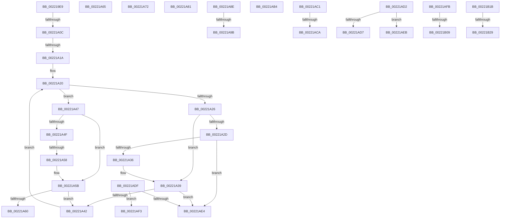

# sub_002219E9

- RVA: `0x002219E9`–`0x00221B3B` (길이 `338` bytes)
- VA: `0x00000001402219E9`
- 실행 섹션: `.text`
- PDB 이름 있음: `아니요`; PDB Function 태그: `아니요`
- unwind 정보 RVA: `0x0005F5C8`
- 디코드: `84`개 명령, `338/338` bytes 표시
- 미해석 바이트: `0` (있으면 어셈블리에 `.byte`로 보존)

> 이 문서는 커널 이미지의 기계어와 PDB 기호를 분석해 생성했습니다. 4번과 5번은 함수 원형과 자료형을 바이너리 사용 방식에서 추정한 C 해석이며 원본 소스 복구 결과는 아닙니다.

## 1. Dependencies

- 직접 호출 지점: **8**; 고유 호출 대상: **4**
- 직접 호출자로 확인된 함수: **0**
- RIP 상대 이미지 참조: **2**

### Outgoing calls
- `0x002219EC` → [KiAbOwnerComputeCpuPriorityKey](../21/KiAbOwnerComputeCpuPriorityKey_function_0021F090.md) (function, `0x0021F090`)
- `0x00221A68` → [KxWaitForLockOwnerShip](../25/KxWaitForLockOwnerShip_function_00257EB0.md) (function, `0x00257EB0`)
- `0x00221A77` → [KxWaitForLockOwnerShip](../25/KxWaitForLockOwnerShip_function_00257EB0.md) (function, `0x00257EB0`)
- `0x00221A84` → [KxWaitForLockOwnerShip](../25/KxWaitForLockOwnerShip_function_00257EB0.md) (function, `0x00257EB0`)
- `0x00221AAA` → [ExAcquireSpinLockExclusiveAtDpcLevel](../24/ExAcquireSpinLockExclusiveAtDpcLevel_function_00248E80.md) (function, `0x00248E80`)
- `0x00221AB7` → [KxWaitForLockOwnerShip](../25/KxWaitForLockOwnerShip_function_00257EB0.md) (function, `0x00257EB0`)
- `0x00221B11` → [ExpReleaseSpinLockExclusiveFromDpcLevelInstrumented](../2C/ExpReleaseSpinLockExclusiveFromDpcLevelInstrumented_function_002C0F44.md) (function, `0x002C0F44`)
- `0x00221B31` → [ExpReleaseSpinLockExclusiveFromDpcLevelInstrumented](../2C/ExpReleaseSpinLockExclusiveFromDpcLevelInstrumented_function_002C0F44.md) (function, `0x002C0F44`)

### Direct callers
- 이 함수 시작 RVA로 연결되는 직접 call은 확인되지 않았습니다. 간접 호출은 완전히 역산할 수 없습니다.

### Static image references
- `0x00221A8E` → RVA `0x00FC6B06` (`ALMOSTRO`; reference)
- `0x00221AFB` → RVA `0x00F0DE58` (`.data`; read)

## 2. Other-region calls and transfers

- 다른 실행 섹션으로 향하는 call: **0**
- call이 아닌 외부 분기/꼬리 이동: **20**
  - `0x00221A06` → [sub_00221B4E + 0x20](Unknown_function_00221B4E.md) (`tail-transfer`)
  - `0x00221A14` → [sub_0022178C + 0x102](Unknown_function_0022178C.md) (`tail-transfer`)
  - `0x00221A52` → [sub_0022178C + 0x100](Unknown_function_0022178C.md) (`tail-transfer`)
  - `0x00221A60` → [sub_0022178C + 0x100](Unknown_function_0022178C.md) (`tail-transfer`)
  - `0x00221A6D` → [sub_00221431 + 0xD2](Unknown_function_00221431.md) (`tail-transfer`)
  - `0x00221A7C` → [sub_00221431 + 0x12A](Unknown_function_00221431.md) (`tail-transfer`)
  - `0x00221A89` → [sub_002216AB + 0x51](Unknown_function_002216AB.md) (`tail-transfer`)
  - `0x00221A95` → [sub_00221B4E + 0xC5](Unknown_function_00221B4E.md) (`tail-transfer`)
  - `0x00221AAF` → [sub_002215AA + 0x1C](Unknown_function_002215AA.md) (`tail-transfer`)
  - `0x00221ABC` → [sub_0022178C + 0x3C](Unknown_function_0022178C.md) (`tail-transfer`)
  - `0x00221AC4` → [sub_002215AA + 0x60](Unknown_function_002215AA.md) (`tail-transfer`)
  - `0x00221ACD` → [sub_002215AA + 0x2D](Unknown_function_002215AA.md) (`tail-transfer`)
  - `0x00221ADA` → [sub_002215AA + 0x9B](Unknown_function_002215AA.md) (`tail-transfer`)
  - `0x00221AE6` → [sub_0022178C + 0x102](Unknown_function_0022178C.md) (`tail-transfer`)
  - `0x00221AEE` → [sub_002216AB + 0x18](Unknown_function_002216AB.md) (`tail-transfer`)
  - `0x00221AF6` → [sub_0022178C + 0xB8](Unknown_function_0022178C.md) (`tail-transfer`)
  - `0x00221B03` → [sub_0022178C + 0x135](Unknown_function_0022178C.md) (`tail-transfer`)
  - `0x00221B16` → [sub_00221431 + 0xF4](Unknown_function_00221431.md) (`tail-transfer`)
  - `0x00221B23` → [sub_0022178C + 0x14E](Unknown_function_0022178C.md) (`tail-transfer`)
  - `0x00221B36` → [sub_002216AB + 0x73](Unknown_function_002216AB.md) (`tail-transfer`)

## 3. Assembly (complete function range)

```asm
002219E9  48 8B CE                        mov rcx, rsi
002219EC  E8 9F D6 FF FF                  call 0x14021f090
002219F1  4C 8D 57 28                     lea r10, [rdi + 0x28]
002219F5  88 46 28                        mov byte ptr [rsi + 0x28], al
002219F8  49 8B 4A 08                     mov rcx, qword ptr [r10 + 8]
002219FC  44 0F B6 C8                     movzx r9d, al
00221A00  49 8B 12                        mov rdx, qword ptr [r10]
00221A03  F6 C1 01                        test cl, 1
00221A06  0F 85 62 01 00 00               jne 0x140221b6e
00221A0C  83 E1 01                        and ecx, 1
00221A0F  32 C0                           xor al, al
00221A11  48 85 D2                        test rdx, rdx
00221A14  0F 84 74 FE FF FF               je 0x14022188e
00221A1A  66 0F 1F 44 00 00               nop word ptr [rax + rax]
00221A20  44 38 4A 18                     cmp byte ptr [rdx + 0x18], r9b
00221A24  7E 21                           jle 0x140221a47
00221A26  48 8B 02                        mov rax, qword ptr [rdx]
00221A29  85 C9                           test ecx, ecx
00221A2B  74 0C                           je 0x140221a39
00221A2D  48 85 C0                        test rax, rax
00221A30  0F 84 AE 00 00 00               je 0x140221ae4
00221A36  48 33 C2                        xor rax, rdx
00221A39  48 85 C0                        test rax, rax
00221A3C  0F 84 A2 00 00 00               je 0x140221ae4
00221A42  48 8B D0                        mov rdx, rax
00221A45  EB D9                           jmp 0x140221a20
00221A47  48 8B 42 08                     mov rax, qword ptr [rdx + 8]
00221A4B  85 C9                           test ecx, ecx
00221A4D  74 0C                           je 0x140221a5b
00221A4F  48 85 C0                        test rax, rax
00221A52  0F 84 34 FE FF FF               je 0x14022188c
00221A58  48 33 C2                        xor rax, rdx
00221A5B  48 85 C0                        test rax, rax
00221A5E  75 E2                           jne 0x140221a42
00221A60  E9 27 FE FF FF                  jmp 0x14022188c
00221A65  49 8B CE                        mov rcx, r14
00221A68  E8 43 64 03 00                  call 0x140257eb0
00221A6D  E9 91 FA FF FF                  jmp 0x140221503
00221A72  48 8D 4C 24 20                  lea rcx, [rsp + 0x20]
00221A77  E8 34 64 03 00                  call 0x140257eb0
00221A7C  E9 DA FA FF FF                  jmp 0x14022155b
00221A81  49 8B CE                        mov rcx, r14
00221A84  E8 27 64 03 00                  call 0x140257eb0
00221A89  E9 6E FC FF FF                  jmp 0x1402216fc
00221A8E  44 84 25 71 50 DA 00            test byte ptr [rip + 0xda5071], r12b
00221A95  0F 85 78 01 00 00               jne 0x140221c13
00221A9B  F0 41 81 27 FF FF FF BF         lock and dword ptr [r15], 0xbfffffff
00221AA3  F0 41 FF 0F                     lock dec dword ptr [r15]
00221AA7  49 8B CF                        mov rcx, r15
00221AAA  E8 D1 73 02 00                  call 0x140248e80
00221AAF  E9 12 FB FF FF                  jmp 0x1402215c6
00221AB4  49 8B CE                        mov rcx, r14
00221AB7  E8 F4 63 03 00                  call 0x140257eb0
00221ABC  E9 07 FD FF FF                  jmp 0x1402217c8
00221AC1  48 85 C9                        test rcx, rcx
00221AC4  0F 84 40 FB FF FF               je 0x14022160a
00221ACA  48 33 CD                        xor rcx, rbp
00221ACD  E9 05 FB FF FF                  jmp 0x1402215d7
00221AD2  48 85 D2                        test rdx, rdx
00221AD5  74 14                           je 0x140221aeb
00221AD7  48 33 D5                        xor rdx, rbp
00221ADA  E9 66 FB FF FF                  jmp 0x140221645
00221ADF  48 85 D2                        test rdx, rdx
00221AE2  75 0F                           jne 0x140221af3
00221AE4  32 C0                           xor al, al
00221AE6  E9 A3 FD FF FF                  jmp 0x14022188e
00221AEB  45 32 C0                        xor r8b, r8b
00221AEE  E9 D0 FB FF FF                  jmp 0x1402216c3
00221AF3  49 33 D2                        xor rdx, r10
00221AF6  E9 49 FD FF FF                  jmp 0x140221844
00221AFB  8B 05 57 C3 CE 00               mov eax, dword ptr [rip + 0xcec357]
00221B01  85 C0                           test eax, eax
00221B03  0F 85 B8 FD FF FF               jne 0x1402218c1
00221B09  48 8B 54 24 68                  mov rdx, qword ptr [rsp + 0x68]
00221B0E  49 8B CF                        mov rcx, r15
00221B11  E8 2E F4 09 00                  call 0x1402c0f44
00221B16  E9 0A FA FF FF                  jmp 0x140221525
00221B1B  8B 05 37 C3 CE 00               mov eax, dword ptr [rip + 0xcec337]
00221B21  85 C0                           test eax, eax
00221B23  0F 85 B1 FD FF FF               jne 0x1402218da
00221B29  48 8B 54 24 68                  mov rdx, qword ptr [rsp + 0x68]
00221B2E  49 8B CF                        mov rcx, r15
00221B31  E8 0E F4 09 00                  call 0x1402c0f44
00221B36  E9 E3 FB FF FF                  jmp 0x14022171e
```

## 4. C-style interpretation (structured pseudocode)

```c
__int64 __fastcall sub_002219E9(__int64 a1, __int64 a2, unsigned __int8 a3)
{
    __int64 result;
    unsigned __int64 v_stack_p20;
    unsigned __int64 v_stack_p68;

    result = KiAbOwnerComputeCpuPriorityKey(v_rsi, a2, a3, a4);
    *(unsigned __int8 *)(v_rsi + 40) = (unsigned __int8)(result);
    a1 = (unsigned int)((*(unsigned __int64 *)(v_rdi + 40 + 8)) & (1));
    result = 0;
loc_00221A20:
    if ((*(unsigned __int8 *)(*(unsigned __int64 *)(v_rdi + 40) + 24)) <= ((unsigned __int8)((unsigned __int8)(result)))) goto loc_00221A47;
    if ((unsigned int)(a1) == 0) goto loc_00221A39;
    if (*(unsigned __int64 *)(*(unsigned __int64 *)(v_rdi + 40)) == 0) goto loc_00221AE4;
    result = (*(unsigned __int64 *)(*(unsigned __int64 *)(v_rdi + 40))) ^ (*(unsigned __int64 *)(v_rdi + 40));
loc_00221A39:
    if (result == 0) goto loc_00221AE4;
loc_00221A42:
    goto loc_00221A20;
loc_00221A47:
    if ((unsigned int)(a1) == 0) goto loc_00221A5B;
    result = (*(unsigned __int64 *)(result + 8)) ^ (result);
loc_00221A5B:
    if (result != 0) goto loc_00221A42;
loc_00221AE4:
    result = 0;
}
```

## 5. (Beta) C Style

```c
int64_t sub_002219E9(int64_t Arg1, int64_t Arg2, uint8_t Arg3)
{
    int64_t result;
    uint64_t v_stack_p20;
    uint64_t v_stack_p68;

    result = KiAbOwnerComputeCpuPriorityKey(local_rsi, Arg2, Arg3, a4);
    *(uint8_t *)(local_rsi + 0x28) = (uint8_t)(result);
    Arg1 = (uint32_t)((*(uint64_t *)(local_rdi + 0x28 + 0x8)) & (1));
    result = 0;
loc_00221A20:
    if ((*(uint8_t *)(*(uint64_t *)(local_rdi + 0x28) + 0x18)) <= ((uint8_t)((uint8_t)(result)))) goto loc_00221A47;
    if ((uint32_t)(Arg1) == 0) goto loc_00221A39;
    if (*(uint64_t *)(*(uint64_t *)(local_rdi + 0x28)) == 0) goto loc_00221AE4;
    result = (*(uint64_t *)(*(uint64_t *)(local_rdi + 0x28))) ^ (*(uint64_t *)(local_rdi + 0x28));
loc_00221A39:
    if (result == 0) goto loc_00221AE4;
loc_00221A42:
    goto loc_00221A20;
loc_00221A47:
    if ((uint32_t)(Arg1) == 0) goto loc_00221A5B;
    result = (*(uint64_t *)(result + 0x8)) ^ (result);
loc_00221A5B:
    if (result != 0) goto loc_00221A42;
loc_00221AE4:
    result = 0;
}
```

## 6. Execution-region graph

[열기: 2D/3D 그래프와 함수 탐색 컨트롤 패널](../../../control-panel.html?section=text&rva=0x002219E9&view=graph)

- 2D 그래프는 위에서 아래로 흐르고, 3D 그래프는 빈 공간을 드래그해 회전합니다. Shift+드래그는 이동, 휠은 확대·축소, 함수 노드 선택은 대상 보고서 이동입니다.

### Static fallback


