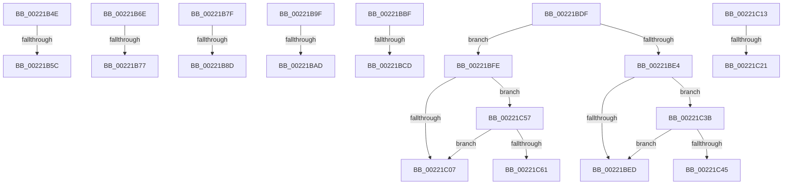

# sub_00221B4E

- RVA: `0x00221B4E`–`0x00221C73` (길이 `293` bytes)
- VA: `0x0000000140221B4E`
- 실행 섹션: `.text`
- PDB 이름 있음: `아니요`; PDB Function 태그: `아니요`
- unwind 정보 RVA: `0x0005F614`
- 디코드: `66`개 명령, `293/293` bytes 표시
- 미해석 바이트: `0` (있으면 어셈블리에 `.byte`로 보존)

> 이 문서는 커널 이미지의 기계어와 PDB 기호를 분석해 생성했습니다. 4번과 5번은 함수 원형과 자료형을 바이너리 사용 방식에서 추정한 C 해석이며 원본 소스 복구 결과는 아닙니다.

## 1. Dependencies

- 직접 호출 지점: **8**; 고유 호출 대상: **3**
- 직접 호출자로 확인된 함수: **0**
- RIP 상대 이미지 참조: **2**

### Outgoing calls
- `0x00221B64` → [ExpReleaseSpinLockExclusiveFromDpcLevelInstrumented](../2C/ExpReleaseSpinLockExclusiveFromDpcLevelInstrumented_function_002C0F44.md) (function, `0x002C0F44`)
- `0x00221B95` → [ExpReleaseSpinLockSharedFromDpcLevelInstrumented](../2F/ExpReleaseSpinLockSharedFromDpcLevelInstrumented_function_002F0F48.md) (function, `0x002F0F48`)
- `0x00221BB5` → [ExpReleaseSpinLockSharedFromDpcLevelInstrumented](../2F/ExpReleaseSpinLockSharedFromDpcLevelInstrumented_function_002F0F48.md) (function, `0x002F0F48`)
- `0x00221BD5` → [ExpReleaseSpinLockSharedFromDpcLevelInstrumented](../2F/ExpReleaseSpinLockSharedFromDpcLevelInstrumented_function_002F0F48.md) (function, `0x002F0F48`)
- `0x00221C29` → [ExpReleaseSpinLockSharedFromDpcLevelInstrumented](../2F/ExpReleaseSpinLockSharedFromDpcLevelInstrumented_function_002F0F48.md) (function, `0x002F0F48`)
- `0x00221C31` → [ExAcquireSpinLockExclusiveAtDpcLevel](../24/ExAcquireSpinLockExclusiveAtDpcLevel_function_00248E80.md) (function, `0x00248E80`)
- `0x00221C4D` → [ExpReleaseSpinLockSharedFromDpcLevelInstrumented](../2F/ExpReleaseSpinLockSharedFromDpcLevelInstrumented_function_002F0F48.md) (function, `0x002F0F48`)
- `0x00221C69` → [ExpReleaseSpinLockExclusiveFromDpcLevelInstrumented](../2C/ExpReleaseSpinLockExclusiveFromDpcLevelInstrumented_function_002C0F44.md) (function, `0x002C0F44`)

### Direct callers
- 이 함수 시작 RVA로 연결되는 직접 call은 확인되지 않았습니다. 간접 호출은 완전히 역산할 수 없습니다.

### Static image references
- `0x00221B4E` → RVA `0x00F0DE58` (`.data`; read)
- `0x00221BE4` → RVA `0x00FC6B06` (`ALMOSTRO`; read)

## 2. Other-region calls and transfers

- 다른 실행 섹션으로 향하는 call: **0**
- call이 아닌 외부 분기/꼬리 이동: **16**
  - `0x00221B56` → [sub_0022178C + 0x204](Unknown_function_0022178C.md) (`tail-transfer`)
  - `0x00221B69` → [sub_0022178C + 0x5E](Unknown_function_0022178C.md) (`tail-transfer`)
  - `0x00221B71` → [sub_002219E9 + 0xFB](Unknown_function_002219E9.md) (`tail-transfer`)
  - `0x00221B7A` → [sub_002219E9 + 0x23](Unknown_function_002219E9.md) (`tail-transfer`)
  - `0x00221B87` → [sub_00221431 + 0xE8](Unknown_function_00221431.md) (`tail-transfer`)
  - `0x00221B9A` → [sub_00221431 + 0xF4](Unknown_function_00221431.md) (`tail-transfer`)
  - `0x00221BA7` → [sub_002216AB + 0x67](Unknown_function_002216AB.md) (`tail-transfer`)
  - `0x00221BBA` → [sub_002216AB + 0x73](Unknown_function_002216AB.md) (`tail-transfer`)
  - `0x00221BC7` → [sub_0022178C + 0x52](Unknown_function_0022178C.md) (`tail-transfer`)
  - `0x00221BDA` → [sub_0022178C + 0x5E](Unknown_function_0022178C.md) (`tail-transfer`)
  - `0x00221BF9` → [sub_00221431 + 0x14E](Unknown_function_00221431.md) (`tail-transfer`)
  - `0x00221C0E` → [sub_00221431 + 0x14E](Unknown_function_00221431.md) (`tail-transfer`)
  - `0x00221C1B` → [sub_002219E9 + 0xB2](Unknown_function_002219E9.md) (`tail-transfer`)
  - `0x00221C36` → [sub_002215AA + 0x1C](Unknown_function_002215AA.md) (`tail-transfer`)
  - `0x00221C52` → [sub_00221431 + 0x14E](Unknown_function_00221431.md) (`tail-transfer`)
  - `0x00221C6E` → [sub_00221431 + 0x14E](Unknown_function_00221431.md) (`tail-transfer`)

## 3. Assembly (complete function range)

```asm
00221B4E  8B 05 04 C3 CE 00               mov eax, dword ptr [rip + 0xcec304]
00221B54  85 C0                           test eax, eax
00221B56  0F 85 34 FE FF FF               jne 0x140221990
00221B5C  48 8B 54 24 68                  mov rdx, qword ptr [rsp + 0x68]
00221B61  49 8B CF                        mov rcx, r15
00221B64  E8 DB F3 09 00                  call 0x1402c0f44
00221B69  E9 7C FC FF FF                  jmp 0x1402217ea
00221B6E  48 85 D2                        test rdx, rdx
00221B71  0F 84 6D FF FF FF               je 0x140221ae4
00221B77  49 33 D2                        xor rdx, r10
00221B7A  E9 8D FE FF FF                  jmp 0x140221a0c
00221B7F  8B 05 D3 C2 CE 00               mov eax, dword ptr [rip + 0xcec2d3]
00221B85  85 C0                           test eax, eax
00221B87  0F 85 8C F9 FF FF               jne 0x140221519
00221B8D  48 8B 54 24 68                  mov rdx, qword ptr [rsp + 0x68]
00221B92  49 8B CF                        mov rcx, r15
00221B95  E8 AE F3 0C 00                  call 0x1402f0f48
00221B9A  E9 86 F9 FF FF                  jmp 0x140221525
00221B9F  8B 05 B3 C2 CE 00               mov eax, dword ptr [rip + 0xcec2b3]
00221BA5  85 C0                           test eax, eax
00221BA7  0F 85 65 FB FF FF               jne 0x140221712
00221BAD  48 8B 54 24 68                  mov rdx, qword ptr [rsp + 0x68]
00221BB2  49 8B CF                        mov rcx, r15
00221BB5  E8 8E F3 0C 00                  call 0x1402f0f48
00221BBA  E9 5F FB FF FF                  jmp 0x14022171e
00221BBF  8B 05 93 C2 CE 00               mov eax, dword ptr [rip + 0xcec293]
00221BC5  85 C0                           test eax, eax
00221BC7  0F 85 11 FC FF FF               jne 0x1402217de
00221BCD  48 8B 54 24 68                  mov rdx, qword ptr [rsp + 0x68]
00221BD2  49 8B CF                        mov rcx, r15
00221BD5  E8 6E F3 0C 00                  call 0x1402f0f48
00221BDA  E9 0B FC FF FF                  jmp 0x1402217ea
00221BDF  45 85 E4                        test r12d, r12d
00221BE2  75 1A                           jne 0x140221bfe
00221BE4  F6 05 1B 4F DA 00 01            test byte ptr [rip + 0xda4f1b], 1
00221BEB  75 4E                           jne 0x140221c3b
00221BED  F0 41 81 27 FF FF FF BF         lock and dword ptr [r15], 0xbfffffff
00221BF5  F0 41 FF 0F                     lock dec dword ptr [r15]
00221BF9  E9 81 F9 FF FF                  jmp 0x14022157f
00221BFE  F6 05 01 4F DA 00 01            test byte ptr [rip + 0xda4f01], 1
00221C05  75 50                           jne 0x140221c57
00221C07  41 C7 07 00 00 00 00            mov dword ptr [r15], 0
00221C0E  E9 6C F9 FF FF                  jmp 0x14022157f
00221C13  8B 05 3F C2 CE 00               mov eax, dword ptr [rip + 0xcec23f]
00221C19  85 C0                           test eax, eax
00221C1B  0F 85 7A FE FF FF               jne 0x140221a9b
00221C21  48 8B 54 24 68                  mov rdx, qword ptr [rsp + 0x68]
00221C26  49 8B CF                        mov rcx, r15
00221C29  E8 1A F3 0C 00                  call 0x1402f0f48
00221C2E  49 8B CF                        mov rcx, r15
00221C31  E8 4A 72 02 00                  call 0x140248e80
00221C36  E9 8B F9 FF FF                  jmp 0x1402215c6
00221C3B  8B 05 17 C2 CE 00               mov eax, dword ptr [rip + 0xcec217]
00221C41  85 C0                           test eax, eax
00221C43  75 A8                           jne 0x140221bed
00221C45  48 8B 54 24 68                  mov rdx, qword ptr [rsp + 0x68]
00221C4A  49 8B CF                        mov rcx, r15
00221C4D  E8 F6 F2 0C 00                  call 0x1402f0f48
00221C52  E9 28 F9 FF FF                  jmp 0x14022157f
00221C57  8B 05 FB C1 CE 00               mov eax, dword ptr [rip + 0xcec1fb]
00221C5D  85 C0                           test eax, eax
00221C5F  75 A6                           jne 0x140221c07
00221C61  48 8B 54 24 68                  mov rdx, qword ptr [rsp + 0x68]
00221C66  49 8B CF                        mov rcx, r15
00221C69  E8 D6 F2 09 00                  call 0x1402c0f44
00221C6E  E9 0C F9 FF FF                  jmp 0x14022157f
```

## 4. C-style interpretation (structured pseudocode)

```c
__int64 __fastcall sub_00221B4E(__int64 a1, __int64 a2, __int64 a3, __int64 a4, __int64 a5, __int64 a6, __int64 a7, __int64 a8, __int64 a9, __int64 a10, __int64 a11, __int64 a12, __int64 a13)
{
    __int64 result;
    unsigned __int64 v_stack_p68;

    result = ExpReleaseSpinLockExclusiveFromDpcLevelInstrumented(v_r15, a13, a3, a4);
}
```

## 5. (Beta) C Style

```c
int64_t sub_00221B4E(int64_t Arg1, int64_t Arg2, int64_t Arg3, int64_t Arg4, uint64_t Arg5, uint64_t Arg6, uint64_t Arg7, uint64_t Arg8, uint64_t Arg9, uint64_t Arg10, uint64_t Arg11, uint64_t Arg12, int64_t Arg13)
{
    int64_t result;
    uint64_t v_stack_p68;

    result = ExpReleaseSpinLockExclusiveFromDpcLevelInstrumented(local_r15, Arg13, Arg3, Arg4);
}
```

## 6. Execution-region graph

[열기: 2D/3D 그래프와 함수 탐색 컨트롤 패널](../../../control-panel.html?section=text&rva=0x00221B4E&view=graph)

- 2D 그래프는 위에서 아래로 흐르고, 3D 그래프는 빈 공간을 드래그해 회전합니다. Shift+드래그는 이동, 휠은 확대·축소, 함수 노드 선택은 대상 보고서 이동입니다.

### Static fallback


