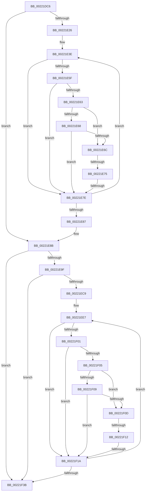

# sub_00221DC6

- RVA: `0x00221DC6`–`0x00221F5D` (길이 `407` bytes)
- VA: `0x0000000140221DC6`
- 실행 섹션: `.text`
- PDB 이름 있음: `아니요`; PDB Function 태그: `아니요`
- unwind 정보 RVA: `0x0005F65C`
- 디코드: `106`개 명령, `407/407` bytes 표시
- 미해석 바이트: `0` (있으면 어셈블리에 `.byte`로 보존)

> 이 문서는 커널 이미지의 기계어와 PDB 기호를 분석해 생성했습니다. 4번과 5번은 함수 원형과 자료형을 바이너리 사용 방식에서 추정한 C 해석이며 원본 소스 복구 결과는 아닙니다.

## 1. Dependencies

- 직접 호출 지점: **0**; 고유 호출 대상: **0**
- 직접 호출자로 확인된 함수: **0**
- RIP 상대 이미지 참조: **0**

### Outgoing calls
- 직접 디코드된 call 명령이 없습니다.

### Direct callers
- 이 함수 시작 RVA로 연결되는 직접 call은 확인되지 않았습니다. 간접 호출은 완전히 역산할 수 없습니다.

### Static image references
- 디코드된 RIP-relative 메모리 참조가 없습니다.

## 2. Other-region calls and transfers

- 다른 실행 섹션으로 향하는 call: **0**
- call이 아닌 외부 분기/꼬리 이동: **5**
  - `0x00221E6F` → [sub_00221F74](Unknown_function_00221F74.md) (`tail-transfer`)
  - `0x00221E78` → [sub_00221FB6 + 0x2B](Unknown_function_00221FB6.md) (`tail-transfer`)
  - `0x00221F10` → [sub_00221F74 + 0x1A](Unknown_function_00221F74.md) (`tail-transfer`)
  - `0x00221F14` → [sub_00221FB6 + 0x190](Unknown_function_00221FB6.md) (`tail-transfer`)
  - `0x00221F5B` → [sub_00221F5D + 0x9](Unknown_function_00221F5D.md) (`tail-transfer`)

## 3. Assembly (complete function range)

```asm
00221DC6  48 89 9C 24 F8 00 00 00         mov qword ptr [rsp + 0xf8], rbx
00221DCE  49 BA 00 00 00 00 00 00 00 80   movabs r10, 0x8000000000000000
00221DD8  4C 89 A4 24 C0 00 00 00         mov qword ptr [rsp + 0xc0], r12
00221DE0  BB 1E 00 00 00                  mov ebx, 0x1e
00221DE5  4C 89 B4 24 B8 00 00 00         mov qword ptr [rsp + 0xb8], r14
00221DED  4D 8B F5                        mov r14, r13
00221DF0  41 0F B7 50 08                  movzx edx, word ptr [r8 + 8]
00221DF5  41 0F B7 40 0A                  movzx eax, word ptr [r8 + 0xa]
00221DFA  41 0F B6 48 0C                  movzx ecx, byte ptr [r8 + 0xc]
00221DFF  0B C2                           or eax, edx
00221E01  49 D3 E6                        shl r14, cl
00221E04  41 FF CE                        dec r14d
00221E07  C7 45 C3 00 00 00 00            mov dword ptr [rbp - 0x3d], 0
00221E0E  44 33 F0                        xor r14d, eax
00221E11  4C 89 BC 24 B0 00 00 00         mov qword ptr [rsp + 0xb0], r15
00221E19  41 0F BC CE                     bsf ecx, r14d
00221E1D  4C 89 45 B7                     mov qword ptr [rbp - 0x49], r8
00221E21  89 4D C3                        mov dword ptr [rbp - 0x3d], ecx
00221E24  74 65                           je 0x140221e8b
00221E26  8B F7                           mov esi, edi
00221E28  8B D7                           mov edx, edi
00221E2A  83 E2 02                        and edx, 2
00221E2D  83 E6 01                        and esi, 1
00221E30  44 8B CF                        mov r9d, edi
00221E33  89 55 A3                        mov dword ptr [rbp - 0x5d], edx
00221E36  41 83 E1 04                     and r9d, 4
00221E3A  44 89 4D A7                     mov dword ptr [rbp - 0x59], r9d
00221E3E  41 8D 46 FF                     lea eax, [r14 - 1]
00221E42  44 23 F0                        and r14d, eax
00221E45  4D 8D 60 10                     lea r12, [r8 + 0x10]
00221E49  8B C1                           mov eax, ecx
00221E4B  48 6B C8 58                     imul rcx, rax, 0x58
00221E4F  4C 89 75 AF                     mov qword ptr [rbp - 0x51], r14
00221E53  4C 03 E1                        add r12, rcx
00221E56  49 8B 04 24                     mov rax, qword ptr [r12]
00221E5A  48 85 C0                        test rax, rax
00221E5D  74 1F                           je 0x140221e7e
00221E5F  A8 02                           test al, 2
00221E61  75 1B                           jne 0x140221e7e
00221E63  40 84 F6                        test sil, sil
00221E66  74 04                           je 0x140221e6c
00221E68  A8 01                           test al, 1
00221E6A  75 12                           jne 0x140221e7e
00221E6C  48 85 C0                        test rax, rax
00221E6F  0F 88 FF 00 00 00               js 0x140221f74
00221E75  40 84 F6                        test sil, sil
00221E78  0F 85 63 01 00 00               jne 0x140221fe1
00221E7E  41 0F BC CE                     bsf ecx, r14d
00221E82  89 4D C3                        mov dword ptr [rbp - 0x3d], ecx
00221E85  75 B7                           jne 0x140221e3e
00221E87  48 8B 75 5F                     mov rsi, qword ptr [rbp + 0x5f]
00221E8B  4C 8B 86 78 04 00 00            mov r8, qword ptr [rsi + 0x478]
00221E92  4C 89 45 B7                     mov qword ptr [rbp - 0x49], r8
00221E96  4D 85 C0                        test r8, r8
00221E99  0F 84 9C 00 00 00               je 0x140221f3b
00221E9F  41 0F B7 50 08                  movzx edx, word ptr [r8 + 8]
00221EA4  49 8B F5                        mov rsi, r13
00221EA7  41 0F B7 40 0A                  movzx eax, word ptr [r8 + 0xa]
00221EAC  41 0F B6 48 0C                  movzx ecx, byte ptr [r8 + 0xc]
00221EB1  0B C2                           or eax, edx
00221EB3  48 D3 E6                        shl rsi, cl
00221EB6  FF CE                           dec esi
00221EB8  C7 45 CB 00 00 00 00            mov dword ptr [rbp - 0x35], 0
00221EBF  33 F0                           xor esi, eax
00221EC1  0F BC CE                        bsf ecx, esi
00221EC4  89 4D CB                        mov dword ptr [rbp - 0x35], ecx
00221EC7  74 72                           je 0x140221f3b
00221EC9  8B D7                           mov edx, edi
00221ECB  44 8B FF                        mov r15d, edi
00221ECE  83 E2 01                        and edx, 1
00221ED1  41 83 E7 02                     and r15d, 2
00221ED5  44 8B CF                        mov r9d, edi
00221ED8  89 55 A3                        mov dword ptr [rbp - 0x5d], edx
00221EDB  41 83 E1 04                     and r9d, 4
00221EDF  44 89 7D AF                     mov dword ptr [rbp - 0x51], r15d
00221EE3  44 89 4D A7                     mov dword ptr [rbp - 0x59], r9d
00221EE7  8D 46 FF                        lea eax, [rsi - 1]
00221EEA  23 F0                           and esi, eax
00221EEC  4D 8D 70 10                     lea r14, [r8 + 0x10]
00221EF0  8B C1                           mov eax, ecx
00221EF2  48 6B C8 58                     imul rcx, rax, 0x58
00221EF6  4C 03 F1                        add r14, rcx
00221EF9  49 8B 06                        mov rax, qword ptr [r14]
00221EFC  48 85 C0                        test rax, rax
00221EFF  74 19                           je 0x140221f1a
00221F01  A8 02                           test al, 2
00221F03  75 15                           jne 0x140221f1a
00221F05  84 D2                           test dl, dl
00221F07  74 04                           je 0x140221f0d
00221F09  A8 01                           test al, 1
00221F0B  75 0D                           jne 0x140221f1a
00221F0D  48 85 C0                        test rax, rax
00221F10  78 7C                           js 0x140221f8e
00221F12  84 D2                           test dl, dl
00221F14  0F 85 2C 02 00 00               jne 0x140222146
00221F1A  0F BC CE                        bsf ecx, esi
00221F1D  BB 1E 00 00 00                  mov ebx, 0x1e
00221F22  49 BA 00 00 00 00 00 00 00 80   movabs r10, 0x8000000000000000
00221F2C  89 4D CB                        mov dword ptr [rbp - 0x35], ecx
00221F2F  49 BB FC FF FF FF FF FF FF 7F   movabs r11, 0x7ffffffffffffffc
00221F39  75 AC                           jne 0x140221ee7
00221F3B  4C 8B B4 24 B8 00 00 00         mov r14, qword ptr [rsp + 0xb8]
00221F43  4C 8B A4 24 C0 00 00 00         mov r12, qword ptr [rsp + 0xc0]
00221F4B  48 8B 9C 24 F8 00 00 00         mov rbx, qword ptr [rsp + 0xf8]
00221F53  4C 8B BC 24 B0 00 00 00         mov r15, qword ptr [rsp + 0xb0]
00221F5B  EB 09                           jmp 0x140221f66
```

## 4. C-style interpretation (structured pseudocode)

```c
__int64 __fastcall sub_00221DC6(__int64 a1, __int64 a2, __int64 a3, __int64 a4, __int64 a5, __int64 a6, __int64 a7, __int64 a8, __int64 a9, __int64 a10, __int64 a11, __int64 a12, __int64 a13, __int64 a14, __int64 a15, __int64 a16, __int64 a17, __int64 a18, __int64 a19, __int64 a20, __int64 a21, __int64 a22, __int64 a23, __int64 a24, __int64 a25, __int64 a26, __int64 a27, __int64 a28, __int64 a29, __int64 a30, __int64 a31)
{
    __int64 result;
    __int64 v_r12;
    __int64 v_r14;
    __int64 v_r15;
    __int64 v_rsi;
    unsigned __int64 v_stack_pB0;
    unsigned __int64 v_stack_pB8;
    unsigned __int64 v_stack_pC0;
    unsigned __int64 v_stack_pF8;

    v_stack_pF8 = v_rbx;
    v_stack_pC0 = v_r12;
    v_stack_pB8 = v_r14;
    result = (unsigned int)((*(unsigned __int16 *)(a3 + 10)) | ((unsigned int)(*(unsigned __int16 *)(a3 + 8))));
    v_r14 = (v_r13) << ((unsigned __int8)(*(unsigned __int8 *)(a3 + 12)));
    v_r14 = (unsigned int)((v_r14) - 1);
    *(unsigned int *)(v_rbp - 61) = 0;
    v_r14 = (unsigned int)((v_r14) ^ ((unsigned int)(result)));
    v_stack_pB0 = v_r15;
    *(unsigned __int64 *)(v_rbp - 73) = a3;
    *(unsigned int *)(v_rbp - 61) = (unsigned int)(*(unsigned __int8 *)(a3 + 12));
    if (condition_is_equal) goto loc_00221E8B;
    a2 = (unsigned int)(((unsigned int)((unsigned int)(v_rdi))) & (2));
    v_rsi = (unsigned int)(((unsigned int)((unsigned int)(v_rdi))) & (1));
    *(unsigned int *)(v_rbp - 93) = (unsigned int)(a2);
    a4 = (unsigned int)(((unsigned int)((unsigned int)(v_rdi))) & (4));
    *(unsigned int *)(v_rbp - 89) = (unsigned int)(a4);
loc_00221E3E:
    v_r14 = (unsigned int)((v_r14) & ((unsigned int)(v_r14 - 1)));
    a1 = (*(unsigned __int8 *)(a3 + 12)) * ((unsigned int)((unsigned int)(*(unsigned __int8 *)(a3 + 12))));
    *(unsigned __int64 *)(v_rbp - 81) = v_r14;
    v_r12 = (a3 + 16) + (a1);
    if (*(unsigned __int64 *)(v_r12) == 0) goto loc_00221E7E;
    if ((((unsigned __int8)(*(unsigned __int64 *)(v_r12))) & (2)) != 0) goto loc_00221E7E;
    if ((unsigned __int8)(v_rsi) == 0) goto loc_00221E6C;
    if ((((unsigned __int8)(*(unsigned __int64 *)(v_r12))) & (1)) != 0) goto loc_00221E7E;
loc_00221E6C:
loc_00221E7E:
    *(unsigned int *)(v_rbp - 61) = (unsigned int)(a1);
    if ((unsigned __int8)(v_rsi) != 0) goto loc_00221E3E;
loc_00221E8B:
    *(unsigned __int64 *)(v_rbp - 73) = *(unsigned __int64 *)(*(unsigned __int64 *)(v_rbp + 95) + 1144);
    if (*(unsigned __int64 *)(*(unsigned __int64 *)(v_rbp + 95) + 1144) == 0) goto loc_00221F3B;
    result = (unsigned int)((*(unsigned __int16 *)(*(unsigned __int64 *)(*(unsigned __int64 *)(v_rbp + 95) + 1144) + 10)) | ((unsigned int)(*(unsigned __int16 *)(*(unsigned __int64 *)(*(unsigned __int64 *)(v_rbp + 95) + 1144) + 8))));
    v_rsi = (v_r13) << ((unsigned __int8)(*(unsigned __int8 *)(*(unsigned __int64 *)(*(unsigned __int64 *)(v_rbp + 95) + 1144) + 12)));
    v_rsi = (unsigned int)((v_rsi) - 1);
    *(unsigned int *)(v_rbp - 53) = 0;
    v_rsi = (unsigned int)((v_rsi) ^ ((unsigned int)(result)));
    *(unsigned int *)(v_rbp - 53) = (unsigned int)(*(unsigned __int8 *)(*(unsigned __int64 *)(*(unsigned __int64 *)(v_rbp + 95) + 1144) + 12));
    if (condition_is_equal) goto loc_00221F3B;
    a2 = (unsigned int)(((unsigned int)((unsigned int)(v_rdi))) & (1));
    v_r15 = (unsigned int)(((unsigned int)((unsigned int)(v_rdi))) & (2));
    *(unsigned int *)(v_rbp - 93) = (unsigned int)(a2);
    a4 = (unsigned int)(((unsigned int)((unsigned int)(v_rdi))) & (4));
    *(unsigned int *)(v_rbp - 81) = (unsigned int)(v_r15);
    *(unsigned int *)(v_rbp - 89) = (unsigned int)(a4);
loc_00221EE7:
    v_rsi = (unsigned int)((v_rsi) & ((unsigned int)(v_rsi - 1)));
    a1 = (*(unsigned __int8 *)(*(unsigned __int64 *)(*(unsigned __int64 *)(v_rbp + 95) + 1144) + 12)) * ((unsigned int)((unsigned int)(*(unsigned __int8 *)(*(unsigned __int64 *)(*(unsigned __int64 *)(v_rbp + 95) + 1144) + 12))));
    v_r14 = (*(unsigned __int64 *)(*(unsigned __int64 *)(v_rbp + 95) + 1144) + 16) + (a1);
    if (*(unsigned __int64 *)(v_r14) == 0) goto loc_00221F1A;
    if ((((unsigned __int8)(*(unsigned __int64 *)(v_r14))) & (2)) != 0) goto loc_00221F1A;
    if ((unsigned __int8)(a2) == 0) goto loc_00221F0D;
    if ((((unsigned __int8)(*(unsigned __int64 *)(v_r14))) & (1)) != 0) goto loc_00221F1A;
loc_00221F0D:
loc_00221F1A:
    *(unsigned int *)(v_rbp - 53) = (unsigned int)(a1);
    if ((unsigned __int8)(a2) != 0) goto loc_00221EE7;
loc_00221F3B:
}
```

## 5. (Beta) C Style

```c
int64_t sub_00221DC6(int64_t Arg1, int64_t Arg2, void *Arg3, int64_t Arg4, uint64_t Arg5, uint64_t Arg6, uint64_t Arg7, uint64_t Arg8, uint64_t Arg9, uint64_t Arg10, uint64_t Arg11, uint64_t Arg12, uint64_t Arg13, uint64_t Arg14, uint64_t Arg15, uint64_t Arg16, uint64_t Arg17, uint64_t Arg18, uint64_t Arg19, uint64_t Arg20, uint64_t Arg21, int64_t Arg22, int64_t Arg23, int64_t Arg24, uint64_t Arg25, uint64_t Arg26, uint64_t Arg27, uint64_t Arg28, uint64_t Arg29, uint64_t Arg30, int64_t Arg31)
{
    uint8_t *arg3 = (uint8_t *)Arg3;

    int64_t result;
    int64_t local_r12;
    int64_t local_r14;
    int64_t local_r15;
    int64_t local_rsi;
    uint64_t v_stack_pB0;
    uint64_t v_stack_pB8;
    uint64_t v_stack_pC0;
    uint64_t v_stack_pF8;

    v_stack_pF8 = local_rbx;
    v_stack_pC0 = local_r12;
    v_stack_pB8 = local_r14;
    result = (uint32_t)((*(uint16_t *)(arg3 + 0xA)) | ((uint32_t)(*(uint16_t *)(arg3 + 0x8))));
    local_r14 = (local_r13) << ((uint8_t)(*(uint8_t *)(arg3 + 0xC)));
    local_r14 = (uint32_t)((local_r14) - 1);
    *(uint32_t *)(local_rbp - 0x3D) = 0;
    local_r14 = (uint32_t)((local_r14) ^ ((uint32_t)(result)));
    v_stack_pB0 = local_r15;
    *(void **)(local_rbp - 0x49) = Arg3;
    *(uint32_t *)(local_rbp - 0x3D) = (uint32_t)(*(uint8_t *)(arg3 + 0xC));
    if (condition_is_equal) goto loc_00221E8B;
    Arg2 = (uint32_t)(((uint32_t)((uint32_t)(local_rdi))) & (2));
    local_rsi = (uint32_t)(((uint32_t)((uint32_t)(local_rdi))) & (1));
    *(uint32_t *)(local_rbp - 0x5D) = (uint32_t)(Arg2);
    Arg4 = (uint32_t)(((uint32_t)((uint32_t)(local_rdi))) & (4));
    *(uint32_t *)(local_rbp - 0x59) = (uint32_t)(Arg4);
loc_00221E3E:
    local_r14 = (uint32_t)((local_r14) & ((uint32_t)(local_r14 - 1)));
    Arg1 = (*(uint8_t *)(arg3 + 0xC)) * ((uint32_t)((uint32_t)(*(uint8_t *)(arg3 + 0xC))));
    *(uint64_t *)(local_rbp - 0x51) = local_r14;
    local_r12 = (Arg3 + 16) + (Arg1);
    if (*(uint64_t *)(local_r12) == 0) goto loc_00221E7E;
    if ((((uint8_t)(*(uint64_t *)(local_r12))) & (2)) != 0) goto loc_00221E7E;
    if ((uint8_t)(local_rsi) == 0) goto loc_00221E6C;
    if ((((uint8_t)(*(uint64_t *)(local_r12))) & (1)) != 0) goto loc_00221E7E;
loc_00221E6C:
loc_00221E7E:
    *(uint32_t *)(local_rbp - 0x3D) = (uint32_t)(Arg1);
    if ((uint8_t)(local_rsi) != 0) goto loc_00221E3E;
loc_00221E8B:
    *(uint64_t *)(local_rbp - 0x49) = *(uint64_t *)(*(uint64_t *)(local_rbp + 0x5F) + 0x478);
    if (*(uint64_t *)(*(uint64_t *)(local_rbp + 0x5F) + 0x478) == 0) goto loc_00221F3B;
    result = (uint32_t)((*(uint16_t *)(*(uint64_t *)(*(uint64_t *)(local_rbp + 0x5F) + 0x478) + 0xA)) | ((uint32_t)(*(uint16_t *)(*(uint64_t *)(*(uint64_t *)(local_rbp + 0x5F) + 0x478) + 0x8))));
    local_rsi = (local_r13) << ((uint8_t)(*(uint8_t *)(*(uint64_t *)(*(uint64_t *)(local_rbp + 0x5F) + 0x478) + 0xC)));
    local_rsi = (uint32_t)((local_rsi) - 1);
    *(uint32_t *)(local_rbp - 0x35) = 0;
    local_rsi = (uint32_t)((local_rsi) ^ ((uint32_t)(result)));
    *(uint32_t *)(local_rbp - 0x35) = (uint32_t)(*(uint8_t *)(*(uint64_t *)(*(uint64_t *)(local_rbp + 0x5F) + 0x478) + 0xC));
    if (condition_is_equal) goto loc_00221F3B;
    Arg2 = (uint32_t)(((uint32_t)((uint32_t)(local_rdi))) & (1));
    local_r15 = (uint32_t)(((uint32_t)((uint32_t)(local_rdi))) & (2));
    *(uint32_t *)(local_rbp - 0x5D) = (uint32_t)(Arg2);
    Arg4 = (uint32_t)(((uint32_t)((uint32_t)(local_rdi))) & (4));
    *(uint32_t *)(local_rbp - 0x51) = (uint32_t)(local_r15);
    *(uint32_t *)(local_rbp - 0x59) = (uint32_t)(Arg4);
loc_00221EE7:
    local_rsi = (uint32_t)((local_rsi) & ((uint32_t)(local_rsi - 1)));
    Arg1 = (*(uint8_t *)(*(uint64_t *)(*(uint64_t *)(local_rbp + 0x5F) + 0x478) + 0xC)) * ((uint32_t)((uint32_t)(*(uint8_t *)(*(uint64_t *)(*(uint64_t *)(local_rbp + 0x5F) + 0x478) + 0xC))));
    local_r14 = (*(uint64_t *)(*(uint64_t *)(local_rbp + 0x5F) + 0x478) + 16) + (Arg1);
    if (*(uint64_t *)(local_r14) == 0) goto loc_00221F1A;
    if ((((uint8_t)(*(uint64_t *)(local_r14))) & (2)) != 0) goto loc_00221F1A;
    if ((uint8_t)(Arg2) == 0) goto loc_00221F0D;
    if ((((uint8_t)(*(uint64_t *)(local_r14))) & (1)) != 0) goto loc_00221F1A;
loc_00221F0D:
loc_00221F1A:
    *(uint32_t *)(local_rbp - 0x35) = (uint32_t)(Arg1);
    if ((uint8_t)(Arg2) != 0) goto loc_00221EE7;
loc_00221F3B:
}
```

### 관측된 메모리 오프셋

구조체 형식이 확인되지 않은 접근은 인자 기준의 오프셋으로만 기록했습니다.

| 기준 인자 | 오프셋 표현 | 폭 (bit) | 접근 |
|---|---:|---:|---|
| `Arg3` | `+ 0x0` | `64` | `R` |
| `Arg3` | `+ 0x8` | `16` | `R` |
| `Arg3` | `+ 0xA` | `16` | `R` |
| `Arg3` | `+ 0xC` | `8` | `R` |
| `Arg3` | `+ 0x10` | `64` | `R` |

## 6. Execution-region graph

[열기: 2D/3D 그래프와 함수 탐색 컨트롤 패널](../../../control-panel.html?section=text&rva=0x00221DC6&view=graph)

- 2D 그래프는 위에서 아래로 흐르고, 3D 그래프는 빈 공간을 드래그해 회전합니다. Shift+드래그는 이동, 휠은 확대·축소, 함수 노드 선택은 대상 보고서 이동입니다.

### Static fallback


