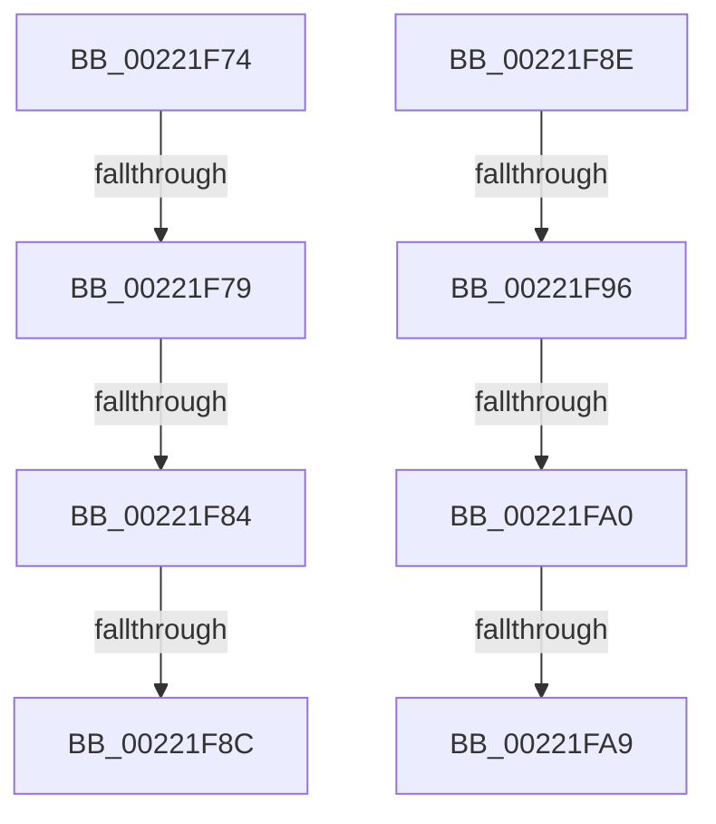

# sub_00221F74

- RVA: `0x00221F74`–`0x00221FAE` (길이 `58` bytes)
- VA: `0x0000000140221F74`
- 실행 섹션: `.text`
- PDB 이름 있음: `아니요`; PDB Function 태그: `아니요`
- unwind 정보 RVA: `0x0005F690`
- 디코드: `14`개 명령, `58/58` bytes 표시
- 미해석 바이트: `0` (있으면 어셈블리에 `.byte`로 보존)

> 이 문서는 커널 이미지의 기계어와 PDB 기호를 분석해 생성했습니다. 4번과 5번은 함수 원형과 자료형을 바이너리 사용 방식에서 추정한 C 해석이며 원본 소스 복구 결과는 아닙니다.

## 1. Dependencies

- 직접 호출 지점: **0**; 고유 호출 대상: **0**
- 직접 호출자로 확인된 함수: **0**
- RIP 상대 이미지 참조: **0**

### Outgoing calls
- 직접 디코드된 call 명령이 없습니다.

### Direct callers
- 이 함수 시작 RVA로 연결되는 직접 call은 확인되지 않았습니다. 간접 호출은 완전히 역산할 수 없습니다.

### Static image references
- 디코드된 RIP-relative 메모리 참조가 없습니다.

## 2. Other-region calls and transfers

- 다른 실행 섹션으로 향하는 call: **0**
- call이 아닌 외부 분기/꼬리 이동: **8**
  - `0x00221F77` → [sub_00221FB6](Unknown_function_00221FB6.md) (`tail-transfer`)
  - `0x00221F7E` → [sub_00221FB6 + 0xBEA](Unknown_function_00221FB6.md) (`tail-transfer`)
  - `0x00221F86` → [sub_00221DC6 + 0xB8](Unknown_function_00221DC6.md) (`tail-transfer`)
  - `0x00221F8C` → [sub_00221FB6 + 0x2B](Unknown_function_00221FB6.md) (`tail-transfer`)
  - `0x00221F90` → [sub_00221FB6 + 0x165](Unknown_function_00221FB6.md) (`tail-transfer`)
  - `0x00221F9A` → [sub_00221FB6 + 0xBF8](Unknown_function_00221FB6.md) (`tail-transfer`)
  - `0x00221FA3` → [sub_00221DC6 + 0x154](Unknown_function_00221DC6.md) (`tail-transfer`)
  - `0x00221FA9` → [sub_00221FB6 + 0x190](Unknown_function_00221FB6.md) (`tail-transfer`)

## 3. Assembly (complete function range)

```asm
00221F74  40 84 F6                        test sil, sil
00221F77  75 3D                           jne 0x140221fb6
00221F79  41 38 74 24 09                  cmp byte ptr [r12 + 9], sil
00221F7E  0F 85 1C 0C 00 00               jne 0x140222ba0
00221F84  85 D2                           test edx, edx
00221F86  0F 84 F2 FE FF FF               je 0x140221e7e
00221F8C  EB 53                           jmp 0x140221fe1
00221F8E  84 D2                           test dl, dl
00221F90  0F 85 85 01 00 00               jne 0x14022211b
00221F96  41 38 56 09                     cmp byte ptr [r14 + 9], dl
00221F9A  0F 85 0E 0C 00 00               jne 0x140222bae
00221FA0  45 85 FF                        test r15d, r15d
00221FA3  0F 84 71 FF FF FF               je 0x140221f1a
00221FA9  E9 98 01 00 00                  jmp 0x140222146
```

## 4. C-style interpretation (structured pseudocode)

```c
void __fastcall sub_00221F74(__int64 a1, int a2)
{
}
```

## 5. (Beta) C Style

```c
void sub_00221F74(int64_t Arg1, int32_t Arg2)
{
}
```

## 6. Execution-region graph

[열기: 2D/3D 그래프와 함수 탐색 컨트롤 패널](../../../control-panel.html?section=text&rva=0x00221F74&view=graph)

- 2D 그래프는 위에서 아래로 흐르고, 3D 그래프는 빈 공간을 드래그해 회전합니다. Shift+드래그는 이동, 휠은 확대·축소, 함수 노드 선택은 대상 보고서 이동입니다.

### Static fallback


