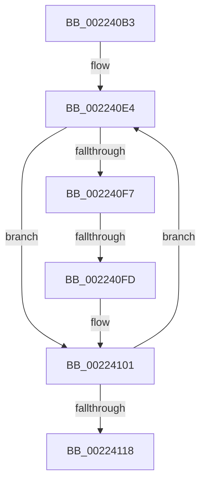

# sub_002240B3

- RVA: `0x002240B3`–`0x00224131` (길이 `126` bytes)
- VA: `0x00000001402240B3`
- 실행 섹션: `.text`
- PDB 이름 있음: `아니요`; PDB Function 태그: `아니요`
- unwind 정보 RVA: `0x0005F860`
- 디코드: `30`개 명령, `126/126` bytes 표시
- 미해석 바이트: `0` (있으면 어셈블리에 `.byte`로 보존)

> 이 문서는 커널 이미지의 기계어와 PDB 기호를 분석해 생성했습니다. 4번과 5번은 함수 원형과 자료형을 바이너리 사용 방식에서 추정한 C 해석이며 원본 소스 복구 결과는 아닙니다.

## 1. Dependencies

- 직접 호출 지점: **0**; 고유 호출 대상: **0**
- 직접 호출자로 확인된 함수: **0**
- RIP 상대 이미지 참조: **0**

### Outgoing calls
- 직접 디코드된 call 명령이 없습니다.

### Direct callers
- 이 함수 시작 RVA로 연결되는 직접 call은 확인되지 않았습니다. 간접 호출은 완전히 역산할 수 없습니다.

### Static image references
- 디코드된 RIP-relative 메모리 참조가 없습니다.

## 2. Other-region calls and transfers

- 다른 실행 섹션으로 향하는 call: **0**
- call이 아닌 외부 분기/꼬리 이동: **1**
  - `0x002240FB` → [sub_00224143](Unknown_function_00224143.md) (`tail-transfer`)

## 3. Assembly (complete function range)

```asm
002240B3  48 89 6C 24 40                  mov qword ptr [rsp + 0x40], rbp
002240B8  48 89 74 24 48                  mov qword ptr [rsp + 0x48], rsi
002240BD  48 8B 74 24 68                  mov rsi, qword ptr [rsp + 0x68]
002240C2  4C 89 64 24 50                  mov qword ptr [rsp + 0x50], r12
002240C7  41 BC C0 00 00 00               mov r12d, 0xc0
002240CD  4C 89 74 24 58                  mov qword ptr [rsp + 0x58], r14
002240D2  4C 8B 74 24 70                  mov r14, qword ptr [rsp + 0x70]
002240D7  4C 89 7C 24 20                  mov qword ptr [rsp + 0x20], r15
002240DC  41 BF E0 FF 00 00               mov r15d, 0xffe0
002240E2  8B E8                           mov ebp, eax
002240E4  41 0F B7 01                     movzx eax, word ptr [r9]
002240E8  0F B6 0C 30                     movzx ecx, byte ptr [rax + rsi]
002240EC  45 0F B7 04 4E                  movzx r8d, word ptr [r14 + rcx*2]
002240F1  41 83 F8 61                     cmp r8d, 0x61
002240F5  72 0A                           jb 0x140224101
002240F7  41 83 F8 7A                     cmp r8d, 0x7a
002240FB  77 46                           ja 0x140224143
002240FD  66 45 03 C7                     add r8w, r15w
00224101  41 0F B7 C0                     movzx eax, r8w
00224105  49 83 C1 02                     add r9, 2
00224109  0F B6 0C 30                     movzx ecx, byte ptr [rax + rsi]
0022410D  88 0B                           mov byte ptr [rbx], cl
0022410F  48 FF C3                        inc rbx
00224112  48 83 ED 01                     sub rbp, 1
00224116  75 CC                           jne 0x1402240e4
00224118  4C 8B 7C 24 20                  mov r15, qword ptr [rsp + 0x20]
0022411D  4C 8B 74 24 58                  mov r14, qword ptr [rsp + 0x58]
00224122  4C 8B 64 24 50                  mov r12, qword ptr [rsp + 0x50]
00224127  48 8B 74 24 48                  mov rsi, qword ptr [rsp + 0x48]
0022412C  48 8B 6C 24 40                  mov rbp, qword ptr [rsp + 0x40]
```

## 4. C-style interpretation (structured pseudocode)

```c
__int64 __fastcall sub_002240B3(__int64 a1, __int64 a2, __int64 a3, __int64 a4, __int64 a5, __int64 a6, __int64 a7, __int64 a8, __int64 a9, __int64 a10, __int64 a11, __int64 a12, __int64 a13, __int64 a14)
{
    __int64 v_rbp;
    __int64 v_rbx;
    unsigned __int64 v_stack_p20;
    unsigned __int64 v_stack_p40;
    unsigned __int64 v_stack_p48;
    unsigned __int64 v_stack_p50;
    unsigned __int64 v_stack_p58;

    v_stack_p40 = v_rbp;
    v_stack_p48 = v_rsi;
    v_stack_p50 = v_r12;
    v_stack_p58 = v_r14;
    v_stack_p20 = v_r15;
loc_002240E4:
    if (((unsigned int)(*(unsigned __int16 *)(a14 + *(unsigned __int8 *)(*(unsigned __int16 *)(a4) + a13 * 1) * 2))) < 97) goto loc_00224101;
    a3 = (unsigned __int16)((*(unsigned __int16 *)(a14 + *(unsigned __int8 *)(*(unsigned __int16 *)(a4) + a13 * 1) * 2)) + ((unsigned __int16)((unsigned int)(0xFFE0ULL))));
loc_00224101:
    a4 = (a4) + (2);
    *(unsigned __int8 *)(v_rbx) = (unsigned __int8)(*(unsigned __int8 *)((unsigned __int16)(a3) + a13 * 1));
    v_rbx = (v_rbx) + 1;
    v_rbp = ((unsigned int)((unsigned int)(result))) - (1);
    if (condition_is_not_equal) goto loc_002240E4;
    return (unsigned __int16)(a3);
}
```

## 5. (Beta) C Style

```c
int64_t sub_002240B3(int64_t Arg1, int64_t Arg2, int64_t Arg3, void *Arg4, uint64_t Arg5, uint64_t Arg6, uint64_t Arg7, int64_t Arg8, int64_t Arg9, int64_t Arg10, int64_t Arg11, uint64_t Arg12, int64_t Arg13, void *Arg14)
{
    uint8_t *arg4 = (uint8_t *)Arg4;
    uint8_t *arg14 = (uint8_t *)Arg14;

    int64_t local_rbp;
    int64_t local_rbx;
    uint64_t v_stack_p20;
    uint64_t v_stack_p40;
    uint64_t v_stack_p48;
    uint64_t v_stack_p50;
    uint64_t v_stack_p58;

    v_stack_p40 = local_rbp;
    v_stack_p48 = local_rsi;
    v_stack_p50 = local_r12;
    v_stack_p58 = local_r14;
    v_stack_p20 = local_r15;
loc_002240E4:
    if (((uint32_t)(*(uint16_t *)(arg14 + *(uint8_t *)(*(uint16_t *)(arg4) + Arg13 * 1) * 2))) < 97) goto loc_00224101;
    Arg3 = (uint16_t)((*(uint16_t *)(arg14 + *(uint8_t *)(*(uint16_t *)(arg4) + Arg13 * 1) * 2)) + ((uint16_t)((uint32_t)(0xFFE0ULL))));
loc_00224101:
    Arg4 = (Arg4) + (2);
    *(uint8_t *)(local_rbx) = (uint8_t)(*(uint8_t *)((uint16_t)(Arg3) + Arg13 * 1));
    local_rbx = (local_rbx) + 1;
    local_rbp = ((uint32_t)((uint32_t)(result))) - (1);
    if (condition_is_not_equal) goto loc_002240E4;
    return (uint16_t)(Arg3);
}
```

### 관측된 메모리 오프셋

구조체 형식이 확인되지 않은 접근은 인자 기준의 오프셋으로만 기록했습니다.

| 기준 인자 | 오프셋 표현 | 폭 (bit) | 접근 |
|---|---:|---:|---|
| `Arg4` | `+ 0x0` | `16` | `R` |
| `Arg14` | `+ 0x0 + rcx*2` | `16` | `R` |

## 6. Execution-region graph

[열기: 2D/3D 그래프와 함수 탐색 컨트롤 패널](../../../control-panel.html?section=text&rva=0x002240B3&view=graph)

- 2D 그래프는 위에서 아래로 흐르고, 3D 그래프는 빈 공간을 드래그해 회전합니다. Shift+드래그는 이동, 휠은 확대·축소, 함수 노드 선택은 대상 보고서 이동입니다.

### Static fallback


