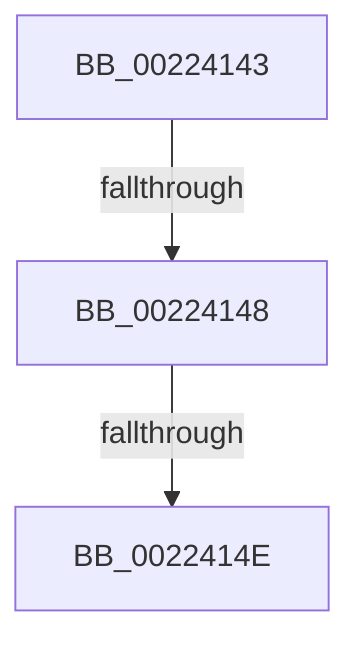

# sub_00224143

- RVA: `0x00224143`–`0x00224177` (길이 `52` bytes)
- VA: `0x0000000140224143`
- 실행 섹션: `.text`
- PDB 이름 있음: `아니요`; PDB Function 태그: `아니요`
- unwind 정보 RVA: `0x0005F898`
- 디코드: `17`개 명령, `52/52` bytes 표시
- 미해석 바이트: `0` (있으면 어셈블리에 `.byte`로 보존)

> 이 문서는 커널 이미지의 기계어와 PDB 기호를 분석해 생성했습니다. 4번과 5번은 함수 원형과 자료형을 바이너리 사용 방식에서 추정한 C 해석이며 원본 소스 복구 결과는 아닙니다.

## 1. Dependencies

- 직접 호출 지점: **0**; 고유 호출 대상: **0**
- 직접 호출자로 확인된 함수: **0**
- RIP 상대 이미지 참조: **0**

### Outgoing calls
- 직접 디코드된 call 명령이 없습니다.

### Direct callers
- 이 함수 시작 RVA로 연결되는 직접 call은 확인되지 않았습니다. 간접 호출은 완전히 역산할 수 없습니다.

### Static image references
- 디코드된 RIP-relative 메모리 참조가 없습니다.

## 2. Other-region calls and transfers

- 다른 실행 섹션으로 향하는 call: **0**
- call이 아닌 외부 분기/꼬리 이동: **3**
  - `0x00224146` → [sub_002240B3 + 0x4E](Unknown_function_002240B3.md) (`tail-transfer`)
  - `0x0022414C` → [sub_002240B3 + 0x4E](Unknown_function_002240B3.md) (`tail-transfer`)
  - `0x00224175` → [sub_002240B3 + 0x4E](Unknown_function_002240B3.md) (`tail-transfer`)

## 3. Assembly (complete function range)

```asm
00224143  48 85 FF                        test rdi, rdi
00224146  74 B9                           je 0x140224101
00224148  66 45 3B C4                     cmp r8w, r12w
0022414C  72 B3                           jb 0x140224101
0022414E  49 8B C0                        mov rax, r8
00224151  41 8B D0                        mov edx, r8d
00224154  48 C1 E8 08                     shr rax, 8
00224158  83 E2 0F                        and edx, 0xf
0022415B  0F B7 0C 47                     movzx ecx, word ptr [rdi + rax*2]
0022415F  41 8B C0                        mov eax, r8d
00224162  C1 E8 04                        shr eax, 4
00224165  83 E0 0F                        and eax, 0xf
00224168  03 C8                           add ecx, eax
0022416A  0F B7 0C 4F                     movzx ecx, word ptr [rdi + rcx*2]
0022416E  03 CA                           add ecx, edx
00224170  66 44 03 04 4F                  add r8w, word ptr [rdi + rcx*2]
00224175  EB 8A                           jmp 0x140224101
```

## 4. C-style interpretation (structured pseudocode)

```c
__int64 __fastcall sub_00224143(__int64 a1, __int64 a2, __int64 a3)
{
    __int64 result;

    result = (a3) >> (8);
    a2 = (unsigned int)(((unsigned int)((unsigned int)(a3))) & (15));
    result = (unsigned int)(((unsigned int)((unsigned int)(a3))) >> (4));
    result = (unsigned int)((result) & (15));
    a1 = (unsigned int)((*(unsigned __int16 *)(v_rdi + result * 2)) + ((unsigned int)(result)));
    a1 = (unsigned int)((*(unsigned __int16 *)(v_rdi + a1 * 2)) + ((unsigned int)(a2)));
    a3 = (unsigned __int16)((a3) + (*(unsigned __int16 *)(v_rdi + a1 * 2)));
}
```

## 5. (Beta) C Style

```c
int64_t sub_00224143(int64_t Arg1, int64_t Arg2, int64_t Arg3)
{
    int64_t result;

    result = (Arg3) >> (8);
    Arg2 = (uint32_t)(((uint32_t)((uint32_t)(Arg3))) & (15));
    result = (uint32_t)(((uint32_t)((uint32_t)(Arg3))) >> (4));
    result = (uint32_t)((result) & (15));
    Arg1 = (uint32_t)((*(uint16_t *)(local_rdi + result * 2)) + ((uint32_t)(result)));
    Arg1 = (uint32_t)((*(uint16_t *)(local_rdi + Arg1 * 2)) + ((uint32_t)(Arg2)));
    Arg3 = (uint16_t)((Arg3) + (*(uint16_t *)(local_rdi + Arg1 * 2)));
}
```

## 6. Execution-region graph

[열기: 2D/3D 그래프와 함수 탐색 컨트롤 패널](../../../control-panel.html?section=text&rva=0x00224143&view=graph)

- 2D 그래프는 위에서 아래로 흐르고, 3D 그래프는 빈 공간을 드래그해 회전합니다. Shift+드래그는 이동, 휠은 확대·축소, 함수 노드 선택은 대상 보고서 이동입니다.

### Static fallback


