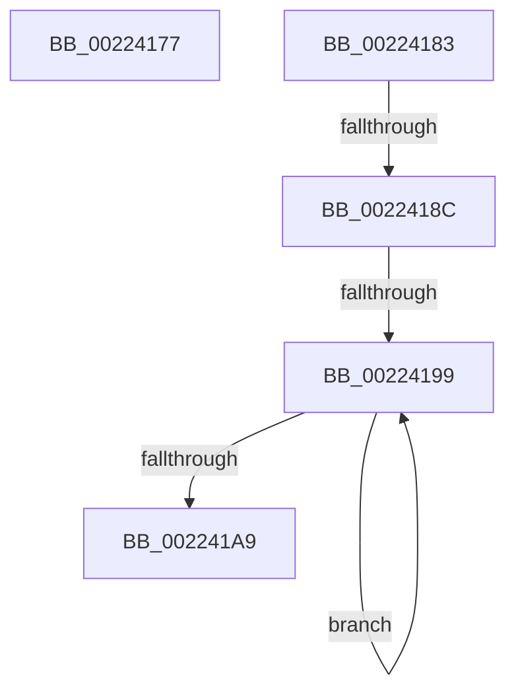

# sub_00224177

- RVA: `0x00224177`–`0x002241AE` (길이 `55` bytes)
- VA: `0x0000000140224177`
- 실행 섹션: `.text`
- PDB 이름 있음: `아니요`; PDB Function 태그: `아니요`
- unwind 정보 RVA: `0x0005F8BC`
- 디코드: `12`개 명령, `55/55` bytes 표시
- 미해석 바이트: `0` (있으면 어셈블리에 `.byte`로 보존)

> 이 문서는 커널 이미지의 기계어와 PDB 기호를 분석해 생성했습니다. 4번과 5번은 함수 원형과 자료형을 바이너리 사용 방식에서 추정한 C 해석이며 원본 소스 복구 결과는 아닙니다.

## 1. Dependencies

- 직접 호출 지점: **2**; 고유 호출 대상: **1**
- 직접 호출자로 확인된 함수: **0**
- RIP 상대 이미지 참조: **0**

### Outgoing calls
- `0x0022418C` → [PsIsServerSilo](PsIsServerSilo_function_00225828.md) (function, `0x00225828`)
- `0x002241A0` → [PsIsServerSilo](PsIsServerSilo_function_00225828.md) (function, `0x00225828`)

### Direct callers
- 이 함수 시작 RVA로 연결되는 직접 call은 확인되지 않았습니다. 간접 호출은 완전히 역산할 수 없습니다.

### Static image references
- 디코드된 RIP-relative 메모리 참조가 없습니다.

## 2. Other-region calls and transfers

- 다른 실행 섹션으로 향하는 call: **0**
- call이 아닌 외부 분기/꼬리 이동: **4**
  - `0x0022417E` → [UpcaseUnicodeToSingleByteNHelper + 0x56](UpcaseUnicodeToSingleByteNHelper_function_00224040.md) (`tail-transfer`)
  - `0x00224186` → [UpcaseUnicodeToSingleByteNHelper + 0x46](UpcaseUnicodeToSingleByteNHelper_function_00224040.md) (`tail-transfer`)
  - `0x00224193` → [UpcaseUnicodeToSingleByteNHelper + 0x46](UpcaseUnicodeToSingleByteNHelper_function_00224040.md) (`tail-transfer`)
  - `0x002241A9` → [UpcaseUnicodeToSingleByteNHelper + 0x46](UpcaseUnicodeToSingleByteNHelper_function_00224040.md) (`tail-transfer`)

## 3. Assembly (complete function range)

```asm
00224177  48 8B 81 E0 05 00 00            mov rax, qword ptr [rcx + 0x5e0]
0022417E  E9 13 FF FF FF                  jmp 0x140224096
00224183  48 85 C9                        test rcx, rcx
00224186  0F 84 FA FE FF FF               je 0x140224086
0022418C  E8 97 16 00 00                  call 0x140225828
00224191  84 C0                           test al, al
00224193  0F 85 ED FE FF FF               jne 0x140224086
00224199  48 8B 89 18 05 00 00            mov rcx, qword ptr [rcx + 0x518]
002241A0  E8 83 16 00 00                  call 0x140225828
002241A5  84 C0                           test al, al
002241A7  74 F0                           je 0x140224199
002241A9  E9 D8 FE FF FF                  jmp 0x140224086
```

## 4. C-style interpretation (structured pseudocode)

```c
__int64 __fastcall sub_00224177(__int64 a1)
{
}
```

## 5. (Beta) C Style

```c
int64_t sub_00224177(void *Arg1)
{
    uint8_t *arg1 = (uint8_t *)Arg1;

}
```

### 관측된 메모리 오프셋

구조체 형식이 확인되지 않은 접근은 인자 기준의 오프셋으로만 기록했습니다.

| 기준 인자 | 오프셋 표현 | 폭 (bit) | 접근 |
|---|---:|---:|---|
| `Arg1` | `+ 0x5E0` | `64` | `R` |

## 6. Execution-region graph

[열기: 2D/3D 그래프와 함수 탐색 컨트롤 패널](../../../control-panel.html?section=text&rva=0x00224177&view=graph)

- 2D 그래프는 위에서 아래로 흐르고, 3D 그래프는 빈 공간을 드래그해 회전합니다. Shift+드래그는 이동, 휠은 확대·축소, 함수 노드 선택은 대상 보고서 이동입니다.

### Static fallback


