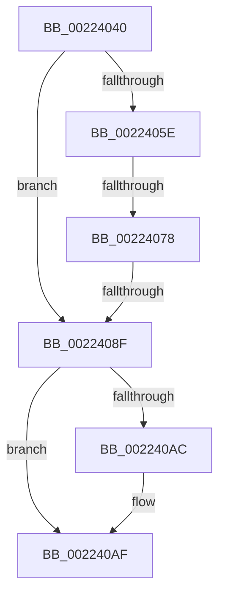

# UpcaseUnicodeToSingleByteNHelper

- RVA: `0x00224040`–`0x002240B3` (길이 `115` bytes)
- VA: `0x0000000140224040`
- 실행 섹션: `.text`
- PDB 이름 있음: `예`; PDB Function 태그: `아니요`
- unwind 정보 RVA: `0x0005F854`
- 디코드: `27`개 명령, `115/115` bytes 표시
- 미해석 바이트: `0` (있으면 어셈블리에 `.byte`로 보존)

> 이 문서는 커널 이미지의 기계어와 PDB 기호를 분석해 생성했습니다. 4번과 5번은 함수 원형과 자료형을 바이너리 사용 방식에서 추정한 C 해석이며 원본 소스 복구 결과는 아닙니다.

## 1. Dependencies

- 직접 호출 지점: **0**; 고유 호출 대상: **0**
- 직접 호출자로 확인된 함수: **3**
- RIP 상대 이미지 참조: **1**

### Outgoing calls
- 직접 디코드된 call 명령이 없습니다.

### Direct callers
- [RtlUpcaseUnicodeToOemN](../../page/90/RtlUpcaseUnicodeToOemN_function_0090CC70.md) at `0x0090CCE3`
- [RtlUpcaseUnicodeToMultiByteN](../../page/90/RtlUpcaseUnicodeToMultiByteN_function_0090D760.md) at `0x0090D7D1`
- [RtlUpcaseUnicodeStringToCountedOemString](../../page/90/RtlUpcaseUnicodeStringToCountedOemString_function_0090E4D0.md) at `0x0090E5DE`

### Static image references
- `0x0022408F` → RVA `0x00FCF940` (`CACHEALI`; read)

## 2. Other-region calls and transfers

- 다른 실행 섹션으로 향하는 call: **0**
- call이 아닌 외부 분기/꼬리 이동: **3**
  - `0x00224072` → [sub_00224177 + 0xC](Unknown_function_00224177.md) (`tail-transfer`)
  - `0x00224089` → [sub_00224177](Unknown_function_00224177.md) (`tail-transfer`)
  - `0x002240B1` → [sub_00224131](Unknown_function_00224131.md) (`tail-transfer`)

## 3. Assembly (complete function range)

```asm
00224040  40 53                           push rbx
00224042  57                              push rdi
00224043  48 83 EC 28                     sub rsp, 0x28
00224047  65 8A 04 25 A0 01 00 00         mov al, byte ptr gs:[0x1a0]
0022404F  44 8B D2                        mov r10d, edx
00224052  44 8B 5C 24 60                  mov r11d, dword ptr [rsp + 0x60]
00224057  48 8B D9                        mov rbx, rcx
0022405A  84 C0                           test al, al
0022405C  75 31                           jne 0x14022408f
0022405E  65 48 8B 04 25 88 01 00 00      mov rax, qword ptr gs:[0x188]
00224067  48 8B 88 98 06 00 00            mov rcx, qword ptr [rax + 0x698]
0022406E  48 83 F9 FD                     cmp rcx, -3
00224072  0F 85 0B 01 00 00               jne 0x140224183
00224078  48 8B 80 20 02 00 00            mov rax, qword ptr [rax + 0x220]
0022407F  48 8B 88 F0 05 00 00            mov rcx, qword ptr [rax + 0x5f0]
00224086  48 85 C9                        test rcx, rcx
00224089  0F 85 E8 00 00 00               jne 0x140224177
0022408F  48 8D 05 AA B8 DA 00            lea rax, [rip + 0xdab8aa]
00224096  48 8B B8 B0 04 00 00            mov rdi, qword ptr [rax + 0x4b0]
0022409D  45 3B DA                        cmp r11d, r10d
002240A0  41 8B C3                        mov eax, r11d
002240A3  41 0F 43 C2                     cmovae eax, r10d
002240A7  4D 85 C0                        test r8, r8
002240AA  74 03                           je 0x1402240af
002240AC  41 89 00                        mov dword ptr [r8], eax
002240AF  85 C0                           test eax, eax
002240B1  74 7E                           je 0x140224131
```

## 4. C-style interpretation (structured pseudocode)

```c
__int64 __fastcall UpcaseUnicodeToSingleByteNHelper(__int64 a1, int a2, __int64 a3, __int64 a4, unsigned int a5)
{
    __int64 result;
    __int64 v_rsp;

    v_rsp = (v_rsp) - (40);
    if ((unsigned __int8)(*(unsigned __int8 *)(gs_base + (0 + 416))) != 0) goto loc_0022408F;
loc_0022408F:
    result = (unsigned int)((unsigned int)((unsigned int)(a5)));
    if (((unsigned int)((unsigned int)(a5))) >= ((unsigned int)((unsigned int)(a2)))) { result = (unsigned int)((unsigned int)(a2)); }
    if (a3 != 0) {
        *(unsigned int *)(a3) = (unsigned int)(result);
    }
}
```

## 5. (Beta) C Style

```c
int64_t UpcaseUnicodeToSingleByteNHelper(int64_t Arg1, int32_t Arg2, int64_t Arg3, int64_t Arg4, uint32_t Arg5)
{
    int64_t result;
    int64_t local_rsp;

    local_rsp = (local_rsp) - (40);
    if ((uint8_t)(*(uint8_t *)(gs_base + (0 + 0x1A0))) != 0) goto loc_0022408F;
loc_0022408F:
    result = (uint32_t)((uint32_t)((uint32_t)(Arg5)));
    if (((uint32_t)((uint32_t)(Arg5))) >= ((uint32_t)((uint32_t)(Arg2)))) { result = (uint32_t)((uint32_t)(Arg2)); }
    if (Arg3 != 0) {
        *(uint32_t *)(Arg3) = (uint32_t)(result);
    }
}
```

## 6. Execution-region graph

[열기: 2D/3D 그래프와 함수 탐색 컨트롤 패널](../../../control-panel.html?section=text&rva=0x00224040&view=graph)

- 2D 그래프는 위에서 아래로 흐르고, 3D 그래프는 빈 공간을 드래그해 회전합니다. Shift+드래그는 이동, 휠은 확대·축소, 함수 노드 선택은 대상 보고서 이동입니다.

### Static fallback


