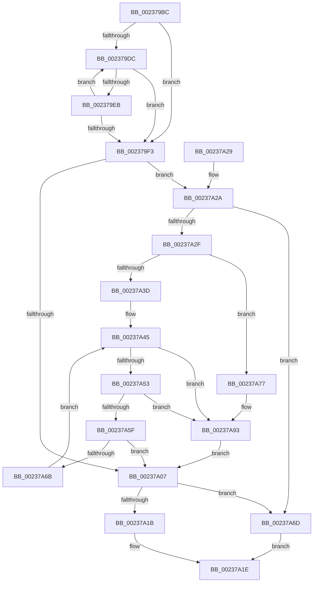

# CcReferenceSharedCacheMapFileObject

- RVA: `0x002379BC`–`0x00237A9E` (길이 `226` bytes)
- VA: `0x00000001402379BC`
- 실행 섹션: `.text`
- PDB 이름 있음: `예`; PDB Function 태그: `아니요`
- unwind 정보 RVA: `0x000609B0`
- 디코드: `67`개 명령, `226/226` bytes 표시
- 미해석 바이트: `0` (있으면 어셈블리에 `.byte`로 보존)

> 이 문서는 커널 이미지의 기계어와 PDB 기호를 분석해 생성했습니다. 4번과 5번은 함수 원형과 자료형을 바이너리 사용 방식에서 추정한 C 해석이며 원본 소스 복구 결과는 아닙니다.

## 1. Dependencies

- 직접 호출 지점: **3**; 고유 호출 대상: **3**
- 직접 호출자로 확인된 함수: **11**
- RIP 상대 이미지 참조: **0**

### Outgoing calls
- `0x00237A11` → [ObpTraceObjectReferenceIfActive](../21/ObpTraceObjectReferenceIfActive_function_00210780.md) (function, `0x00210780`)
- `0x00237A70` → [CcSlowReferenceSharedCacheMapFileObject](../45/CcSlowReferenceSharedCacheMapFileObject_function_00458C10.md) (function, `0x00458C10`)
- `0x00237A8D` → [KeBugCheckEx](../4F/KeBugCheckEx_function_004FD660.md) (function, `0x004FD660`)

### Direct callers
- [CcFlushCacheOneRange](CcFlushCacheOneRange_function_00236A30.md) at `0x00236C9B`
- [CcWriteBehindPostProcess](../35/CcWriteBehindPostProcess_function_00357BB4.md) at `0x00357CC4`
- [CcWriteBehindPostProcess](../35/CcWriteBehindPostProcess_function_00357BB4.md) at `0x00357DE6`
- [CcWriteBehindPostProcess](../35/CcWriteBehindPostProcess_function_00357BB4.md) at `0x00357E40`
- [CcGetDirtyPagesHelper](../35/CcGetDirtyPagesHelper_function_00358D40.md) at `0x00358E5D`
- [CcPurgeAndClearCacheSection](../38/CcPurgeAndClearCacheSection_function_0038A614.md) at `0x0038A64A`
- [CcUnmapAndPurge](../38/CcUnmapAndPurge_function_0038ADF0.md) at `0x0038AE04`
- [CcIsFatalWriteError](../40/CcIsFatalWriteError_function_0040855C.md) at `0x0040859B`
- [CcPerfLogFlushCache](../47/CcPerfLogFlushCache_function_00479A54.md) at `0x00479A94`
- [CcPerfLogFlushSection](../47/CcPerfLogFlushSection_function_0047CE0C.md) at `0x0047CE47`
- [CcUnpinRepinnedBcb](../49/CcUnpinRepinnedBcb_function_0049F560.md) at `0x0049F603`
- [sub_006E2A72](../6E/Unknown_function_006E2A72.md) at `0x006E2A79`
- [sub_009E96D3](../../page/9E/Unknown_function_009E96D3.md) at `0x009E96D8`

### Static image references
- 디코드된 RIP-relative 메모리 참조가 없습니다.

## 2. Other-region calls and transfers

- 다른 실행 섹션으로 향하는 call: **0**
- 별도 외부 분기/꼬리 이동을 확인하지 못했습니다.

## 3. Assembly (complete function range)

```asm
002379BC  48 89 5C 24 08                  mov qword ptr [rsp + 8], rbx
002379C1  57                              push rdi
002379C2  48 83 EC 30                     sub rsp, 0x30
002379C6  48 8B F9                        mov rdi, rcx
002379C9  0F 0D 49 60                     prefetchw byte ptr [rcx + 0x60]
002379CD  4C 8B 41 60                     mov r8, qword ptr [rcx + 0x60]
002379D1  41 B9 0F 00 00 00               mov r9d, 0xf
002379D7  45 84 C1                        test r9b, r8b
002379DA  74 17                           je 0x1402379f3
002379DC  49 8D 50 FF                     lea rdx, [r8 - 1]
002379E0  49 8B C0                        mov rax, r8
002379E3  F0 48 0F B1 51 60               lock cmpxchg qword ptr [rcx + 0x60], rdx
002379E9  74 08                           je 0x1402379f3
002379EB  4C 8B C0                        mov r8, rax
002379EE  41 84 C1                        test r9b, al
002379F1  75 E9                           jne 0x1402379dc
002379F3  49 8B D8                        mov rbx, r8
002379F6  BA 01 00 00 00                  mov edx, 1
002379FB  48 83 E3 F0                     and rbx, 0xfffffffffffffff0
002379FF  45 23 C1                        and r8d, r9d
00237A02  44 3B C2                        cmp r8d, edx
00237A05  76 23                           jbe 0x140237a2a
00237A07  48 8D 4B D0                     lea rcx, [rbx - 0x30]
00237A0B  41 B8 43 63 53 63               mov r8d, 0x63536343
00237A11  E8 6A 8D FD FF                  call 0x140210780
00237A16  48 85 DB                        test rbx, rbx
00237A19  74 52                           je 0x140237a6d
00237A1B  48 8B C3                        mov rax, rbx
00237A1E  48 8B 5C 24 40                  mov rbx, qword ptr [rsp + 0x40]
00237A23  48 83 C4 30                     add rsp, 0x30
00237A27  5F                              pop rdi
00237A28  C3                              ret
00237A29  CC                              int3
00237A2A  45 85 C0                        test r8d, r8d
00237A2D  74 3E                           je 0x140237a6d
00237A2F  49 8B C1                        mov rax, r9
00237A32  F0 48 0F C1 43 D0               lock xadd qword ptr [rbx - 0x30], rax
00237A38  48 85 C0                        test rax, rax
00237A3B  7E 3A                           jle 0x140237a77
00237A3D  0F 0D 49 60                     prefetchw byte ptr [rcx + 0x60]
00237A41  48 8B 41 60                     mov rax, qword ptr [rcx + 0x60]
00237A45  48 8B C8                        mov rcx, rax
00237A48  49 23 C9                        and rcx, r9
00237A4B  49 03 C9                        add rcx, r9
00237A4E  49 3B C9                        cmp rcx, r9
00237A51  77 40                           ja 0x140237a93
00237A53  48 8B C8                        mov rcx, rax
00237A56  48 83 E1 F0                     and rcx, 0xfffffffffffffff0
00237A5A  48 3B D9                        cmp rbx, rcx
00237A5D  75 34                           jne 0x140237a93
00237A5F  48 8D 48 0F                     lea rcx, [rax + 0xf]
00237A63  F0 48 0F B1 4F 60               lock cmpxchg qword ptr [rdi + 0x60], rcx
00237A69  74 9C                           je 0x140237a07
00237A6B  EB D8                           jmp 0x140237a45
00237A6D  48 8B CF                        mov rcx, rdi
00237A70  E8 9B 11 22 00                  call 0x140458c10
00237A75  EB A7                           jmp 0x140237a1e
00237A77  49 03 C1                        add rax, r9
00237A7A  33 D2                           xor edx, edx
00237A7C  41 B9 10 00 00 00               mov r9d, 0x10
00237A82  48 89 44 24 20                  mov qword ptr [rsp + 0x20], rax
00237A87  4C 8B C3                        mov r8, rbx
00237A8A  8D 4A 18                        lea ecx, [rdx + 0x18]
00237A8D  E8 CE 5B 2C 00                  call 0x1404fd660
00237A92  CC                              int3
00237A93  F0 48 83 43 D0 F1               lock add qword ptr [rbx - 0x30], -0xf
00237A99  E9 69 FF FF FF                  jmp 0x140237a07
```

## 4. C-style interpretation (structured pseudocode)

```c
__int64 __fastcall CcReferenceSharedCacheMapFileObject(__int64 a1)
{
    __int64 result;
    __int64 v_rbx;
    __int64 v_rsp;
    unsigned __int64 v_stack_p20;
    unsigned __int64 v_stack_p8;

    v_stack_p8 = v_rbx;
    v_rsp = (v_rsp) - (48);
    if (((15) & ((unsigned __int8)(*(unsigned __int64 *)(a1 + 96)))) == 0) goto loc_002379F3;
loc_002379DC:
    if (((15) & ((unsigned __int8)(*(unsigned __int64 *)(a1 + 96)))) == 0) goto loc_002379F3;
    if (((15) & ((unsigned __int8)(*(unsigned __int64 *)(a1 + 96)))) != 0) goto loc_002379DC;
loc_002379F3:
    v_rbx = (*(unsigned __int64 *)(a1 + 96)) & (-16);
    a3 = (unsigned int)((*(unsigned __int64 *)(a1 + 96)) & (15));
    if (((unsigned int)(a3)) <= 1) goto loc_00237A2A;
loc_00237A07:
    result = ObpTraceObjectReferenceIfActive(v_rbx - 48, 1, (unsigned int)(0x63536343ULL), 15);
    if (v_rbx == 0) goto loc_00237A6D;
loc_00237A1E:
    v_rsp = (v_rsp) + (48);
    return v_rbx;
loc_00237A2A:
    if ((unsigned int)((unsigned int)(0x63536343ULL)) == 0) goto loc_00237A6D;
    if (condition_is_less_or_equal) goto loc_00237A77;
loc_00237A45:
    a1 = (*(unsigned __int64 *)(v_rbx - 48 + 96)) & (15);
    a1 = (a1) + (15);
    if (a1 > 15) goto loc_00237A93;
    a1 = (*(unsigned __int64 *)(v_rbx - 48 + 96)) & (-16);
    if (v_stack_p8 != a1) goto loc_00237A93;
    if (v_stack_p8 == a1) goto loc_00237A07;
    goto loc_00237A45;
loc_00237A6D:
    result = CcSlowReferenceSharedCacheMapFileObject(a1, 1, (unsigned int)(0x63536343ULL), 15);
    goto loc_00237A1E;
loc_00237A77:
    result = (result) + (15);
    a2 = 0;
    v_stack_p20 = result;
    result = KeBugCheckEx(a2 + 24, a2, v_stack_p8, 16);
loc_00237A93:
    goto loc_00237A07;
}
```

## 5. (Beta) C Style

```c
int64_t CcReferenceSharedCacheMapFileObject(void *Arg1)
{
    uint8_t *arg1 = (uint8_t *)Arg1;

    int64_t result;
    int64_t local_rbx;
    int64_t local_rsp;
    uint64_t v_stack_p20;
    uint64_t v_stack_p8;

    v_stack_p8 = local_rbx;
    local_rsp = (local_rsp) - (48);
    if (((15) & ((uint8_t)(*(uint64_t *)(arg1 + 0x60)))) == 0) goto loc_002379F3;
loc_002379DC:
    if (((15) & ((uint8_t)(*(uint64_t *)(arg1 + 0x60)))) == 0) goto loc_002379F3;
    if (((15) & ((uint8_t)(*(uint64_t *)(arg1 + 0x60)))) != 0) goto loc_002379DC;
loc_002379F3:
    local_rbx = (*(uint64_t *)(arg1 + 0x60)) & (-16);
    a3 = (uint32_t)((*(uint64_t *)(arg1 + 0x60)) & (15));
    if (((uint32_t)(a3)) <= 1) goto loc_00237A2A;
loc_00237A07:
    result = ObpTraceObjectReferenceIfActive(local_rbx - 48, 1, (uint32_t)(0x63536343ULL), 15);
    if (local_rbx == 0) goto loc_00237A6D;
loc_00237A1E:
    local_rsp = (local_rsp) + (48);
    return local_rbx;
loc_00237A2A:
    if ((uint32_t)((uint32_t)(0x63536343ULL)) == 0) goto loc_00237A6D;
    if (condition_is_less_or_equal) goto loc_00237A77;
loc_00237A45:
    Arg1 = (*(uint64_t *)(local_rbx - 0x30 + 0x60)) & (15);
    Arg1 = (Arg1) + (15);
    if (Arg1 > 15) goto loc_00237A93;
    Arg1 = (*(uint64_t *)(local_rbx - 0x30 + 0x60)) & (-16);
    if (v_stack_p8 != Arg1) goto loc_00237A93;
    if (v_stack_p8 == Arg1) goto loc_00237A07;
    goto loc_00237A45;
loc_00237A6D:
    result = CcSlowReferenceSharedCacheMapFileObject(Arg1, 1, (uint32_t)(0x63536343ULL), 15);
    goto loc_00237A1E;
loc_00237A77:
    result = (result) + (15);
    a2 = 0;
    v_stack_p20 = result;
    result = KeBugCheckEx(a2 + 24, a2, v_stack_p8, 16);
loc_00237A93:
    goto loc_00237A07;
}
```

### 관측된 메모리 오프셋

구조체 형식이 확인되지 않은 접근은 인자 기준의 오프셋으로만 기록했습니다.

| 기준 인자 | 오프셋 표현 | 폭 (bit) | 접근 |
|---|---:|---:|---|
| `Arg1` | `+ 0x60` | `8` | `R` |
| `Arg1` | `+ 0x60` | `64` | `R` |

## 6. Execution-region graph

[열기: 2D/3D 그래프와 함수 탐색 컨트롤 패널](../../../control-panel.html?section=text&rva=0x002379BC&view=graph)

- 2D 그래프는 위에서 아래로 흐르고, 3D 그래프는 빈 공간을 드래그해 회전합니다. Shift+드래그는 이동, 휠은 확대·축소, 함수 노드 선택은 대상 보고서 이동입니다.

### Static fallback


