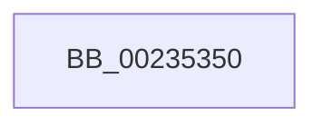

# EtwTraceKernelEvent

- RVA: `0x00235350`–`0x0023538B` (길이 `59` bytes)
- VA: `0x0000000140235350`
- 실행 섹션: `.text`
- PDB 이름 있음: `예`; PDB Function 태그: `아니요`
- unwind 정보 RVA: `0x00060660`
- 디코드: `15`개 명령, `59/59` bytes 표시
- 미해석 바이트: `0` (있으면 어셈블리에 `.byte`로 보존)

> 이 문서는 커널 이미지의 기계어와 PDB 기호를 분석해 생성했습니다. 4번과 5번은 함수 원형과 자료형을 바이너리 사용 방식에서 추정한 C 해석이며 원본 소스 복구 결과는 아닙니다.

## 1. Dependencies

- 직접 호출 지점: **0**; 고유 호출 대상: **0**
- 직접 호출자로 확인된 함수: **151**
- RIP 상대 이미지 참조: **1**

### Outgoing calls
- 직접 디코드된 call 명령이 없습니다.

### Direct callers
- [MiDemoteCombinedPte](../22/MiDemoteCombinedPte_function_0022ABAC.md) at `0x0022B030`
- [MiCombineWithExisting](../22/MiCombineWithExisting_function_0022B4B8.md) at `0x0022B91C`
- [MiCombineInitialInstance](../22/MiCombineInitialInstance_function_0022BC0C.md) at `0x0022CA7A`
- [KiTraceSetTimer](../22/KiTraceSetTimer_function_0022FB08.md) at `0x0022FC0C`
- [ExpSetTimerObject](ExpSetTimerObject_function_00231730.md) at `0x00232359`
- [sub_002329B4](Unknown_function_002329B4.md) at `0x00232C91`
- [KiSetTimerEx](KiSetTimerEx_function_00232CB0.md) at `0x002332B4`
- [KeSetTimer](KeSetTimer_function_00233BE0.md) at `0x002341C4`
- [KiProcessExpiredTimerList](KiProcessExpiredTimerList_function_00234200.md) at `0x002346C6`
- [sub_002348D3](Unknown_function_002348D3.md) at `0x00234974`
- [EtwpTraceNetwork](EtwpTraceNetwork_function_002356F0.md) at `0x00235756`
- [sub_00235EB4](Unknown_function_00235EB4.md) at `0x00235F90`
- [sub_00235EB4](Unknown_function_00235EB4.md) at `0x00235FE9`
- [MiLogPerfMemoryEvent](MiLogPerfMemoryEvent_function_002369C8.md) at `0x00236A0B`
- [CcFlushCacheOneRange](CcFlushCacheOneRange_function_00236A30.md) at `0x00236D26`
- [KiExecuteAllDpcs](../25/KiExecuteAllDpcs_function_0025B740.md) at `0x0025BA00`
- [sub_0025E5F6](../25/Unknown_function_0025E5F6.md) at `0x0025EA2B`
- [sub_00260366](../26/Unknown_function_00260366.md) at `0x00260C5F`
- [PopLogNotifyDevice](../27/PopLogNotifyDevice_function_00270400.md) at `0x002704CA`
- [sub_0027475D](../27/Unknown_function_0027475D.md) at `0x002750DF`
- [sub_0027475D](../27/Unknown_function_0027475D.md) at `0x002751D4`
- [EtwTraceShouldYieldProcessor](../27/EtwTraceShouldYieldProcessor_function_00279088.md) at `0x002790DC`
- [MiMakePageAvoidRead](../2B/MiMakePageAvoidRead_function_002B7DE0.md) at `0x002B851F`
- [PpmIdleSelectStates](../2C/PpmIdleSelectStates_function_002CFFE8.md) at `0x002D0844`
- [PpmIdleSelectStates](../2C/PpmIdleSelectStates_function_002CFFE8.md) at `0x002D088C`
- [PpmEventExitIdleState](../2D/PpmEventExitIdleState_function_002D1AC4.md) at `0x002D1B33`
- [PpmEventEnterIdleState](../2D/PpmEventEnterIdleState_function_002D1B40.md) at `0x002D1BAA`
- [CcPerfLogWorkItemEnqueue](../35/CcPerfLogWorkItemEnqueue_function_00357340.md) at `0x00357419`
- [CcPerfLogWorkItemComplete](../35/CcPerfLogWorkItemComplete_function_00358710.md) at `0x0035875C`
- [CcPerfLogWorkItemDequeue](../35/CcPerfLogWorkItemDequeue_function_0035877C.md) at `0x003587C8`
- [MiCopyOnWrite](../36/MiCopyOnWrite_function_00362A0C.md) at `0x00363582`
- [MiDecommitPrivatePageTail](../36/MiDecommitPrivatePageTail_function_0036F564.md) at `0x0036F90A`
- [CcPerfLogScheduleReadAhead](../38/CcPerfLogScheduleReadAhead_function_00386A38.md) at `0x00386B3B`
- [EtwTraceEnqueueWork](../39/EtwTraceEnqueueWork_function_0039674C.md) at `0x003967B2`
- [sub_0039CDF2](../39/Unknown_function_0039CDF2.md) at `0x0039CE59`
- [sub_003A1A0C](../3A/Unknown_function_003A1A0C.md) at `0x003A1A78`
- [KiTraceSetTimer2](../3A/KiTraceSetTimer2_function_003A1F28.md) at `0x003A20BD`
- [KiTraceCancelTimer2](../3A/KiTraceCancelTimer2_function_003A378C.md) at `0x003A3805`
- [EtwpLogMemInfo](../3B/EtwpLogMemInfo_function_003B9AC0.md) at `0x003B9BCC`
- [EtwTraceIdealProcessor](../3C/EtwTraceIdealProcessor_function_003C0808.md) at `0x003C0869`
- [EtwTraceThreadAffinity](../3C/EtwTraceThreadAffinity_function_003C29A0.md) at `0x003C2B80`
- [EtwTracePriority](../3C/EtwTracePriority_function_003C41A4.md) at `0x003C424E`
- [EtwTracePriQDequeueWork](../3C/EtwTracePriQDequeueWork_function_003C6608.md) at `0x003C6681`
- [KiCancelTimer](../3D/KiCancelTimer_function_003D3A80.md) at `0x003D3EF1`
- [EtwTraceLongDpcDetectionEvent](../42/EtwTraceLongDpcDetectionEvent_function_0042A940.md) at `0x0042A9A0`
- [PpmEventThermalCapChange](../42/PpmEventThermalCapChange_function_0042B6E4.md) at `0x0042B767`
- [EtwpTraceImageUnload](../44/EtwpTraceImageUnload_function_0044C048.md) at `0x0044C202`
- [CcPerfLogFlushCache](../47/CcPerfLogFlushCache_function_00479A54.md) at `0x00479B15`
- [CcPerfLogFlushSection](../47/CcPerfLogFlushSection_function_0047CE0C.md) at `0x0047CEBD`
- [PpmEventLegacyProcessorPerfStateChange](../48/PpmEventLegacyProcessorPerfStateChange_function_004800AC.md) at `0x004801A0`
- [PoSetUserPresent](../48/PoSetUserPresent_function_004829A0.md) at `0x00482A2F`
- [CcPerfLogReadAheadPrefetch](../48/CcPerfLogReadAheadPrefetch_function_0048FD38.md) at `0x0048FD98`
- [CcPerfLogReadAhead](../49/CcPerfLogReadAhead_function_00491F48.md) at `0x00491FA4`
- [EtwTraceProcessTerminate](../49/EtwTraceProcessTerminate_function_0049612C.md) at `0x0049617B`
- [PpmTracePerfIdleRundown](../4A/PpmTracePerfIdleRundown_function_004A22D0.md) at `0x004A2380`
- [PpmEventIdleStateChange](../4A/PpmEventIdleStateChange_function_004A23C8.md) at `0x004A2438`
- [EtwpTraceWdf](../4A/EtwpTraceWdf_function_004A5BB0.md) at `0x004A5BEC`
- [IopPerfCompleteRequest](../4A/IopPerfCompleteRequest_function_004A69B8.md) at `0x004A6AD0`
- [IopPerfCompleteRequest](../4A/IopPerfCompleteRequest_function_004A69B8.md) at `0x004A6B87`
- [IopPerfLogCallReturnEvent](../4A/IopPerfLogCallReturnEvent_function_004A9768.md) at `0x004A97B8`
- [IopPerfLogCallEvent](../4A/IopPerfLogCallEvent_function_004A97D8.md) at `0x004A9868`
- [CcPerfLogLazyWriteScan](../4A/CcPerfLogLazyWriteScan_function_004ABD64.md) at `0x004ABDFF`
- [EtwTraceEnterVtl1](../4A/EtwTraceEnterVtl1_function_004ADEEC.md) at `0x004ADF3E`
- [EtwpPmcInterrupt](../4A/EtwpPmcInterrupt_function_004AFB00.md) at `0x004AFB83`
- [EtwTraceExitVtl1](../4B/EtwTraceExitVtl1_function_004B0A30.md) at `0x004B0A82`
- [IopPerfCompletionRoutine](../4B/IopPerfCompletionRoutine_function_004B11E0.md) at `0x004B130D`
- [CcPerfLogVolumeLogHandleInfo](../4B/CcPerfLogVolumeLogHandleInfo_function_004B2494.md) at `0x004B251E`
- [PpmEventCoordinatedIdleTransition](../4B/PpmEventCoordinatedIdleTransition_function_004BB304.md) at `0x004BB388`
- [MiLogAllocateWsleEvent](../4B/MiLogAllocateWsleEvent_function_004BC098.md) at `0x004BC114`
- [EtwTraceDequeueWork](../4B/EtwTraceDequeueWork_function_004BDBFC.md) at `0x004BDC68`
- [PerfLogSpinLockRelease](../4C/PerfLogSpinLockRelease_function_004CD094.md) at `0x004CD24F`
- [EtwTraceXSchedulerPriorityUpdate](../4D/EtwTraceXSchedulerPriorityUpdate_function_004D2358.md) at `0x004D2423`
- [EtwTraceDebuggerEvent](../4D/EtwTraceDebuggerEvent_function_004D2700.md) at `0x004D2760`
- [EtwTracePriQEnqueueWork](../4D/EtwTracePriQEnqueueWork_function_004D3C4C.md) at `0x004D3CBB`
- [MiLogRemoveWsleEvent](../4D/MiLogRemoveWsleEvent_function_004D64BC.md) at `0x004D6518`
- [MiLogKernelStackEvent](../4D/MiLogKernelStackEvent_function_004D6848.md) at `0x004D68AD`
- [CcPerfLogExtraWBThreadAction](../4D/CcPerfLogExtraWBThreadAction_function_004D7420.md) at `0x004D74A0`
- [MiLogPerfMemoryRangeEvent](../4D/MiLogPerfMemoryRangeEvent_function_004D9D7C.md) at `0x004D9E17`
- [EtwTraceThreadWorkItem](../4D/EtwTraceThreadWorkItem_function_004DC3D0.md) at `0x004DC435`
- [MiLogNonPagedPoolReleaseEvent](../4D/MiLogNonPagedPoolReleaseEvent_function_004DF938.md) at `0x004DFA0E`
- [EtwTraceScbRankChange](../4F/EtwTraceScbRankChange_function_004F899C.md) at `0x004F8A06`
- [RtlpLogHeapDecommit](../4F/RtlpLogHeapDecommit_function_004F9EF4.md) at `0x004F9F55`
- [RtlpLogHeapCommit](../4F/RtlpLogHeapCommit_function_004F9F74.md) at `0x004F9FD1`
- [EtwTraceXSchedulerPriorityKickSend](../4F/EtwTraceXSchedulerPriorityKickSend_function_004FB2C0.md) at `0x004FB310`
- [EtwTraceDpcEnqueueEvent](../4F/EtwTraceDpcEnqueueEvent_function_004FBC30.md) at `0x004FBCB4`
- [CcPerfLogCanWriteFail](../57/CcPerfLogCanWriteFail_function_0057F21C.md) at `0x0057F28B`
- [KePrepareClockTimerForPlatformIdle](../5B/KePrepareClockTimerForPlatformIdle_function_005BA820.md) at `0x005BAA76`
- [KeResumeClockTimerFromIdle](../5B/KeResumeClockTimerFromIdle_function_005BACC4.md) at `0x005BAFA2`
- [KiTimerExpirationDpc](../5C/KiTimerExpirationDpc_function_005C86D0.md) at `0x005C8743`
- [PpmTraceExitLatency](../5D/PpmTraceExitLatency_function_005D0A64.md) at `0x005D0B2F`
- [PpmEventEnterPlatformIdleState](../5D/PpmEventEnterPlatformIdleState_function_005DA864.md) at `0x005DA8BC`
- [RtlpLogHeapAllocateEvent](../5F/RtlpLogHeapAllocateEvent_function_005F1638.md) at `0x005F1690`
- [RtlpLogHeapCreateEvent](../5F/RtlpLogHeapCreateEvent_function_005F16B0.md) at `0x005F1721`
- [RtlpLogHeapFreeEvent](../5F/RtlpLogHeapFreeEvent_function_005F1740.md) at `0x005F1794`
- [EtwTraceAntiStarvationBoost](../64/EtwTraceAntiStarvationBoost_function_0064F568.md) at `0x0064F5CE`
- [EtwTraceForceParkTransition](../64/EtwTraceForceParkTransition_function_0064F9FC.md) at `0x0064FA58`
- [EtwTraceInswapProcess](../64/EtwTraceInswapProcess_function_0064FA78.md) at `0x0064FADD`
- [EtwTraceIoTimerEvent](../64/EtwTraceIoTimerEvent_function_0064FAFC.md) at `0x0064FB4A`
- [EtwTraceLongDpcMitigationEvent](../64/EtwTraceLongDpcMitigationEvent_function_0064FCE4.md) at `0x0064FD5C`
- [EtwTraceParkTransition](../64/EtwTraceParkTransition_function_0064FE38.md) at `0x0064FE94`
- [EtwTracePriQEnqueueFailed](../64/EtwTracePriQEnqueueFailed_function_0064FEB4.md) at `0x0064FF19`
- [EtwTraceRetpolineExit](../65/EtwTraceRetpolineExit_function_00650000.md) at `0x0065004C`
- [EtwTraceSchedulingGroup](../65/EtwTraceSchedulingGroup_function_00650108.md) at `0x0065016E`
- [EtwTraceThreadFeedbackRead](../65/EtwTraceThreadFeedbackRead_function_00650330.md) at `0x0065038D`
- [EtwTraceThreadSchedulingGroup](../65/EtwTraceThreadSchedulingGroup_function_006503AC.md) at `0x00650410`
- [EtwTraceWorkloadClassUpdate](../65/EtwTraceWorkloadClassUpdate_function_00650714.md) at `0x00650774`
- [EtwTraceXSchedulerPriorityKickReceive](../65/EtwTraceXSchedulerPriorityKickReceive_function_00650794.md) at `0x006507EA`
- [EtwpSystemTraceWdf](../65/EtwpSystemTraceWdf_function_00650B40.md) at `0x00650B7C`
- [EtwpTraceALPC](../65/EtwpTraceALPC_function_00650BA0.md) at `0x00650C7E`
- [EtwpTraceDebugPrint](../65/EtwpTraceDebugPrint_function_00650CA0.md) at `0x00650D26`
- [EtwpTraceFltIo](../65/EtwpTraceFltIo_function_00650D50.md) at `0x00650D83`
- [EtwpTraceOpticalIo](../65/EtwpTraceOpticalIo_function_00650DF0.md) at `0x0065106F`
- [EtwpTraceOpticalIoInit](../65/EtwpTraceOpticalIoInit_function_006510A0.md) at `0x00651162`
- [EtwpTraceSplitIo](../65/EtwpTraceSplitIo_function_00651230.md) at `0x0065127E`
- [PerfInfoLogUnexpectedInterrupt](../65/PerfInfoLogUnexpectedInterrupt_function_006513E0.md) at `0x0065142C`
- [PerfLogExecutiveResourceInitialize](../65/PerfLogExecutiveResourceInitialize_function_006525E8.md) at `0x0065266D`
- [PerfLogExecutiveResourceSetOwnerPointer](../65/PerfLogExecutiveResourceSetOwnerPointer_function_00652690.md) at `0x00652726`
- [MiLogMdlRangeEvent](../67/MiLogMdlRangeEvent_function_006775E4.md) at `0x00677719`
- [MiLogCombinedPteDelete](../68/MiLogCombinedPteDelete_function_0068BF1C.md) at `0x0068BF76`
- [sub_006D7DB2](../6D/Unknown_function_006D7DB2.md) at `0x006D7DF4`
- [sub_006DA40C](../6D/Unknown_function_006DA40C.md) at `0x006DA485`
- [sub_006EF87E](../6E/Unknown_function_006EF87E.md) at `0x006EF8D3`
- [sub_006F27C2](../6F/Unknown_function_006F27C2.md) at `0x006F2800`
- [sub_006FA560](../6F/Unknown_function_006FA560.md) at `0x006FA5D0`
- [sub_006FC414](../6F/Unknown_function_006FC414.md) at `0x006FC487`
- [PsSessionCreate](../../page/70/PsSessionCreate_function_00700438.md) at `0x00700574`
- [EtwTraceWakeEvent](../../page/70/EtwTraceWakeEvent_function_007042C8.md) at `0x00704318`
- [PopExecutePowerAction](../../page/75/PopExecutePowerAction_function_0075E6B4.md) at `0x0075E750`
- [CmpLogHiveDestroyEvent](../../page/7E/CmpLogHiveDestroyEvent_function_007E615C.md) at `0x007E622C`
- [CmpLogHiveInitializeEvent](../../page/7E/CmpLogHiveInitializeEvent_function_007E6250.md) at `0x007E6314`
- [CmpLogHiveLinkEvent](../../page/7E/CmpLogHiveLinkEvent_function_007E6338.md) at `0x007E63BD`
- [CmpLogNotificationRegister](../../page/7E/CmpLogNotificationRegister_function_007E6504.md) at `0x007E6568`
- [MiLogSectionCreate](../../page/7F/MiLogSectionCreate_function_007FCDEC.md) at `0x007FCE88`
- [MiLogSectionCreate](../../page/7F/MiLogSectionCreate_function_007FCDEC.md) at `0x007FCEE4`
- [EtwTraceWakeCounter](../../page/88/EtwTraceWakeCounter_function_0088B73C.md) at `0x0088B7E1`
- [EtwpEnumerateAddressSpace](../../page/8A/EtwpEnumerateAddressSpace_function_008A7590.md) at `0x008A7E21`
- [PerfLogImageLoad](../../page/8D/PerfLogImageLoad_function_008D6DE0.md) at `0x008D70AE`
- [MmLogQueryCombineStats](../../page/90/MmLogQueryCombineStats_function_00901D04.md) at `0x00901E05`
- [PopDispatchStateCallout](../../page/91/PopDispatchStateCallout_function_0091248C.md) at `0x00912506`
- [PopDispatchStateCallout](../../page/91/PopDispatchStateCallout_function_0091248C.md) at `0x0091256B`
- [EtwTraceJobSendNotification](../../page/91/EtwTraceJobSendNotification_function_0091713C.md) at `0x009171AD`
- [EtwTraceJob](../../page/91/EtwTraceJob_function_00917C38.md) at `0x00917CDD`
- [EtwpLogMemInfoWsHelper](../../page/91/EtwpLogMemInfoWsHelper_function_0091E304.md) at `0x0091E35F`
- [EtwTraceJobSetQuery](../../page/9F/EtwTraceJobSetQuery_function_009FB480.md) at `0x009FB68E`
- [EtwTraceThreadSetName](../../page/A1/EtwTraceThreadSetName_function_00A1DBD8.md) at `0x00A1DC9C`
- [EtwTraceJobAssignProcess](../../page/A2/EtwTraceJobAssignProcess_function_00A230E8.md) at `0x00A23168`
- [EtwTraceJobRemoveProcess](../../page/A7/EtwTraceJobRemoveProcess_function_00A74650.md) at `0x00A746CE`
- [EtwTraceFreezeThawProcess](../../page/A8/EtwTraceFreezeThawProcess_function_00A862A4.md) at `0x00A86360`
- [PopPolicyWorkerAction](../../page/A9/PopPolicyWorkerAction_function_00A9CC40.md) at `0x00A9CE18`
- [KeSetIntervalProfile](../../page/AD/KeSetIntervalProfile_function_00ADB5A8.md) at `0x00ADB67B`
- [sub_00B2B0A8](../../page/B2/Unknown_function_00B2B0A8.md) at `0x00B2B3E8`
- [sub_00B3C70E](../../page/B3/Unknown_function_00B3C70E.md) at `0x00B3C754`
- [sub_00B48FD4](../../page/B4/Unknown_function_00B48FD4.md) at `0x00B4902B`
- [PopSystemIrpCompletion](../../pagelk/B7/PopSystemIrpCompletion_function_00B70CC0.md) at `0x00B70D4B`
- [PoBroadcastSystemState](../../pagelk/B7/PoBroadcastSystemState_function_00B761B0.md) at `0x00B76450`
- [PoBroadcastSystemState](../../pagelk/B7/PoBroadcastSystemState_function_00B761B0.md) at `0x00B7668A`
- [PopInvokeSystemStateHandler](../../pagelk/B7/PopInvokeSystemStateHandler_function_00B76A6C.md) at `0x00B76D98`
- [PopInvokeSystemStateHandler](../../pagelk/B7/PopInvokeSystemStateHandler_function_00B76A6C.md) at `0x00B7713A`
- [sub_00B80868](../../pagelk/B8/Unknown_function_00B80868.md) at `0x00B80A36`

### Static image references
- `0x00235363` → RVA `0x00FC6AA8` (`ALMOSTRO`; read)

## 2. Other-region calls and transfers

- 다른 실행 섹션으로 향하는 call: **0**
- call이 아닌 외부 분기/꼬리 이동: **1**
  - `0x00235389` → [sub_002353F2](Unknown_function_002353F2.md) (`tail-transfer`)

## 3. Assembly (complete function range)

```asm
00235350  48 89 5C 24 10                  mov qword ptr [rsp + 0x10], rbx
00235355  48 89 6C 24 18                  mov qword ptr [rsp + 0x18], rbp
0023535A  57                              push rdi
0023535B  41 56                           push r14
0023535D  41 57                           push r15
0023535F  48 83 EC 40                     sub rsp, 0x40
00235363  48 8B 1D 3E 17 D9 00            mov rbx, qword ptr [rip + 0xd9173e]
0023536A  41 0F B7 E9                     movzx ebp, r9w
0023536E  41 8B F8                        mov edi, r8d
00235371  44 8B F2                        mov r14d, edx
00235374  4C 8B F9                        mov r15, rcx
00235377  C7 44 24 30 00 00 00 00         mov dword ptr [rsp + 0x30], 0
0023537F  8B 9B A8 11 00 00               mov ebx, dword ptr [rbx + 0x11a8]
00235385  44 0F BC D3                     bsf r10d, ebx
00235389  74 67                           je 0x1402353f2
```

## 4. C-style interpretation (structured pseudocode)

```c
void __fastcall EtwTraceKernelEvent(__int64 a1, int a2, int a3, unsigned __int16 a4)
{
    __int64 v_rsp;
    unsigned int v_stack_m28;
    unsigned __int64 v_stack_p10;
    unsigned __int64 v_stack_p18;

    v_stack_p10 = v_rbx;
    v_stack_p18 = v_rbp;
    v_rsp = (v_rsp) - (64);
    v_stack_m28 = 0;
}
```

## 5. (Beta) C Style

```c
void EtwTraceKernelEvent(int64_t Arg1, int32_t Arg2, int32_t Arg3, uint16_t Arg4)
{
    int64_t local_rsp;
    uint32_t v_stack_m28;
    uint64_t v_stack_p10;
    uint64_t v_stack_p18;

    v_stack_p10 = local_rbx;
    v_stack_p18 = local_rbp;
    local_rsp = (local_rsp) - (64);
    v_stack_m28 = 0;
}
```

## 6. Execution-region graph

[열기: 2D/3D 그래프와 함수 탐색 컨트롤 패널](../../../control-panel.html?section=text&rva=0x00235350&view=graph)

- 2D 그래프는 위에서 아래로 흐르고, 3D 그래프는 빈 공간을 드래그해 회전합니다. Shift+드래그는 이동, 휠은 확대·축소, 함수 노드 선택은 대상 보고서 이동입니다.

### Static fallback


