# EtwpNetProvTraceNetwork

- RVA: `0x00235778`–`0x0023597A` (길이 `514` bytes)
- VA: `0x0000000140235778`
- 실행 섹션: `.text`
- PDB 이름 있음: `예`; PDB Function 태그: `아니요`
- unwind 정보 RVA: `0x000606D4`
- 디코드: `104`개 명령, `514/514` bytes 표시
- 미해석 바이트: `0` (있으면 어셈블리에 `.byte`로 보존)

> 이 문서는 커널 이미지의 기계어와 PDB 기호를 분석해 생성했습니다. 4번과 5번은 함수 원형과 자료형을 바이너리 사용 방식에서 추정한 C 해석이며 원본 소스 복구 결과는 아닙니다.

## 1. Dependencies

- 직접 호출 지점: **1**; 고유 호출 대상: **1**
- 직접 호출자로 확인된 함수: **1**
- RIP 상대 이미지 참조: **23**

### Outgoing calls
- `0x002357E9` → [EtwWriteEx](../25/EtwWriteEx_function_0025F0D0.md) (function, `0x0025F0D0`)

### Direct callers
- [EtwpTraceNetwork](EtwpTraceNetwork_function_002356F0.md) at `0x00235735`

### Static image references
- `0x002357B3` → RVA `0x00010608` (`.rdata`; read)
- `0x002357BC` → RVA `0x000105F8` (`.rdata`; read)
- `0x002357CB` → RVA `0x00EFF9F0` (`.data`; read)
- `0x002357FD` → RVA `0x00010618` (`.rdata`; read)
- `0x00235806` → RVA `0x00010628` (`.rdata`; read)
- `0x00235829` → RVA `0x00010770` (`.rdata`; read)
- `0x00235832` → RVA `0x00010638` (`.rdata`; read)
- `0x00235877` → RVA `0x00021AE0` (`.rdata`; read)
- `0x002358C6` → RVA `0x00010750` (`.rdata`; read)
- `0x002358D2` → RVA `0x00010760` (`.rdata`; read)
- `0x002358DE` → RVA `0x00010788` (`.rdata`; read)
- `0x002358EA` → RVA `0x00010798` (`.rdata`; read)
- `0x002358F6` → RVA `0x000107A8` (`.rdata`; read)
- `0x00235902` → RVA `0x000107B8` (`.rdata`; read)
- `0x0023590E` → RVA `0x000107C8` (`.rdata`; read)
- `0x0023591A` → RVA `0x000107D8` (`.rdata`; read)
- `0x00235926` → RVA `0x000107E8` (`.rdata`; read)
- `0x00235932` → RVA `0x00010808` (`.rdata`; read)
- `0x0023593E` → RVA `0x000107F8` (`.rdata`; read)
- `0x0023594A` → RVA `0x00020D30` (`.rdata`; read)
- `0x00235956` → RVA `0x00020E18` (`.rdata`; read)
- `0x00235962` → RVA `0x00022478` (`.rdata`; read)
- `0x0023596E` → RVA `0x00022E30` (`.rdata`; read)

## 2. Other-region calls and transfers

- 다른 실행 섹션으로 향하는 call: **0**
- 별도 외부 분기/꼬리 이동을 확인하지 못했습니다.

## 3. Assembly (complete function range)

```asm
00235778  48 83 EC 48                     sub rsp, 0x48
0023577C  44 0F B7 C2                     movzx r8d, dx
00235780  B8 0A 08 00 00                  mov eax, 0x80a
00235785  44 3B C0                        cmp r8d, eax
00235788  77 6A                           ja 0x1402357f4
0023578A  0F 84 A2 00 00 00               je 0x140235832
00235790  B8 12 06 00 00                  mov eax, 0x612
00235795  44 3B C0                        cmp r8d, eax
00235798  74 22                           je 0x1402357bc
0023579A  0F 87 E3 00 00 00               ja 0x140235883
002357A0  41 81 E8 0A 06 00 00            sub r8d, 0x60a
002357A7  74 5D                           je 0x140235806
002357A9  41 83 E8 01                     sub r8d, 1
002357AD  0F 85 88 00 00 00               jne 0x14023583b
002357B3  48 8D 15 4E AE DD FF            lea rdx, [rip - 0x2251b2]
002357BA  EB 07                           jmp 0x1402357c3
002357BC  48 8D 15 35 AE DD FF            lea rdx, [rip - 0x2251cb]
002357C3  48 89 4C 24 38                  mov qword ptr [rsp + 0x38], rcx
002357C8  45 33 C9                        xor r9d, r9d
002357CB  48 8B 0D 1E A2 CC 00            mov rcx, qword ptr [rip + 0xcca21e]
002357D2  45 33 C0                        xor r8d, r8d
002357D5  C7 44 24 30 01 00 00 00         mov dword ptr [rsp + 0x30], 1
002357DD  48 83 64 24 28 00               and qword ptr [rsp + 0x28], 0
002357E3  48 83 64 24 20 00               and qword ptr [rsp + 0x20], 0
002357E9  E8 E2 98 02 00                  call 0x14025f0d0
002357EE  48 83 C4 48                     add rsp, 0x48
002357F2  C3                              ret
002357F3  CC                              int3
002357F4  41 81 E8 0B 08 00 00            sub r8d, 0x80b
002357FB  75 12                           jne 0x14023580f
002357FD  48 8D 15 14 AE DD FF            lea rdx, [rip - 0x2251ec]
00235804  EB BD                           jmp 0x1402357c3
00235806  48 8D 15 1B AE DD FF            lea rdx, [rip - 0x2251e5]
0023580D  EB B4                           jmp 0x1402357c3
0023580F  41 83 E8 06                     sub r8d, 6
00235813  0F 84 55 01 00 00               je 0x14023596e
00235819  41 83 E8 09                     sub r8d, 9
0023581D  0F 84 BB 00 00 00               je 0x1402358de
00235823  41 83 F8 01                     cmp r8d, 1
00235827  75 C5                           jne 0x1402357ee
00235829  48 8D 15 40 AF DD FF            lea rdx, [rip - 0x2250c0]
00235830  EB 91                           jmp 0x1402357c3
00235832  48 8D 15 FF AD DD FF            lea rdx, [rip - 0x225201]
00235839  EB 88                           jmp 0x1402357c3
0023583B  41 83 E8 01                     sub r8d, 1
0023583F  0F 84 BD 00 00 00               je 0x140235902
00235845  41 83 E8 01                     sub r8d, 1
00235849  0F 84 A7 00 00 00               je 0x1402358f6
0023584F  41 83 E8 01                     sub r8d, 1
00235853  0F 84 D9 00 00 00               je 0x140235932
00235859  41 83 E8 01                     sub r8d, 1
0023585D  0F 84 AB 00 00 00               je 0x14023590e
00235863  41 83 E8 01                     sub r8d, 1
00235867  0F 84 DD 00 00 00               je 0x14023594a
0023586D  41 83 F8 01                     cmp r8d, 1
00235871  0F 85 77 FF FF FF               jne 0x1402357ee
00235877  48 8D 15 62 C2 DE FF            lea rdx, [rip - 0x213d9e]
0023587E  E9 40 FF FF FF                  jmp 0x1402357c3
00235883  41 81 E8 1A 06 00 00            sub r8d, 0x61a
0023588A  74 5E                           je 0x1402358ea
0023588C  41 83 E8 01                     sub r8d, 1
00235890  74 40                           je 0x1402358d2
00235892  41 83 E8 01                     sub r8d, 1
00235896  0F 84 A2 00 00 00               je 0x14023593e
0023589C  41 83 E8 01                     sub r8d, 1
002358A0  74 78                           je 0x14023591a
002358A2  41 83 E8 01                     sub r8d, 1
002358A6  0F 84 B6 00 00 00               je 0x140235962
002358AC  41 83 E8 01                     sub r8d, 1
002358B0  0F 84 A0 00 00 00               je 0x140235956
002358B6  41 83 E8 01                     sub r8d, 1
002358BA  74 6A                           je 0x140235926
002358BC  41 83 F8 02                     cmp r8d, 2
002358C0  0F 85 28 FF FF FF               jne 0x1402357ee
002358C6  48 8D 15 83 AE DD FF            lea rdx, [rip - 0x22517d]
002358CD  E9 F1 FE FF FF                  jmp 0x1402357c3
002358D2  48 8D 15 87 AE DD FF            lea rdx, [rip - 0x225179]
002358D9  E9 E5 FE FF FF                  jmp 0x1402357c3
002358DE  48 8D 15 A3 AE DD FF            lea rdx, [rip - 0x22515d]
002358E5  E9 D9 FE FF FF                  jmp 0x1402357c3
002358EA  48 8D 15 A7 AE DD FF            lea rdx, [rip - 0x225159]
002358F1  E9 CD FE FF FF                  jmp 0x1402357c3
002358F6  48 8D 15 AB AE DD FF            lea rdx, [rip - 0x225155]
002358FD  E9 C1 FE FF FF                  jmp 0x1402357c3
00235902  48 8D 15 AF AE DD FF            lea rdx, [rip - 0x225151]
00235909  E9 B5 FE FF FF                  jmp 0x1402357c3
0023590E  48 8D 15 B3 AE DD FF            lea rdx, [rip - 0x22514d]
00235915  E9 A9 FE FF FF                  jmp 0x1402357c3
0023591A  48 8D 15 B7 AE DD FF            lea rdx, [rip - 0x225149]
00235921  E9 9D FE FF FF                  jmp 0x1402357c3
00235926  48 8D 15 BB AE DD FF            lea rdx, [rip - 0x225145]
0023592D  E9 91 FE FF FF                  jmp 0x1402357c3
00235932  48 8D 15 CF AE DD FF            lea rdx, [rip - 0x225131]
00235939  E9 85 FE FF FF                  jmp 0x1402357c3
0023593E  48 8D 15 B3 AE DD FF            lea rdx, [rip - 0x22514d]
00235945  E9 79 FE FF FF                  jmp 0x1402357c3
0023594A  48 8D 15 DF B3 DE FF            lea rdx, [rip - 0x214c21]
00235951  E9 6D FE FF FF                  jmp 0x1402357c3
00235956  48 8D 15 BB B4 DE FF            lea rdx, [rip - 0x214b45]
0023595D  E9 61 FE FF FF                  jmp 0x1402357c3
00235962  48 8D 15 0F CB DE FF            lea rdx, [rip - 0x2134f1]
00235969  E9 55 FE FF FF                  jmp 0x1402357c3
0023596E  48 8D 15 BB D4 DE FF            lea rdx, [rip - 0x212b45]
00235975  E9 49 FE FF FF                  jmp 0x1402357c3
```

## 4. C-style interpretation (structured pseudocode)

```c
__int64 __fastcall EtwpNetProvTraceNetwork(__int64 a1, unsigned __int16 a2, __int64 a3, int a4)
{
    __int64 result;
    __int64 v_rsp;
    unsigned __int64 v_stack_m10;
    unsigned int v_stack_m18;
    unsigned __int64 v_stack_m20;
    unsigned __int64 v_stack_m28;

    v_rsp = (v_rsp) - (72);
    if (a2 > ((unsigned int)((unsigned int)(0x80AULL)))) goto loc_002357F4;
    if (a2 == ((unsigned int)((unsigned int)(0x80AULL)))) goto loc_00235832;
    if (a2 == ((unsigned int)((unsigned int)(0x612ULL)))) goto loc_002357BC;
    if (a2 > ((unsigned int)((unsigned int)(0x612ULL)))) goto loc_00235883;
    a3 = (unsigned int)((a2) - (0x60AULL));
    if (condition_is_equal) goto loc_00235806;
    a3 = (unsigned int)((a3) - (1));
    if (condition_is_not_equal) goto loc_0023583B;
    goto loc_002357C3;
loc_002357BC:
loc_002357C3:
    v_stack_m10 = a1;
    a4 = 0;
    a3 = 0;
    v_stack_m18 = 1;
    result = EtwWriteEx(*(unsigned __int64 *)(v_rip + 13410846), v_rip - 2249163, a3, a4);
loc_002357EE:
    v_rsp = (v_rsp) + (72);
    return result;
loc_002357F4:
    a3 = (unsigned int)((a3) - (0x80BULL));
    if (condition_is_not_equal) goto loc_0023580F;
    goto loc_002357C3;
loc_00235806:
    goto loc_002357C3;
loc_0023580F:
    a3 = (unsigned int)((a3) - (6));
    if (condition_is_equal) goto loc_0023596E;
    a3 = (unsigned int)((a3) - (9));
    if (condition_is_equal) goto loc_002358DE;
    if (((unsigned int)(a3)) != 1) goto loc_002357EE;
    goto loc_002357C3;
loc_00235832:
    goto loc_002357C3;
loc_0023583B:
    a3 = (unsigned int)((a3) - (1));
    if (condition_is_equal) goto loc_00235902;
    a3 = (unsigned int)((a3) - (1));
    if (condition_is_equal) goto loc_002358F6;
    a3 = (unsigned int)((a3) - (1));
    if (condition_is_equal) goto loc_00235932;
    a3 = (unsigned int)((a3) - (1));
    if (condition_is_equal) goto loc_0023590E;
    a3 = (unsigned int)((a3) - (1));
    if (condition_is_equal) goto loc_0023594A;
    if (((unsigned int)(a3)) != 1) goto loc_002357EE;
    goto loc_002357C3;
loc_00235883:
    a3 = (unsigned int)((a3) - (0x61AULL));
    if (condition_is_equal) goto loc_002358EA;
    a3 = (unsigned int)((a3) - (1));
    if (condition_is_equal) goto loc_002358D2;
    a3 = (unsigned int)((a3) - (1));
    if (condition_is_equal) goto loc_0023593E;
    a3 = (unsigned int)((a3) - (1));
    if (condition_is_equal) goto loc_0023591A;
    a3 = (unsigned int)((a3) - (1));
    if (condition_is_equal) goto loc_00235962;
    a3 = (unsigned int)((a3) - (1));
    if (condition_is_equal) goto loc_00235956;
    a3 = (unsigned int)((a3) - (1));
    if (condition_is_equal) goto loc_00235926;
    if (((unsigned int)(a3)) != 2) goto loc_002357EE;
    goto loc_002357C3;
loc_002358D2:
    goto loc_002357C3;
loc_002358DE:
    goto loc_002357C3;
loc_002358EA:
    goto loc_002357C3;
loc_002358F6:
    goto loc_002357C3;
loc_00235902:
    goto loc_002357C3;
loc_0023590E:
    goto loc_002357C3;
loc_0023591A:
    goto loc_002357C3;
loc_00235926:
    goto loc_002357C3;
loc_00235932:
    goto loc_002357C3;
loc_0023593E:
    goto loc_002357C3;
loc_0023594A:
    goto loc_002357C3;
loc_00235956:
    goto loc_002357C3;
loc_00235962:
    goto loc_002357C3;
loc_0023596E:
    goto loc_002357C3;
}
```

## 5. (Beta) C Style

```c
int64_t EtwpNetProvTraceNetwork(int64_t Arg1, uint16_t Arg2, int64_t Arg3, int32_t Arg4)
{
    int64_t result;
    int64_t local_rsp;
    uint64_t v_stack_m10;
    uint32_t v_stack_m18;
    uint64_t v_stack_m20;
    uint64_t v_stack_m28;

    local_rsp = (local_rsp) - (72);
    if (Arg2 > ((uint32_t)((uint32_t)(0x80AULL)))) goto loc_002357F4;
    if (Arg2 == ((uint32_t)((uint32_t)(0x80AULL)))) goto loc_00235832;
    if (Arg2 == ((uint32_t)((uint32_t)(0x612ULL)))) goto loc_002357BC;
    if (Arg2 > ((uint32_t)((uint32_t)(0x612ULL)))) goto loc_00235883;
    Arg3 = (uint32_t)((Arg2) - (0x60AULL));
    if (condition_is_equal) goto loc_00235806;
    Arg3 = (uint32_t)((Arg3) - (1));
    if (condition_is_not_equal) goto loc_0023583B;
    goto loc_002357C3;
loc_002357BC:
loc_002357C3:
    v_stack_m10 = Arg1;
    Arg4 = 0;
    Arg3 = 0;
    v_stack_m18 = 1;
    result = EtwWriteEx(*(uint64_t *)(v_rip + 0xCCA21E), v_rip - 2249163, Arg3, Arg4);
loc_002357EE:
    local_rsp = (local_rsp) + (72);
    return result;
loc_002357F4:
    Arg3 = (uint32_t)((Arg3) - (0x80BULL));
    if (condition_is_not_equal) goto loc_0023580F;
    goto loc_002357C3;
loc_00235806:
    goto loc_002357C3;
loc_0023580F:
    Arg3 = (uint32_t)((Arg3) - (6));
    if (condition_is_equal) goto loc_0023596E;
    Arg3 = (uint32_t)((Arg3) - (9));
    if (condition_is_equal) goto loc_002358DE;
    if (((uint32_t)(Arg3)) != 1) goto loc_002357EE;
    goto loc_002357C3;
loc_00235832:
    goto loc_002357C3;
loc_0023583B:
    Arg3 = (uint32_t)((Arg3) - (1));
    if (condition_is_equal) goto loc_00235902;
    Arg3 = (uint32_t)((Arg3) - (1));
    if (condition_is_equal) goto loc_002358F6;
    Arg3 = (uint32_t)((Arg3) - (1));
    if (condition_is_equal) goto loc_00235932;
    Arg3 = (uint32_t)((Arg3) - (1));
    if (condition_is_equal) goto loc_0023590E;
    Arg3 = (uint32_t)((Arg3) - (1));
    if (condition_is_equal) goto loc_0023594A;
    if (((uint32_t)(Arg3)) != 1) goto loc_002357EE;
    goto loc_002357C3;
loc_00235883:
    Arg3 = (uint32_t)((Arg3) - (0x61AULL));
    if (condition_is_equal) goto loc_002358EA;
    Arg3 = (uint32_t)((Arg3) - (1));
    if (condition_is_equal) goto loc_002358D2;
    Arg3 = (uint32_t)((Arg3) - (1));
    if (condition_is_equal) goto loc_0023593E;
    Arg3 = (uint32_t)((Arg3) - (1));
    if (condition_is_equal) goto loc_0023591A;
    Arg3 = (uint32_t)((Arg3) - (1));
    if (condition_is_equal) goto loc_00235962;
    Arg3 = (uint32_t)((Arg3) - (1));
    if (condition_is_equal) goto loc_00235956;
    Arg3 = (uint32_t)((Arg3) - (1));
    if (condition_is_equal) goto loc_00235926;
    if (((uint32_t)(Arg3)) != 2) goto loc_002357EE;
    goto loc_002357C3;
loc_002358D2:
    goto loc_002357C3;
loc_002358DE:
    goto loc_002357C3;
loc_002358EA:
    goto loc_002357C3;
loc_002358F6:
    goto loc_002357C3;
loc_00235902:
    goto loc_002357C3;
loc_0023590E:
    goto loc_002357C3;
loc_0023591A:
    goto loc_002357C3;
loc_00235926:
    goto loc_002357C3;
loc_00235932:
    goto loc_002357C3;
loc_0023593E:
    goto loc_002357C3;
loc_0023594A:
    goto loc_002357C3;
loc_00235956:
    goto loc_002357C3;
loc_00235962:
    goto loc_002357C3;
loc_0023596E:
    goto loc_002357C3;
}
```

## 6. Execution-region graph

[열기: 2D/3D 그래프와 함수 탐색 컨트롤 패널](../../../control-panel.html?section=text&rva=0x00235778&view=graph)

- 2D 그래프는 위에서 아래로 흐르고, 3D 그래프는 빈 공간을 드래그해 회전합니다. Shift+드래그는 이동, 휠은 확대·축소, 함수 노드 선택은 대상 보고서 이동입니다.

### Static fallback

```mermaid
flowchart TD
  bb_00235778[BB_00235778]
  bb_0023578A[BB_0023578A]
  bb_00235790[BB_00235790]
  bb_0023579A[BB_0023579A]
  bb_002357A0[BB_002357A0]
  bb_002357A9[BB_002357A9]
  bb_002357B3[BB_002357B3]
  bb_002357BC[BB_002357BC]
  bb_002357C3[BB_002357C3]
  bb_002357EE[BB_002357EE]
  bb_002357F3[BB_002357F3]
  bb_002357F4[BB_002357F4]
  bb_002357FD[BB_002357FD]
  bb_00235806[BB_00235806]
  bb_0023580F[BB_0023580F]
  bb_00235819[BB_00235819]
  bb_00235823[BB_00235823]
  bb_00235829[BB_00235829]
  bb_00235832[BB_00235832]
  bb_0023583B[BB_0023583B]
  bb_00235845[BB_00235845]
  bb_0023584F[BB_0023584F]
  bb_00235859[BB_00235859]
  bb_00235863[BB_00235863]
  bb_0023586D[BB_0023586D]
  bb_00235877[BB_00235877]
  bb_00235883[BB_00235883]
  bb_0023588C[BB_0023588C]
  bb_00235892[BB_00235892]
  bb_0023589C[BB_0023589C]
  bb_002358A2[BB_002358A2]
  bb_002358AC[BB_002358AC]
  bb_002358B6[BB_002358B6]
  bb_002358BC[BB_002358BC]
  bb_002358C6[BB_002358C6]
  bb_002358D2[BB_002358D2]
  bb_002358DE[BB_002358DE]
  bb_002358EA[BB_002358EA]
  bb_002358F6[BB_002358F6]
  bb_00235902[BB_00235902]
  bb_0023590E[BB_0023590E]
  bb_0023591A[BB_0023591A]
  bb_00235926[BB_00235926]
  bb_00235932[BB_00235932]
  bb_0023593E[BB_0023593E]
  bb_0023594A[BB_0023594A]
  bb_00235956[BB_00235956]
  bb_00235962[BB_00235962]
  bb_0023596E[BB_0023596E]
  bb_00235778 -->|branch| bb_002357F4
  bb_00235778 -->|fallthrough| bb_0023578A
  bb_0023578A -->|branch| bb_00235832
  bb_0023578A -->|fallthrough| bb_00235790
  bb_00235790 -->|branch| bb_002357BC
  bb_00235790 -->|fallthrough| bb_0023579A
  bb_0023579A -->|branch| bb_00235883
  bb_0023579A -->|fallthrough| bb_002357A0
  bb_002357A0 -->|branch| bb_00235806
  bb_002357A0 -->|fallthrough| bb_002357A9
  bb_002357A9 -->|branch| bb_0023583B
  bb_002357A9 -->|fallthrough| bb_002357B3
  bb_002357B3 -->|branch| bb_002357C3
  bb_002357BC -->|flow| bb_002357C3
  bb_002357C3 -->|flow| bb_002357EE
  bb_002357F3 -->|flow| bb_002357F4
  bb_002357F4 -->|branch| bb_0023580F
  bb_002357F4 -->|fallthrough| bb_002357FD
  bb_002357FD -->|branch| bb_002357C3
  bb_00235806 -->|branch| bb_002357C3
  bb_0023580F -->|branch| bb_0023596E
  bb_0023580F -->|fallthrough| bb_00235819
  bb_00235819 -->|branch| bb_002358DE
  bb_00235819 -->|fallthrough| bb_00235823
  bb_00235823 -->|branch| bb_002357EE
  bb_00235823 -->|fallthrough| bb_00235829
  bb_00235829 -->|branch| bb_002357C3
  bb_00235832 -->|branch| bb_002357C3
  bb_0023583B -->|branch| bb_00235902
  bb_0023583B -->|fallthrough| bb_00235845
  bb_00235845 -->|branch| bb_002358F6
  bb_00235845 -->|fallthrough| bb_0023584F
  bb_0023584F -->|branch| bb_00235932
  bb_0023584F -->|fallthrough| bb_00235859
  bb_00235859 -->|branch| bb_0023590E
  bb_00235859 -->|fallthrough| bb_00235863
  bb_00235863 -->|branch| bb_0023594A
  bb_00235863 -->|fallthrough| bb_0023586D
  bb_0023586D -->|branch| bb_002357EE
  bb_0023586D -->|fallthrough| bb_00235877
  bb_00235877 -->|branch| bb_002357C3
  bb_00235883 -->|branch| bb_002358EA
  bb_00235883 -->|fallthrough| bb_0023588C
  bb_0023588C -->|branch| bb_002358D2
  bb_0023588C -->|fallthrough| bb_00235892
  bb_00235892 -->|branch| bb_0023593E
  bb_00235892 -->|fallthrough| bb_0023589C
  bb_0023589C -->|branch| bb_0023591A
  bb_0023589C -->|fallthrough| bb_002358A2
  bb_002358A2 -->|branch| bb_00235962
  bb_002358A2 -->|fallthrough| bb_002358AC
  bb_002358AC -->|branch| bb_00235956
  bb_002358AC -->|fallthrough| bb_002358B6
  bb_002358B6 -->|branch| bb_00235926
  bb_002358B6 -->|fallthrough| bb_002358BC
  bb_002358BC -->|branch| bb_002357EE
  bb_002358BC -->|fallthrough| bb_002358C6
  bb_002358C6 -->|branch| bb_002357C3
  bb_002358D2 -->|branch| bb_002357C3
  bb_002358DE -->|branch| bb_002357C3
  bb_002358EA -->|branch| bb_002357C3
  bb_002358F6 -->|branch| bb_002357C3
  bb_00235902 -->|branch| bb_002357C3
  bb_0023590E -->|branch| bb_002357C3
  bb_0023591A -->|branch| bb_002357C3
  bb_00235926 -->|branch| bb_002357C3
  bb_00235932 -->|branch| bb_002357C3
  bb_0023593E -->|branch| bb_002357C3
  bb_0023594A -->|branch| bb_002357C3
  bb_00235956 -->|branch| bb_002357C3
  bb_00235962 -->|branch| bb_002357C3
  bb_0023596E -->|branch| bb_002357C3
```


