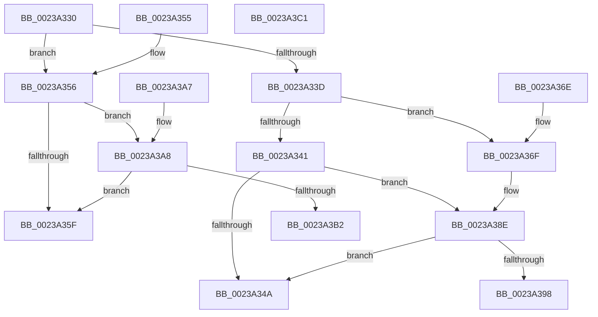

# ExReleaseSpinLockRegardlessFromDpcLevel

- RVA: `0x0023A330`–`0x0023A3C2` (길이 `146` bytes)
- VA: `0x000000014023A330`
- 실행 섹션: `.text`
- PDB 이름 있음: `예`; PDB Function 태그: `아니요`
- unwind 정보 RVA: `0x00060CE0`
- 디코드: `42`개 명령, `146/146` bytes 표시
- 미해석 바이트: `0` (있으면 어셈블리에 `.byte`로 보존)

> 이 문서는 커널 이미지의 기계어와 PDB 기호를 분석해 생성했습니다. 4번과 5번은 함수 원형과 자료형을 바이너리 사용 방식에서 추정한 C 해석이며 원본 소스 복구 결과는 아닙니다.

## 1. Dependencies

- 직접 호출 지점: **3**; 고유 호출 대상: **3**
- 직접 호출자로 확인된 함수: **10**
- RIP 상대 이미지 참조: **2**

### Outgoing calls
- `0x0023A388` → [KeBugCheckEx](../4F/KeBugCheckEx_function_004FD660.md) (function, `0x004FD660`)
- `0x0023A39D` → [ExpReleaseSpinLockExclusiveFromDpcLevelInstrumented](../2C/ExpReleaseSpinLockExclusiveFromDpcLevelInstrumented_function_002C0F44.md) (function, `0x002C0F44`)
- `0x0023A3B7` → [ExpReleaseSpinLockSharedFromDpcLevelInstrumented](../2F/ExpReleaseSpinLockSharedFromDpcLevelInstrumented_function_002F0F48.md) (function, `0x002F0F48`)

### Direct callers
- [MiUnlockWorkingSetOptimal](MiUnlockWorkingSetOptimal_function_00238DFC.md) at `0x00238EB1`
- [sub_0023A03C](Unknown_function_0023A03C.md) at `0x0023A0C2`
- [MiProbeAndLockPages](MiProbeAndLockPages_function_0023B4F0.md) at `0x0023B69C`
- [sub_0023B894](Unknown_function_0023B894.md) at `0x0023B8D4`
- [MiLockPageLeafPageTable](MiLockPageLeafPageTable_function_0023D160.md) at `0x0023D4D9`
- [sub_00275BEF](../27/Unknown_function_00275BEF.md) at `0x00275EC1`
- [MiDeleteVaDirect](../27/MiDeleteVaDirect_function_00277560.md) at `0x0027868F`
- [MiWalkPageTablesRecursively](../27/MiWalkPageTablesRecursively_function_002796C0.md) at `0x0027B367`
- [sub_0027BB85](../27/Unknown_function_0027BB85.md) at `0x0027BE69`
- [MiCaptureDeleteHierarchy](../27/MiCaptureDeleteHierarchy_function_0027F5F0.md) at `0x0027FC17`

### Static image references
- `0x0023A341` → RVA `0x00FC6B06` (`ALMOSTRO`; read)
- `0x0023A38E` → RVA `0x00F0DE58` (`.data`; read)

## 2. Other-region calls and transfers

- 다른 실행 섹션으로 향하는 call: **0**
- 별도 외부 분기/꼬리 이동을 확인하지 못했습니다.

## 3. Assembly (complete function range)

```asm
0023A330  48 83 EC 38                     sub rsp, 0x38
0023A334  8B 01                           mov eax, dword ptr [rcx]
0023A336  A9 FF FF FF 3F                  test eax, 0x3fffffff
0023A33B  75 19                           jne 0x14023a356
0023A33D  85 C0                           test eax, eax
0023A33F  79 2E                           jns 0x14023a36f
0023A341  F6 05 BE C7 D8 00 01            test byte ptr [rip + 0xd8c7be], 1
0023A348  75 44                           jne 0x14023a38e
0023A34A  C7 01 00 00 00 00               mov dword ptr [rcx], 0
0023A350  48 83 C4 38                     add rsp, 0x38
0023A354  C3                              ret
0023A355  CC                              int3
0023A356  F6 05 A9 C7 D8 00 01            test byte ptr [rip + 0xd8c7a9], 1
0023A35D  75 49                           jne 0x14023a3a8
0023A35F  F0 81 21 FF FF FF BF            lock and dword ptr [rcx], 0xbfffffff
0023A366  F0 FF 09                        lock dec dword ptr [rcx]
0023A369  48 83 C4 38                     add rsp, 0x38
0023A36D  C3                              ret
0023A36E  CC                              int3
0023A36F  45 33 C9                        xor r9d, r9d
0023A372  48 C7 44 24 20 00 00 00 00      mov qword ptr [rsp + 0x20], 0
0023A37B  48 8B D1                        mov rdx, rcx
0023A37E  41 B8 00 01 00 00               mov r8d, 0x100
0023A384  41 8D 49 10                     lea ecx, [r9 + 0x10]
0023A388  E8 D3 32 2C 00                  call 0x1404fd660
0023A38D  CC                              int3
0023A38E  8B 05 C4 3A CD 00               mov eax, dword ptr [rip + 0xcd3ac4]
0023A394  85 C0                           test eax, eax
0023A396  75 B2                           jne 0x14023a34a
0023A398  48 8B 54 24 38                  mov rdx, qword ptr [rsp + 0x38]
0023A39D  E8 A2 6B 08 00                  call 0x1402c0f44
0023A3A2  48 83 C4 38                     add rsp, 0x38
0023A3A6  C3                              ret
0023A3A7  CC                              int3
0023A3A8  8B 05 AA 3A CD 00               mov eax, dword ptr [rip + 0xcd3aaa]
0023A3AE  85 C0                           test eax, eax
0023A3B0  75 AD                           jne 0x14023a35f
0023A3B2  48 8B 54 24 38                  mov rdx, qword ptr [rsp + 0x38]
0023A3B7  E8 8C 6B 0B 00                  call 0x1402f0f48
0023A3BC  48 83 C4 38                     add rsp, 0x38
0023A3C0  C3                              ret
0023A3C1  CC                              int3
```

## 4. C-style interpretation (structured pseudocode)

```c
__int64 __fastcall ExReleaseSpinLockRegardlessFromDpcLevel(__int64 a1, __int64 a2, __int64 a3, int a4)
{
    __int64 result;
    __int64 v_rsp;
    unsigned __int64 v_stack_p58;
    unsigned __int64 v_stack_p70;
    unsigned __int64 v_stack_pA8;

    v_rsp = (v_rsp) - (56);
    if ((((unsigned int)((unsigned int)(*(unsigned int *)(a1)))) & (0x3FFFFFFFULL)) != 0) goto loc_0023A356;
    if (!sign_flag) goto loc_0023A36F;
    if (((*(unsigned __int8 *)(v_rip + 14206910)) & (1)) != 0) goto loc_0023A38E;
loc_0023A34A:
    *(unsigned int *)(a1) = 0;
    v_rsp = (v_rsp) + (56);
    return (unsigned int)(*(unsigned int *)(a1));
loc_0023A356:
    if (((*(unsigned __int8 *)(v_rip + 14206889)) & (1)) != 0) goto loc_0023A3A8;
loc_0023A35F:
    v_rsp = (v_rsp) + (56);
    return (unsigned int)(*(unsigned int *)(a1));
loc_0023A36F:
    a4 = 0;
    v_stack_p58 = 0;
    result = KeBugCheckEx(a4 + 16, a1, 256, a4);
loc_0023A38E:
    if ((unsigned int)((unsigned int)(*(unsigned int *)(v_rip + 13449924))) != 0) goto loc_0023A34A;
    result = ExpReleaseSpinLockExclusiveFromDpcLevelInstrumented(a4 + 16, v_stack_p70, 256, a4);
    v_rsp = (v_rsp) + (56);
    return result;
loc_0023A3A8:
    if ((unsigned int)((unsigned int)(*(unsigned int *)(v_rip + 13449898))) != 0) goto loc_0023A35F;
    result = ExpReleaseSpinLockSharedFromDpcLevelInstrumented(a4 + 16, v_stack_pA8, 256, a4);
    v_rsp = (v_rsp) + (56);
    return result;
}
```

## 5. (Beta) C Style

```c
int64_t ExReleaseSpinLockRegardlessFromDpcLevel(void *Arg1, int64_t Arg2, int64_t Arg3, int32_t Arg4)
{
    uint8_t *arg1 = (uint8_t *)Arg1;

    int64_t result;
    int64_t local_rsp;
    uint64_t v_stack_p58;
    uint64_t v_stack_p70;
    uint64_t v_stack_pA8;

    local_rsp = (local_rsp) - (56);
    if ((((uint32_t)((uint32_t)(*(uint32_t *)(arg1)))) & (0x3FFFFFFFULL)) != 0) goto loc_0023A356;
    if (!sign_flag) goto loc_0023A36F;
    if (((*(uint8_t *)(v_rip + 0xD8C7BE)) & (1)) != 0) goto loc_0023A38E;
loc_0023A34A:
    *(uint32_t *)(arg1) = 0;
    local_rsp = (local_rsp) + (56);
    return (uint32_t)(*(uint32_t *)(arg1));
loc_0023A356:
    if (((*(uint8_t *)(v_rip + 0xD8C7A9)) & (1)) != 0) goto loc_0023A3A8;
loc_0023A35F:
    local_rsp = (local_rsp) + (56);
    return (uint32_t)(*(uint32_t *)(arg1));
loc_0023A36F:
    Arg4 = 0;
    v_stack_p58 = 0;
    result = KeBugCheckEx(Arg4 + 16, Arg1, 256, Arg4);
loc_0023A38E:
    if ((uint32_t)((uint32_t)(*(uint32_t *)(v_rip + 0xCD3AC4))) != 0) goto loc_0023A34A;
    result = ExpReleaseSpinLockExclusiveFromDpcLevelInstrumented(Arg4 + 16, v_stack_p70, 256, Arg4);
    local_rsp = (local_rsp) + (56);
    return result;
loc_0023A3A8:
    if ((uint32_t)((uint32_t)(*(uint32_t *)(v_rip + 0xCD3AAA))) != 0) goto loc_0023A35F;
    result = ExpReleaseSpinLockSharedFromDpcLevelInstrumented(Arg4 + 16, v_stack_pA8, 256, Arg4);
    local_rsp = (local_rsp) + (56);
    return result;
}
```

### 관측된 메모리 오프셋

구조체 형식이 확인되지 않은 접근은 인자 기준의 오프셋으로만 기록했습니다.

| 기준 인자 | 오프셋 표현 | 폭 (bit) | 접근 |
|---|---:|---:|---|
| `Arg1` | `+ 0x0` | `32` | `R` |
| `Arg1` | `+ 0x0` | `32` | `R/W` |

## 6. Execution-region graph

[열기: 2D/3D 그래프와 함수 탐색 컨트롤 패널](../../../control-panel.html?section=text&rva=0x0023A330&view=graph)

- 2D 그래프는 위에서 아래로 흐르고, 3D 그래프는 빈 공간을 드래그해 회전합니다. Shift+드래그는 이동, 휠은 확대·축소, 함수 노드 선택은 대상 보고서 이동입니다.

### Static fallback


