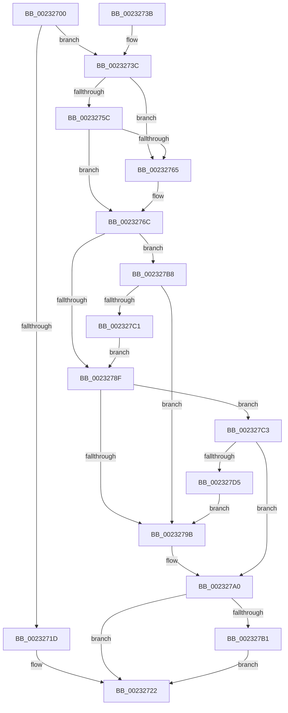

# ExpCancelTimer

- RVA: `0x00232700`–`0x002327D7` (길이 `215` bytes)
- VA: `0x0000000140232700`
- 실행 섹션: `.text`
- PDB 이름 있음: `예`; PDB Function 태그: `아니요`
- unwind 정보 RVA: `0x00060460`
- 디코드: `56`개 명령, `215/215` bytes 표시
- 미해석 바이트: `0` (있으면 어셈블리에 `.byte`로 보존)

> 이 문서는 커널 이미지의 기계어와 PDB 기호를 분석해 생성했습니다. 4번과 5번은 함수 원형과 자료형을 바이너리 사용 방식에서 추정한 C 해석이며 원본 소스 복구 결과는 아닙니다.

## 1. Dependencies

- 직접 호출 지점: **6**; 고유 호출 대상: **5**
- 직접 호출자로 확인된 함수: **2**
- RIP 상대 이미지 참조: **0**

### Outgoing calls
- `0x0023271D` → [KeCancelTimer](KeCancelTimer_function_002327E0.md) (function, `0x002327E0`)
- `0x00232747` → [KeAcquireSpinLockAtDpcLevel](../20/KeAcquireSpinLockAtDpcLevel_function_00208430.md) (function, `0x00208430`)
- `0x0023277A` → [KxReleaseSpinLock](../20/KxReleaseSpinLock_function_00206670.md) (function, `0x00206670`)
- `0x00232792` → [KeCancelTimer](KeCancelTimer_function_002327E0.md) (function, `0x002327E0`)
- `0x002327A4` → [KeRemoveQueueApc](../3C/KeRemoveQueueApc_function_003C4820.md) (function, `0x003C4820`)
- `0x002327CC` → [KeRemoveQueueDpcEx](../46/KeRemoveQueueDpcEx_function_0046CDC0.md) (function, `0x0046CDC0`)

### Direct callers
- [NtCancelTimer](NtCancelTimer_function_00230D90.md) at `0x00230E85`
- [ExTimerRundown](../39/ExTimerRundown_function_00391394.md) at `0x00391471`

### Static image references
- 디코드된 RIP-relative 메모리 참조가 없습니다.

## 2. Other-region calls and transfers

- 다른 실행 섹션으로 향하는 call: **0**
- 별도 외부 분기/꼬리 이동을 확인하지 못했습니다.

## 3. Assembly (complete function range)

```asm
00232700  48 89 5C 24 08                  mov qword ptr [rsp + 8], rbx
00232705  48 89 74 24 10                  mov qword ptr [rsp + 0x10], rsi
0023270A  57                              push rdi
0023270B  48 83 EC 20                     sub rsp, 0x20
0023270F  33 FF                           xor edi, edi
00232711  48 8B D9                        mov rbx, rcx
00232714  F6 81 30 01 00 00 01            test byte ptr [rcx + 0x130], 1
0023271B  75 1F                           jne 0x14023273c
0023271D  E8 BE 00 00 00                  call 0x1402327e0
00232722  48 8B 74 24 38                  mov rsi, qword ptr [rsp + 0x38]
00232727  8B C7                           mov eax, edi
00232729  C6 83 F8 00 00 00 00            mov byte ptr [rbx + 0xf8], 0
00232730  48 8B 5C 24 30                  mov rbx, qword ptr [rsp + 0x30]
00232735  48 83 C4 20                     add rsp, 0x20
00232739  5F                              pop rdi
0023273A  C3                              ret
0023273B  CC                              int3
0023273C  48 8B 71 50                     mov rsi, qword ptr [rcx + 0x50]
00232740  48 8D 8E F0 04 00 00            lea rcx, [rsi + 0x4f0]
00232747  E8 E4 5C FD FF                  call 0x140208430
0023274C  48 8D 83 E0 00 00 00            lea rax, [rbx + 0xe0]
00232753  4C 8B 00                        mov r8, qword ptr [rax]
00232756  49 39 40 08                     cmp qword ptr [r8 + 8], rax
0023275A  75 09                           jne 0x140232765
0023275C  48 8B 50 08                     mov rdx, qword ptr [rax + 8]
00232760  48 39 02                        cmp qword ptr [rdx], rax
00232763  74 07                           je 0x14023276c
00232765  B9 03 00 00 00                  mov ecx, 3
0023276A  CD 29                           int 0x29
0023276C  4C 89 02                        mov qword ptr [rdx], r8
0023276F  48 8D 8E F0 04 00 00            lea rcx, [rsi + 0x4f0]
00232776  49 89 50 08                     mov qword ptr [r8 + 8], rdx
0023277A  E8 F1 3E FD FF                  call 0x140206670
0023277F  80 A3 30 01 00 00 FE            and byte ptr [rbx + 0x130], 0xfe
00232786  F6 83 30 01 00 00 02            test byte ptr [rbx + 0x130], 2
0023278D  75 29                           jne 0x1402327b8
0023278F  48 8B CB                        mov rcx, rbx
00232792  E8 49 00 00 00                  call 0x1402327e0
00232797  84 C0                           test al, al
00232799  74 28                           je 0x1402327c3
0023279B  BF 01 00 00 00                  mov edi, 1
002327A0  48 8D 4B 48                     lea rcx, [rbx + 0x48]
002327A4  E8 77 20 19 00                  call 0x1403c4820
002327A9  84 C0                           test al, al
002327AB  0F 84 71 FF FF FF               je 0x140232722
002327B1  FF C7                           inc edi
002327B3  E9 6A FF FF FF                  jmp 0x140232722
002327B8  40 38 BB F8 00 00 00            cmp byte ptr [rbx + 0xf8], dil
002327BF  75 DA                           jne 0x14023279b
002327C1  EB CC                           jmp 0x14023278f
002327C3  48 8D 8B A0 00 00 00            lea rcx, [rbx + 0xa0]
002327CA  33 D2                           xor edx, edx
002327CC  E8 EF A5 23 00                  call 0x14046cdc0
002327D1  84 C0                           test al, al
002327D3  74 CB                           je 0x1402327a0
002327D5  EB C4                           jmp 0x14023279b
```

## 4. C-style interpretation (structured pseudocode)

```c
__int64 __fastcall ExpCancelTimer(__int64 a1)
{
    __int64 result;
    __int64 v_rdi;
    __int64 v_rsp;
    unsigned __int64 v_stack_p10;
    unsigned __int64 v_stack_p8;

    v_stack_p8 = v_rbx;
    v_stack_p10 = v_rsi;
    v_rsp = (v_rsp) - (32);
    v_rdi = 0;
    if (((*(unsigned __int8 *)(a1 + 304)) & (1)) != 0) goto loc_0023273C;
    result = KeCancelTimer(a1, a2, a3, a4);
loc_00232722:
    *(unsigned __int8 *)(a1 + 248) = 0;
    v_rsp = (v_rsp) + (32);
    return 0;
loc_0023273C:
    result = KeAcquireSpinLockAtDpcLevel(*(unsigned __int64 *)(a1 + 80) + 1264, a2, a3, a4);
    if ((*(unsigned __int64 *)(*(unsigned __int64 *)(v_stack_p8 + 224) + 8)) != (v_stack_p8 + 224)) goto loc_00232765;
    if ((*(unsigned __int64 *)(*(unsigned __int64 *)(v_stack_p8 + 224 + 8))) != (v_stack_p8 + 224)) {
        a1 = 3;
    }
    *(unsigned __int64 *)(*(unsigned __int64 *)(v_stack_p8 + 224 + 8)) = *(unsigned __int64 *)(v_stack_p8 + 224);
    *(unsigned __int64 *)(*(unsigned __int64 *)(v_stack_p8 + 224) + 8) = *(unsigned __int64 *)(v_stack_p8 + 224 + 8);
    result = KxReleaseSpinLock(*(unsigned __int64 *)(a1 + 80) + 1264, *(unsigned __int64 *)(v_stack_p8 + 224 + 8), *(unsigned __int64 *)(v_stack_p8 + 224), a4);
    if (((*(unsigned __int8 *)(v_stack_p8 + 304)) & (2)) != 0) goto loc_002327B8;
loc_0023278F:
    result = KeCancelTimer(v_stack_p8, *(unsigned __int64 *)(v_stack_p8 + 224 + 8), *(unsigned __int64 *)(v_stack_p8 + 224), a4);
    if ((unsigned __int8)(result) == 0) goto loc_002327C3;
loc_0023279B:
loc_002327A0:
    result = KeRemoveQueueApc(v_stack_p8 + 72, *(unsigned __int64 *)(v_stack_p8 + 224 + 8), *(unsigned __int64 *)(v_stack_p8 + 224), a4);
    if ((unsigned __int8)(result) == 0) goto loc_00232722;
    v_rdi = (unsigned int)((1) + 1);
    goto loc_00232722;
loc_002327B8:
    if ((*(unsigned __int8 *)(v_stack_p8 + 248)) != ((unsigned __int8)(v_rdi))) goto loc_0023279B;
    goto loc_0023278F;
loc_002327C3:
    a2 = 0;
    result = KeRemoveQueueDpcEx(v_stack_p8 + 160, a2, *(unsigned __int64 *)(v_stack_p8 + 224), a4);
    if ((unsigned __int8)(result) == 0) goto loc_002327A0;
    goto loc_0023279B;
}
```

## 5. (Beta) C Style

```c
int64_t ExpCancelTimer(void *Arg1)
{
    uint8_t *arg1 = (uint8_t *)Arg1;

    int64_t result;
    int64_t local_rdi;
    int64_t local_rsp;
    uint64_t v_stack_p10;
    uint64_t v_stack_p8;

    v_stack_p8 = local_rbx;
    v_stack_p10 = local_rsi;
    local_rsp = (local_rsp) - (32);
    local_rdi = 0;
    if (((*(uint8_t *)(arg1 + 0x130)) & (1)) != 0) goto loc_0023273C;
    result = KeCancelTimer(Arg1, a2, a3, a4);
loc_00232722:
    *(uint8_t *)(arg1 + 0xF8) = 0;
    local_rsp = (local_rsp) + (32);
    return 0;
loc_0023273C:
    result = KeAcquireSpinLockAtDpcLevel(*(uint64_t *)(arg1 + 0x50) + 1264, a2, a3, a4);
    if ((*(uint64_t *)(*(uint64_t *)(v_stack_p8 + 0xE0) + 0x8)) != (v_stack_p8 + 224)) goto loc_00232765;
    if ((*(uint64_t *)(*(uint64_t *)(v_stack_p8 + 0xE0 + 0x8))) != (v_stack_p8 + 224)) {
        Arg1 = 3;
    }
    *(uint64_t *)(*(uint64_t *)(v_stack_p8 + 0xE0 + 0x8)) = *(uint64_t *)(v_stack_p8 + 0xE0);
    *(uint64_t *)(*(uint64_t *)(v_stack_p8 + 0xE0) + 0x8) = *(uint64_t *)(v_stack_p8 + 0xE0 + 0x8);
    result = KxReleaseSpinLock(*(uint64_t *)(arg1 + 0x50) + 1264, *(uint64_t *)(v_stack_p8 + 0xE0 + 0x8), *(uint64_t *)(v_stack_p8 + 0xE0), a4);
    if (((*(uint8_t *)(v_stack_p8 + 0x130)) & (2)) != 0) goto loc_002327B8;
loc_0023278F:
    result = KeCancelTimer(v_stack_p8, *(uint64_t *)(v_stack_p8 + 0xE0 + 0x8), *(uint64_t *)(v_stack_p8 + 0xE0), a4);
    if ((uint8_t)(result) == 0) goto loc_002327C3;
loc_0023279B:
loc_002327A0:
    result = KeRemoveQueueApc(v_stack_p8 + 72, *(uint64_t *)(v_stack_p8 + 0xE0 + 0x8), *(uint64_t *)(v_stack_p8 + 0xE0), a4);
    if ((uint8_t)(result) == 0) goto loc_00232722;
    local_rdi = (uint32_t)((1) + 1);
    goto loc_00232722;
loc_002327B8:
    if ((*(uint8_t *)(v_stack_p8 + 0xF8)) != ((uint8_t)(local_rdi))) goto loc_0023279B;
    goto loc_0023278F;
loc_002327C3:
    a2 = 0;
    result = KeRemoveQueueDpcEx(v_stack_p8 + 160, a2, *(uint64_t *)(v_stack_p8 + 0xE0), a4);
    if ((uint8_t)(result) == 0) goto loc_002327A0;
    goto loc_0023279B;
}
```

### 관측된 메모리 오프셋

구조체 형식이 확인되지 않은 접근은 인자 기준의 오프셋으로만 기록했습니다.

| 기준 인자 | 오프셋 표현 | 폭 (bit) | 접근 |
|---|---:|---:|---|
| `Arg1` | `+ 0x0` | `64` | `R` |
| `Arg1` | `+ 0x8` | `64` | `R` |
| `Arg1` | `+ 0x48` | `64` | `R` |
| `Arg1` | `+ 0x50` | `64` | `R` |
| `Arg1` | `+ 0xA0` | `64` | `R` |
| `Arg1` | `+ 0xE0` | `64` | `R` |
| `Arg1` | `+ 0xF8` | `8` | `R` |
| `Arg1` | `+ 0xF8` | `8` | `W` |
| `Arg1` | `+ 0x130` | `8` | `R` |
| `Arg1` | `+ 0x130` | `8` | `R/W` |

## 6. Execution-region graph

[열기: 2D/3D 그래프와 함수 탐색 컨트롤 패널](../../../control-panel.html?section=text&rva=0x00232700&view=graph)

- 2D 그래프는 위에서 아래로 흐르고, 3D 그래프는 빈 공간을 드래그해 회전합니다. Shift+드래그는 이동, 휠은 확대·축소, 함수 노드 선택은 대상 보고서 이동입니다.

### Static fallback


