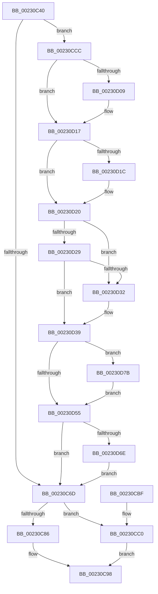

# ExpDeleteTimer

- RVA: `0x00230C40`–`0x00230D85` (길이 `325` bytes)
- VA: `0x0000000140230C40`
- 실행 섹션: `.text`
- PDB 이름 있음: `예`; PDB Function 태그: `아니요`
- unwind 정보 RVA: `0x0006031C`
- 디코드: `86`개 명령, `325/325` bytes 표시
- 미해석 바이트: `0` (있으면 어셈블리에 `.byte`로 보존)

> 이 문서는 커널 이미지의 기계어와 PDB 기호를 분석해 생성했습니다. 4번과 5번은 함수 원형과 자료형을 바이너리 사용 방식에서 추정한 C 해석이며 원본 소스 복구 결과는 아닙니다.

## 1. Dependencies

- 직접 호출 지점: **10**; 고유 호출 대상: **10**
- 직접 호출자로 확인된 함수: **0**
- RIP 상대 이미지 참조: **2**

### Outgoing calls
- `0x00230C74` → [KeAcquireSpinLockRaiseToDpc](../20/KeAcquireSpinLockRaiseToDpc_function_00208470.md) (function, `0x00208470`)
- `0x00230C93` → [PsRemoveVirtualizedTimer](PsRemoveVirtualizedTimer_function_00230B5C.md) (function, `0x00230B5C`)
- `0x00230C9B` → [KeCancelTimer](KeCancelTimer_function_002327E0.md) (function, `0x002327E0`)
- `0x00230CC5` → [KeReleaseSpinLock](../39/KeReleaseSpinLock_function_00392BA0.md) (function, `0x00392BA0`)
- `0x00230CF8` → [KeAbPreAcquire](../21/KeAbPreAcquire_function_00210230.md) (function, `0x00210230`)
- `0x00230D12` → [ExfAcquirePushLockExclusiveEx](../20/ExfAcquirePushLockExclusiveEx_function_0020FC90.md) (function, `0x0020FC90`)
- `0x00230D58` → [KeAbPostRelease](../2E/KeAbPostRelease_function_002E1600.md) (function, `0x002E1600`)
- `0x00230D60` → [KiLeaveCriticalRegionUnsafe](../25/KiLeaveCriticalRegionUnsafe_function_0025F010.md) (function, `0x0025F010`)
- `0x00230D71` → [PoDestroyReasonContext](PoDestroyReasonContext_function_00230944.md) (function, `0x00230944`)
- `0x00230D7E` → [ExfTryToWakePushLock](../26/ExfTryToWakePushLock_function_00265DD0.md) (function, `0x00265DD0`)

### Direct callers
- 이 함수 시작 RVA로 연결되는 직접 call은 확인되지 않았습니다. 간접 호출은 완전히 역산할 수 없습니다.

### Static image references
- `0x00230CD3` → RVA `0x00EFABA8` (`.data`; read)
- `0x00230D44` → RVA `0x00EFABA8` (`.data`; read/write)

## 2. Other-region calls and transfers

- 다른 실행 섹션으로 향하는 call: **0**
- 별도 외부 분기/꼬리 이동을 확인하지 못했습니다.

## 3. Assembly (complete function range)

```asm
00230C40  48 8B C4                        mov rax, rsp
00230C43  48 89 58 08                     mov qword ptr [rax + 8], rbx
00230C47  48 89 68 10                     mov qword ptr [rax + 0x10], rbp
00230C4B  48 89 70 18                     mov qword ptr [rax + 0x18], rsi
00230C4F  48 89 78 20                     mov qword ptr [rax + 0x20], rdi
00230C53  41 55                           push r13
00230C55  41 56                           push r14
00230C57  41 57                           push r15
00230C59  48 83 EC 20                     sub rsp, 0x20
00230C5D  48 8D B1 08 01 00 00            lea rsi, [rcx + 0x108]
00230C64  48 8B F9                        mov rdi, rcx
00230C67  48 83 3E 00                     cmp qword ptr [rsi], 0
00230C6B  75 5F                           jne 0x140230ccc
00230C6D  48 8D 5F 40                     lea rbx, [rdi + 0x40]
00230C71  48 8B CB                        mov rcx, rbx
00230C74  E8 F7 77 FD FF                  call 0x140208470
00230C79  48 8D 8F 18 01 00 00            lea rcx, [rdi + 0x118]
00230C80  48 83 39 00                     cmp qword ptr [rcx], 0
00230C84  74 3A                           je 0x140230cc0
00230C86  48 8D 97 20 01 00 00            lea rdx, [rdi + 0x120]
00230C8D  44 8A C8                        mov r9b, al
00230C90  4C 8B C3                        mov r8, rbx
00230C93  E8 C4 FE FF FF                  call 0x140230b5c
00230C98  48 8B CF                        mov rcx, rdi
00230C9B  E8 40 1B 00 00                  call 0x1402327e0
00230CA0  48 8B 5C 24 40                  mov rbx, qword ptr [rsp + 0x40]
00230CA5  48 8B 6C 24 48                  mov rbp, qword ptr [rsp + 0x48]
00230CAA  48 8B 74 24 50                  mov rsi, qword ptr [rsp + 0x50]
00230CAF  48 8B 7C 24 58                  mov rdi, qword ptr [rsp + 0x58]
00230CB4  48 83 C4 20                     add rsp, 0x20
00230CB8  41 5F                           pop r15
00230CBA  41 5E                           pop r14
00230CBC  41 5D                           pop r13
00230CBE  C3                              ret
00230CBF  CC                              int3
00230CC0  8A D0                           mov dl, al
00230CC2  48 8B CB                        mov rcx, rbx
00230CC5  E8 D6 1E 16 00                  call 0x140392ba0
00230CCA  EB CC                           jmp 0x140230c98
00230CCC  4C 8B B1 00 01 00 00            mov r14, qword ptr [rcx + 0x100]
00230CD3  4C 8D 2D CE 9E CC 00            lea r13, [rip + 0xcc9ece]
00230CDA  65 4C 8B 3C 25 88 01 00 00      mov r15, qword ptr gs:[0x188]
00230CE3  48 83 CB FF                     or rbx, 0xffffffffffffffff
00230CE7  45 33 C0                        xor r8d, r8d
00230CEA  33 D2                           xor edx, edx
00230CEC  49 8B CD                        mov rcx, r13
00230CEF  66 41 01 9F E4 01 00 00         add word ptr [r15 + 0x1e4], bx
00230CF7  90                              nop
00230CF8  E8 33 F5 FD FF                  call 0x140210230
00230CFD  F0 49 0F BA 6D 00 00            lock bts qword ptr [r13], 0
00230D04  48 8B E8                        mov rbp, rax
00230D07  73 0E                           jae 0x140230d17
00230D09  4D 8B C5                        mov r8, r13
00230D0C  48 8B D0                        mov rdx, rax
00230D0F  49 8B CD                        mov rcx, r13
00230D12  E8 79 EF FD FF                  call 0x14020fc90
00230D17  48 85 ED                        test rbp, rbp
00230D1A  74 04                           je 0x140230d20
00230D1C  C6 45 0A 01                     mov byte ptr [rbp + 0xa], 1
00230D20  48 8B 16                        mov rdx, qword ptr [rsi]
00230D23  48 39 72 08                     cmp qword ptr [rdx + 8], rsi
00230D27  75 09                           jne 0x140230d32
00230D29  48 8B 46 08                     mov rax, qword ptr [rsi + 8]
00230D2D  48 39 30                        cmp qword ptr [rax], rsi
00230D30  74 07                           je 0x140230d39
00230D32  B9 03 00 00 00                  mov ecx, 3
00230D37  CD 29                           int 0x29
00230D39  48 89 10                        mov qword ptr [rax], rdx
00230D3C  48 89 42 08                     mov qword ptr [rdx + 8], rax
00230D40  48 83 26 00                     and qword ptr [rsi], 0
00230D44  F0 48 0F C1 1D 5B 9E CC 00      lock xadd qword ptr [rip + 0xcc9e5b], rbx
00230D4D  80 E3 06                        and bl, 6
00230D50  80 FB 02                        cmp bl, 2
00230D53  74 26                           je 0x140230d7b
00230D55  49 8B CD                        mov rcx, r13
00230D58  E8 A3 08 0B 00                  call 0x1402e1600
00230D5D  49 8B CF                        mov rcx, r15
00230D60  E8 AB E2 02 00                  call 0x14025f010
00230D65  4D 85 F6                        test r14, r14
00230D68  0F 84 FF FE FF FF               je 0x140230c6d
00230D6E  49 8B CE                        mov rcx, r14
00230D71  E8 CE FB FF FF                  call 0x140230944
00230D76  E9 F2 FE FF FF                  jmp 0x140230c6d
00230D7B  49 8B CD                        mov rcx, r13
00230D7E  E8 4D 50 03 00                  call 0x140265dd0
00230D83  EB D0                           jmp 0x140230d55
```

## 4. C-style interpretation (structured pseudocode)

```c
__int64 __fastcall ExpDeleteTimer(__int64 a1)
{
    __int64 result;
    __int64 v_rbx;
    __int64 v_rsp;
    unsigned __int64 v_stack_p10;
    unsigned __int64 v_stack_p18;
    unsigned __int64 v_stack_p20;
    unsigned __int64 v_stack_p8;

    *(unsigned __int64 *)(v_rsp + 8) = v_rbx;
    *(unsigned __int64 *)(v_rsp + 16) = v_rbp;
    *(unsigned __int64 *)(v_rsp + 24) = v_rsi;
    *(unsigned __int64 *)(v_rsp + 32) = v_rdi;
    v_rsp = (v_rsp) - (32);
    if ((*(unsigned __int64 *)(a1 + 264)) != 0) goto loc_00230CCC;
loc_00230C6D:
    result = KeAcquireSpinLockRaiseToDpc(a1 + 64, a2, a3, a4);
    if ((*(unsigned __int64 *)(a1 + 280)) == 0) goto loc_00230CC0;
    result = PsRemoveVirtualizedTimer(a1 + 280, a1 + 288, a1 + 64, (unsigned __int8)(result));
loc_00230C98:
    result = KeCancelTimer(a1, a1 + 288, a1 + 64, (unsigned __int8)(result));
    v_rsp = (v_rsp) + (32);
    return result;
loc_00230CC0:
    result = KeReleaseSpinLock(v_stack_p8, (unsigned __int8)(result), a1 + 64, (unsigned __int8)(result));
    goto loc_00230C98;
loc_00230CCC:
    v_rbx = (v_stack_p8) | (-1);
    a3 = 0;
    a2 = 0;
    result = KeAbPreAcquire(v_rip + 13409998, a2, a3, (unsigned __int8)(result));
    if (!(condition_is_above_or_equal)) {
        a3 = v_rip + 13409998;
        a2 = result;
        a1 = v_rip + 13409998;
        result = ExfAcquirePushLockExclusiveEx(a1, a2, a3, (unsigned __int8)(result));
    }
    if (result != 0) {
        *(unsigned __int8 *)(result + 10) = 1;
    }
    if ((*(unsigned __int64 *)(*(unsigned __int64 *)(v_stack_p18) + 8)) != v_stack_p18) goto loc_00230D32;
    if ((*(unsigned __int64 *)(*(unsigned __int64 *)(v_stack_p18 + 8))) != v_stack_p18) {
        a1 = 3;
    }
    *(unsigned __int64 *)(*(unsigned __int64 *)(v_stack_p18 + 8)) = *(unsigned __int64 *)(v_stack_p18);
    *(unsigned __int64 *)(*(unsigned __int64 *)(v_stack_p18) + 8) = *(unsigned __int64 *)(v_stack_p18 + 8);
    v_rbx = (unsigned __int8)((v_rbx) & (6));
    if (((unsigned __int8)(v_rbx)) == 2) goto loc_00230D7B;
loc_00230D55:
    result = KeAbPostRelease(v_rip + 13409998, *(unsigned __int64 *)(v_stack_p18), a3, (unsigned __int8)(result));
    result = KiLeaveCriticalRegionUnsafe(*(unsigned __int64 *)(gs_base + (0 + 392)), *(unsigned __int64 *)(v_stack_p18), a3, (unsigned __int8)(result));
    if (*(unsigned __int64 *)(v_stack_p8 + 256) == 0) goto loc_00230C6D;
    result = PoDestroyReasonContext(*(unsigned __int64 *)(v_stack_p8 + 256), *(unsigned __int64 *)(v_stack_p18), a3, (unsigned __int8)(result));
    goto loc_00230C6D;
loc_00230D7B:
    result = ExfTryToWakePushLock(v_rip + 13409998, *(unsigned __int64 *)(v_stack_p18), a3, (unsigned __int8)(result));
    goto loc_00230D55;
}
```

## 5. (Beta) C Style

```c
int64_t ExpDeleteTimer(void *Arg1)
{
    uint8_t *arg1 = (uint8_t *)Arg1;

    int64_t result;
    int64_t local_rbx;
    int64_t local_rsp;
    uint64_t v_stack_p10;
    uint64_t v_stack_p18;
    uint64_t v_stack_p20;
    uint64_t v_stack_p8;

    *(uint64_t *)(local_rsp + 0x8) = local_rbx;
    *(uint64_t *)(local_rsp + 0x10) = local_rbp;
    *(uint64_t *)(local_rsp + 0x18) = local_rsi;
    *(uint64_t *)(local_rsp + 0x20) = local_rdi;
    local_rsp = (local_rsp) - (32);
    if ((*(uint64_t *)(arg1 + 0x108)) != 0) goto loc_00230CCC;
loc_00230C6D:
    result = KeAcquireSpinLockRaiseToDpc(Arg1 + 64, a2, a3, a4);
    if ((*(uint64_t *)(arg1 + 0x118)) == 0) goto loc_00230CC0;
    result = PsRemoveVirtualizedTimer(Arg1 + 280, Arg1 + 288, Arg1 + 64, (uint8_t)(result));
loc_00230C98:
    result = KeCancelTimer(Arg1, Arg1 + 288, Arg1 + 64, (uint8_t)(result));
    local_rsp = (local_rsp) + (32);
    return result;
loc_00230CC0:
    result = KeReleaseSpinLock(v_stack_p8, (uint8_t)(result), Arg1 + 64, (uint8_t)(result));
    goto loc_00230C98;
loc_00230CCC:
    local_rbx = (v_stack_p8) | (-1);
    a3 = 0;
    a2 = 0;
    result = KeAbPreAcquire(v_rip + 13409998, a2, a3, (uint8_t)(result));
    if (!(condition_is_above_or_equal)) {
        a3 = v_rip + 13409998;
        a2 = result;
        Arg1 = v_rip + 13409998;
        result = ExfAcquirePushLockExclusiveEx(Arg1, a2, a3, (uint8_t)(result));
    }
    if (result != 0) {
        *(uint8_t *)(result + 0xA) = 1;
    }
    if ((*(uint64_t *)(*(uint64_t *)(v_stack_p18) + 0x8)) != v_stack_p18) goto loc_00230D32;
    if ((*(uint64_t *)(*(uint64_t *)(v_stack_p18 + 0x8))) != v_stack_p18) {
        Arg1 = 3;
    }
    *(uint64_t *)(*(uint64_t *)(v_stack_p18 + 0x8)) = *(uint64_t *)(v_stack_p18);
    *(uint64_t *)(*(uint64_t *)(v_stack_p18) + 0x8) = *(uint64_t *)(v_stack_p18 + 0x8);
    local_rbx = (uint8_t)((local_rbx) & (6));
    if (((uint8_t)(local_rbx)) == 2) goto loc_00230D7B;
loc_00230D55:
    result = KeAbPostRelease(v_rip + 13409998, *(uint64_t *)(v_stack_p18), a3, (uint8_t)(result));
    result = KiLeaveCriticalRegionUnsafe(*(uint64_t *)(gs_base + (0 + 0x188)), *(uint64_t *)(v_stack_p18), a3, (uint8_t)(result));
    if (*(uint64_t *)(v_stack_p8 + 0x100) == 0) goto loc_00230C6D;
    result = PoDestroyReasonContext(*(uint64_t *)(v_stack_p8 + 0x100), *(uint64_t *)(v_stack_p18), a3, (uint8_t)(result));
    goto loc_00230C6D;
loc_00230D7B:
    result = ExfTryToWakePushLock(v_rip + 13409998, *(uint64_t *)(v_stack_p18), a3, (uint8_t)(result));
    goto loc_00230D55;
}
```

### 관측된 메모리 오프셋

구조체 형식이 확인되지 않은 접근은 인자 기준의 오프셋으로만 기록했습니다.

| 기준 인자 | 오프셋 표현 | 폭 (bit) | 접근 |
|---|---:|---:|---|
| `Arg1` | `+ 0x0` | `64` | `R` |
| `Arg1` | `+ 0x0` | `64` | `R/W` |
| `Arg1` | `+ 0x8` | `64` | `R` |
| `Arg1` | `+ 0x40` | `64` | `R` |
| `Arg1` | `+ 0x100` | `64` | `R` |
| `Arg1` | `+ 0x108` | `64` | `R` |
| `Arg1` | `+ 0x118` | `64` | `R` |
| `Arg1` | `+ 0x120` | `64` | `R` |

## 6. Execution-region graph

[열기: 2D/3D 그래프와 함수 탐색 컨트롤 패널](../../../control-panel.html?section=text&rva=0x00230C40&view=graph)

- 2D 그래프는 위에서 아래로 흐르고, 3D 그래프는 빈 공간을 드래그해 회전합니다. Shift+드래그는 이동, 휠은 확대·축소, 함수 노드 선택은 대상 보고서 이동입니다.

### Static fallback


