# ExpUpdateTimerConfigurationWorker

- RVA: `0x00235410`–`0x0023566A` (길이 `602` bytes)
- VA: `0x0000000140235410`
- 실행 섹션: `.text`
- PDB 이름 있음: `예`; PDB Function 태그: `아니요`
- unwind 정보 RVA: `0x0006069C`
- 디코드: `144`개 명령, `602/602` bytes 표시
- 미해석 바이트: `0` (있으면 어셈블리에 `.byte`로 보존)

> 이 문서는 커널 이미지의 기계어와 PDB 기호를 분석해 생성했습니다. 4번과 5번은 함수 원형과 자료형을 바이너리 사용 방식에서 추정한 C 해석이며 원본 소스 복구 결과는 아닙니다.

## 1. Dependencies

- 직접 호출 지점: **14**; 고유 호출 대상: **13**
- 직접 호출자로 확인된 함수: **1**
- RIP 상대 이미지 참조: **18**

### Outgoing calls
- `0x0023542C` → [KeAcquireSpinLockRaiseToDpc](../20/KeAcquireSpinLockRaiseToDpc_function_00208470.md) (function, `0x00208470`)
- `0x0023547D` → [RtlRbRemoveNode](../2E/RtlRbRemoveNode_function_002E4C10.md) (function, `0x002E4C10`)
- `0x002354F1` → [RtlRbInsertNodeEx](../2E/RtlRbInsertNodeEx_function_002E4570.md) (function, `0x002E4570`)
- `0x00235522` → [RtlGetInterruptTimePrecise](../20/RtlGetInterruptTimePrecise_function_0020A4C0.md) (function, `0x0020A4C0`)
- `0x00235539` → [KiSetClockTimerKTimerDeadlines](KiSetClockTimerKTimerDeadlines_function_0023671C.md) (function, `0x0023671C`)
- `0x00235543` → [KiSetNextClockTickDueTime](KiSetNextClockTickDueTime_function_002363F0.md) (function, `0x002363F0`)
- `0x0023555E` → [KiSendClockInterruptToTargetProcessor](KiSendClockInterruptToTargetProcessor_function_00234700.md) (function, `0x00234700`)
- `0x0023558E` → [KiLowerIrqlProcessIrqlFlags](../4F/KiLowerIrqlProcessIrqlFlags_function_004F5698.md) (function, `0x004F5698`)
- `0x002355A3` → [KeSetTimeAdjustment](KeSetTimeAdjustment_function_00235670.md) (function, `0x00235670`)
- `0x002355CC` → [KiLowerIrqlProcessIrqlFlags](../4F/KiLowerIrqlProcessIrqlFlags_function_004F5698.md) (function, `0x004F5698`)
- `0x002355FA` → [KiSetClockIntervalToMinimumRequested](../39/KiSetClockIntervalToMinimumRequested_function_0039DF1C.md) (function, `0x0039DF1C`)
- `0x00235607` → [KiRaiseIrqlProcessIrqlFlags](../4F/KiRaiseIrqlProcessIrqlFlags_function_004F56FC.md) (function, `0x004F56FC`)
- `0x0023564A` → [KiReleaseSpinLockInstrumented](../39/KiReleaseSpinLockInstrumented_function_00392EF0.md) (function, `0x00392EF0`)
- `0x00235660` → [PoTraceSystemTimerResolutionKernel](../2F/PoTraceSystemTimerResolutionKernel_function_002FD154.md) (function, `0x002FD154`)

### Direct callers
- [KeGenericProcessorCallback](../39/KeGenericProcessorCallback_function_00398C2C.md) at `0x00398D9C`

### Static image references
- `0x00235422` → RVA `0x00EFEE50` (`.data`; read)
- `0x00235442` → RVA `0x00FC6D20` (`ALMOSTRO`; read)
- `0x0023545D` → RVA `0x00EFEE98` (`.data`; read)
- `0x00235464` → RVA `0x00E668D8` (`.data`; read)
- `0x0023546B` → RVA `0x00E0EB94` (`.data`; read)
- `0x00235473` → RVA `0x00EFEE80` (`.data`; read)
- `0x00235482` → RVA `0x00E668E0` (`.data`; read)
- `0x00235489` → RVA `0x00EFEE9C` (`.data`; write)
- `0x002354F6` → RVA `0x00FC6A85` (`ALMOSTRO`; read)
- `0x002354FD` → RVA `0x00EFEE98` (`.data`; write)
- `0x00235504` → RVA `0x00FC6BB8` (`ALMOSTRO`; write)
- `0x00235510` → RVA `0x00FC6AA5` (`ALMOSTRO`; read)
- `0x00235548` → RVA `0x00EFEEA0` (`.data`; read)
- `0x00235558` → RVA `0x00F21FB0` (`.data`; read)
- `0x00235568` → RVA `0x00FC6B06` (`ALMOSTRO`; read)
- `0x00235575` → RVA `0x00EFEE50` (`.data`; read/write)
- `0x002355B6` → RVA `0x00FC5017` (`ALMOSTRO`; write)
- `0x00235630` → RVA `0x00F0DE58` (`.data`; read)

## 2. Other-region calls and transfers

- 다른 실행 섹션으로 향하는 call: **0**
- 별도 외부 분기/꼬리 이동을 확인하지 못했습니다.

## 3. Assembly (complete function range)

```asm
00235410  48 89 5C 24 08                  mov qword ptr [rsp + 8], rbx
00235415  48 89 6C 24 18                  mov qword ptr [rsp + 0x18], rbp
0023541A  56                              push rsi
0023541B  57                              push rdi
0023541C  41 57                           push r15
0023541E  48 83 EC 20                     sub rsp, 0x20
00235422  48 8D 0D 27 9A CC 00            lea rcx, [rip + 0xcc9a27]
00235429  48 8B DA                        mov rbx, rdx
0023542C  E8 3F 30 FD FF                  call 0x140208470
00235431  0F B6 E8                        movzx ebp, al
00235434  44 0F 20 C1                     mov rcx, cr8
00235438  41 BF 0F 00 00 00               mov r15d, 0xf
0023543E  45 0F 22 C7                     mov cr8, r15
00235442  83 3D D7 18 D9 00 00            cmp dword ptr [rip + 0xd918d7], 0
00235449  0F 85 B5 01 00 00               jne 0x140235604
0023544F  83 63 18 00                     and dword ptr [rbx + 0x18], 0
00235453  48 83 3B 00                     cmp qword ptr [rbx], 0
00235457  0F 84 0B 01 00 00               je 0x140235568
0023545D  80 3D 34 9A CC 00 00            cmp byte ptr [rip + 0xcc9a34], 0
00235464  48 8D 3D 6D 14 C3 00            lea rdi, [rip + 0xc3146d]
0023546B  8B 35 23 97 BD 00               mov esi, dword ptr [rip + 0xbd9723]
00235471  74 0F                           je 0x140235482
00235473  48 8D 15 06 9A CC 00            lea rdx, [rip + 0xcc9a06]
0023547A  48 8B CF                        mov rcx, rdi
0023547D  E8 8E F7 0A 00                  call 0x1402e4c10
00235482  48 8B 0D 57 14 C3 00            mov rcx, qword ptr [rip + 0xc31457]
00235489  89 35 0D 9A CC 00               mov dword ptr [rip + 0xcc9a0d], esi
0023548F  F6 C1 01                        test cl, 1
00235492  0F 85 79 01 00 00               jne 0x140235611
00235498  48 8B 15 39 14 C3 00            mov rdx, qword ptr [rip + 0xc31439]
0023549F  44 0F B6 C9                     movzx r9d, cl
002354A3  45 32 C0                        xor r8b, r8b
002354A6  41 83 E1 01                     and r9d, 1
002354AA  48 85 D2                        test rdx, rdx
002354AD  74 38                           je 0x1402354e7
002354AF  3B 72 1C                        cmp esi, dword ptr [rdx + 0x1c]
002354B2  73 1A                           jae 0x1402354ce
002354B4  48 8B 02                        mov rax, qword ptr [rdx]
002354B7  45 85 C9                        test r9d, r9d
002354BA  74 08                           je 0x1402354c4
002354BC  48 85 C0                        test rax, rax
002354BF  74 26                           je 0x1402354e7
002354C1  48 33 C2                        xor rax, rdx
002354C4  48 85 C0                        test rax, rax
002354C7  74 1E                           je 0x1402354e7
002354C9  48 8B D0                        mov rdx, rax
002354CC  EB E1                           jmp 0x1402354af
002354CE  48 8B 42 08                     mov rax, qword ptr [rdx + 8]
002354D2  45 85 C9                        test r9d, r9d
002354D5  0F 84 11 01 00 00               je 0x1402355ec
002354DB  48 85 C0                        test rax, rax
002354DE  0F 85 05 01 00 00               jne 0x1402355e9
002354E4  41 B0 01                        mov r8b, 1
002354E7  4C 8D 0D 92 99 CC 00            lea r9, [rip + 0xcc9992]
002354EE  48 8B CF                        mov rcx, rdi
002354F1  E8 7A F0 0A 00                  call 0x1402e4570
002354F6  80 3D 88 15 D9 00 00            cmp byte ptr [rip + 0xd91588], 0
002354FD  C6 05 94 99 CC 00 01            mov byte ptr [rip + 0xcc9994], 1
00235504  89 35 AE 16 D9 00               mov dword ptr [rip + 0xd916ae], esi
0023550A  0F 84 EA 00 00 00               je 0x1402355fa
00235510  80 3D 8E 15 D9 00 00            cmp byte ptr [rip + 0xd9158e], 0
00235517  0F 84 37 01 00 00               je 0x140235654
0023551D  48 8D 4C 24 48                  lea rcx, [rsp + 0x48]
00235522  E8 99 4F FD FF                  call 0x14020a4c0
00235527  48 8B F8                        mov rdi, rax
0023552A  65 48 8B 0C 25 20 00 00 00      mov rcx, qword ptr gs:[0x20]
00235533  45 33 C0                        xor r8d, r8d
00235536  48 8B D7                        mov rdx, rdi
00235539  E8 DE 11 00 00                  call 0x14023671c
0023553E  B2 01                           mov dl, 1
00235540  48 8B CF                        mov rcx, rdi
00235543  E8 A8 0E 00 00                  call 0x1402363f0
00235548  8B 15 52 99 CC 00               mov edx, dword ptr [rip + 0xcc9952]
0023554E  8B F8                           mov edi, eax
00235550  85 D2                           test edx, edx
00235552  0F 85 03 01 00 00               jne 0x14023565b
00235558  8B 0D 52 CA CE 00               mov ecx, dword ptr [rip + 0xceca52]
0023555E  E8 9D F1 FF FF                  call 0x140234700
00235563  48 8B 03                        mov rax, qword ptr [rbx]
00235566  89 38                           mov dword ptr [rax], edi
00235568  F6 05 97 15 D9 00 01            test byte ptr [rip + 0xd91597], 1
0023556F  0F 85 BB 00 00 00               jne 0x140235630
00235575  F0 48 83 25 D2 98 CC 00 00      lock and qword ptr [rip + 0xcc98d2], 0
0023557E  83 3D 9B 17 D9 00 00            cmp dword ptr [rip + 0xd9179b], 0
00235585  74 0C                           je 0x140235593
00235587  44 0F 20 C1                     mov rcx, cr8
0023558B  41 8A D7                        mov dl, r15b
0023558E  E8 05 01 2C 00                  call 0x1404f5698
00235593  45 0F 22 C7                     mov cr8, r15
00235597  48 8B 4B 08                     mov rcx, qword ptr [rbx + 8]
0023559B  48 85 C9                        test rcx, rcx
0023559E  74 0B                           je 0x1402355ab
002355A0  48 8B 09                        mov rcx, qword ptr [rcx]
002355A3  E8 C8 00 00 00                  call 0x140235670
002355A8  89 43 18                        mov dword ptr [rbx + 0x18], eax
002355AB  48 8B 43 10                     mov rax, qword ptr [rbx + 0x10]
002355AF  48 85 C0                        test rax, rax
002355B2  74 08                           je 0x1402355bc
002355B4  8A 00                           mov al, byte ptr [rax]
002355B6  88 05 5B FA D8 00               mov byte ptr [rip + 0xd8fa5b], al
002355BC  83 3D 5D 17 D9 00 00            cmp dword ptr [rip + 0xd9175d], 0
002355C3  74 0C                           je 0x1402355d1
002355C5  44 0F 20 C1                     mov rcx, cr8
002355C9  40 8A D5                        mov dl, bpl
002355CC  E8 C7 00 2C 00                  call 0x1404f5698
002355D1  44 0F 22 C5                     mov cr8, rbp
002355D5  48 8B 5C 24 40                  mov rbx, qword ptr [rsp + 0x40]
002355DA  48 8B 6C 24 50                  mov rbp, qword ptr [rsp + 0x50]
002355DF  48 83 C4 20                     add rsp, 0x20
002355E3  41 5F                           pop r15
002355E5  5F                              pop rdi
002355E6  5E                              pop rsi
002355E7  C3                              ret
002355E8  CC                              int3
002355E9  48 33 C2                        xor rax, rdx
002355EC  48 85 C0                        test rax, rax
002355EF  0F 85 D4 FE FF FF               jne 0x1402354c9
002355F5  E9 EA FE FF FF                  jmp 0x1402354e4
002355FA  E8 1D 89 16 00                  call 0x14039df1c
002355FF  E9 44 FF FF FF                  jmp 0x140235548
00235604  41 8A D7                        mov dl, r15b
00235607  E8 F0 00 2C 00                  call 0x1404f56fc
0023560C  E9 3E FE FF FF                  jmp 0x14023544f
00235611  48 8B 05 C0 12 C3 00            mov rax, qword ptr [rip + 0xc312c0]
00235618  48 85 C0                        test rax, rax
0023561B  74 0B                           je 0x140235628
0023561D  48 8B D7                        mov rdx, rdi
00235620  48 33 D0                        xor rdx, rax
00235623  E9 77 FE FF FF                  jmp 0x14023549f
00235628  48 8B D0                        mov rdx, rax
0023562B  E9 6F FE FF FF                  jmp 0x14023549f
00235630  8B 05 22 88 CD 00               mov eax, dword ptr [rip + 0xcd8822]
00235636  85 C0                           test eax, eax
00235638  0F 85 37 FF FF FF               jne 0x140235575
0023563E  48 8B 54 24 38                  mov rdx, qword ptr [rsp + 0x38]
00235643  48 8D 0D 06 98 CC 00            lea rcx, [rip + 0xcc9806]
0023564A  E8 A1 D8 15 00                  call 0x140392ef0
0023564F  E9 2A FF FF FF                  jmp 0x14023557e
00235654  33 FF                           xor edi, edi
00235656  E9 CF FE FF FF                  jmp 0x14023552a
0023565B  41 B0 01                        mov r8b, 1
0023565E  8B CE                           mov ecx, esi
00235660  E8 EF 7A 0C 00                  call 0x1402fd154
00235665  E9 EE FE FF FF                  jmp 0x140235558
```

## 4. C-style interpretation (structured pseudocode)

```c
__int64 __fastcall ExpUpdateTimerConfigurationWorker(__int64 a1, __int64 a2, unsigned __int8 a3)
{
    __int64 result;
    __int64 v_rdi;
    __int64 v_rsp;
    unsigned __int64 v_stack_p10;
    unsigned __int64 v_stack_p18;
    unsigned __int64 v_stack_p38;
    unsigned __int64 v_stack_p8;

    v_stack_p8 = v_rbx;
    v_stack_p18 = v_rbp;
    v_rsp = (v_rsp) - (32);
    result = KeAcquireSpinLockRaiseToDpc(v_rip + 13408807, a2, a3, a4);
    if ((*(unsigned int *)(v_rip + 14227671)) != 0) goto loc_00235604;
loc_0023544F:
    if ((*(unsigned __int64 *)(a2)) == 0) goto loc_00235568;
    if ((*(unsigned __int8 *)(v_rip + 13408820)) != 0) {
        a2 = v_rip + 13408774;
        a1 = v_rip + 12784749;
        result = RtlRbRemoveNode(a1, a2, a3, a4);
    }
    *(unsigned int *)(v_rip + 13408781) = (unsigned int)((unsigned int)(*(unsigned int *)(v_rip + 12424995)));
    if ((((unsigned __int8)(*(unsigned __int64 *)(v_rip + 12784727))) & (1)) != 0) goto loc_00235611;
loc_0023549F:
    a3 = 0;
    a4 = (unsigned int)(((unsigned __int8)(*(unsigned __int64 *)(v_rip + 12784727))) & (1));
    if (*(unsigned __int64 *)(v_rip + 12784697) == 0) goto loc_002354E7;
loc_002354AF:
    if (((unsigned int)((unsigned int)(*(unsigned int *)(v_rip + 12424995)))) >= (*(unsigned int *)(*(unsigned __int64 *)(v_rip + 12784697) + 28))) goto loc_002354CE;
    if ((unsigned int)(a4) == 0) goto loc_002354C4;
    if (*(unsigned __int64 *)(*(unsigned __int64 *)(v_rip + 12784697)) == 0) goto loc_002354E7;
    result = (*(unsigned __int64 *)(*(unsigned __int64 *)(v_rip + 12784697))) ^ (*(unsigned __int64 *)(v_rip + 12784697));
loc_002354C4:
    if (result == 0) goto loc_002354E7;
loc_002354C9:
    goto loc_002354AF;
loc_002354CE:
    if ((unsigned int)(a4) == 0) goto loc_002355EC;
    if (*(unsigned __int64 *)(result + 8) != 0) goto loc_002355E9;
loc_002354E4:
loc_002354E7:
    result = RtlRbInsertNodeEx(v_rip + 12784749, result, 1, v_rip + 13408658);
    *(unsigned __int8 *)(v_rip + 13408660) = 1;
    *(unsigned int *)(v_rip + 14227118) = (unsigned int)((unsigned int)(*(unsigned int *)(v_rip + 12424995)));
    if ((*(unsigned __int8 *)(v_rip + 14226824)) == 0) goto loc_002355FA;
    if ((*(unsigned __int8 *)(v_rip + 14226830)) == 0) goto loc_00235654;
    result = RtlGetInterruptTimePrecise(v_stack_p10, result, 1, v_rip + 13408658);
loc_0023552A:
    a3 = 0;
    result = KiSetClockTimerKTimerDeadlines(*(unsigned __int64 *)(gs_base + (0 + 32)), result, a3, v_rip + 13408658);
    result = KiSetNextClockTickDueTime(result, 1, a3, v_rip + 13408658);
loc_00235548:
    if ((unsigned int)((unsigned int)(*(unsigned int *)(v_rip + 13408594))) != 0) goto loc_0023565B;
loc_00235558:
    result = KiSendClockInterruptToTargetProcessor((unsigned int)(*(unsigned int *)(v_rip + 13552210)), (unsigned int)(*(unsigned int *)(v_rip + 13408594)), a3, v_rip + 13408658);
    *(unsigned int *)(*(unsigned __int64 *)(a2)) = (unsigned int)((unsigned int)((unsigned int)(result)));
loc_00235568:
    if (((*(unsigned __int8 *)(v_rip + 14226839)) & (1)) != 0) goto loc_00235630;
loc_00235575:
loc_0023557E:
    result = *(unsigned __int64 *)(a2);
    if ((*(unsigned int *)(v_rip + 14227355)) != 0) {
        a1 = 15;
        a2 = 15;
        result = KiLowerIrqlProcessIrqlFlags(a1, a2, a3, v_rip + 13408658);
    }
    if (*(unsigned __int64 *)(a2 + 8) != 0) {
        a1 = *(unsigned __int64 *)(*(unsigned __int64 *)(a2 + 8));
        result = KeSetTimeAdjustment(a1, a2, a3, v_rip + 13408658);
        *(unsigned int *)(a2 + 24) = (unsigned int)(result);
    }
    result = *(unsigned __int64 *)(a2 + 16);
    if (*(unsigned __int64 *)(a2 + 16) != 0) {
        result = *(unsigned __int8 *)(*(unsigned __int64 *)(a2 + 16));
        *(unsigned __int8 *)(v_rip + 14219867) = (unsigned __int8)(result);
    }
    if ((*(unsigned int *)(v_rip + 14227293)) != 0) {
        a1 = 15;
        a2 = (unsigned __int8)((unsigned __int8)(result));
        result = KiLowerIrqlProcessIrqlFlags(a1, a2, a3, v_rip + 13408658);
    }
    v_rsp = (v_rsp) + (32);
    return result;
loc_002355E9:
    result = (result) ^ (a2);
loc_002355EC:
    if (result != 0) goto loc_002354C9;
    goto loc_002354E4;
loc_002355FA:
    result = KiSetClockIntervalToMinimumRequested(a1, a2, a3, v_rip + 13408658);
    goto loc_00235548;
loc_00235604:
    result = KiRaiseIrqlProcessIrqlFlags(a1, 15, a3, v_rip + 13408658);
    goto loc_0023544F;
loc_00235611:
    if (*(unsigned __int64 *)(v_rip + 12784320) == 0) goto loc_00235628;
    a2 = ((unsigned int)((unsigned int)(result))) ^ (*(unsigned __int64 *)(v_rip + 12784320));
    goto loc_0023549F;
loc_00235628:
    goto loc_0023549F;
loc_00235630:
    if ((unsigned int)((unsigned int)(*(unsigned int *)(v_rip + 13469730))) != 0) goto loc_00235575;
    result = KiReleaseSpinLockInstrumented(v_rip + 13408262, v_stack_p38, a3, v_rip + 13408658);
    goto loc_0023557E;
loc_00235654:
    v_rdi = 0;
    goto loc_0023552A;
loc_0023565B:
    result = PoTraceSystemTimerResolutionKernel((unsigned int)((unsigned int)((unsigned int)(*(unsigned int *)(v_rip + 12424995)))), v_stack_p38, 1, v_rip + 13408658);
    goto loc_00235558;
}
```

## 5. (Beta) C Style

```c
int64_t ExpUpdateTimerConfigurationWorker(int64_t Arg1, void *Arg2, uint8_t Arg3)
{
    uint8_t *arg2 = (uint8_t *)Arg2;

    int64_t result;
    int64_t local_rdi;
    int64_t local_rsp;
    uint64_t v_stack_p10;
    uint64_t v_stack_p18;
    uint64_t v_stack_p38;
    uint64_t v_stack_p8;

    v_stack_p8 = local_rbx;
    v_stack_p18 = local_rbp;
    local_rsp = (local_rsp) - (32);
    result = KeAcquireSpinLockRaiseToDpc(v_rip + 13408807, Arg2, Arg3, a4);
    if ((*(uint32_t *)(v_rip + 0xD918D7)) != 0) goto loc_00235604;
loc_0023544F:
    if ((*(uint64_t *)(arg2)) == 0) goto loc_00235568;
    if ((*(uint8_t *)(v_rip + 0xCC9A34)) != 0) {
        Arg2 = v_rip + 13408774;
        Arg1 = v_rip + 12784749;
        result = RtlRbRemoveNode(Arg1, Arg2, Arg3, a4);
    }
    *(uint32_t *)(v_rip + 0xCC9A0D) = (uint32_t)((uint32_t)(*(uint32_t *)(v_rip + 0xBD9723)));
    if ((((uint8_t)(*(uint64_t *)(v_rip + 0xC31457))) & (1)) != 0) goto loc_00235611;
loc_0023549F:
    Arg3 = 0;
    a4 = (uint32_t)(((uint8_t)(*(uint64_t *)(v_rip + 0xC31457))) & (1));
    if (*(uint64_t *)(v_rip + 0xC31439) == 0) goto loc_002354E7;
loc_002354AF:
    if (((uint32_t)((uint32_t)(*(uint32_t *)(v_rip + 0xBD9723)))) >= (*(uint32_t *)(*(uint64_t *)(v_rip + 0xC31439) + 0x1C))) goto loc_002354CE;
    if ((uint32_t)(a4) == 0) goto loc_002354C4;
    if (*(uint64_t *)(*(uint64_t *)(v_rip + 0xC31439)) == 0) goto loc_002354E7;
    result = (*(uint64_t *)(*(uint64_t *)(v_rip + 0xC31439))) ^ (*(uint64_t *)(v_rip + 0xC31439));
loc_002354C4:
    if (result == 0) goto loc_002354E7;
loc_002354C9:
    goto loc_002354AF;
loc_002354CE:
    if ((uint32_t)(a4) == 0) goto loc_002355EC;
    if (*(uint64_t *)(result + 0x8) != 0) goto loc_002355E9;
loc_002354E4:
loc_002354E7:
    result = RtlRbInsertNodeEx(v_rip + 12784749, result, 1, v_rip + 13408658);
    *(uint8_t *)(v_rip + 0xCC9994) = 1;
    *(uint32_t *)(v_rip + 0xD916AE) = (uint32_t)((uint32_t)(*(uint32_t *)(v_rip + 0xBD9723)));
    if ((*(uint8_t *)(v_rip + 0xD91588)) == 0) goto loc_002355FA;
    if ((*(uint8_t *)(v_rip + 0xD9158E)) == 0) goto loc_00235654;
    result = RtlGetInterruptTimePrecise(v_stack_p10, result, 1, v_rip + 13408658);
loc_0023552A:
    Arg3 = 0;
    result = KiSetClockTimerKTimerDeadlines(*(uint64_t *)(gs_base + (0 + 0x20)), result, Arg3, v_rip + 13408658);
    result = KiSetNextClockTickDueTime(result, 1, Arg3, v_rip + 13408658);
loc_00235548:
    if ((uint32_t)((uint32_t)(*(uint32_t *)(v_rip + 0xCC9952))) != 0) goto loc_0023565B;
loc_00235558:
    result = KiSendClockInterruptToTargetProcessor((uint32_t)(*(uint32_t *)(v_rip + 0xCECA52)), (uint32_t)(*(uint32_t *)(v_rip + 0xCC9952)), Arg3, v_rip + 13408658);
    *(uint32_t *)(*(uint64_t *)(arg2)) = (uint32_t)((uint32_t)((uint32_t)(result)));
loc_00235568:
    if (((*(uint8_t *)(v_rip + 0xD91597)) & (1)) != 0) goto loc_00235630;
loc_00235575:
loc_0023557E:
    result = *(uint64_t *)(arg2);
    if ((*(uint32_t *)(v_rip + 0xD9179B)) != 0) {
        Arg1 = 15;
        Arg2 = 15;
        result = KiLowerIrqlProcessIrqlFlags(Arg1, Arg2, Arg3, v_rip + 13408658);
    }
    if (*(uint64_t *)(arg2 + 0x8) != 0) {
        Arg1 = *(uint64_t *)(*(uint64_t *)(arg2 + 0x8));
        result = KeSetTimeAdjustment(Arg1, Arg2, Arg3, v_rip + 13408658);
        *(uint32_t *)(arg2 + 0x18) = (uint32_t)(result);
    }
    result = *(uint64_t *)(arg2 + 0x10);
    if (*(uint64_t *)(arg2 + 0x10) != 0) {
        result = *(uint8_t *)(*(uint64_t *)(arg2 + 0x10));
        *(uint8_t *)(v_rip + 0xD8FA5B) = (uint8_t)(result);
    }
    if ((*(uint32_t *)(v_rip + 0xD9175D)) != 0) {
        Arg1 = 15;
        Arg2 = (uint8_t)((uint8_t)(result));
        result = KiLowerIrqlProcessIrqlFlags(Arg1, Arg2, Arg3, v_rip + 13408658);
    }
    local_rsp = (local_rsp) + (32);
    return result;
loc_002355E9:
    result = (result) ^ (Arg2);
loc_002355EC:
    if (result != 0) goto loc_002354C9;
    goto loc_002354E4;
loc_002355FA:
    result = KiSetClockIntervalToMinimumRequested(Arg1, Arg2, Arg3, v_rip + 13408658);
    goto loc_00235548;
loc_00235604:
    result = KiRaiseIrqlProcessIrqlFlags(Arg1, 15, Arg3, v_rip + 13408658);
    goto loc_0023544F;
loc_00235611:
    if (*(uint64_t *)(v_rip + 0xC312C0) == 0) goto loc_00235628;
    Arg2 = ((uint32_t)((uint32_t)(result))) ^ (*(uint64_t *)(v_rip + 0xC312C0));
    goto loc_0023549F;
loc_00235628:
    goto loc_0023549F;
loc_00235630:
    if ((uint32_t)((uint32_t)(*(uint32_t *)(v_rip + 0xCD8822))) != 0) goto loc_00235575;
    result = KiReleaseSpinLockInstrumented(v_rip + 13408262, v_stack_p38, Arg3, v_rip + 13408658);
    goto loc_0023557E;
loc_00235654:
    local_rdi = 0;
    goto loc_0023552A;
loc_0023565B:
    result = PoTraceSystemTimerResolutionKernel((uint32_t)((uint32_t)((uint32_t)(*(uint32_t *)(v_rip + 0xBD9723)))), v_stack_p38, 1, v_rip + 13408658);
    goto loc_00235558;
}
```

### 관측된 메모리 오프셋

구조체 형식이 확인되지 않은 접근은 인자 기준의 오프셋으로만 기록했습니다.

| 기준 인자 | 오프셋 표현 | 폭 (bit) | 접근 |
|---|---:|---:|---|
| `Arg2` | `+ 0x0` | `64` | `R` |
| `Arg2` | `+ 0x8` | `64` | `R` |
| `Arg2` | `+ 0x10` | `64` | `R` |
| `Arg2` | `+ 0x18` | `32` | `R/W` |
| `Arg2` | `+ 0x18` | `32` | `W` |

## 6. Execution-region graph

[열기: 2D/3D 그래프와 함수 탐색 컨트롤 패널](../../../control-panel.html?section=text&rva=0x00235410&view=graph)

- 2D 그래프는 위에서 아래로 흐르고, 3D 그래프는 빈 공간을 드래그해 회전합니다. Shift+드래그는 이동, 휠은 확대·축소, 함수 노드 선택은 대상 보고서 이동입니다.

### Static fallback

```mermaid
flowchart TD
  bb_00235410[BB_00235410]
  bb_0023544F[BB_0023544F]
  bb_0023545D[BB_0023545D]
  bb_00235473[BB_00235473]
  bb_00235482[BB_00235482]
  bb_00235498[BB_00235498]
  bb_0023549F[BB_0023549F]
  bb_002354AF[BB_002354AF]
  bb_002354B4[BB_002354B4]
  bb_002354BC[BB_002354BC]
  bb_002354C1[BB_002354C1]
  bb_002354C4[BB_002354C4]
  bb_002354C9[BB_002354C9]
  bb_002354CE[BB_002354CE]
  bb_002354DB[BB_002354DB]
  bb_002354E4[BB_002354E4]
  bb_002354E7[BB_002354E7]
  bb_00235510[BB_00235510]
  bb_0023551D[BB_0023551D]
  bb_0023552A[BB_0023552A]
  bb_00235548[BB_00235548]
  bb_00235558[BB_00235558]
  bb_00235568[BB_00235568]
  bb_00235575[BB_00235575]
  bb_0023557E[BB_0023557E]
  bb_00235587[BB_00235587]
  bb_00235593[BB_00235593]
  bb_002355A0[BB_002355A0]
  bb_002355AB[BB_002355AB]
  bb_002355B4[BB_002355B4]
  bb_002355BC[BB_002355BC]
  bb_002355C5[BB_002355C5]
  bb_002355D1[BB_002355D1]
  bb_002355E8[BB_002355E8]
  bb_002355E9[BB_002355E9]
  bb_002355EC[BB_002355EC]
  bb_002355F5[BB_002355F5]
  bb_002355FA[BB_002355FA]
  bb_00235604[BB_00235604]
  bb_00235611[BB_00235611]
  bb_0023561D[BB_0023561D]
  bb_00235628[BB_00235628]
  bb_00235630[BB_00235630]
  bb_0023563E[BB_0023563E]
  bb_00235654[BB_00235654]
  bb_0023565B[BB_0023565B]
  bb_00235410 -->|branch| bb_00235604
  bb_00235410 -->|fallthrough| bb_0023544F
  bb_0023544F -->|branch| bb_00235568
  bb_0023544F -->|fallthrough| bb_0023545D
  bb_0023545D -->|branch| bb_00235482
  bb_0023545D -->|fallthrough| bb_00235473
  bb_00235473 -->|flow| bb_00235482
  bb_00235482 -->|branch| bb_00235611
  bb_00235482 -->|fallthrough| bb_00235498
  bb_00235498 -->|flow| bb_0023549F
  bb_0023549F -->|branch| bb_002354E7
  bb_0023549F -->|fallthrough| bb_002354AF
  bb_002354AF -->|branch| bb_002354CE
  bb_002354AF -->|fallthrough| bb_002354B4
  bb_002354B4 -->|branch| bb_002354C4
  bb_002354B4 -->|fallthrough| bb_002354BC
  bb_002354BC -->|branch| bb_002354E7
  bb_002354BC -->|fallthrough| bb_002354C1
  bb_002354C1 -->|flow| bb_002354C4
  bb_002354C4 -->|branch| bb_002354E7
  bb_002354C4 -->|fallthrough| bb_002354C9
  bb_002354C9 -->|branch| bb_002354AF
  bb_002354CE -->|branch| bb_002355EC
  bb_002354CE -->|fallthrough| bb_002354DB
  bb_002354DB -->|branch| bb_002355E9
  bb_002354DB -->|fallthrough| bb_002354E4
  bb_002354E4 -->|flow| bb_002354E7
  bb_002354E7 -->|branch| bb_002355FA
  bb_002354E7 -->|fallthrough| bb_00235510
  bb_00235510 -->|branch| bb_00235654
  bb_00235510 -->|fallthrough| bb_0023551D
  bb_0023551D -->|flow| bb_0023552A
  bb_0023552A -->|flow| bb_00235548
  bb_00235548 -->|branch| bb_0023565B
  bb_00235548 -->|fallthrough| bb_00235558
  bb_00235558 -->|flow| bb_00235568
  bb_00235568 -->|branch| bb_00235630
  bb_00235568 -->|fallthrough| bb_00235575
  bb_00235575 -->|flow| bb_0023557E
  bb_0023557E -->|branch| bb_00235593
  bb_0023557E -->|fallthrough| bb_00235587
  bb_00235587 -->|flow| bb_00235593
  bb_00235593 -->|branch| bb_002355AB
  bb_00235593 -->|fallthrough| bb_002355A0
  bb_002355A0 -->|flow| bb_002355AB
  bb_002355AB -->|branch| bb_002355BC
  bb_002355AB -->|fallthrough| bb_002355B4
  bb_002355B4 -->|flow| bb_002355BC
  bb_002355BC -->|branch| bb_002355D1
  bb_002355BC -->|fallthrough| bb_002355C5
  bb_002355C5 -->|flow| bb_002355D1
  bb_002355E8 -->|flow| bb_002355E9
  bb_002355E9 -->|flow| bb_002355EC
  bb_002355EC -->|branch| bb_002354C9
  bb_002355EC -->|fallthrough| bb_002355F5
  bb_002355F5 -->|branch| bb_002354E4
  bb_002355FA -->|branch| bb_00235548
  bb_00235604 -->|branch| bb_0023544F
  bb_00235611 -->|branch| bb_00235628
  bb_00235611 -->|fallthrough| bb_0023561D
  bb_0023561D -->|branch| bb_0023549F
  bb_00235628 -->|branch| bb_0023549F
  bb_00235630 -->|branch| bb_00235575
  bb_00235630 -->|fallthrough| bb_0023563E
  bb_0023563E -->|branch| bb_0023557E
  bb_00235654 -->|branch| bb_0023552A
  bb_0023565B -->|branch| bb_00235558
```


