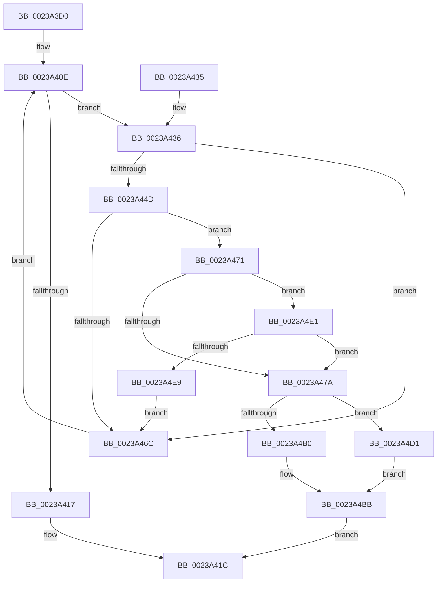

# HalpAcpiAccessSecureAddress

- RVA: `0x0023A3D0`–`0x0023A4EB` (길이 `283` bytes)
- VA: `0x000000014023A3D0`
- 실행 섹션: `.text`
- PDB 이름 있음: `예`; PDB Function 태그: `아니요`
- unwind 정보 RVA: `0x00060CF4`
- 디코드: `77`개 명령, `283/283` bytes 표시
- 미해석 바이트: `0` (있으면 어셈블리에 `.byte`로 보존)

> 이 문서는 커널 이미지의 기계어와 PDB 기호를 분석해 생성했습니다. 4번과 5번은 함수 원형과 자료형을 바이너리 사용 방식에서 추정한 C 해석이며 원본 소스 복구 결과는 아닙니다.

## 1. Dependencies

- 직접 호출 지점: **2**; 고유 호출 대상: **2**
- 직접 호출자로 확인된 함수: **0**
- RIP 상대 이미지 참조: **5**

### Outgoing calls
- `0x0023A406` → [MmGetPhysicalAddress](MmGetPhysicalAddress_function_0023A500.md) (function, `0x0023A500`)
- `0x0023A4C3` → [HalpPCIConfig](HalpPCIConfig_function_00235980.md) (function, `0x00235980`)

### Direct callers
- 이 함수 시작 RVA로 연결되는 직접 call은 확인되지 않았습니다. 간접 호출은 완전히 역산할 수 없습니다.

### Static image references
- `0x0023A40E` → RVA `0x00F901E0` (`.data`; read)
- `0x0023A43D` → RVA `0x00F90200` (`.data`; read)
- `0x0023A471` → RVA `0x00E11748` (`.data`; read)
- `0x0023A4B0` → RVA `0x00F901F8` (`.data`; read/write)
- `0x0023A4D1` → RVA `0x00F901F4` (`.data`; read/write)

## 2. Other-region calls and transfers

- 다른 실행 섹션으로 향하는 call: **0**
- 별도 외부 분기/꼬리 이동을 확인하지 못했습니다.

## 3. Assembly (complete function range)

```asm
0023A3D0  48 89 5C 24 08                  mov qword ptr [rsp + 8], rbx
0023A3D5  48 89 6C 24 10                  mov qword ptr [rsp + 0x10], rbp
0023A3DA  48 89 74 24 18                  mov qword ptr [rsp + 0x18], rsi
0023A3DF  57                              push rdi
0023A3E0  41 56                           push r14
0023A3E2  41 57                           push r15
0023A3E4  48 83 EC 40                     sub rsp, 0x40
0023A3E8  48 8B 9C 24 80 00 00 00         mov rbx, qword ptr [rsp + 0x80]
0023A3F0  44 0F B6 F1                     movzx r14d, cl
0023A3F4  45 33 FF                        xor r15d, r15d
0023A3F7  48 8B CA                        mov rcx, rdx
0023A3FA  41 8B F1                        mov esi, r9d
0023A3FD  49 8B E8                        mov rbp, r8
0023A400  48 8B FA                        mov rdi, rdx
0023A403  44 89 3B                        mov dword ptr [rbx], r15d
0023A406  E8 F5 00 00 00                  call 0x14023a500
0023A40B  45 8B D7                        mov r10d, r15d
0023A40E  44 3B 15 CB 5D D5 00            cmp r10d, dword ptr [rip + 0xd55dcb]
0023A415  72 1F                           jb 0x14023a436
0023A417  B8 41 01 00 C0                  mov eax, 0xc0000141
0023A41C  48 8B 5C 24 60                  mov rbx, qword ptr [rsp + 0x60]
0023A421  48 8B 6C 24 68                  mov rbp, qword ptr [rsp + 0x68]
0023A426  48 8B 74 24 70                  mov rsi, qword ptr [rsp + 0x70]
0023A42B  48 83 C4 40                     add rsp, 0x40
0023A42F  41 5F                           pop r15
0023A431  41 5E                           pop r14
0023A433  5F                              pop rdi
0023A434  C3                              ret
0023A435  CC                              int3
0023A436  45 8B C2                        mov r8d, r10d
0023A439  49 C1 E0 04                     shl r8, 4
0023A43D  4C 03 05 BC 5D D5 00            add r8, qword ptr [rip + 0xd55dbc]
0023A444  4D 8B 48 2C                     mov r9, qword ptr [r8 + 0x2c]
0023A448  49 3B C1                        cmp rax, r9
0023A44B  72 1F                           jb 0x14023a46c
0023A44D  41 0F B6 48 36                  movzx ecx, byte ptr [r8 + 0x36]
0023A452  41 0F B6 50 37                  movzx edx, byte ptr [r8 + 0x37]
0023A457  48 2B D1                        sub rdx, rcx
0023A45A  48 8D 4A 01                     lea rcx, [rdx + 1]
0023A45E  48 C1 E1 14                     shl rcx, 0x14
0023A462  8B C9                           mov ecx, ecx
0023A464  49 03 C9                        add rcx, r9
0023A467  48 3B C1                        cmp rax, rcx
0023A46A  72 05                           jb 0x14023a471
0023A46C  41 FF C2                        inc r10d
0023A46F  EB 9D                           jmp 0x14023a40e
0023A471  44 38 3D D0 72 BD 00            cmp byte ptr [rip + 0xbd72d0], r15b
0023A478  75 67                           jne 0x14023a4e1
0023A47A  41 0F B7 48 34                  movzx ecx, word ptr [r8 + 0x34]
0023A47F  49 2B C1                        sub rax, r9
0023A482  4C 8B C0                        mov r8, rax
0023A485  48 8B D0                        mov rdx, rax
0023A488  49 C1 F8 0C                     sar r8, 0xc
0023A48C  81 E7 FF 0F 00 00               and edi, 0xfff
0023A492  41 83 E0 07                     and r8d, 7
0023A496  48 C1 F8 0F                     sar rax, 0xf
0023A49A  41 C1 E0 05                     shl r8d, 5
0023A49E  83 E0 1F                        and eax, 0x1f
0023A4A1  44 0B C0                        or r8d, eax
0023A4A4  48 C1 FA 14                     sar rdx, 0x14
0023A4A8  4C 8B CD                        mov r9, rbp
0023A4AB  45 84 F6                        test r14b, r14b
0023A4AE  75 21                           jne 0x14023a4d1
0023A4B0  FF 05 42 5D D5 00               inc dword ptr [rip + 0xd55d42]
0023A4B6  44 89 7C 24 30                  mov dword ptr [rsp + 0x30], r15d
0023A4BB  89 74 24 28                     mov dword ptr [rsp + 0x28], esi
0023A4BF  89 7C 24 20                     mov dword ptr [rsp + 0x20], edi
0023A4C3  E8 B8 B4 FF FF                  call 0x140235980
0023A4C8  33 C0                           xor eax, eax
0023A4CA  89 33                           mov dword ptr [rbx], esi
0023A4CC  E9 4B FF FF FF                  jmp 0x14023a41c
0023A4D1  FF 05 1D 5D D5 00               inc dword ptr [rip + 0xd55d1d]
0023A4D7  C7 44 24 30 01 00 00 00         mov dword ptr [rsp + 0x30], 1
0023A4DF  EB DA                           jmp 0x14023a4bb
0023A4E1  48 A9 00 0F 00 00               test rax, 0xf00
0023A4E7  74 91                           je 0x14023a47a
0023A4E9  EB 81                           jmp 0x14023a46c
```

## 4. C-style interpretation (structured pseudocode)

```c
__int64 __fastcall HalpAcpiAccessSecureAddress(unsigned __int8 a1, __int64 a2, __int64 a3, int a4, __int64 a5)
{
    __int64 result;
    __int64 v_r10;
    __int64 v_r15;
    __int64 v_rdi;
    __int64 v_rsp;
    unsigned __int64 v_stack_p10;
    unsigned __int64 v_stack_p18;
    unsigned int v_stack_p20;
    unsigned int v_stack_p28;
    unsigned int v_stack_p30;
    unsigned __int64 v_stack_p8;

    v_stack_p8 = v_rbx;
    v_stack_p10 = v_rbp;
    v_stack_p18 = v_rsi;
    v_rsp = (v_rsp) - (64);
    v_r15 = 0;
    *(unsigned int *)(a5) = 0;
    result = MmGetPhysicalAddress(a2, a2, a3, a4);
loc_0023A40E:
    if (0 < (*(unsigned int *)(v_rip + 13983179))) goto loc_0023A436;
loc_0023A41C:
    v_rsp = (v_rsp) + (64);
    return (unsigned int)(0xC0000141ULL);
loc_0023A436:
    a3 = (0) << (4);
    a3 = (a3) + (*(unsigned __int64 *)(v_rip + 13983164));
    if (((unsigned int)(0xC0000141ULL)) < (*(unsigned __int64 *)(a3 + 44))) goto loc_0023A46C;
    a2 = (*(unsigned __int8 *)(a3 + 55)) - (*(unsigned __int8 *)(a3 + 54));
    a1 = (a2 + 1) << (20);
    a1 = ((unsigned int)(a1)) + (*(unsigned __int64 *)(a3 + 44));
    if (((unsigned int)(0xC0000141ULL)) < a1) goto loc_0023A471;
loc_0023A46C:
    v_r10 = (unsigned int)((0) + 1);
    goto loc_0023A40E;
loc_0023A471:
    if ((*(unsigned __int8 *)(v_rip + 12415696)) != 0) goto loc_0023A4E1;
loc_0023A47A:
    result = ((unsigned int)(0xC0000141ULL)) - (*(unsigned __int64 *)(a3 + 44));
    a3 = (result) >> (12);
    v_rdi = (unsigned int)((a2) & (0xFFFULL));
    a3 = (unsigned int)((a3) & (7));
    result = (result) >> (15);
    a3 = (unsigned int)((a3) << (5));
    result = (unsigned int)((result) & (31));
    a3 = (unsigned int)((a3) | ((unsigned int)(result)));
    a2 = (result) >> (20);
    if (a1 != 0) goto loc_0023A4D1;
    v_stack_p30 = 0;
loc_0023A4BB:
    v_stack_p28 = (unsigned int)(v_stack_p18);
    v_stack_p20 = (unsigned int)(v_rdi);
    result = HalpPCIConfig(*(unsigned __int16 *)(a3 + 52), a2, a3, v_stack_p10);
    result = 0;
    *(unsigned int *)(v_stack_p8) = (unsigned int)(v_stack_p18);
    goto loc_0023A41C;
loc_0023A4D1:
    v_stack_p30 = 1;
    goto loc_0023A4BB;
loc_0023A4E1:
    if (((0) & (0xF00ULL)) == 0) goto loc_0023A47A;
    goto loc_0023A46C;
}
```

## 5. (Beta) C Style

```c
int64_t HalpAcpiAccessSecureAddress(uint8_t Arg1, int64_t Arg2, int64_t Arg3, int32_t Arg4, void *Arg5)
{
    uint8_t *arg5 = (uint8_t *)Arg5;

    int64_t result;
    int64_t local_r10;
    int64_t local_r15;
    int64_t local_rdi;
    int64_t local_rsp;
    uint64_t v_stack_p10;
    uint64_t v_stack_p18;
    uint32_t v_stack_p20;
    uint32_t v_stack_p28;
    uint32_t v_stack_p30;
    uint64_t v_stack_p8;

    v_stack_p8 = local_rbx;
    v_stack_p10 = local_rbp;
    v_stack_p18 = local_rsi;
    local_rsp = (local_rsp) - (64);
    local_r15 = 0;
    *(uint32_t *)(arg5) = 0;
    result = MmGetPhysicalAddress(Arg2, Arg2, Arg3, Arg4);
loc_0023A40E:
    if (0 < (*(uint32_t *)(v_rip + 0xD55DCB))) goto loc_0023A436;
loc_0023A41C:
    local_rsp = (local_rsp) + (64);
    return (uint32_t)(0xC0000141ULL);
loc_0023A436:
    Arg3 = (0) << (4);
    Arg3 = (Arg3) + (*(uint64_t *)(v_rip + 0xD55DBC));
    if (((uint32_t)(0xC0000141ULL)) < (*(uint64_t *)(Arg3 + 0x2C))) goto loc_0023A46C;
    Arg2 = (*(uint8_t *)(Arg3 + 0x37)) - (*(uint8_t *)(Arg3 + 0x36));
    Arg1 = (Arg2 + 1) << (20);
    Arg1 = ((uint32_t)(Arg1)) + (*(uint64_t *)(Arg3 + 0x2C));
    if (((uint32_t)(0xC0000141ULL)) < Arg1) goto loc_0023A471;
loc_0023A46C:
    local_r10 = (uint32_t)((0) + 1);
    goto loc_0023A40E;
loc_0023A471:
    if ((*(uint8_t *)(v_rip + 0xBD72D0)) != 0) goto loc_0023A4E1;
loc_0023A47A:
    result = ((uint32_t)(0xC0000141ULL)) - (*(uint64_t *)(Arg3 + 0x2C));
    Arg3 = (result) >> (12);
    local_rdi = (uint32_t)((Arg2) & (0xFFFULL));
    Arg3 = (uint32_t)((Arg3) & (7));
    result = (result) >> (15);
    Arg3 = (uint32_t)((Arg3) << (5));
    result = (uint32_t)((result) & (31));
    Arg3 = (uint32_t)((Arg3) | ((uint32_t)(result)));
    Arg2 = (result) >> (20);
    if (Arg1 != 0) goto loc_0023A4D1;
    v_stack_p30 = 0;
loc_0023A4BB:
    v_stack_p28 = (uint32_t)(v_stack_p18);
    v_stack_p20 = (uint32_t)(local_rdi);
    result = HalpPCIConfig(*(uint16_t *)(Arg3 + 0x34), Arg2, Arg3, v_stack_p10);
    result = 0;
    *(uint32_t *)(v_stack_p8) = (uint32_t)(v_stack_p18);
    goto loc_0023A41C;
loc_0023A4D1:
    v_stack_p30 = 1;
    goto loc_0023A4BB;
loc_0023A4E1:
    if (((0) & (0xF00ULL)) == 0) goto loc_0023A47A;
    goto loc_0023A46C;
}
```

### 관측된 메모리 오프셋

구조체 형식이 확인되지 않은 접근은 인자 기준의 오프셋으로만 기록했습니다.

| 기준 인자 | 오프셋 표현 | 폭 (bit) | 접근 |
|---|---:|---:|---|
| `Arg5` | `+ 0x0` | `32` | `W` |

## 6. Execution-region graph

[열기: 2D/3D 그래프와 함수 탐색 컨트롤 패널](../../../control-panel.html?section=text&rva=0x0023A3D0&view=graph)

- 2D 그래프는 위에서 아래로 흐르고, 3D 그래프는 빈 공간을 드래그해 회전합니다. Shift+드래그는 이동, 휠은 확대·축소, 함수 노드 선택은 대상 보고서 이동입니다.

### Static fallback


