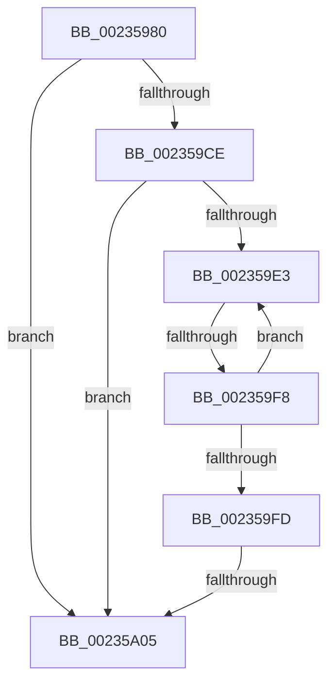

# HalpPCIConfig

- RVA: `0x00235980`–`0x00235A0C` (길이 `140` bytes)
- VA: `0x0000000140235980`
- 실행 섹션: `.text`
- PDB 이름 있음: `예`; PDB Function 태그: `예`
- unwind 정보 RVA: `0x000606E0`
- 디코드: `35`개 명령, `140/140` bytes 표시
- 미해석 바이트: `0` (있으면 어셈블리에 `.byte`로 보존)

> 이 문서는 커널 이미지의 기계어와 PDB 기호를 분석해 생성했습니다. 4번과 5번은 함수 원형과 자료형을 바이너리 사용 방식에서 추정한 C 해석이며 원본 소스 복구 결과는 아닙니다.

## 1. Dependencies

- 직접 호출 지점: **0**; 고유 호출 대상: **0**
- 직접 호출자로 확인된 함수: **4**
- RIP 상대 이미지 참조: **4**

### Outgoing calls
- 직접 디코드된 call 명령이 없습니다.

### Direct callers
- [HalpAcpiAccessSecureAddress](HalpAcpiAccessSecureAddress_function_0023A3D0.md) at `0x0023A4C3`
- [HalpWritePCIConfig](../46/HalpWritePCIConfig_function_004616AC.md) at `0x004616FE`
- [HalpReadPCIConfig](../46/HalpReadPCIConfig_function_00461978.md) at `0x004619C9`
- [HaliPciInterfaceWriteConfig](../47/HaliPciInterfaceWriteConfig_function_00474830.md) at `0x00474855`

### Static image references
- `0x00235993` → RVA `0x00E0A740` (`.data`; read)
- `0x002359A1` → RVA `0x00FC1750` (`.data`; read)
- `0x002359CE` → RVA `0x00FC1740` (`.data`; read)
- `0x00235A05` → RVA `0x00FC1D48` (`.data`; read)

## 2. Other-region calls and transfers

- 다른 실행 섹션으로 향하는 call: **0**
- call이 아닌 외부 분기/꼬리 이동: **2**
  - `0x002359F2` → [sub_00235D12](Unknown_function_00235D12.md) (`tail-transfer`)
  - `0x002359FF` → [sub_00235D65](Unknown_function_00235D65.md) (`tail-transfer`)

## 3. Assembly (complete function range)

```asm
00235980  40 55                           push rbp
00235982  53                              push rbx
00235983  56                              push rsi
00235984  57                              push rdi
00235985  41 56                           push r14
00235987  48 8D 6C 24 F0                  lea rbp, [rsp - 0x10]
0023598C  48 81 EC 10 01 00 00            sub rsp, 0x110
00235993  48 8B 05 A6 4D BD 00            mov rax, qword ptr [rip + 0xbd4da6]
0023599A  48 33 C4                        xor rax, rsp
0023599D  48 89 45 E0                     mov qword ptr [rbp - 0x20], rax
002359A1  80 3D A8 BD D8 00 00            cmp byte ptr [rip + 0xd8bda8], 0
002359A8  49 8B F1                        mov rsi, r9
002359AB  44 0F B6 D2                     movzx r10d, dl
002359AF  41 BE 01 00 00 00               mov r14d, 1
002359B5  44 0F B7 D9                     movzx r11d, cx
002359B9  44 88 54 24 50                  mov byte ptr [rsp + 0x50], r10b
002359BE  66 44 89 5C 24 52               mov word ptr [rsp + 0x52], r11w
002359C4  4C 89 4C 24 58                  mov qword ptr [rsp + 0x58], r9
002359C9  41 8B F8                        mov edi, r8d
002359CC  75 37                           jne 0x140235a05
002359CE  48 8B 05 6B BD D8 00            mov rax, qword ptr [rip + 0xd8bd6b]
002359D5  4C 8D 0D 64 BD D8 00            lea r9, [rip + 0xd8bd64]
002359DC  32 DB                           xor bl, bl
002359DE  49 3B C1                        cmp rax, r9
002359E1  74 22                           je 0x140235a05
002359E3  48 8D 10                        lea rdx, [rax]
002359E6  48 8B 00                        mov rax, qword ptr [rax]
002359E9  8B 8A D8 01 00 00               mov ecx, dword ptr [rdx + 0x1d8]
002359EF  F6 C1 08                        test cl, 8
002359F2  0F 85 1A 03 00 00               jne 0x140235d12
002359F8  49 3B C1                        cmp rax, r9
002359FB  75 E6                           jne 0x1402359e3
002359FD  84 DB                           test bl, bl
002359FF  0F 85 60 03 00 00               jne 0x140235d65
00235A05  48 8B 1D 3C C3 D8 00            mov rbx, qword ptr [rip + 0xd8c33c]
```

## 4. C-style interpretation (structured pseudocode)

```c
__int64 __fastcall HalpPCIConfig(unsigned __int16 a1, unsigned __int8 a2, int a3, __int64 a4)
{
    __int64 result;
    __int64 v_rbx;
    __int64 v_rsp;
    unsigned __int64 v_stack_m38;
    unsigned __int64 v_stack_m58;
    unsigned __int64 v_stack_mE0;
    unsigned __int16 v_stack_mE6;
    unsigned __int8 v_stack_mE8;

    v_rsp = (v_rsp) - (272);
    result = (*(unsigned __int64 *)(v_rip + 12406182)) ^ (v_rsp);
    v_stack_m58 = result;
    v_stack_mE8 = a2;
    v_stack_mE6 = a1;
    v_stack_mE0 = a4;
    if ((*(unsigned __int8 *)(v_rip + 14204328)) != 0) goto loc_00235A05;
    v_rbx = 0;
    if ((*(unsigned __int64 *)(v_rip + 14204267)) == (v_rip + 14204260)) goto loc_00235A05;
loc_002359E3:
    if ((*(unsigned __int64 *)(*(unsigned __int64 *)(v_rip + 14204267))) != (v_rip + 14204260)) goto loc_002359E3;
loc_00235A05:
    return *(unsigned __int64 *)(*(unsigned __int64 *)(v_rip + 14204267));
}
```

## 5. (Beta) C Style

```c
int64_t HalpPCIConfig(uint16_t Arg1, uint8_t Arg2, int32_t Arg3, int64_t Arg4)
{
    int64_t result;
    int64_t local_rbx;
    int64_t local_rsp;
    uint64_t v_stack_m38;
    uint64_t v_stack_m58;
    uint64_t v_stack_mE0;
    uint16_t v_stack_mE6;
    uint8_t v_stack_mE8;

    local_rsp = (local_rsp) - (272);
    result = (*(uint64_t *)(v_rip + 0xBD4DA6)) ^ (local_rsp);
    v_stack_m58 = result;
    v_stack_mE8 = Arg2;
    v_stack_mE6 = Arg1;
    v_stack_mE0 = Arg4;
    if ((*(uint8_t *)(v_rip + 0xD8BDA8)) != 0) goto loc_00235A05;
    local_rbx = 0;
    if ((*(uint64_t *)(v_rip + 0xD8BD6B)) == (v_rip + 14204260)) goto loc_00235A05;
loc_002359E3:
    if ((*(uint64_t *)(*(uint64_t *)(v_rip + 0xD8BD6B))) != (v_rip + 14204260)) goto loc_002359E3;
loc_00235A05:
    return *(uint64_t *)(*(uint64_t *)(v_rip + 0xD8BD6B));
}
```

## 6. Execution-region graph

[열기: 2D/3D 그래프와 함수 탐색 컨트롤 패널](../../../control-panel.html?section=text&rva=0x00235980&view=graph)

- 2D 그래프는 위에서 아래로 흐르고, 3D 그래프는 빈 공간을 드래그해 회전합니다. Shift+드래그는 이동, 휠은 확대·축소, 함수 노드 선택은 대상 보고서 이동입니다.

### Static fallback


