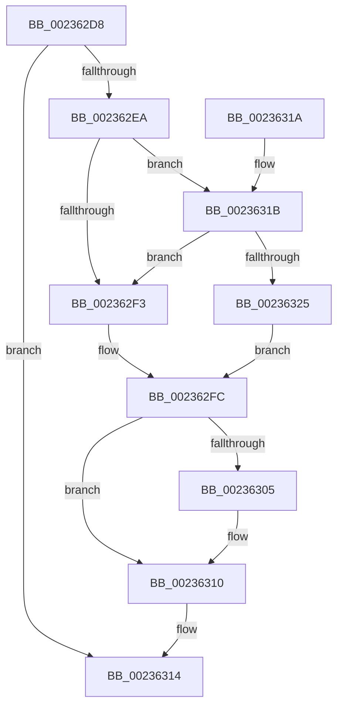

# HalpPCIReleaseConfigSpaceLock

- RVA: `0x002362D8`–`0x00236338` (길이 `96` bytes)
- VA: `0x00000001402362D8`
- 실행 섹션: `.text`
- PDB 이름 있음: `예`; PDB Function 태그: `아니요`
- unwind 정보 RVA: `0x0006084C`
- 디코드: `25`개 명령, `96/96` bytes 표시
- 미해석 바이트: `0` (있으면 어셈블리에 `.byte`로 보존)

> 이 문서는 커널 이미지의 기계어와 PDB 기호를 분석해 생성했습니다. 4번과 5번은 함수 원형과 자료형을 바이너리 사용 방식에서 추정한 C 해석이며 원본 소스 복구 결과는 아닙니다.

## 1. Dependencies

- 직접 호출 지점: **2**; 고유 호출 대상: **2**
- 직접 호출자로 확인된 함수: **2**
- RIP 상대 이미지 참조: **6**

### Outgoing calls
- `0x0023630B` → [KiLowerIrqlProcessIrqlFlags](../4F/KiLowerIrqlProcessIrqlFlags_function_004F5698.md) (function, `0x004F5698`)
- `0x00236331` → [KiReleaseSpinLockInstrumented](../39/KiReleaseSpinLockInstrumented_function_00392EF0.md) (function, `0x00392EF0`)

### Direct callers
- [sub_00235B5D](Unknown_function_00235B5D.md) at `0x00235CBE`
- [HaliPciInterfaceReadConfig](../43/HaliPciInterfaceReadConfig_function_004391A0.md) at `0x004392EC`

### Static image references
- `0x002362DE` → RVA `0x00FC19B8` (`.data`; read)
- `0x002362EA` → RVA `0x00FC6B06` (`ALMOSTRO`; read)
- `0x002362F3` → RVA `0x00FC1708` (`.data`; read/write)
- `0x002362FC` → RVA `0x00FC6D20` (`ALMOSTRO`; read)
- `0x0023631B` → RVA `0x00F0DE58` (`.data`; read)
- `0x0023632A` → RVA `0x00FC1708` (`.data`; read)

## 2. Other-region calls and transfers

- 다른 실행 섹션으로 향하는 call: **0**
- 별도 외부 분기/꼬리 이동을 확인하지 못했습니다.

## 3. Assembly (complete function range)

```asm
002362D8  40 53                           push rbx
002362DA  48 83 EC 20                     sub rsp, 0x20
002362DE  80 3D D3 B6 D8 00 00            cmp byte ptr [rip + 0xd8b6d3], 0
002362E5  0F B6 D9                        movzx ebx, cl
002362E8  75 2A                           jne 0x140236314
002362EA  F6 05 15 08 D9 00 01            test byte ptr [rip + 0xd90815], 1
002362F1  75 28                           jne 0x14023631b
002362F3  F0 48 83 25 0C B4 D8 00 00      lock and qword ptr [rip + 0xd8b40c], 0
002362FC  83 3D 1D 0A D9 00 00            cmp dword ptr [rip + 0xd90a1d], 0
00236303  74 0B                           je 0x140236310
00236305  44 0F 20 C1                     mov rcx, cr8
00236309  8A D3                           mov dl, bl
0023630B  E8 88 F3 2B 00                  call 0x1404f5698
00236310  44 0F 22 C3                     mov cr8, rbx
00236314  48 83 C4 20                     add rsp, 0x20
00236318  5B                              pop rbx
00236319  C3                              ret
0023631A  CC                              int3
0023631B  8B 05 37 7B CD 00               mov eax, dword ptr [rip + 0xcd7b37]
00236321  85 C0                           test eax, eax
00236323  75 CE                           jne 0x1402362f3
00236325  48 8B 54 24 28                  mov rdx, qword ptr [rsp + 0x28]
0023632A  48 8D 0D D7 B3 D8 00            lea rcx, [rip + 0xd8b3d7]
00236331  E8 BA CB 15 00                  call 0x140392ef0
00236336  EB C4                           jmp 0x1402362fc
```

## 4. C-style interpretation (structured pseudocode)

```c
__int64 __fastcall HalpPCIReleaseConfigSpaceLock(unsigned __int8 a1)
{
    __int64 result;
    __int64 v_rsp;
    unsigned __int64 v_stack_p28;

    v_rsp = (v_rsp) - (32);
    if ((*(unsigned __int8 *)(v_rip + 14202579)) != 0) goto loc_00236314;
    if (((*(unsigned __int8 *)(v_rip + 14223381)) & (1)) != 0) goto loc_0023631B;
loc_002362F3:
loc_002362FC:
    if ((*(unsigned int *)(v_rip + 14223901)) != 0) {
        a1 = v_cr8;
        a2 = a1;
        result = KiLowerIrqlProcessIrqlFlags(a1, a2, a3, a4);
    }
loc_00236314:
    v_rsp = (v_rsp) + (32);
    return result;
loc_0023631B:
    if ((unsigned int)((unsigned int)(*(unsigned int *)(v_rip + 13466423))) != 0) goto loc_002362F3;
    result = KiReleaseSpinLockInstrumented(v_rip + 14201815, v_stack_p28, a3, a4);
    goto loc_002362FC;
}
```

## 5. (Beta) C Style

```c
int64_t HalpPCIReleaseConfigSpaceLock(uint8_t Arg1)
{
    int64_t result;
    int64_t local_rsp;
    uint64_t v_stack_p28;

    local_rsp = (local_rsp) - (32);
    if ((*(uint8_t *)(v_rip + 0xD8B6D3)) != 0) goto loc_00236314;
    if (((*(uint8_t *)(v_rip + 0xD90815)) & (1)) != 0) goto loc_0023631B;
loc_002362F3:
loc_002362FC:
    if ((*(uint32_t *)(v_rip + 0xD90A1D)) != 0) {
        Arg1 = v_cr8;
        a2 = Arg1;
        result = KiLowerIrqlProcessIrqlFlags(Arg1, a2, a3, a4);
    }
loc_00236314:
    local_rsp = (local_rsp) + (32);
    return result;
loc_0023631B:
    if ((uint32_t)((uint32_t)(*(uint32_t *)(v_rip + 0xCD7B37))) != 0) goto loc_002362F3;
    result = KiReleaseSpinLockInstrumented(v_rip + 14201815, v_stack_p28, a3, a4);
    goto loc_002362FC;
}
```

## 6. Execution-region graph

[열기: 2D/3D 그래프와 함수 탐색 컨트롤 패널](../../../control-panel.html?section=text&rva=0x002362D8&view=graph)

- 2D 그래프는 위에서 아래로 흐르고, 3D 그래프는 빈 공간을 드래그해 회전합니다. Shift+드래그는 이동, 휠은 확대·축소, 함수 노드 선택은 대상 보고서 이동입니다.

### Static fallback


