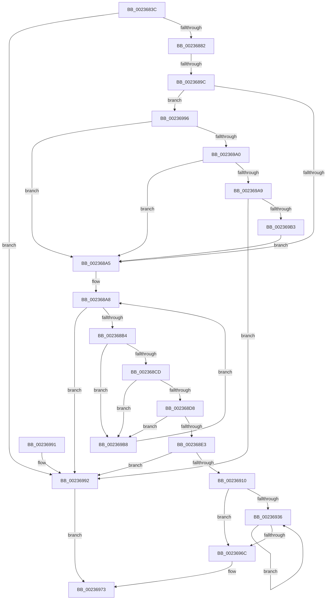

# HalpPciAccessMmConfigSpace

- RVA: `0x0023683C`–`0x002369BF` (길이 `387` bytes)
- VA: `0x000000014023683C`
- 실행 섹션: `.text`
- PDB 이름 있음: `예`; PDB Function 태그: `예`
- unwind 정보 RVA: `0x000608D4`
- 디코드: `102`개 명령, `387/387` bytes 표시
- 미해석 바이트: `0` (있으면 어셈블리에 `.byte`로 보존)

> 이 문서는 커널 이미지의 기계어와 PDB 기호를 분석해 생성했습니다. 4번과 5번은 함수 원형과 자료형을 바이너리 사용 방식에서 추정한 C 해석이며 원본 소스 복구 결과는 아닙니다.

## 1. Dependencies

- 직접 호출 지점: **3**; 고유 호출 대상: **3**
- 직접 호출자로 확인된 함수: **1**
- RIP 상대 이미지 참조: **7**

### Outgoing calls
- `0x00236910` → [HalpPciMapMmConfigPhysicalAddress](HalpPciMapMmConfigPhysicalAddress_function_00236340.md) (function, `0x00236340`)
- `0x0023695C` → [guard_dispatch_icall](../6B/guard_dispatch_icall_function_006BAAD0.md) (function, `0x006BAAD0`)
- `0x0023697B` → [_security_check_cookie](../6A/_security_check_cookie_function_006AC640.md) (function, `0x006AC640`)

### Direct callers
- [HaliPciInterfaceReadConfig](../43/HaliPciInterfaceReadConfig_function_004391A0.md) at `0x004392DB`

### Static image references
- `0x0023684C` → RVA `0x00E0A740` (`.data`; read)
- `0x00236882` → RVA `0x00E0A830` (`.data`; read)
- `0x002368A8` → RVA `0x00F901E0` (`.data`; read)
- `0x002368B4` → RVA `0x00F90200` (`.data`; read)
- `0x0023691D` → RVA `0x00001018` (`.rdata`; read)
- `0x00236927` → RVA `0x00001000` (`.rdata`; read)
- `0x0023694A` → RVA `0x000105D0` (`.rdata`; read)

## 2. Other-region calls and transfers

- 다른 실행 섹션으로 향하는 call: **0**
- call이 아닌 외부 분기/꼬리 이동: **1**
  - `0x00236896` → [sub_006D781C](../6D/Unknown_function_006D781C.md) (`tail-transfer`)

## 3. Assembly (complete function range)

```asm
0023683C  48 89 5C 24 08                  mov qword ptr [rsp + 8], rbx
00236841  55                              push rbp
00236842  56                              push rsi
00236843  57                              push rdi
00236844  41 56                           push r14
00236846  41 57                           push r15
00236848  48 83 EC 40                     sub rsp, 0x40
0023684C  48 8B 05 ED 3E BD 00            mov rax, qword ptr [rip + 0xbd3eed]
00236853  48 33 C4                        xor rax, rsp
00236856  48 89 44 24 30                  mov qword ptr [rsp + 0x30], rax
0023685B  8B B4 24 90 00 00 00            mov esi, dword ptr [rsp + 0x90]
00236862  4D 8B F1                        mov r14, r9
00236865  8B BC 24 98 00 00 00            mov edi, dword ptr [rsp + 0x98]
0023686C  44 0F B7 D9                     movzx r11d, cx
00236870  44 0F B6 D2                     movzx r10d, dl
00236874  8D 04 3E                        lea eax, [rsi + rdi]
00236877  3D 00 10 00 00                  cmp eax, 0x1000
0023687C  0F 87 10 01 00 00               ja 0x140236992
00236882  8B 05 A8 3F BD 00               mov eax, dword ptr [rip + 0xbd3fa8]
00236888  45 33 FF                        xor r15d, r15d
0023688B  0F 57 C0                        xorps xmm0, xmm0
0023688E  0F 11 44 24 20                  movups xmmword ptr [rsp + 0x20], xmm0
00236893  83 F8 FF                        cmp eax, -1
00236896  0F 84 80 0F 4A 00               je 0x1406d781c
0023689C  83 F8 01                        cmp eax, 1
0023689F  0F 84 F1 00 00 00               je 0x140236996
002368A5  41 8B C7                        mov eax, r15d
002368A8  3B 05 32 99 D5 00               cmp eax, dword ptr [rip + 0xd59932]
002368AE  0F 83 DE 00 00 00               jae 0x140236992
002368B4  4C 8B 0D 45 99 D5 00            mov r9, qword ptr [rip + 0xd59945]
002368BB  8B D8                           mov ebx, eax
002368BD  48 C1 E3 04                     shl rbx, 4
002368C1  66 46 3B 5C 0B 34               cmp r11w, word ptr [rbx + r9 + 0x34]
002368C7  0F 85 EB 00 00 00               jne 0x1402369b8
002368CD  46 3A 54 0B 36                  cmp r10b, byte ptr [rbx + r9 + 0x36]
002368D2  0F 82 E0 00 00 00               jb 0x1402369b8
002368D8  46 3A 54 0B 37                  cmp r10b, byte ptr [rbx + r9 + 0x37]
002368DD  0F 87 D5 00 00 00               ja 0x1402369b8
002368E3  41 8B C0                        mov eax, r8d
002368E6  49 8B CA                        mov rcx, r10
002368E9  48 C1 E1 05                     shl rcx, 5
002368ED  83 E0 1F                        and eax, 0x1f
002368F0  48 03 C8                        add rcx, rax
002368F3  41 8B D0                        mov edx, r8d
002368F6  48 C1 EA 05                     shr rdx, 5
002368FA  83 E2 07                        and edx, 7
002368FD  48 8D 0C CA                     lea rcx, [rdx + rcx*8]
00236901  48 C1 E1 0C                     shl rcx, 0xc
00236905  4A 03 4C 0B 2C                  add rcx, qword ptr [rbx + r9 + 0x2c]
0023690A  0F 84 82 00 00 00               je 0x140236992
00236910  E8 2B FA FF FF                  call 0x140236340
00236915  44 39 BC 24 A0 00 00 00         cmp dword ptr [rsp + 0xa0], r15d
0023691D  48 8D 1D F4 A6 DC FF            lea rbx, [rip - 0x23590c]
00236924  48 8B E8                        mov rbp, rax
00236927  48 8D 05 D2 A6 DC FF            lea rax, [rip - 0x23592e]
0023692E  48 0F 45 D8                     cmovne rbx, rax
00236932  85 FF                           test edi, edi
00236934  74 36                           je 0x14023696c
00236936  8B C7                           mov eax, edi
00236938  8B CE                           mov ecx, esi
0023693A  83 E0 03                        and eax, 3
0023693D  83 E1 03                        and ecx, 3
00236940  44 8B C6                        mov r8d, esi
00236943  49 8B D6                        mov rdx, r14
00236946  48 8D 0C 88                     lea rcx, [rax + rcx*4]
0023694A  48 8D 05 7F 9C DD FF            lea rax, [rip - 0x226381]
00236951  0F B6 04 01                     movzx eax, byte ptr [rcx + rax]
00236955  48 8B CD                        mov rcx, rbp
00236958  48 8B 04 C3                     mov rax, qword ptr [rbx + rax*8]
0023695C  E8 6F 41 48 00                  call 0x1406baad0
00236961  8B C8                           mov ecx, eax
00236963  03 F0                           add esi, eax
00236965  4C 03 F1                        add r14, rcx
00236968  2B F8                           sub edi, eax
0023696A  75 CA                           jne 0x140236936
0023696C  F0 44 09 3C 24                  lock or dword ptr [rsp], r15d
00236971  B0 01                           mov al, 1
00236973  48 8B 4C 24 30                  mov rcx, qword ptr [rsp + 0x30]
00236978  48 33 CC                        xor rcx, rsp
0023697B  E8 C0 5C 47 00                  call 0x1406ac640
00236980  48 8B 5C 24 70                  mov rbx, qword ptr [rsp + 0x70]
00236985  48 83 C4 40                     add rsp, 0x40
00236989  41 5F                           pop r15
0023698B  41 5E                           pop r14
0023698D  5F                              pop rdi
0023698E  5E                              pop rsi
0023698F  5D                              pop rbp
00236990  C3                              ret
00236991  CC                              int3
00236992  32 C0                           xor al, al
00236994  EB DD                           jmp 0x140236973
00236996  66 45 85 DB                     test r11w, r11w
0023699A  0F 85 05 FF FF FF               jne 0x1402368a5
002369A0  45 84 D2                        test r10b, r10b
002369A3  0F 85 FC FE FF FF               jne 0x1402368a5
002369A9  41 8B C0                        mov eax, r8d
002369AC  83 E0 1F                        and eax, 0x1f
002369AF  3C 18                           cmp al, 0x18
002369B1  73 DF                           jae 0x140236992
002369B3  E9 ED FE FF FF                  jmp 0x1402368a5
002369B8  FF C0                           inc eax
002369BA  E9 E9 FE FF FF                  jmp 0x1402368a8
```

## 4. C-style interpretation (structured pseudocode)

```c
__int64 __fastcall HalpPciAccessMmConfigSpace(unsigned __int16 a1, unsigned __int8 a2, int a3, __int64 a4, unsigned int a5, unsigned int a6, unsigned int a7)
{
    __int64 result;
    __int64 v_r14;
    __int64 v_r15;
    __int64 v_rbx;
    __int64 v_rdi;
    __int64 v_rsi;
    __int64 v_rsp;
    unsigned __int64 v_stack_m38;
    unsigned __int64 v_stack_m48;
    unsigned int v_stack_m68;
    unsigned __int64 v_stack_p8;

    v_stack_p8 = v_rbx;
    v_rsp = (v_rsp) - (64);
    result = (*(unsigned __int64 *)(v_rip + 12402413)) ^ (v_rsp);
    v_stack_m38 = result;
    if (((unsigned int)((unsigned int)(a5) + (unsigned int)(a6) * 1)) > 0x1000ULL) goto loc_00236992;
    v_r15 = 0;
    v_stack_m48 = v_xmm0;
    if (((unsigned int)((unsigned int)(*(unsigned int *)(v_rip + 12402600)))) == 1) goto loc_00236996;
loc_002368A5:
loc_002368A8:
    if (0 >= (*(unsigned int *)(v_rip + 13998386))) goto loc_00236992;
    v_rbx = (0) << (4);
    if (a1 != (*(unsigned __int16 *)(v_rbx + *(unsigned __int64 *)(v_rip + 13998405) * 1 + 52))) goto loc_002369B8;
    if (a2 < (*(unsigned __int8 *)(v_rbx + *(unsigned __int64 *)(v_rip + 13998405) * 1 + 54))) goto loc_002369B8;
    if (a2 > (*(unsigned __int8 *)(v_rbx + *(unsigned __int64 *)(v_rip + 13998405) * 1 + 55))) goto loc_002369B8;
    a1 = (a2) << (5);
    result = (unsigned int)(((unsigned int)(a3)) & (31));
    a1 = (a1) + (result);
    a2 = ((unsigned int)(a3)) >> (5);
    a2 = (unsigned int)((a2) & (7));
    a1 = (a2 + a1 * 8) << (12);
    a1 = (a1) + (*(unsigned __int64 *)(v_rbx + *(unsigned __int64 *)(v_rip + 13998405) * 1 + 44));
    if (condition_is_equal) goto loc_00236992;
    result = HalpPciMapMmConfigPhysicalAddress(a1, a2, a3, *(unsigned __int64 *)(v_rip + 13998405));
    v_rbx = v_rip - 2316556;
    if (a7 != 0) { v_rbx = v_rip - 2316590; }
    if ((unsigned int)((unsigned int)(a6)) == 0) goto loc_0023696C;
loc_00236936:
    result = (unsigned int)(((unsigned int)((unsigned int)((unsigned int)(a6)))) & (3));
    a1 = (unsigned int)(((unsigned int)((unsigned int)((unsigned int)(a5)))) & (3));
    result = guard_dispatch_icall(result, a4, (unsigned int)((unsigned int)((unsigned int)(a5))), *(unsigned __int64 *)(v_rip + 13998405));
    v_rsi = (unsigned int)(((unsigned int)(a5)) + ((unsigned int)(result)));
    v_r14 = (a4) + ((unsigned int)((unsigned int)(result)));
    v_rdi = (unsigned int)(((unsigned int)(a6)) - ((unsigned int)(result)));
    if (condition_is_not_equal) goto loc_00236936;
loc_0023696C:
loc_00236973:
    a1 = (v_stack_m38) ^ (v_rsp);
    result = _security_check_cookie(a1, a4, (unsigned int)((unsigned int)((unsigned int)(a5))), *(unsigned __int64 *)(v_rip + 13998405));
    v_rsp = (v_rsp) + (64);
    return result;
loc_00236992:
    result = 0;
    goto loc_00236973;
loc_00236996:
    if (a1 != 0) goto loc_002368A5;
    if (a2 != 0) goto loc_002368A5;
    result = (unsigned int)(((unsigned int)((unsigned int)((unsigned int)((unsigned int)((unsigned int)(a5)))))) & (31));
    if (((unsigned __int8)(result)) >= 24) goto loc_00236992;
    goto loc_002368A5;
loc_002369B8:
    result = (unsigned int)((result) + 1);
    goto loc_002368A8;
}
```

## 5. (Beta) C Style

```c
int64_t HalpPciAccessMmConfigSpace(uint16_t Arg1, uint8_t Arg2, int32_t Arg3, int64_t Arg4, void *Arg5, uint32_t Arg6, uint32_t Arg7)
{
    uint8_t *arg5 = (uint8_t *)Arg5;

    int64_t result;
    int64_t local_r14;
    int64_t local_r15;
    int64_t local_rbx;
    int64_t local_rdi;
    int64_t local_rsi;
    int64_t local_rsp;
    uint64_t v_stack_m38;
    uint64_t v_stack_m48;
    uint32_t v_stack_m68;
    uint64_t v_stack_p8;

    v_stack_p8 = local_rbx;
    local_rsp = (local_rsp) - (64);
    result = (*(uint64_t *)(v_rip + 0xBD3EED)) ^ (local_rsp);
    v_stack_m38 = result;
    if (((uint32_t)((uint32_t)(Arg5) + (uint32_t)(Arg6) * 1)) > 0x1000ULL) goto loc_00236992;
    local_r15 = 0;
    v_stack_m48 = v_xmm0;
    if (((uint32_t)((uint32_t)(*(uint32_t *)(v_rip + 0xBD3FA8)))) == 1) goto loc_00236996;
loc_002368A5:
loc_002368A8:
    if (0 >= (*(uint32_t *)(v_rip + 0xD59932))) goto loc_00236992;
    local_rbx = (0) << (4);
    if (Arg1 != (*(uint16_t *)(local_rbx + *(uint64_t *)(v_rip + 0xD59945) * 1 + 0x34))) goto loc_002369B8;
    if (Arg2 < (*(uint8_t *)(local_rbx + *(uint64_t *)(v_rip + 0xD59945) * 1 + 0x36))) goto loc_002369B8;
    if (Arg2 > (*(uint8_t *)(local_rbx + *(uint64_t *)(v_rip + 0xD59945) * 1 + 0x37))) goto loc_002369B8;
    Arg1 = (Arg2) << (5);
    result = (uint32_t)(((uint32_t)(Arg3)) & (31));
    Arg1 = (Arg1) + (result);
    Arg2 = ((uint32_t)(Arg3)) >> (5);
    Arg2 = (uint32_t)((Arg2) & (7));
    Arg1 = (Arg2 + Arg1 * 8) << (12);
    Arg1 = (Arg1) + (*(uint64_t *)(local_rbx + *(uint64_t *)(v_rip + 0xD59945) * 1 + 0x2C));
    if (condition_is_equal) goto loc_00236992;
    result = HalpPciMapMmConfigPhysicalAddress(Arg1, Arg2, Arg3, *(uint64_t *)(v_rip + 0xD59945));
    local_rbx = v_rip - 2316556;
    if (Arg7 != 0) { local_rbx = v_rip - 2316590; }
    if ((uint32_t)((uint32_t)(Arg6)) == 0) goto loc_0023696C;
loc_00236936:
    result = (uint32_t)(((uint32_t)((uint32_t)((uint32_t)(Arg6)))) & (3));
    Arg1 = (uint32_t)(((uint32_t)((uint32_t)((uint32_t)(Arg5)))) & (3));
    result = guard_dispatch_icall(result, Arg4, (uint32_t)((uint32_t)((uint32_t)(Arg5))), *(uint64_t *)(v_rip + 0xD59945));
    local_rsi = (uint32_t)(((uint32_t)(Arg5)) + ((uint32_t)(result)));
    local_r14 = (Arg4) + ((uint32_t)((uint32_t)(result)));
    local_rdi = (uint32_t)(((uint32_t)(Arg6)) - ((uint32_t)(result)));
    if (condition_is_not_equal) goto loc_00236936;
loc_0023696C:
loc_00236973:
    Arg1 = (v_stack_m38) ^ (local_rsp);
    result = _security_check_cookie(Arg1, Arg4, (uint32_t)((uint32_t)((uint32_t)(Arg5))), *(uint64_t *)(v_rip + 0xD59945));
    local_rsp = (local_rsp) + (64);
    return result;
loc_00236992:
    result = 0;
    goto loc_00236973;
loc_00236996:
    if (Arg1 != 0) goto loc_002368A5;
    if (Arg2 != 0) goto loc_002368A5;
    result = (uint32_t)(((uint32_t)((uint32_t)((uint32_t)((uint32_t)((uint32_t)(Arg5)))))) & (31));
    if (((uint8_t)(result)) >= 24) goto loc_00236992;
    goto loc_002368A5;
loc_002369B8:
    result = (uint32_t)((result) + 1);
    goto loc_002368A8;
}
```

### 관측된 메모리 오프셋

구조체 형식이 확인되지 않은 접근은 인자 기준의 오프셋으로만 기록했습니다.

| 기준 인자 | 오프셋 표현 | 폭 (bit) | 접근 |
|---|---:|---:|---|
| `Arg5` | `+ 0x0 + rdi*1` | `32` | `R` |

## 6. Execution-region graph

[열기: 2D/3D 그래프와 함수 탐색 컨트롤 패널](../../../control-panel.html?section=text&rva=0x0023683C&view=graph)

- 2D 그래프는 위에서 아래로 흐르고, 3D 그래프는 빈 공간을 드래그해 회전합니다. Shift+드래그는 이동, 휠은 확대·축소, 함수 노드 선택은 대상 보고서 이동입니다.

### Static fallback


