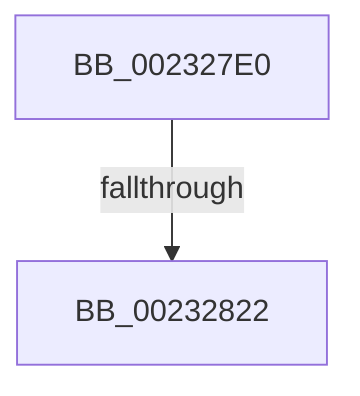

# KeCancelTimer

- RVA: `0x002327E0`–`0x00232835` (길이 `85` bytes)
- VA: `0x00000001402327E0`
- 실행 섹션: `.text`
- PDB 이름 있음: `예`; PDB Function 태그: `아니요`
- unwind 정보 RVA: `0x00060474`
- 디코드: `20`개 명령, `85/85` bytes 표시
- 미해석 바이트: `0` (있으면 어셈블리에 `.byte`로 보존)

> 이 문서는 커널 이미지의 기계어와 PDB 기호를 분석해 생성했습니다. 4번과 5번은 함수 원형과 자료형을 바이너리 사용 방식에서 추정한 C 해석이며 원본 소스 복구 결과는 아닙니다.

## 1. Dependencies

- 직접 호출 지점: **0**; 고유 호출 대상: **0**
- 직접 호출자로 확인된 함수: **48**
- RIP 상대 이미지 참조: **3**

### Outgoing calls
- 직접 디코드된 call 명령이 없습니다.

### Direct callers
- [sub_00204895](../20/Unknown_function_00204895.md) at `0x00204939`
- [ExpDeleteTimer](ExpDeleteTimer_function_00230C40.md) at `0x00230C9B`
- [ExpSetTimerObject](ExpSetTimerObject_function_00231730.md) at `0x0023186A`
- [ExpSetTimerObject](ExpSetTimerObject_function_00231730.md) at `0x002324A3`
- [ExpCancelTimer](ExpCancelTimer_function_00232700.md) at `0x0023271D`
- [ExpCancelTimer](ExpCancelTimer_function_00232700.md) at `0x00232792`
- [PopCompleteIrpWatchdog](../26/PopCompleteIrpWatchdog_function_0026EB94.md) at `0x0026EBDB`
- [PfSnDeactivateTrace](../2A/PfSnDeactivateTrace_function_002A50CC.md) at `0x002A513E`
- [PopFxDisableWorkOrderWatchdog](../2B/PopFxDisableWorkOrderWatchdog_function_002BC858.md) at `0x002BC872`
- [sub_002BD95A](../2B/Unknown_function_002BD95A.md) at `0x002BDB9E`
- [MiRebuildLargePagesThread](../37/MiRebuildLargePagesThread_function_00379AC0.md) at `0x00379C90`
- [KiInvokeInterruptServiceRoutine](../39/KiInvokeInterruptServiceRoutine_function_0039F8E0.md) at `0x0039FAA3`
- [CcDeletePrivateVolumeCacheMap](../3C/CcDeletePrivateVolumeCacheMap_function_003CE950.md) at `0x003CEC0E`
- [PopSetWatchdog](../46/PopSetWatchdog_function_00460CAC.md) at `0x00460D57`
- [MiModifiedPageWriter](../47/MiModifiedPageWriter_function_0047E5F0.md) at `0x0047EB6B`
- [PopFxUpdateDeviceIdleTimer](../4A/PopFxUpdateDeviceIdleTimer_function_004A5C84.md) at `0x004A5CAF`
- [PopDisableIrpWatchdog](../4A/PopDisableIrpWatchdog_function_004A95E8.md) at `0x004A9638`
- [PopCoalescingSetActiveState](../4B/PopCoalescingSetActiveState_function_004B7E18.md) at `0x004B7E38`
- [PpmDisableHighPerfRequestDeferredExpiration](../4B/PpmDisableHighPerfRequestDeferredExpiration_function_004BA678.md) at `0x004BA6CC`
- [PopSetPowerActionWatchdogState](../4C/PopSetPowerActionWatchdogState_function_004C86B8.md) at `0x004C86FF`
- [PopIgnoreBatteryStatusChange](../4E/PopIgnoreBatteryStatusChange_function_004E347C.md) at `0x004E3493`
- [MiUnlinkUnusedControlArea](../4E/MiUnlinkUnusedControlArea_function_004ED9F8.md) at `0x004EDA4E`
- [FsRtlpSyncWithAckTimeout](../4F/FsRtlpSyncWithAckTimeout_function_004F23C4.md) at `0x004F23DE`
- [CcDeletePartition](../57/CcDeletePartition_function_0057DE9C.md) at `0x0057DF25`
- [CcDeletePartition](../57/CcDeletePartition_function_0057DE9C.md) at `0x0057DF68`
- [IopDisableTimer](../59/IopDisableTimer_function_00597000.md) at `0x00597070`
- [DifKeCancelTimerWrapper](../62/DifKeCancelTimerWrapper_function_0062EE20.md) at `0x0062EEED`
- [DbgkpWerDeferredWriteRoutine](../../page/71/DbgkpWerDeferredWriteRoutine_function_00712340.md) at `0x007123D5`
- [PopCoalescingNotify](../../page/75/PopCoalescingNotify_function_0075C0E0.md) at `0x0075C0F9`
- [TtmiResetInactivityTimer](../../page/77/TtmiResetInactivityTimer_function_0077CCF0.md) at `0x0077CD32`
- [TtmpResetEvaluationTimer](../../page/77/TtmpResetEvaluationTimer_function_0077D4E4.md) at `0x0077D52A`
- [ExpTimeZoneCleanupSiloState](../../page/7C/ExpTimeZoneCleanupSiloState_function_007C638C.md) at `0x007C63C5`
- [ExpTimeZoneCleanupSiloState](../../page/7C/ExpTimeZoneCleanupSiloState_function_007C638C.md) at `0x007C63E4`
- [ExpTimeZoneCleanupSiloState](../../page/7C/ExpTimeZoneCleanupSiloState_function_007C638C.md) at `0x007C6403`
- [ExpPartitionDestroy](../../page/7C/ExpPartitionDestroy_function_007CF9B8.md) at `0x007CFA59`
- [CmpShutdownWorkers](../../page/7E/CmpShutdownWorkers_function_007E5AA0.md) at `0x007E5AB9`
- [CmThawRegistry](../../page/7E/CmThawRegistry_function_007E8510.md) at `0x007E8528`
- [PiDrvDbLoadNode](../../page/93/PiDrvDbLoadNode_function_00931AB0.md) at `0x00931B09`
- [PfSnPowerBoost](../../page/93/PfSnPowerBoost_function_00939C14.md) at `0x00939C6A`
- [EtwpLogger](../../page/9B/EtwpLogger_function_009BE310.md) at `0x009BE7A4`
- [EtwpFreeLoggerContext](../../page/9C/EtwpFreeLoggerContext_function_009C1688.md) at `0x009C1742`
- [ExpRefreshTimeZoneInformation](../../page/A6/ExpRefreshTimeZoneInformation_function_00A6B46C.md) at `0x00A6B853`
- [CmSetLazyFlushState](../../page/AB/CmSetLazyFlushState_function_00AB7824.md) at `0x00AB7869`
- [PopBatteryWorker](../../page/AE/PopBatteryWorker_function_00AE1650.md) at `0x00AE1D18`
- [sub_00B30002](../../page/B3/Unknown_function_00B30002.md) at `0x00B300F4`
- [sub_00B3E38E](../../page/B3/Unknown_function_00B3E38E.md) at `0x00B3E3ED`
- [PopBuildDeviceNotifyList](../../pagelk/B7/PopBuildDeviceNotifyList_function_00B789E8.md) at `0x00B78AE4`
- [ViPendingDelayCompletion](../../pagevrfy/BA/ViPendingDelayCompletion_function_00BA1E78.md) at `0x00BA1F59`
- [VfWdCheckForSettingsChange](../../pagevrfy/BA/VfWdCheckForSettingsChange_function_00BAC888.md) at `0x00BAC8AB`
- [AnFwDisableBackgroundUpdateTimer](../../pagebgfx/BC/AnFwDisableBackgroundUpdateTimer_function_00BC008C.md) at `0x00BC00A0`
- [AnFwDisplayBackgroundUpdate](../../pagebgfx/BC/AnFwDisplayBackgroundUpdate_function_00BC1E44.md) at `0x00BC1F8C`
- [AnFwpFadeAnimationTimer](../../pagebgfx/BC/AnFwpFadeAnimationTimer_function_00BC2F50.md) at `0x00BC33D9`
- [AnFwpDisableProgressTimer](../../pagebgfx/BC/AnFwpDisableProgressTimer_function_00BC3CB4.md) at `0x00BC3D08`

### Static image references
- `0x002327F6` → RVA `0x00E0A740` (`.data`; read)
- `0x00232815` → RVA `0x00FC6D20` (`ALMOSTRO`; read)
- `0x0023282B` → RVA `0x00000000` (`image boundary/outside`; read)

## 2. Other-region calls and transfers

- 다른 실행 섹션으로 향하는 call: **0**
- call이 아닌 외부 분기/꼬리 이동: **1**
  - `0x0023281C` → [sub_002329A3](Unknown_function_002329A3.md) (`tail-transfer`)

## 3. Assembly (complete function range)

```asm
002327E0  48 89 5C 24 18                  mov qword ptr [rsp + 0x18], rbx
002327E5  48 89 6C 24 20                  mov qword ptr [rsp + 0x20], rbp
002327EA  56                              push rsi
002327EB  57                              push rdi
002327EC  41 54                           push r12
002327EE  41 56                           push r14
002327F0  41 57                           push r15
002327F2  48 83 EC 70                     sub rsp, 0x70
002327F6  48 8B 05 43 7F BD 00            mov rax, qword ptr [rip + 0xbd7f43]
002327FD  48 33 C4                        xor rax, rsp
00232800  48 89 44 24 68                  mov qword ptr [rsp + 0x68], rax
00232805  48 8B F9                        mov rdi, rcx
00232808  44 0F 20 C6                     mov rsi, cr8
0023280C  B8 02 00 00 00                  mov eax, 2
00232811  44 0F 22 C0                     mov cr8, rax
00232815  83 3D 04 45 D9 00 00            cmp dword ptr [rip + 0xd94504], 0
0023281C  0F 85 81 01 00 00               jne 0x1402329a3
00232822  48 C7 44 24 40 00 00 00 00      mov qword ptr [rsp + 0x40], 0
0023282B  4C 8D 25 CE D7 DC FF            lea r12, [rip - 0x232832]
00232832  45 32 F6                        xor r14b, r14b
```

## 4. C-style interpretation (structured pseudocode)

```c
__int64 __fastcall KeCancelTimer(__int64 a1)
{
    __int64 result;
    __int64 v_r14;
    __int64 v_rsp;
    unsigned __int64 v_stack_m30;
    unsigned __int64 v_stack_m58;
    unsigned __int64 v_stack_p18;
    unsigned __int64 v_stack_p20;

    v_stack_p18 = v_rbx;
    v_stack_p20 = v_rbp;
    v_rsp = (v_rsp) - (112);
    result = (*(unsigned __int64 *)(v_rip + 12418883)) ^ (v_rsp);
    v_stack_m30 = result;
    v_stack_m58 = 0;
    v_r14 = 0;
    return 2;
}
```

## 5. (Beta) C Style

```c
int64_t KeCancelTimer(int64_t Arg1)
{
    int64_t result;
    int64_t local_r14;
    int64_t local_rsp;
    uint64_t v_stack_m30;
    uint64_t v_stack_m58;
    uint64_t v_stack_p18;
    uint64_t v_stack_p20;

    v_stack_p18 = local_rbx;
    v_stack_p20 = local_rbp;
    local_rsp = (local_rsp) - (112);
    result = (*(uint64_t *)(v_rip + 0xBD7F43)) ^ (local_rsp);
    v_stack_m30 = result;
    v_stack_m58 = 0;
    local_r14 = 0;
    return 2;
}
```

## 6. Execution-region graph

[열기: 2D/3D 그래프와 함수 탐색 컨트롤 패널](../../../control-panel.html?section=text&rva=0x002327E0&view=graph)

- 2D 그래프는 위에서 아래로 흐르고, 3D 그래프는 빈 공간을 드래그해 회전합니다. Shift+드래그는 이동, 휠은 확대·축소, 함수 노드 선택은 대상 보고서 이동입니다.

### Static fallback


