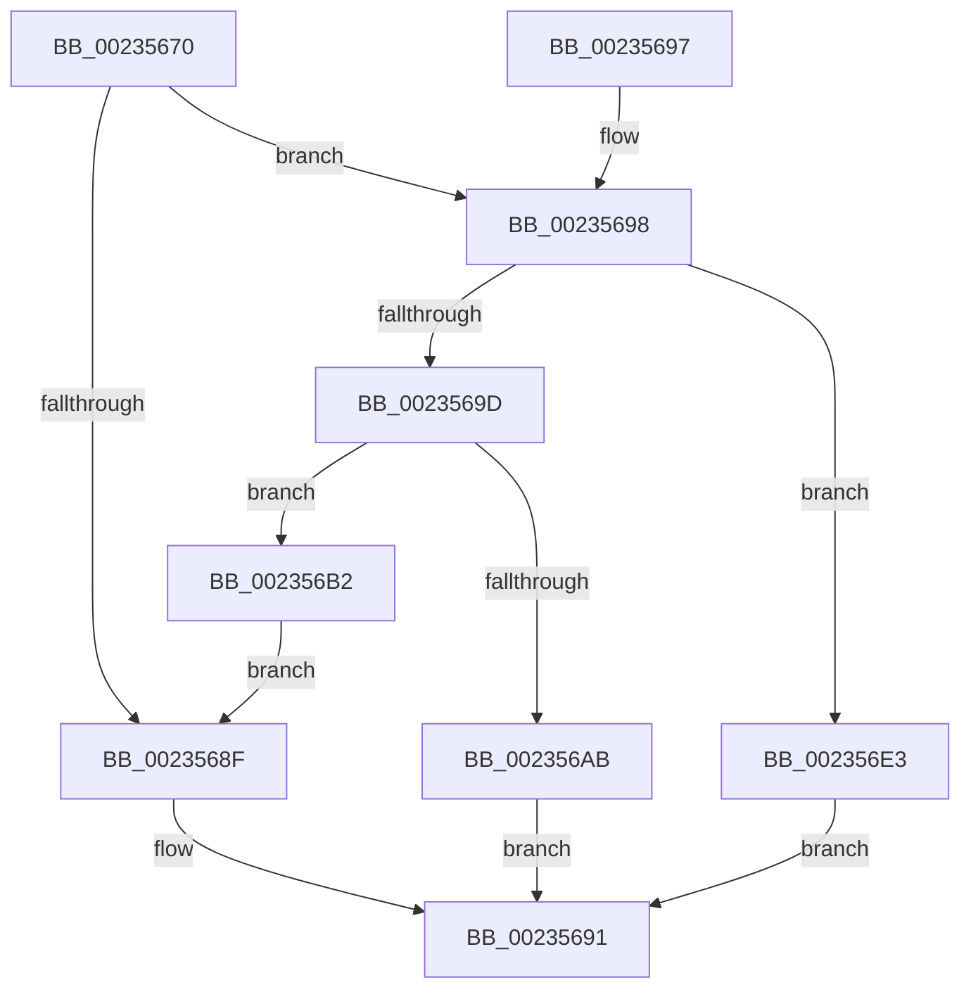

# KeSetTimeAdjustment

- RVA: `0x00235670`–`0x002356EA` (길이 `122` bytes)
- VA: `0x0000000140235670`
- 실행 섹션: `.text`
- PDB 이름 있음: `예`; PDB Function 태그: `아니요`
- unwind 정보 RVA: `0x000606B4`
- 디코드: `35`개 명령, `122/122` bytes 표시
- 미해석 바이트: `0` (있으면 어셈블리에 `.byte`로 보존)

> 이 문서는 커널 이미지의 기계어와 PDB 기호를 분석해 생성했습니다. 4번과 5번은 함수 원형과 자료형을 바이너리 사용 방식에서 추정한 C 해석이며 원본 소스 복구 결과는 아닙니다.

## 1. Dependencies

- 직접 호출 지점: **2**; 고유 호출 대상: **2**
- 직접 호출자로 확인된 함수: **1**
- RIP 상대 이미지 참조: **2**

### Outgoing calls
- `0x002356B9` → [RtlGenerateQpcToIncrementConstants](../4B/RtlGenerateQpcToIncrementConstants_function_004BCB20.md) (function, `0x004BCB20`)
- `0x002356DC` → [KiUpdateSystemTime](../4B/KiUpdateSystemTime_function_004B1570.md) (function, `0x004B1570`)

### Direct callers
- [ExpUpdateTimerConfigurationWorker](ExpUpdateTimerConfigurationWorker_function_00235410.md) at `0x002355A3`

### Static image references
- `0x00235676` → RVA `0x00FC7070` (`ALMOSTRO`; read)
- `0x002356D5` → RVA `0x00FC7070` (`ALMOSTRO`; write)

## 2. Other-region calls and transfers

- 다른 실행 섹션으로 향하는 call: **0**
- 별도 외부 분기/꼬리 이동을 확인하지 못했습니다.

## 3. Assembly (complete function range)

```asm
00235670  40 53                           push rbx
00235672  48 83 EC 30                     sub rsp, 0x30
00235676  48 3B 0D F3 19 D9 00            cmp rcx, qword ptr [rip + 0xd919f3]
0023567D  0F 57 C0                        xorps xmm0, xmm0
00235680  0F 11 44 24 20                  movups xmmword ptr [rsp + 0x20], xmm0
00235685  48 8B D9                        mov rbx, rcx
00235688  C6 44 24 40 00                  mov byte ptr [rsp + 0x40], 0
0023568D  75 09                           jne 0x140235698
0023568F  33 C0                           xor eax, eax
00235691  48 83 C4 30                     add rsp, 0x30
00235695  5B                              pop rbx
00235696  C3                              ret
00235697  CC                              int3
00235698  48 85 DB                        test rbx, rbx
0023569B  74 46                           je 0x1402356e3
0023569D  48 8D 41 FE                     lea rax, [rcx - 2]
002356A1  B9 FD FF FF FF                  mov ecx, 0xfffffffd
002356A6  48 3B C1                        cmp rax, rcx
002356A9  76 07                           jbe 0x1402356b2
002356AB  B8 95 00 00 C0                  mov eax, 0xc0000095
002356B0  EB DF                           jmp 0x140235691
002356B2  48 8D 54 24 40                  lea rdx, [rsp + 0x40]
002356B7  8B CB                           mov ecx, ebx
002356B9  E8 62 74 28 00                  call 0x1404bcb20
002356BE  48 89 44 24 20                  mov qword ptr [rsp + 0x20], rax
002356C3  48 8D 54 24 20                  lea rdx, [rsp + 0x20]
002356C8  8A 44 24 40                     mov al, byte ptr [rsp + 0x40]
002356CC  45 33 C0                        xor r8d, r8d
002356CF  33 C9                           xor ecx, ecx
002356D1  88 44 24 28                     mov byte ptr [rsp + 0x28], al
002356D5  48 89 1D 94 19 D9 00            mov qword ptr [rip + 0xd91994], rbx
002356DC  E8 8F BE 27 00                  call 0x1404b1570
002356E1  EB AC                           jmp 0x14023568f
002356E3  B8 94 00 00 C0                  mov eax, 0xc0000094
002356E8  EB A7                           jmp 0x140235691
```

## 4. C-style interpretation (structured pseudocode)

```c
__int64 __fastcall KeSetTimeAdjustment(__int64 a1, __int64 a2, int a3)
{
    __int64 result;
    __int64 v_rsp;
    unsigned __int64 v_stack_m18;
    unsigned __int64 v_stack_p20;
    unsigned __int8 v_stack_p28;
    unsigned __int64 v_stack_p40;
    unsigned __int8 v_stack_p8;

    v_rsp = (v_rsp) - (48);
    v_stack_m18 = v_xmm0;
    v_stack_p8 = 0;
    if (a1 != (*(unsigned __int64 *)(v_rip + 14227955))) goto loc_00235698;
loc_0023568F:
    result = 0;
loc_00235691:
    v_rsp = (v_rsp) + (48);
    return result;
loc_00235698:
    if (a1 == 0) goto loc_002356E3;
    if ((a1 - 2) <= ((unsigned int)(0xFFFFFFFDULL))) goto loc_002356B2;
    goto loc_00235691;
loc_002356B2:
    result = RtlGenerateQpcToIncrementConstants((unsigned int)((unsigned int)(a1)), v_stack_p40, a3, a4);
    v_stack_p20 = result;
    a3 = 0;
    a1 = 0;
    v_stack_p28 = (unsigned __int8)(v_stack_p40);
    *(unsigned __int64 *)(v_rip + 14227860) = 0;
    result = KiUpdateSystemTime(a1, v_stack_p20, a3, a4);
    goto loc_0023568F;
loc_002356E3:
    goto loc_00235691;
}
```

## 5. (Beta) C Style

```c
int64_t KeSetTimeAdjustment(int64_t Arg1, int64_t Arg2, int32_t Arg3)
{
    int64_t result;
    int64_t local_rsp;
    uint64_t v_stack_m18;
    uint64_t v_stack_p20;
    uint8_t v_stack_p28;
    uint64_t v_stack_p40;
    uint8_t v_stack_p8;

    local_rsp = (local_rsp) - (48);
    v_stack_m18 = v_xmm0;
    v_stack_p8 = 0;
    if (Arg1 != (*(uint64_t *)(v_rip + 0xD919F3))) goto loc_00235698;
loc_0023568F:
    result = 0;
loc_00235691:
    local_rsp = (local_rsp) + (48);
    return result;
loc_00235698:
    if (Arg1 == 0) goto loc_002356E3;
    if ((Arg1 - 2) <= ((uint32_t)(0xFFFFFFFDULL))) goto loc_002356B2;
    goto loc_00235691;
loc_002356B2:
    result = RtlGenerateQpcToIncrementConstants((uint32_t)((uint32_t)(Arg1)), v_stack_p40, Arg3, a4);
    v_stack_p20 = result;
    Arg3 = 0;
    Arg1 = 0;
    v_stack_p28 = (uint8_t)(v_stack_p40);
    *(uint64_t *)(v_rip + 0xD91994) = 0;
    result = KiUpdateSystemTime(Arg1, v_stack_p20, Arg3, a4);
    goto loc_0023568F;
loc_002356E3:
    goto loc_00235691;
}
```

## 6. Execution-region graph

[열기: 2D/3D 그래프와 함수 탐색 컨트롤 패널](../../../control-panel.html?section=text&rva=0x00235670&view=graph)

- 2D 그래프는 위에서 아래로 흐르고, 3D 그래프는 빈 공간을 드래그해 회전합니다. Shift+드래그는 이동, 휠은 확대·축소, 함수 노드 선택은 대상 보고서 이동입니다.

### Static fallback


