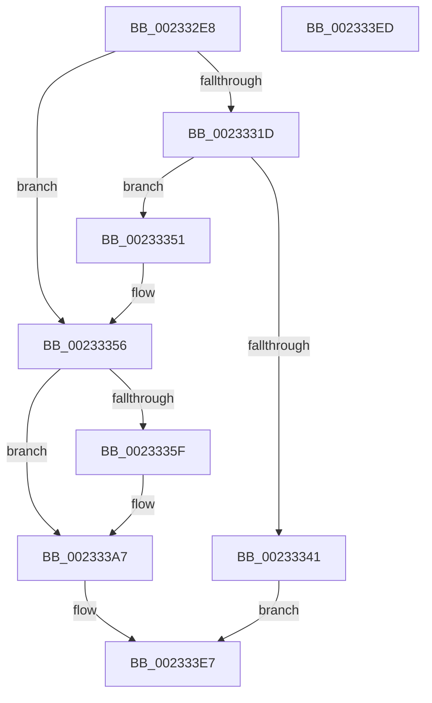

# KiComputeDueTime

- RVA: `0x002332E8`–`0x002333EE` (길이 `262` bytes)
- VA: `0x00000001402332E8`
- 실행 섹션: `.text`
- PDB 이름 있음: `예`; PDB Function 태그: `아니요`
- unwind 정보 RVA: `0x0005CF00`
- 디코드: `75`개 명령, `262/262` bytes 표시
- 미해석 바이트: `0` (있으면 어셈블리에 `.byte`로 보존)

> 이 문서는 커널 이미지의 기계어와 PDB 기호를 분석해 생성했습니다. 4번과 5번은 함수 원형과 자료형을 바이너리 사용 방식에서 추정한 C 해석이며 원본 소스 복구 결과는 아닙니다.

## 1. Dependencies

- 직접 호출 지점: **0**; 고유 호출 대상: **0**
- 직접 호출자로 확인된 함수: **5**
- RIP 상대 이미지 참조: **0**

### Outgoing calls
- 직접 디코드된 call 명령이 없습니다.

### Direct callers
- [KiResumeThread](../20/KiResumeThread_function_00203644.md) at `0x0020394B`
- [KiCommitThreadWait](../20/KiCommitThreadWait_function_0020DFE0.md) at `0x0020E4C3`
- [ExpSetTimerObject](ExpSetTimerObject_function_00231730.md) at `0x00231C69`
- [KiSetTimerEx](KiSetTimerEx_function_00232CB0.md) at `0x00232EDF`
- [KeSetTimer](KeSetTimer_function_00233BE0.md) at `0x00233DF1`

### Static image references
- 디코드된 RIP-relative 메모리 참조가 없습니다.

## 2. Other-region calls and transfers

- 다른 실행 섹션으로 향하는 call: **0**
- 별도 외부 분기/꼬리 이동을 확인하지 못했습니다.

## 3. Assembly (complete function range)

```asm
002332E8  40 53                           push rbx
002332EA  48 83 EC 20                     sub rsp, 0x20
002332EE  33 C0                           xor eax, eax
002332F0  0F 57 C0                        xorps xmm0, xmm0
002332F3  48 89 44 24 10                  mov qword ptr [rsp + 0x10], rax
002332F8  49 8B D9                        mov rbx, r9
002332FB  8B 01                           mov eax, dword ptr [rcx]
002332FD  45 33 C9                        xor r9d, r9d
00233300  0F 11 04 24                     movups xmmword ptr [rsp], xmm0
00233304  89 04 24                        mov dword ptr [rsp], eax
00233307  45 8A D0                        mov r10b, r8b
0023330A  48 8B C2                        mov rax, rdx
0023330D  44 88 44 24 01                  mov byte ptr [rsp + 1], r8b
00233312  48 C1 E8 20                     shr rax, 0x20
00233316  4C 8B D9                        mov r11, rcx
00233319  85 C0                           test eax, eax
0023331B  78 39                           js 0x140233356
0023331D  41 80 CA 01                     or r10b, 1
00233321  48 B8 14 00 00 00 80 F7 FF FF   movabs rax, 0xfffff78000000014
0023332B  44 88 54 24 01                  mov byte ptr [rsp + 1], r10b
00233330  48 8B 00                        mov rax, qword ptr [rax]
00233333  48 2B C2                        sub rax, rdx
00233336  48 8B D0                        mov rdx, rax
00233339  48 C1 E8 20                     shr rax, 0x20
0023333D  85 C0                           test eax, eax
0023333F  78 10                           js 0x140233351
00233341  8B 04 24                        mov eax, dword ptr [rsp]
00233344  89 01                           mov dword ptr [rcx], eax
00233346  33 C0                           xor eax, eax
00233348  4C 89 49 18                     mov qword ptr [rcx + 0x18], r9
0023334C  E9 96 00 00 00                  jmp 0x1402333e7
00233351  44 8A 54 24 01                  mov r10b, byte ptr [rsp + 1]
00233356  41 C0 EA 02                     shr r10b, 2
0023335A  45 84 D2                        test r10b, r10b
0023335D  74 48                           je 0x1402333a7
0023335F  41 8A C2                        mov al, r10b
00233362  C0 E8 03                        shr al, 3
00233365  04 02                           add al, 2
00233367  0F B6 C8                        movzx ecx, al
0023336A  41 80 FA 08                     cmp r10b, 8
0023336E  41 8A C2                        mov al, r10b
00233371  66 45 1B C9                     sbb r9w, r9w
00233375  24 07                           and al, 7
00233377  44 0F B6 C0                     movzx r8d, al
0023337B  66 41 F7 D1                     not r9w
0023337F  66 41 83 E1 08                  and r9w, 8
00233384  8D 41 01                        lea eax, [rcx + 1]
00233387  66 45 0B C8                     or r9w, r8w
0023338B  0F B6 C0                        movzx eax, al
0023338E  41 80 FA 08                     cmp r10b, 8
00233392  0F 42 C8                        cmovb ecx, eax
00233395  66 41 D3 E1                     shl r9w, cl
00233399  41 0F B7 C1                     movzx eax, r9w
0023339D  C1 E8 03                        shr eax, 3
002333A0  44 69 C8 10 27 00 00            imul r9d, eax, 0x2710
002333A7  49 B8 08 00 00 00 80 F7 FF FF   movabs r8, 0xfffff78000000008
002333B1  B8 01 00 00 00                  mov eax, 1
002333B6  4D 8B 00                        mov r8, qword ptr [r8]
002333B9  4C 2B C2                        sub r8, rdx
002333BC  48 83 CA FF                     or rdx, 0xffffffffffffffff
002333C0  4D 89 43 18                     mov qword ptr [r11 + 0x18], r8
002333C4  4B 8D 0C 08                     lea rcx, [r8 + r9]
002333C8  49 3B C8                        cmp rcx, r8
002333CB  48 0F 43 D1                     cmovae rdx, rcx
002333CF  48 C1 EA 12                     shr rdx, 0x12
002333D3  80 4C 24 03 40                  or byte ptr [rsp + 3], 0x40
002333D8  0F B6 CA                        movzx ecx, dl
002333DB  88 4C 24 02                     mov byte ptr [rsp + 2], cl
002333DF  89 0B                           mov dword ptr [rbx], ecx
002333E1  8B 0C 24                        mov ecx, dword ptr [rsp]
002333E4  41 89 0B                        mov dword ptr [r11], ecx
002333E7  48 83 C4 20                     add rsp, 0x20
002333EB  5B                              pop rbx
002333EC  C3                              ret
002333ED  CC                              int3
```

## 4. C-style interpretation (structured pseudocode)

```c
__int64 __fastcall KiComputeDueTime(__int64 a1, __int64 a2, unsigned __int8 a3, __int64 a4)
{
    __int64 result;
    __int64 v_r10;
    __int64 v_rsp;
    unsigned __int64 v_stack_m18;
    unsigned __int8 v_stack_m25;
    unsigned __int8 v_stack_m26;
    unsigned __int8 v_stack_m27;
    unsigned __int64 v_stack_m28;

    v_rsp = (v_rsp) - (32);
    result = 0;
    v_stack_m18 = 0;
    a4 = 0;
    v_stack_m28 = v_xmm0;
    v_stack_m28 = (unsigned int)((unsigned int)(*(unsigned int *)(a1)));
    v_stack_m27 = a3;
    result = (a2) >> (32);
    if (sign_flag) goto loc_00233356;
    v_r10 = (unsigned __int8)((a3) | (1));
    v_stack_m27 = (unsigned __int8)(v_r10);
    result = (*(unsigned __int64 *)(result)) - (a2);
    result = (result) >> (32);
    if (sign_flag) goto loc_00233351;
    *(unsigned int *)(a1) = (unsigned int)((unsigned int)(v_stack_m28));
    result = 0;
    *(unsigned __int64 *)(a1 + 24) = 0;
    goto loc_002333E7;
loc_00233351:
loc_00233356:
    v_r10 = (unsigned __int8)((v_stack_m27) >> (2));
    if ((unsigned __int8)(v_r10) != 0) {
        result = (unsigned __int8)(v_r10);
        result = (unsigned __int8)((result) >> (3));
        result = (unsigned __int8)((result) + (2));
        a1 = (unsigned __int8)(result);
        result = (unsigned __int8)(v_r10);
        result = (unsigned __int8)((result) & (7));
        a3 = (unsigned __int8)(result);
        a4 = (unsigned __int16)(~(a4));
        a4 = (unsigned __int16)((a4) & (8));
        result = a1 + 1;
        a4 = (unsigned __int16)((a4) | (a3));
        result = (unsigned __int8)(result);
        if (((unsigned __int8)(v_r10)) < 8) { a1 = (unsigned int)(result); }
        a4 = (unsigned __int16)((a4) << ((unsigned __int8)(a1)));
        result = (unsigned __int16)(a4);
        result = (unsigned int)((result) >> (3));
        a4 = (unsigned int)((a4) * ((unsigned int)(result)));
    }
    a3 = (*(unsigned __int64 *)(a3)) - (result);
    a2 = (result) | (-1);
    *(unsigned __int64 *)(a1 + 24) = a3;
    if ((a3 + a4 * 1) >= a3) { a2 = a3 + a4 * 1; }
    a2 = (a2) >> (18);
    v_stack_m26 = (unsigned __int8)((unsigned __int8)(a2));
    *(unsigned int *)(a4) = (unsigned int)((unsigned __int8)(a2));
    *(unsigned int *)(a1) = (unsigned int)((unsigned int)(v_stack_m28));
loc_002333E7:
    v_rsp = (v_rsp) + (32);
    return 1;
}
```

## 5. (Beta) C Style

```c
int64_t KiComputeDueTime(void *Arg1, int64_t Arg2, uint8_t Arg3, void *Arg4)
{
    uint8_t *arg1 = (uint8_t *)Arg1;
    uint8_t *arg4 = (uint8_t *)Arg4;

    int64_t result;
    int64_t local_r10;
    int64_t local_rsp;
    uint64_t v_stack_m18;
    uint8_t v_stack_m25;
    uint8_t v_stack_m26;
    uint8_t v_stack_m27;
    uint64_t v_stack_m28;

    local_rsp = (local_rsp) - (32);
    result = 0;
    v_stack_m18 = 0;
    Arg4 = 0;
    v_stack_m28 = v_xmm0;
    v_stack_m28 = (uint32_t)((uint32_t)(*(uint32_t *)(arg1)));
    v_stack_m27 = Arg3;
    result = (Arg2) >> (32);
    if (sign_flag) goto loc_00233356;
    local_r10 = (uint8_t)((Arg3) | (1));
    v_stack_m27 = (uint8_t)(local_r10);
    result = (*(uint64_t *)(result)) - (Arg2);
    result = (result) >> (32);
    if (sign_flag) goto loc_00233351;
    *(uint32_t *)(arg1) = (uint32_t)((uint32_t)(v_stack_m28));
    result = 0;
    *(uint64_t *)(arg1 + 0x18) = 0;
    goto loc_002333E7;
loc_00233351:
loc_00233356:
    local_r10 = (uint8_t)((v_stack_m27) >> (2));
    if ((uint8_t)(local_r10) != 0) {
        result = (uint8_t)(local_r10);
        result = (uint8_t)((result) >> (3));
        result = (uint8_t)((result) + (2));
        Arg1 = (uint8_t)(result);
        result = (uint8_t)(local_r10);
        result = (uint8_t)((result) & (7));
        Arg3 = (uint8_t)(result);
        Arg4 = (uint16_t)(~(Arg4));
        Arg4 = (uint16_t)((Arg4) & (8));
        result = Arg1 + 1;
        Arg4 = (uint16_t)((Arg4) | (Arg3));
        result = (uint8_t)(result);
        if (((uint8_t)(local_r10)) < 8) { Arg1 = (uint32_t)(result); }
        Arg4 = (uint16_t)((Arg4) << ((uint8_t)(Arg1)));
        result = (uint16_t)(Arg4);
        result = (uint32_t)((result) >> (3));
        Arg4 = (uint32_t)((Arg4) * ((uint32_t)(result)));
    }
    Arg3 = (*(uint64_t *)(Arg3)) - (result);
    Arg2 = (result) | (-1);
    *(uint64_t *)(arg1 + 0x18) = Arg3;
    if ((Arg3 + Arg4 * 1) >= Arg3) { Arg2 = Arg3 + Arg4 * 1; }
    Arg2 = (Arg2) >> (18);
    v_stack_m26 = (uint8_t)((uint8_t)(Arg2));
    *(uint32_t *)(arg4) = (uint32_t)((uint8_t)(Arg2));
    *(uint32_t *)(arg1) = (uint32_t)((uint32_t)(v_stack_m28));
loc_002333E7:
    local_rsp = (local_rsp) + (32);
    return 1;
}
```

### 관측된 메모리 오프셋

구조체 형식이 확인되지 않은 접근은 인자 기준의 오프셋으로만 기록했습니다.

| 기준 인자 | 오프셋 표현 | 폭 (bit) | 접근 |
|---|---:|---:|---|
| `Arg1` | `+ 0x0` | `32` | `R` |
| `Arg1` | `+ 0x0` | `32` | `W` |
| `Arg1` | `+ 0x18` | `64` | `W` |
| `Arg4` | `+ 0x0` | `32` | `W` |

## 6. Execution-region graph

[열기: 2D/3D 그래프와 함수 탐색 컨트롤 패널](../../../control-panel.html?section=text&rva=0x002332E8&view=graph)

- 2D 그래프는 위에서 아래로 흐르고, 3D 그래프는 빈 공간을 드래그해 회전합니다. Shift+드래그는 이동, 휠은 확대·축소, 함수 노드 선택은 대상 보고서 이동입니다.

### Static fallback


