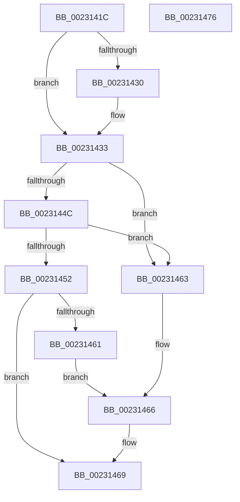

# KiEncodeTolerableDelayValue

- RVA: `0x0023141C`–`0x00231477` (길이 `91` bytes)
- VA: `0x000000014023141C`
- 실행 섹션: `.text`
- PDB 이름 있음: `예`; PDB Function 태그: `아니요`
- unwind 정보 RVA: `0x000DB714`
- 디코드: `31`개 명령, `91/91` bytes 표시
- 미해석 바이트: `0` (있으면 어셈블리에 `.byte`로 보존)

> 이 문서는 커널 이미지의 기계어와 PDB 기호를 분석해 생성했습니다. 4번과 5번은 함수 원형과 자료형을 바이너리 사용 방식에서 추정한 C 해석이며 원본 소스 복구 결과는 아닙니다.

## 1. Dependencies

- 직접 호출 지점: **0**; 고유 호출 대상: **0**
- 직접 호출자로 확인된 함수: **3**
- RIP 상대 이미지 참조: **0**

### Outgoing calls
- 직접 디코드된 call 명령이 없습니다.

### Direct callers
- [KeSetCoalescableTimer](../22/KeSetCoalescableTimer_function_0022FFD0.md) at `0x00230046`
- [ExpSetTimerObject](ExpSetTimerObject_function_00231730.md) at `0x00231E57`
- [PopFxEnableWorkOrderWatchdog](../2B/PopFxEnableWorkOrderWatchdog_function_002BD268.md) at `0x002BD346`

### Static image references
- 디코드된 RIP-relative 메모리 참조가 없습니다.

## 2. Other-region calls and transfers

- 다른 실행 섹션으로 향하는 call: **0**
- 별도 외부 분기/꼬리 이동을 확인하지 못했습니다.

## 3. Assembly (complete function range)

```asm
0023141C  B8 59 17 B7 D1                  mov eax, 0xd1b71759
00231421  F7 E1                           mul ecx
00231423  B8 C0 03 00 00                  mov eax, 0x3c0
00231428  C1 EA 0D                        shr edx, 0xd
0023142B  66 3B D0                        cmp dx, ax
0023142E  76 03                           jbe 0x140231433
00231430  0F B7 D0                        movzx edx, ax
00231433  B8 FF 1F 00 00                  mov eax, 0x1fff
00231438  66 23 D0                        and dx, ax
0023143B  66 03 D2                        add dx, dx
0023143E  0F B7 C2                        movzx eax, dx
00231441  44 0F BD C0                     bsr r8d, eax
00231445  0F 95 C0                        setne al
00231448  84 C0                           test al, al
0023144A  74 17                           je 0x140231463
0023144C  41 83 F8 03                     cmp r8d, 3
00231450  72 11                           jb 0x140231463
00231452  41 80 E8 03                     sub r8b, 3
00231456  41 8A C8                        mov cl, r8b
00231459  66 D3 EA                        shr dx, cl
0023145C  45 84 C0                        test r8b, r8b
0023145F  75 08                           jne 0x140231469
00231461  EB 03                           jmp 0x140231466
00231463  45 32 C0                        xor r8b, r8b
00231466  66 D1 EA                        shr dx, 1
00231469  80 E2 07                        and dl, 7
0023146C  41 C0 E0 03                     shl r8b, 3
00231470  41 0A D0                        or dl, r8b
00231473  8A C2                           mov al, dl
00231475  C3                              ret
00231476  CC                              int3
```

## 4. C-style interpretation (structured pseudocode)

```c
__int64 __fastcall KiEncodeTolerableDelayValue(int a1, int a2)
{
    __int64 result;

    a2 = (unsigned int)((a2) >> (13));
    if (((unsigned __int16)(a2)) >= = 960) {
        a2 = 960;
    }
    a2 = (unsigned __int16)((a2) & ((unsigned __int16)((unsigned int)(0x1FFFULL))));
    a2 = (unsigned __int16)((a2) + ((unsigned __int16)(a2)));
    result = (condition_is_not_equal) ? 1 : 0;
    if ((unsigned __int8)(result) == 0) goto loc_00231463;
    if (((unsigned int)(a3)) < 3) goto loc_00231463;
    a3 = (unsigned __int8)((a3) - (3));
    a2 = (unsigned __int16)((a2) >> ((unsigned __int8)((unsigned __int8)(a3))));
    if ((unsigned __int8)(a3) != 0) goto loc_00231469;
    goto loc_00231466;
loc_00231463:
    a3 = 0;
loc_00231466:
    a2 = (unsigned __int16)((a2) >> (1));
loc_00231469:
    a2 = (unsigned __int8)((a2) & (7));
    a3 = (unsigned __int8)((a3) << (3));
    a2 = (unsigned __int8)((a2) | ((unsigned __int8)(a3)));
    return (unsigned __int8)(a2);
}
```

## 5. (Beta) C Style

```c
int64_t KiEncodeTolerableDelayValue(int32_t Arg1, int32_t Arg2)
{
    int64_t result;

    Arg2 = (uint32_t)((Arg2) >> (13));
    if (((uint16_t)(Arg2)) >= = 960) {
        Arg2 = 960;
    }
    Arg2 = (uint16_t)((Arg2) & ((uint16_t)((uint32_t)(0x1FFFULL))));
    Arg2 = (uint16_t)((Arg2) + ((uint16_t)(Arg2)));
    result = (condition_is_not_equal) ? 1 : 0;
    if ((uint8_t)(result) == 0) goto loc_00231463;
    if (((uint32_t)(a3)) < 3) goto loc_00231463;
    a3 = (uint8_t)((a3) - (3));
    Arg2 = (uint16_t)((Arg2) >> ((uint8_t)((uint8_t)(a3))));
    if ((uint8_t)(a3) != 0) goto loc_00231469;
    goto loc_00231466;
loc_00231463:
    a3 = 0;
loc_00231466:
    Arg2 = (uint16_t)((Arg2) >> (1));
loc_00231469:
    Arg2 = (uint8_t)((Arg2) & (7));
    a3 = (uint8_t)((a3) << (3));
    Arg2 = (uint8_t)((Arg2) | ((uint8_t)(a3)));
    return (uint8_t)(Arg2);
}
```

## 6. Execution-region graph

[열기: 2D/3D 그래프와 함수 탐색 컨트롤 패널](../../../control-panel.html?section=text&rva=0x0023141C&view=graph)

- 2D 그래프는 위에서 아래로 흐르고, 3D 그래프는 빈 공간을 드래그해 회전합니다. Shift+드래그는 이동, 휠은 확대·축소, 함수 노드 선택은 대상 보고서 이동입니다.

### Static fallback


