# KiGetClockTimerEarliestDeadline

- RVA: `0x00237AB0`–`0x00237C55` (길이 `421` bytes)
- VA: `0x0000000140237AB0`
- 실행 섹션: `.text`
- PDB 이름 있음: `예`; PDB Function 태그: `아니요`
- unwind 정보 RVA: `0x000DB714`
- 디코드: `104`개 명령, `421/421` bytes 표시
- 미해석 바이트: `0` (있으면 어셈블리에 `.byte`로 보존)

> 이 문서는 커널 이미지의 기계어와 PDB 기호를 분석해 생성했습니다. 4번과 5번은 함수 원형과 자료형을 바이너리 사용 방식에서 추정한 C 해석이며 원본 소스 복구 결과는 아닙니다.

## 1. Dependencies

- 직접 호출 지점: **0**; 고유 호출 대상: **0**
- 직접 호출자로 확인된 함수: **3**
- RIP 상대 이미지 참조: **0**

### Outgoing calls
- 직접 디코드된 call 명령이 없습니다.

### Direct callers
- [KiSetNextClockTickDueTime](KiSetNextClockTickDueTime_function_002363F0.md) at `0x0023644F`
- [KiShouldRearmClockTimer](../39/KiShouldRearmClockTimer_function_0039E134.md) at `0x0039E19A`
- [KeEstimateClockTickDuration](../4C/KeEstimateClockTickDuration_function_004C7CCC.md) at `0x004C7D5D`

### Static image references
- 디코드된 RIP-relative 메모리 참조가 없습니다.

## 2. Other-region calls and transfers

- 다른 실행 섹션으로 향하는 call: **0**
- 별도 외부 분기/꼬리 이동을 확인하지 못했습니다.

## 3. Assembly (complete function range)

```asm
00237AB0  0F B6 81 A4 95 00 00            movzx eax, byte ptr [rcx + 0x95a4]
00237AB7  44 0F B6 D2                     movzx r10d, dl
00237ABB  41 B9 07 00 00 00               mov r9d, 7
00237AC1  49 C7 C0 FF FF FF FF            mov r8, 0xffffffffffffffff
00237AC8  A8 01                           test al, 1
00237ACA  74 20                           je 0x140237aec
00237ACC  84 D2                           test dl, dl
00237ACE  0F 84 37 01 00 00               je 0x140237c0b
00237AD4  8B 81 A0 95 00 00               mov eax, dword ptr [rcx + 0x95a0]
00237ADA  48 03 81 98 95 00 00            add rax, qword ptr [rcx + 0x9598]
00237AE1  49 3B C0                        cmp rax, r8
00237AE4  73 06                           jae 0x140237aec
00237AE6  4C 8B C0                        mov r8, rax
00237AE9  45 33 C9                        xor r9d, r9d
00237AEC  0F B6 81 B4 95 00 00            movzx eax, byte ptr [rcx + 0x95b4]
00237AF3  A8 01                           test al, 1
00237AF5  74 24                           je 0x140237b1b
00237AF7  45 84 D2                        test r10b, r10b
00237AFA  0F 84 18 01 00 00               je 0x140237c18
00237B00  8B 81 B0 95 00 00               mov eax, dword ptr [rcx + 0x95b0]
00237B06  48 03 81 A8 95 00 00            add rax, qword ptr [rcx + 0x95a8]
00237B0D  49 3B C0                        cmp rax, r8
00237B10  73 09                           jae 0x140237b1b
00237B12  4C 8B C0                        mov r8, rax
00237B15  41 B9 01 00 00 00               mov r9d, 1
00237B1B  0F B6 81 C4 95 00 00            movzx eax, byte ptr [rcx + 0x95c4]
00237B22  A8 01                           test al, 1
00237B24  74 24                           je 0x140237b4a
00237B26  45 84 D2                        test r10b, r10b
00237B29  0F 84 F6 00 00 00               je 0x140237c25
00237B2F  8B 81 C0 95 00 00               mov eax, dword ptr [rcx + 0x95c0]
00237B35  48 03 81 B8 95 00 00            add rax, qword ptr [rcx + 0x95b8]
00237B3C  49 3B C0                        cmp rax, r8
00237B3F  73 09                           jae 0x140237b4a
00237B41  4C 8B C0                        mov r8, rax
00237B44  41 B9 02 00 00 00               mov r9d, 2
00237B4A  0F B6 81 D4 95 00 00            movzx eax, byte ptr [rcx + 0x95d4]
00237B51  A8 01                           test al, 1
00237B53  74 24                           je 0x140237b79
00237B55  45 84 D2                        test r10b, r10b
00237B58  0F 84 D4 00 00 00               je 0x140237c32
00237B5E  8B 81 D0 95 00 00               mov eax, dword ptr [rcx + 0x95d0]
00237B64  48 03 81 C8 95 00 00            add rax, qword ptr [rcx + 0x95c8]
00237B6B  49 3B C0                        cmp rax, r8
00237B6E  73 09                           jae 0x140237b79
00237B70  4C 8B C0                        mov r8, rax
00237B73  41 B9 03 00 00 00               mov r9d, 3
00237B79  0F B6 81 E4 95 00 00            movzx eax, byte ptr [rcx + 0x95e4]
00237B80  A8 01                           test al, 1
00237B82  74 24                           je 0x140237ba8
00237B84  45 84 D2                        test r10b, r10b
00237B87  0F 84 B2 00 00 00               je 0x140237c3f
00237B8D  8B 81 E0 95 00 00               mov eax, dword ptr [rcx + 0x95e0]
00237B93  48 03 81 D8 95 00 00            add rax, qword ptr [rcx + 0x95d8]
00237B9A  49 3B C0                        cmp rax, r8
00237B9D  73 09                           jae 0x140237ba8
00237B9F  4C 8B C0                        mov r8, rax
00237BA2  41 B9 04 00 00 00               mov r9d, 4
00237BA8  0F B6 81 F4 95 00 00            movzx eax, byte ptr [rcx + 0x95f4]
00237BAF  A8 01                           test al, 1
00237BB1  74 24                           je 0x140237bd7
00237BB3  45 84 D2                        test r10b, r10b
00237BB6  0F 84 90 00 00 00               je 0x140237c4c
00237BBC  8B 81 F0 95 00 00               mov eax, dword ptr [rcx + 0x95f0]
00237BC2  48 03 81 E8 95 00 00            add rax, qword ptr [rcx + 0x95e8]
00237BC9  49 3B C0                        cmp rax, r8
00237BCC  73 09                           jae 0x140237bd7
00237BCE  4C 8B C0                        mov r8, rax
00237BD1  41 B9 05 00 00 00               mov r9d, 5
00237BD7  0F B6 91 04 96 00 00            movzx edx, byte ptr [rcx + 0x9604]
00237BDE  F6 C2 01                        test dl, 1
00237BE1  74 23                           je 0x140237c06
00237BE3  45 84 D2                        test r10b, r10b
00237BE6  74 19                           je 0x140237c01
00237BE8  8B 81 00 96 00 00               mov eax, dword ptr [rcx + 0x9600]
00237BEE  48 03 81 F8 95 00 00            add rax, qword ptr [rcx + 0x95f8]
00237BF5  49 3B C0                        cmp rax, r8
00237BF8  73 0C                           jae 0x140237c06
00237BFA  B8 06 00 00 00                  mov eax, 6
00237BFF  C3                              ret
00237C00  CC                              int3
00237C01  F6 C2 02                        test dl, 2
00237C04  74 E2                           je 0x140237be8
00237C06  41 8B C1                        mov eax, r9d
00237C09  C3                              ret
00237C0A  CC                              int3
00237C0B  A8 02                           test al, 2
00237C0D  0F 85 D9 FE FF FF               jne 0x140237aec
00237C13  E9 BC FE FF FF                  jmp 0x140237ad4
00237C18  A8 02                           test al, 2
00237C1A  0F 85 FB FE FF FF               jne 0x140237b1b
00237C20  E9 DB FE FF FF                  jmp 0x140237b00
00237C25  A8 02                           test al, 2
00237C27  0F 85 1D FF FF FF               jne 0x140237b4a
00237C2D  E9 FD FE FF FF                  jmp 0x140237b2f
00237C32  A8 02                           test al, 2
00237C34  0F 85 3F FF FF FF               jne 0x140237b79
00237C3A  E9 1F FF FF FF                  jmp 0x140237b5e
00237C3F  A8 02                           test al, 2
00237C41  0F 85 61 FF FF FF               jne 0x140237ba8
00237C47  E9 41 FF FF FF                  jmp 0x140237b8d
00237C4C  A8 02                           test al, 2
00237C4E  75 87                           jne 0x140237bd7
00237C50  E9 67 FF FF FF                  jmp 0x140237bbc
```

## 4. C-style interpretation (structured pseudocode)

```c
__int64 __fastcall KiGetClockTimerEarliestDeadline(__int64 a1, unsigned __int8 a2)
{
    __int64 result;

    if ((((unsigned __int8)(*(unsigned __int8 *)(a1 + 38308))) & (1)) == 0) goto loc_00237AEC;
    if (a2 == 0) goto loc_00237C0B;
loc_00237AD4:
    result = ((unsigned int)(*(unsigned int *)(a1 + 38304))) + (*(unsigned __int64 *)(a1 + 38296));
    if (result < -1) {
        a3 = result;
        a4 = 0;
    }
    if ((((unsigned __int8)(*(unsigned __int8 *)(a1 + 38324))) & (1)) == 0) goto loc_00237B1B;
    if (a2 == 0) goto loc_00237C18;
loc_00237B00:
    result = ((unsigned int)(*(unsigned int *)(a1 + 38320))) + (*(unsigned __int64 *)(a1 + 38312));
    if (result < a3) {
        a3 = result;
        a4 = 1;
    }
    if ((((unsigned __int8)(*(unsigned __int8 *)(a1 + 38340))) & (1)) == 0) goto loc_00237B4A;
    if (a2 == 0) goto loc_00237C25;
loc_00237B2F:
    result = ((unsigned int)(*(unsigned int *)(a1 + 38336))) + (*(unsigned __int64 *)(a1 + 38328));
    if (result < a3) {
        a3 = result;
        a4 = 2;
    }
    if ((((unsigned __int8)(*(unsigned __int8 *)(a1 + 38356))) & (1)) == 0) goto loc_00237B79;
    if (a2 == 0) goto loc_00237C32;
loc_00237B5E:
    result = ((unsigned int)(*(unsigned int *)(a1 + 38352))) + (*(unsigned __int64 *)(a1 + 38344));
    if (result < a3) {
        a3 = result;
        a4 = 3;
    }
    if ((((unsigned __int8)(*(unsigned __int8 *)(a1 + 38372))) & (1)) == 0) goto loc_00237BA8;
    if (a2 == 0) goto loc_00237C3F;
loc_00237B8D:
    result = ((unsigned int)(*(unsigned int *)(a1 + 38368))) + (*(unsigned __int64 *)(a1 + 38360));
    if (result < a3) {
        a3 = result;
        a4 = 4;
    }
    if ((((unsigned __int8)(*(unsigned __int8 *)(a1 + 38388))) & (1)) == 0) goto loc_00237BD7;
    if (a2 == 0) goto loc_00237C4C;
loc_00237BBC:
    result = ((unsigned int)(*(unsigned int *)(a1 + 38384))) + (*(unsigned __int64 *)(a1 + 38376));
    if (result < a3) {
        a3 = result;
        a4 = 5;
    }
    if ((((unsigned __int8)(*(unsigned __int8 *)(a1 + 38404))) & (1)) == 0) goto loc_00237C06;
    if (a2 == 0) goto loc_00237C01;
loc_00237BE8:
    result = ((unsigned int)(*(unsigned int *)(a1 + 38400))) + (*(unsigned __int64 *)(a1 + 38392));
    if (result >= a3) goto loc_00237C06;
    return 6;
loc_00237C01:
    if ((((unsigned __int8)(*(unsigned __int8 *)(a1 + 38404))) & (2)) == 0) goto loc_00237BE8;
loc_00237C06:
    return (unsigned int)((unsigned int)(a4));
loc_00237C0B:
    if ((((unsigned __int8)((unsigned int)((unsigned int)(a4)))) & (2)) != 0) goto loc_00237AEC;
    goto loc_00237AD4;
loc_00237C18:
    if ((((unsigned __int8)((unsigned int)((unsigned int)(a4)))) & (2)) != 0) goto loc_00237B1B;
    goto loc_00237B00;
loc_00237C25:
    if ((((unsigned __int8)((unsigned int)((unsigned int)(a4)))) & (2)) != 0) goto loc_00237B4A;
    goto loc_00237B2F;
loc_00237C32:
    if ((((unsigned __int8)((unsigned int)((unsigned int)(a4)))) & (2)) != 0) goto loc_00237B79;
    goto loc_00237B5E;
loc_00237C3F:
    if ((((unsigned __int8)((unsigned int)((unsigned int)(a4)))) & (2)) != 0) goto loc_00237BA8;
    goto loc_00237B8D;
loc_00237C4C:
    if ((((unsigned __int8)((unsigned int)((unsigned int)(a4)))) & (2)) != 0) goto loc_00237BD7;
    goto loc_00237BBC;
}
```

## 5. (Beta) C Style

```c
int64_t KiGetClockTimerEarliestDeadline(void *Arg1, uint8_t Arg2)
{
    uint8_t *arg1 = (uint8_t *)Arg1;

    int64_t result;

    if ((((uint8_t)(*(uint8_t *)(arg1 + 0x95A4))) & (1)) == 0) goto loc_00237AEC;
    if (Arg2 == 0) goto loc_00237C0B;
loc_00237AD4:
    result = ((uint32_t)(*(uint32_t *)(arg1 + 0x95A0))) + (*(uint64_t *)(arg1 + 0x9598));
    if (result < -1) {
        a3 = result;
        a4 = 0;
    }
    if ((((uint8_t)(*(uint8_t *)(arg1 + 0x95B4))) & (1)) == 0) goto loc_00237B1B;
    if (Arg2 == 0) goto loc_00237C18;
loc_00237B00:
    result = ((uint32_t)(*(uint32_t *)(arg1 + 0x95B0))) + (*(uint64_t *)(arg1 + 0x95A8));
    if (result < a3) {
        a3 = result;
        a4 = 1;
    }
    if ((((uint8_t)(*(uint8_t *)(arg1 + 0x95C4))) & (1)) == 0) goto loc_00237B4A;
    if (Arg2 == 0) goto loc_00237C25;
loc_00237B2F:
    result = ((uint32_t)(*(uint32_t *)(arg1 + 0x95C0))) + (*(uint64_t *)(arg1 + 0x95B8));
    if (result < a3) {
        a3 = result;
        a4 = 2;
    }
    if ((((uint8_t)(*(uint8_t *)(arg1 + 0x95D4))) & (1)) == 0) goto loc_00237B79;
    if (Arg2 == 0) goto loc_00237C32;
loc_00237B5E:
    result = ((uint32_t)(*(uint32_t *)(arg1 + 0x95D0))) + (*(uint64_t *)(arg1 + 0x95C8));
    if (result < a3) {
        a3 = result;
        a4 = 3;
    }
    if ((((uint8_t)(*(uint8_t *)(arg1 + 0x95E4))) & (1)) == 0) goto loc_00237BA8;
    if (Arg2 == 0) goto loc_00237C3F;
loc_00237B8D:
    result = ((uint32_t)(*(uint32_t *)(arg1 + 0x95E0))) + (*(uint64_t *)(arg1 + 0x95D8));
    if (result < a3) {
        a3 = result;
        a4 = 4;
    }
    if ((((uint8_t)(*(uint8_t *)(arg1 + 0x95F4))) & (1)) == 0) goto loc_00237BD7;
    if (Arg2 == 0) goto loc_00237C4C;
loc_00237BBC:
    result = ((uint32_t)(*(uint32_t *)(arg1 + 0x95F0))) + (*(uint64_t *)(arg1 + 0x95E8));
    if (result < a3) {
        a3 = result;
        a4 = 5;
    }
    if ((((uint8_t)(*(uint8_t *)(arg1 + 0x9604))) & (1)) == 0) goto loc_00237C06;
    if (Arg2 == 0) goto loc_00237C01;
loc_00237BE8:
    result = ((uint32_t)(*(uint32_t *)(arg1 + 0x9600))) + (*(uint64_t *)(arg1 + 0x95F8));
    if (result >= a3) goto loc_00237C06;
    return 6;
loc_00237C01:
    if ((((uint8_t)(*(uint8_t *)(arg1 + 0x9604))) & (2)) == 0) goto loc_00237BE8;
loc_00237C06:
    return (uint32_t)((uint32_t)(a4));
loc_00237C0B:
    if ((((uint8_t)((uint32_t)((uint32_t)(a4)))) & (2)) != 0) goto loc_00237AEC;
    goto loc_00237AD4;
loc_00237C18:
    if ((((uint8_t)((uint32_t)((uint32_t)(a4)))) & (2)) != 0) goto loc_00237B1B;
    goto loc_00237B00;
loc_00237C25:
    if ((((uint8_t)((uint32_t)((uint32_t)(a4)))) & (2)) != 0) goto loc_00237B4A;
    goto loc_00237B2F;
loc_00237C32:
    if ((((uint8_t)((uint32_t)((uint32_t)(a4)))) & (2)) != 0) goto loc_00237B79;
    goto loc_00237B5E;
loc_00237C3F:
    if ((((uint8_t)((uint32_t)((uint32_t)(a4)))) & (2)) != 0) goto loc_00237BA8;
    goto loc_00237B8D;
loc_00237C4C:
    if ((((uint8_t)((uint32_t)((uint32_t)(a4)))) & (2)) != 0) goto loc_00237BD7;
    goto loc_00237BBC;
}
```

### 관측된 메모리 오프셋

구조체 형식이 확인되지 않은 접근은 인자 기준의 오프셋으로만 기록했습니다.

| 기준 인자 | 오프셋 표현 | 폭 (bit) | 접근 |
|---|---:|---:|---|
| `Arg1` | `+ 0x9598` | `64` | `R` |
| `Arg1` | `+ 0x95A0` | `32` | `R` |
| `Arg1` | `+ 0x95A4` | `8` | `R` |
| `Arg1` | `+ 0x95A8` | `64` | `R` |
| `Arg1` | `+ 0x95B0` | `32` | `R` |
| `Arg1` | `+ 0x95B4` | `8` | `R` |
| `Arg1` | `+ 0x95B8` | `64` | `R` |
| `Arg1` | `+ 0x95C0` | `32` | `R` |
| `Arg1` | `+ 0x95C4` | `8` | `R` |
| `Arg1` | `+ 0x95C8` | `64` | `R` |
| `Arg1` | `+ 0x95D0` | `32` | `R` |
| `Arg1` | `+ 0x95D4` | `8` | `R` |
| `Arg1` | `+ 0x95D8` | `64` | `R` |
| `Arg1` | `+ 0x95E0` | `32` | `R` |
| `Arg1` | `+ 0x95E4` | `8` | `R` |
| `Arg1` | `+ 0x95E8` | `64` | `R` |
| `Arg1` | `+ 0x95F0` | `32` | `R` |
| `Arg1` | `+ 0x95F4` | `8` | `R` |
| `Arg1` | `+ 0x95F8` | `64` | `R` |
| `Arg1` | `+ 0x9600` | `32` | `R` |
| `Arg1` | `+ 0x9604` | `8` | `R` |

## 6. Execution-region graph

[열기: 2D/3D 그래프와 함수 탐색 컨트롤 패널](../../../control-panel.html?section=text&rva=0x00237AB0&view=graph)

- 2D 그래프는 위에서 아래로 흐르고, 3D 그래프는 빈 공간을 드래그해 회전합니다. Shift+드래그는 이동, 휠은 확대·축소, 함수 노드 선택은 대상 보고서 이동입니다.

### Static fallback

```mermaid
flowchart TD
  bb_00237AB0[BB_00237AB0]
  bb_00237ACC[BB_00237ACC]
  bb_00237AD4[BB_00237AD4]
  bb_00237AE6[BB_00237AE6]
  bb_00237AEC[BB_00237AEC]
  bb_00237AF7[BB_00237AF7]
  bb_00237B00[BB_00237B00]
  bb_00237B12[BB_00237B12]
  bb_00237B1B[BB_00237B1B]
  bb_00237B26[BB_00237B26]
  bb_00237B2F[BB_00237B2F]
  bb_00237B41[BB_00237B41]
  bb_00237B4A[BB_00237B4A]
  bb_00237B55[BB_00237B55]
  bb_00237B5E[BB_00237B5E]
  bb_00237B70[BB_00237B70]
  bb_00237B79[BB_00237B79]
  bb_00237B84[BB_00237B84]
  bb_00237B8D[BB_00237B8D]
  bb_00237B9F[BB_00237B9F]
  bb_00237BA8[BB_00237BA8]
  bb_00237BB3[BB_00237BB3]
  bb_00237BBC[BB_00237BBC]
  bb_00237BCE[BB_00237BCE]
  bb_00237BD7[BB_00237BD7]
  bb_00237BE3[BB_00237BE3]
  bb_00237BE8[BB_00237BE8]
  bb_00237BFA[BB_00237BFA]
  bb_00237C00[BB_00237C00]
  bb_00237C01[BB_00237C01]
  bb_00237C06[BB_00237C06]
  bb_00237C0A[BB_00237C0A]
  bb_00237C0B[BB_00237C0B]
  bb_00237C13[BB_00237C13]
  bb_00237C18[BB_00237C18]
  bb_00237C20[BB_00237C20]
  bb_00237C25[BB_00237C25]
  bb_00237C2D[BB_00237C2D]
  bb_00237C32[BB_00237C32]
  bb_00237C3A[BB_00237C3A]
  bb_00237C3F[BB_00237C3F]
  bb_00237C47[BB_00237C47]
  bb_00237C4C[BB_00237C4C]
  bb_00237C50[BB_00237C50]
  bb_00237AB0 -->|branch| bb_00237AEC
  bb_00237AB0 -->|fallthrough| bb_00237ACC
  bb_00237ACC -->|branch| bb_00237C0B
  bb_00237ACC -->|fallthrough| bb_00237AD4
  bb_00237AD4 -->|branch| bb_00237AEC
  bb_00237AD4 -->|fallthrough| bb_00237AE6
  bb_00237AE6 -->|flow| bb_00237AEC
  bb_00237AEC -->|branch| bb_00237B1B
  bb_00237AEC -->|fallthrough| bb_00237AF7
  bb_00237AF7 -->|branch| bb_00237C18
  bb_00237AF7 -->|fallthrough| bb_00237B00
  bb_00237B00 -->|branch| bb_00237B1B
  bb_00237B00 -->|fallthrough| bb_00237B12
  bb_00237B12 -->|flow| bb_00237B1B
  bb_00237B1B -->|branch| bb_00237B4A
  bb_00237B1B -->|fallthrough| bb_00237B26
  bb_00237B26 -->|branch| bb_00237C25
  bb_00237B26 -->|fallthrough| bb_00237B2F
  bb_00237B2F -->|branch| bb_00237B4A
  bb_00237B2F -->|fallthrough| bb_00237B41
  bb_00237B41 -->|flow| bb_00237B4A
  bb_00237B4A -->|branch| bb_00237B79
  bb_00237B4A -->|fallthrough| bb_00237B55
  bb_00237B55 -->|branch| bb_00237C32
  bb_00237B55 -->|fallthrough| bb_00237B5E
  bb_00237B5E -->|branch| bb_00237B79
  bb_00237B5E -->|fallthrough| bb_00237B70
  bb_00237B70 -->|flow| bb_00237B79
  bb_00237B79 -->|branch| bb_00237BA8
  bb_00237B79 -->|fallthrough| bb_00237B84
  bb_00237B84 -->|branch| bb_00237C3F
  bb_00237B84 -->|fallthrough| bb_00237B8D
  bb_00237B8D -->|branch| bb_00237BA8
  bb_00237B8D -->|fallthrough| bb_00237B9F
  bb_00237B9F -->|flow| bb_00237BA8
  bb_00237BA8 -->|branch| bb_00237BD7
  bb_00237BA8 -->|fallthrough| bb_00237BB3
  bb_00237BB3 -->|branch| bb_00237C4C
  bb_00237BB3 -->|fallthrough| bb_00237BBC
  bb_00237BBC -->|branch| bb_00237BD7
  bb_00237BBC -->|fallthrough| bb_00237BCE
  bb_00237BCE -->|flow| bb_00237BD7
  bb_00237BD7 -->|branch| bb_00237C06
  bb_00237BD7 -->|fallthrough| bb_00237BE3
  bb_00237BE3 -->|branch| bb_00237C01
  bb_00237BE3 -->|fallthrough| bb_00237BE8
  bb_00237BE8 -->|branch| bb_00237C06
  bb_00237BE8 -->|fallthrough| bb_00237BFA
  bb_00237C00 -->|flow| bb_00237C01
  bb_00237C01 -->|branch| bb_00237BE8
  bb_00237C01 -->|fallthrough| bb_00237C06
  bb_00237C0A -->|flow| bb_00237C0B
  bb_00237C0B -->|branch| bb_00237AEC
  bb_00237C0B -->|fallthrough| bb_00237C13
  bb_00237C13 -->|branch| bb_00237AD4
  bb_00237C18 -->|branch| bb_00237B1B
  bb_00237C18 -->|fallthrough| bb_00237C20
  bb_00237C20 -->|branch| bb_00237B00
  bb_00237C25 -->|branch| bb_00237B4A
  bb_00237C25 -->|fallthrough| bb_00237C2D
  bb_00237C2D -->|branch| bb_00237B2F
  bb_00237C32 -->|branch| bb_00237B79
  bb_00237C32 -->|fallthrough| bb_00237C3A
  bb_00237C3A -->|branch| bb_00237B5E
  bb_00237C3F -->|branch| bb_00237BA8
  bb_00237C3F -->|fallthrough| bb_00237C47
  bb_00237C47 -->|branch| bb_00237B8D
  bb_00237C4C -->|branch| bb_00237BD7
  bb_00237C4C -->|fallthrough| bb_00237C50
  bb_00237C50 -->|branch| bb_00237BBC
```


