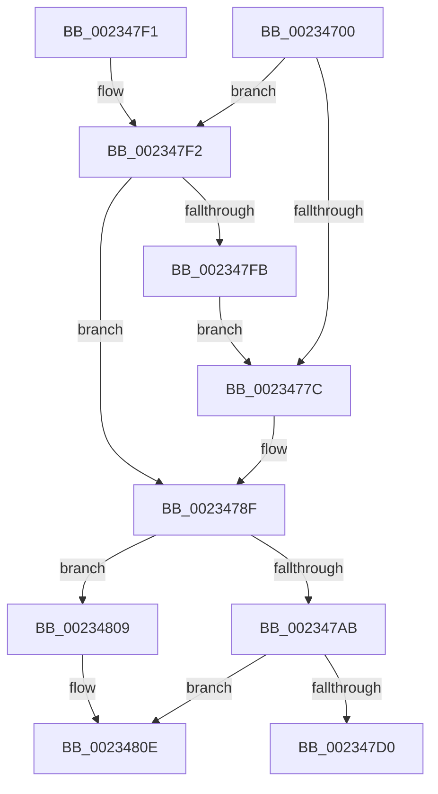

# KiSendClockInterruptToTargetProcessor

- RVA: `0x00234700`–`0x0023482E` (길이 `302` bytes)
- VA: `0x0000000140234700`
- 실행 섹션: `.text`
- PDB 이름 있음: `예`; PDB Function 태그: `아니요`
- unwind 정보 RVA: `0x00060584`
- 디코드: `73`개 명령, `302/302` bytes 표시
- 미해석 바이트: `0` (있으면 어셈블리에 `.byte`로 보존)

> 이 문서는 커널 이미지의 기계어와 PDB 기호를 분석해 생성했습니다. 4번과 5번은 함수 원형과 자료형을 바이너리 사용 방식에서 추정한 C 해석이며 원본 소스 복구 결과는 아닙니다.

## 1. Dependencies

- 직접 호출 지점: **6**; 고유 호출 대상: **5**
- 직접 호출자로 확인된 함수: **7**
- RIP 상대 이미지 참조: **3**

### Outgoing calls
- `0x00234734` → [memset](../6C/memset_function_006C6C40.md) (function, `0x006C6C40`)
- `0x00234759` → [memset](../6C/memset_function_006C6C40.md) (function, `0x006C6C40`)
- `0x002347A2` → [KeIsEmptyAffinityEx](../2D/KeIsEmptyAffinityEx_function_002D1580.md) (function, `0x002D1580`)
- `0x002347C7` → [HalpInterruptSendIpi](../25/HalpInterruptSendIpi_function_00252310.md) (function, `0x00252310`)
- `0x002347D7` → [_security_check_cookie](../6A/_security_check_cookie_function_006AC640.md) (function, `0x006AC640`)
- `0x00234828` → [KeBugCheckEx](../4F/KeBugCheckEx_function_004FD660.md) (function, `0x004FD660`)

### Direct callers
- [KiInsertTimerTable](KiInsertTimerTable_function_00233400.md) at `0x00233717`
- [ExpUpdateTimerConfigurationWorker](ExpUpdateTimerConfigurationWorker_function_00235410.md) at `0x0023555E`
- [KeSetTimer2](../3A/KeSetTimer2_function_003A08E0.md) at `0x003A1087`
- [sub_003A1A0C](../3A/Unknown_function_003A1A0C.md) at `0x003A1C48`
- [KiAdjustTimer2DueTimes](../3A/KiAdjustTimer2DueTimes_function_003A3550.md) at `0x003A377E`
- [KeSetClockInterval](../47/KeSetClockInterval_function_0047503C.md) at `0x0047504F`
- [KeResumeClockTimerFromIdle](../5B/KeResumeClockTimerFromIdle_function_005BACC4.md) at `0x005BAF53`

### Static image references
- `0x00234717` → RVA `0x00E0A740` (`.data`; read)
- `0x0023475E` → RVA `0x00F231B0` (`.data`; read)
- `0x00234819` → RVA `0x00E101F0` (`.data`; read)

## 2. Other-region calls and transfers

- 다른 실행 섹션으로 향하는 call: **0**
- 별도 외부 분기/꼬리 이동을 확인하지 못했습니다.

## 3. Assembly (complete function range)

```asm
00234700  48 89 5C 24 10                  mov qword ptr [rsp + 0x10], rbx
00234705  4C 89 74 24 18                  mov qword ptr [rsp + 0x18], r14
0023470A  55                              push rbp
0023470B  48 8D 6C 24 90                  lea rbp, [rsp - 0x70]
00234710  48 81 EC 70 01 00 00            sub rsp, 0x170
00234717  48 8B 05 22 60 BD 00            mov rax, qword ptr [rip + 0xbd6022]
0023471E  48 33 C4                        xor rax, rsp
00234721  48 89 45 60                     mov qword ptr [rbp + 0x60], rax
00234725  8B D9                           mov ebx, ecx
00234727  33 D2                           xor edx, edx
00234729  48 8D 4C 24 58                  lea rcx, [rsp + 0x58]
0023472E  41 B8 00 01 00 00               mov r8d, 0x100
00234734  E8 07 25 49 00                  call 0x1406c6c40
00234739  83 64 24 54 00                  and dword ptr [rsp + 0x54], 0
0023473E  48 8D 4C 24 58                  lea rcx, [rsp + 0x58]
00234743  33 D2                           xor edx, edx
00234745  C7 44 24 50 01 00 20 00         mov dword ptr [rsp + 0x50], 0x200001
0023474D  41 B8 00 01 00 00               mov r8d, 0x100
00234753  41 BE 01 00 00 00               mov r14d, 1
00234759  E8 E2 24 49 00                  call 0x1406c6c40
0023475E  48 8B 05 4B EA CE 00            mov rax, qword ptr [rip + 0xceea4b]
00234765  44 8B 04 98                     mov r8d, dword ptr [rax + rbx*4]
00234769  41 8B C8                        mov ecx, r8d
0023476C  0F B7 44 24 50                  movzx eax, word ptr [rsp + 0x50]
00234771  41 83 E0 3F                     and r8d, 0x3f
00234775  C1 E9 06                        shr ecx, 6
00234778  3B C1                           cmp eax, ecx
0023477A  76 76                           jbe 0x1402347f2
0023477C  8B D1                           mov edx, ecx
0023477E  48 8B 4C CC 58                  mov rcx, qword ptr [rsp + rcx*8 + 0x58]
00234783  41 8B C0                        mov eax, r8d
00234786  48 0F AB C1                     bts rcx, rax
0023478A  48 89 4C D4 58                  mov qword ptr [rsp + rdx*8 + 0x58], rcx
0023478F  33 C0                           xor eax, eax
00234791  48 8D 4C 24 50                  lea rcx, [rsp + 0x50]
00234796  21 44 24 40                     and dword ptr [rsp + 0x40], eax
0023479A  89 44 24 34                     mov dword ptr [rsp + 0x34], eax
0023479E  21 44 24 34                     and dword ptr [rsp + 0x34], eax
002347A2  E8 D9 CD 09 00                  call 0x1402d1580
002347A7  85 C0                           test eax, eax
002347A9  75 5E                           jne 0x140234809
002347AB  48 8D 44 24 50                  lea rax, [rsp + 0x50]
002347B0  C7 44 24 30 02 00 00 00         mov dword ptr [rsp + 0x30], 2
002347B8  BA D2 00 00 00                  mov edx, 0xd2
002347BD  48 89 44 24 38                  mov qword ptr [rsp + 0x38], rax
002347C2  48 8D 4C 24 30                  lea rcx, [rsp + 0x30]
002347C7  E8 44 DB 01 00                  call 0x140252310
002347CC  85 C0                           test eax, eax
002347CE  78 3E                           js 0x14023480e
002347D0  48 8B 4D 60                     mov rcx, qword ptr [rbp + 0x60]
002347D4  48 33 CC                        xor rcx, rsp
002347D7  E8 64 7E 47 00                  call 0x1406ac640
002347DC  4C 8D 9C 24 70 01 00 00         lea r11, [rsp + 0x170]
002347E4  49 8B 5B 18                     mov rbx, qword ptr [r11 + 0x18]
002347E8  4D 8B 73 20                     mov r14, qword ptr [r11 + 0x20]
002347EC  49 8B E3                        mov rsp, r11
002347EF  5D                              pop rbp
002347F0  C3                              ret
002347F1  CC                              int3
002347F2  0F B7 44 24 52                  movzx eax, word ptr [rsp + 0x52]
002347F7  3B C1                           cmp eax, ecx
002347F9  76 94                           jbe 0x14023478f
002347FB  41 8D 04 0E                     lea eax, [r14 + rcx]
002347FF  66 89 44 24 50                  mov word ptr [rsp + 0x50], ax
00234804  E9 73 FF FF FF                  jmp 0x14023477c
00234809  B8 0D 00 00 C0                  mov eax, 0xc000000d
0023480E  48 83 64 24 20 00               and qword ptr [rsp + 0x20], 0
00234814  BA 01 02 00 00                  mov edx, 0x201
00234819  4C 8B 05 D0 B9 BD 00            mov r8, qword ptr [rip + 0xbdb9d0]
00234820  B9 5C 00 00 00                  mov ecx, 0x5c
00234825  4C 63 C8                        movsxd r9, eax
00234828  E8 33 8E 2C 00                  call 0x1404fd660
0023482D  CC                              int3
```

## 4. C-style interpretation (structured pseudocode)

```c
__int64 __fastcall KiSendClockInterruptToTargetProcessor(int a1, int a2)
{
    __int64 result;
    __int64 v_rsp;
    unsigned __int16 v_stack_m11E;
    unsigned __int64 v_stack_m120;
    unsigned int v_stack_m124;
    unsigned int v_stack_m128;
    unsigned int v_stack_m138;
    unsigned __int64 v_stack_m140;
    unsigned int v_stack_m144;
    unsigned int v_stack_m148;
    unsigned __int64 v_stack_m150;
    unsigned __int64 v_stack_m18;
    unsigned __int64 v_stack_m78;
    unsigned __int64 v_stack_m8;
    unsigned __int64 v_stack_p10;
    unsigned __int64 v_stack_p18;

    v_stack_p10 = v_rbx;
    v_stack_p18 = v_r14;
    v_rsp = (v_rsp) - (368);
    result = (*(unsigned __int64 *)(v_rip + 12410914)) ^ (v_rsp);
    v_stack_m18 = result;
    a2 = 0;
    result = memset(v_stack_m120, a2, 256, a4);
    a2 = 0;
    v_stack_m128 = 0x200001ULL;
    result = memset(v_stack_m120, a2, 256, a4);
    a3 = (unsigned int)(((unsigned int)(*(unsigned int *)(*(unsigned __int64 *)(v_rip + 13560395) + (unsigned int)(a1) * 4))) & (63));
    a1 = (unsigned int)(((unsigned int)((unsigned int)((unsigned int)(*(unsigned int *)(*(unsigned __int64 *)(v_rip + 13560395) + (unsigned int)(a1) * 4))))) >> (6));
    if (((unsigned int)(v_stack_m128)) <= a1) goto loc_002347F2;
loc_0023477C:
    *(unsigned __int64 *)(v_rsp + (unsigned int)(a1) * 8 + 88) = *(unsigned __int64 *)(v_rsp + a1 * 8 + 88);
loc_0023478F:
    result = 0;
    v_stack_m144 = 0;
    result = KeIsEmptyAffinityEx(v_stack_m128, (unsigned int)(a1), a3, a4);
    if ((unsigned int)(result) != 0) goto loc_00234809;
    v_stack_m148 = 2;
    v_stack_m140 = v_stack_m128;
    result = HalpInterruptSendIpi(v_stack_m148, 210, a3, a4);
    if (sign_flag) goto loc_0023480E;
    a1 = (v_stack_m18) ^ (v_rsp);
    result = _security_check_cookie(a1, 210, a3, a4);
    return result;
loc_002347F2:
    if (((unsigned int)(v_stack_m11E)) <= a1) goto loc_0023478F;
    v_stack_m120 = (unsigned __int16)(*(unsigned __int64 *)(v_stack_m8 + 32) + a1 * 1);
    goto loc_0023477C;
loc_00234809:
loc_0023480E:
    result = KeBugCheckEx(92, 513, *(unsigned __int64 *)(v_rip + 12433872), (int)((unsigned int)((unsigned int)(0xC000000DULL))));
    return result;
}
```

## 5. (Beta) C Style

```c
int64_t KiSendClockInterruptToTargetProcessor(int32_t Arg1, int32_t Arg2)
{
    int64_t result;
    int64_t local_rsp;
    uint16_t v_stack_m11E;
    uint64_t v_stack_m120;
    uint32_t v_stack_m124;
    uint32_t v_stack_m128;
    uint32_t v_stack_m138;
    uint64_t v_stack_m140;
    uint32_t v_stack_m144;
    uint32_t v_stack_m148;
    uint64_t v_stack_m150;
    uint64_t v_stack_m18;
    uint64_t v_stack_m78;
    uint64_t v_stack_m8;
    uint64_t v_stack_p10;
    uint64_t v_stack_p18;

    v_stack_p10 = local_rbx;
    v_stack_p18 = local_r14;
    local_rsp = (local_rsp) - (368);
    result = (*(uint64_t *)(v_rip + 0xBD6022)) ^ (local_rsp);
    v_stack_m18 = result;
    Arg2 = 0;
    result = memset(v_stack_m120, Arg2, 256, a4);
    Arg2 = 0;
    v_stack_m128 = 0x200001ULL;
    result = memset(v_stack_m120, Arg2, 256, a4);
    a3 = (uint32_t)(((uint32_t)(*(uint32_t *)(*(uint64_t *)(v_rip + 0xCEEA4B) + (uint32_t)(Arg1) * 4))) & (63));
    Arg1 = (uint32_t)(((uint32_t)((uint32_t)((uint32_t)(*(uint32_t *)(*(uint64_t *)(v_rip + 0xCEEA4B) + (uint32_t)(Arg1) * 4))))) >> (6));
    if (((uint32_t)(v_stack_m128)) <= Arg1) goto loc_002347F2;
loc_0023477C:
    *(uint64_t *)(local_rsp + (uint32_t)(Arg1) * 8 + 0x58) = *(uint64_t *)(local_rsp + Arg1 * 8 + 0x58);
loc_0023478F:
    result = 0;
    v_stack_m144 = 0;
    result = KeIsEmptyAffinityEx(v_stack_m128, (uint32_t)(Arg1), a3, a4);
    if ((uint32_t)(result) != 0) goto loc_00234809;
    v_stack_m148 = 2;
    v_stack_m140 = v_stack_m128;
    result = HalpInterruptSendIpi(v_stack_m148, 210, a3, a4);
    if (sign_flag) goto loc_0023480E;
    Arg1 = (v_stack_m18) ^ (local_rsp);
    result = _security_check_cookie(Arg1, 210, a3, a4);
    return result;
loc_002347F2:
    if (((uint32_t)(v_stack_m11E)) <= Arg1) goto loc_0023478F;
    v_stack_m120 = (uint16_t)(*(uint64_t *)(v_stack_m8 + 0x20) + Arg1 * 1);
    goto loc_0023477C;
loc_00234809:
loc_0023480E:
    result = KeBugCheckEx(92, 513, *(uint64_t *)(v_rip + 0xBDB9D0), (int32_t)((uint32_t)((uint32_t)(0xC000000DULL))));
    return result;
}
```

## 6. Execution-region graph

[열기: 2D/3D 그래프와 함수 탐색 컨트롤 패널](../../../control-panel.html?section=text&rva=0x00234700&view=graph)

- 2D 그래프는 위에서 아래로 흐르고, 3D 그래프는 빈 공간을 드래그해 회전합니다. Shift+드래그는 이동, 휠은 확대·축소, 함수 노드 선택은 대상 보고서 이동입니다.

### Static fallback


