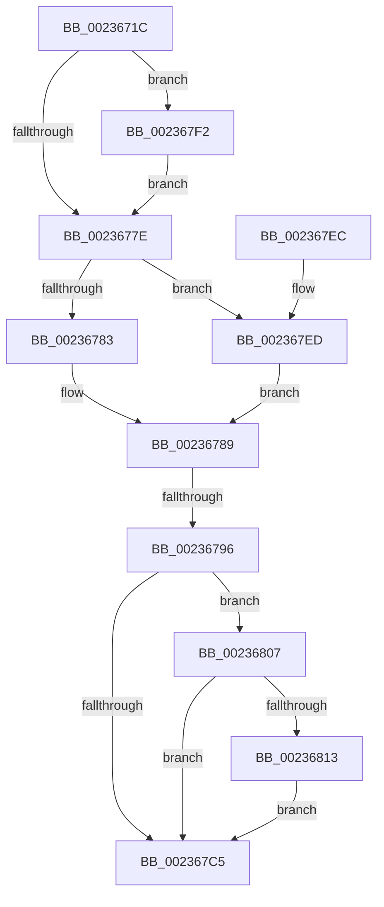

# KiSetClockTimerKTimerDeadlines

- RVA: `0x0023671C`–`0x00236835` (길이 `281` bytes)
- VA: `0x000000014023671C`
- 실행 섹션: `.text`
- PDB 이름 있음: `예`; PDB Function 태그: `예`
- unwind 정보 RVA: `0x0006089C`
- 디코드: `75`개 명령, `281/281` bytes 표시
- 미해석 바이트: `0` (있으면 어셈블리에 `.byte`로 보존)

> 이 문서는 커널 이미지의 기계어와 PDB 기호를 분석해 생성했습니다. 4번과 5번은 함수 원형과 자료형을 바이너리 사용 방식에서 추정한 C 해석이며 원본 소스 복구 결과는 아닙니다.

## 1. Dependencies

- 직접 호출 지점: **4**; 고유 호출 대상: **4**
- 직접 호출자로 확인된 함수: **7**
- RIP 상대 이미지 참조: **7**

### Outgoing calls
- `0x0023675D` → [Feature_Servicing_Kernel_ClockTickIdleEstimateFix__private_IsEnabledNoReportingNoInline](../39/Feature_Servicing_Kernel_ClockTickIdleEstimateFix__private_IsEnabledNoReportingNoInline_function_0039CEE8.md) (function, `0x0039CEE8`)
- `0x002367CC` → [_security_check_cookie](../6A/_security_check_cookie_function_006AC640.md) (function, `0x006AC640`)
- `0x002367F7` → [RtlGetInterruptTimePrecise](../20/RtlGetInterruptTimePrecise_function_0020A4C0.md) (function, `0x0020A4C0`)
- `0x0023682E` → [KiSetClockTimer](../39/KiSetClockTimer_function_0039DB2C.md) (function, `0x0039DB2C`)

### Direct callers
- [ExpUpdateTimerConfigurationWorker](ExpUpdateTimerConfigurationWorker_function_00235410.md) at `0x00235539`
- [KeClockInterruptNotify](../39/KeClockInterruptNotify_function_0039A970.md) at `0x0039AE96`
- [KiSetClockInterval](../47/KiSetClockInterval_function_00475064.md) at `0x0047513D`
- [KiResumeClockTimer](../4F/KiResumeClockTimer_function_004F6420.md) at `0x004F6526`
- [KeResumeClockTimerFromIdle](../5B/KeResumeClockTimerFromIdle_function_005BACC4.md) at `0x005BB0B6`
- [KeResumeClockTimerFromIdle](../5B/KeResumeClockTimerFromIdle_function_005BACC4.md) at `0x005BB260`
- [KiResetClockInterval](../5B/KiResetClockInterval_function_005BB8BC.md) at `0x005BB91D`
- [KeInitializeClock](../../init/C7/KeInitializeClock_function_00C70C30.md) at `0x00C70FDB`

### Static image references
- `0x00236738` → RVA `0x00E0A740` (`.data`; read)
- `0x00236746` → RVA `0x00FC6BB8` (`ALMOSTRO`; read)
- `0x00236750` → RVA `0x00E668A8` (`.data`; read)
- `0x00236762` → RVA `0x00FC6B3C` (`ALMOSTRO`; read)
- `0x00236775` → RVA `0x00FC6AA5` (`ALMOSTRO`; read)
- `0x00236789` → RVA `0x00E070D8` (`.data`; read)
- `0x00236807` → RVA `0x00F21F90` (`.data`; read)

## 2. Other-region calls and transfers

- 다른 실행 섹션으로 향하는 call: **0**
- call이 아닌 외부 분기/꼬리 이동: **1**
  - `0x00236790` → [sub_006D7730](../6D/Unknown_function_006D7730.md) (`tail-transfer`)

## 3. Assembly (complete function range)

```asm
0023671C  48 89 5C 24 18                  mov qword ptr [rsp + 0x18], rbx
00236721  55                              push rbp
00236722  56                              push rsi
00236723  57                              push rdi
00236724  41 54                           push r12
00236726  41 55                           push r13
00236728  41 56                           push r14
0023672A  41 57                           push r15
0023672C  48 8D 6C 24 E0                  lea rbp, [rsp - 0x20]
00236731  48 81 EC 20 01 00 00            sub rsp, 0x120
00236738  48 8B 05 01 40 BD 00            mov rax, qword ptr [rip + 0xbd4001]
0023673F  48 33 C4                        xor rax, rsp
00236742  48 89 45 10                     mov qword ptr [rbp + 0x10], rax
00236746  48 63 3D 6B 04 D9 00            movsxd rdi, dword ptr [rip + 0xd9046b]
0023674D  45 8A E8                        mov r13b, r8b
00236750  48 03 3D 51 01 C3 00            add rdi, qword ptr [rip + 0xc30151]
00236757  4C 8B FA                        mov r15, rdx
0023675A  48 8B F1                        mov rsi, rcx
0023675D  E8 86 67 16 00                  call 0x14039cee8
00236762  44 8B 25 D3 03 D9 00            mov r12d, dword ptr [rip + 0xd903d3]
00236769  45 33 C9                        xor r9d, r9d
0023676C  85 C0                           test eax, eax
0023676E  49 8B CF                        mov rcx, r15
00236771  41 0F 94 C6                     sete r14b
00236775  44 38 0D 29 03 D9 00            cmp byte ptr [rip + 0xd90329], r9b
0023677C  74 74                           je 0x1402367f2
0023677E  48 85 FF                        test rdi, rdi
00236781  7F 6A                           jg 0x1402367ed
00236783  48 8B D9                        mov rbx, rcx
00236786  48 2B DF                        sub rbx, rdi
00236789  83 3D 48 09 BD 00 05            cmp dword ptr [rip + 0xbd0948], 5
00236790  0F 87 9A 0F 4A 00               ja 0x1406d7730
00236796  8A 86 B4 95 00 00               mov al, byte ptr [rsi + 0x95b4]
0023679C  45 8A C6                        mov r8b, r14b
0023679F  45 02 C0                        add r8b, r8b
002367A2  48 89 9E A8 95 00 00            mov qword ptr [rsi + 0x95a8], rbx
002367A9  24 FD                           and al, 0xfd
002367AB  44 89 A6 B0 95 00 00            mov dword ptr [rsi + 0x95b0], r12d
002367B2  44 0A C0                        or r8b, al
002367B5  41 80 C8 01                     or r8b, 1
002367B9  44 88 86 B4 95 00 00            mov byte ptr [rsi + 0x95b4], r8b
002367C0  45 84 ED                        test r13b, r13b
002367C3  75 42                           jne 0x140236807
002367C5  48 8B 4D 10                     mov rcx, qword ptr [rbp + 0x10]
002367C9  48 33 CC                        xor rcx, rsp
002367CC  E8 6F 5E 47 00                  call 0x1406ac640
002367D1  48 8B 9C 24 70 01 00 00         mov rbx, qword ptr [rsp + 0x170]
002367D9  48 81 C4 20 01 00 00            add rsp, 0x120
002367E0  41 5F                           pop r15
002367E2  41 5E                           pop r14
002367E4  41 5D                           pop r13
002367E6  41 5C                           pop r12
002367E8  5F                              pop rdi
002367E9  5E                              pop rsi
002367EA  5D                              pop rbp
002367EB  C3                              ret
002367EC  CC                              int3
002367ED  48 8B DF                        mov rbx, rdi
002367F0  EB 97                           jmp 0x140236789
002367F2  48 8D 4C 24 50                  lea rcx, [rsp + 0x50]
002367F7  E8 C4 3C FD FF                  call 0x14020a4c0
002367FC  48 8B C8                        mov rcx, rax
002367FF  45 33 C9                        xor r9d, r9d
00236802  E9 77 FF FF FF                  jmp 0x14023677e
00236807  4C 8B 05 82 B7 CE 00            mov r8, qword ptr [rip + 0xceb782]
0023680E  4D 85 C0                        test r8, r8
00236811  74 B2                           je 0x1402367c5
00236813  44 88 4C 24 30                  mov byte ptr [rsp + 0x30], r9b
00236818  49 8B D7                        mov rdx, r15
0023681B  44 88 74 24 28                  mov byte ptr [rsp + 0x28], r14b
00236820  45 33 C9                        xor r9d, r9d
00236823  48 8B CE                        mov rcx, rsi
00236826  C7 44 24 20 02 00 00 00         mov dword ptr [rsp + 0x20], 2
0023682E  E8 F9 72 16 00                  call 0x14039db2c
00236833  EB 90                           jmp 0x1402367c5
```

## 4. C-style interpretation (structured pseudocode)

```c
__int64 __fastcall KiSetClockTimerKTimerDeadlines(__int64 a1, __int64 a2, unsigned __int8 a3, int a4)
{
    __int64 result;
    __int64 v_r14;
    __int64 v_rbx;
    __int64 v_rdi;
    __int64 v_rsp;
    unsigned __int64 v_stack_m48;
    unsigned __int64 v_stack_m58;
    unsigned __int64 v_stack_p18;
    unsigned int v_stack_p20;
    unsigned __int8 v_stack_p28;
    unsigned __int8 v_stack_p30;
    unsigned __int64 v_stack_p50;

    v_stack_p18 = v_rbx;
    v_rsp = (v_rsp) - (288);
    result = (*(unsigned __int64 *)(v_rip + 12402689)) ^ (v_rsp);
    v_stack_m48 = result;
    v_rdi = ((int)(*(unsigned int *)(v_rip + 14222443))) + (*(unsigned __int64 *)(v_rip + 12779857));
    result = Feature_Servicing_Kernel_ClockTickIdleEstimateFix__private_IsEnabledNoReportingNoInline(a1, a2, a3, a4);
    a4 = 0;
    v_r14 = ((unsigned int)(result) == 0) ? 1 : 0;
    if ((*(unsigned __int8 *)(v_rip + 14222121)) == 0) goto loc_002367F2;
loc_0023677E:
    if (condition_is_greater) goto loc_002367ED;
    v_rbx = (a2) - (v_rdi);
loc_00236789:
    a3 = (unsigned __int8)(((unsigned __int8)(v_r14)) + ((unsigned __int8)((unsigned __int8)(v_r14))));
    *(unsigned __int64 *)(a1 + 38312) = v_rbx;
    result = (unsigned __int8)((*(unsigned __int8 *)(a1 + 38324)) & (253));
    *(unsigned int *)(a1 + 38320) = (unsigned int)((unsigned int)(*(unsigned int *)(v_rip + 14222291)));
    a3 = (unsigned __int8)((a3) | ((unsigned __int8)(result)));
    a3 = (unsigned __int8)((a3) | (1));
    *(unsigned __int8 *)(a1 + 38324) = a3;
    if (a3 != 0) goto loc_00236807;
loc_002367C5:
    a1 = (v_stack_m48) ^ (v_rsp);
    result = _security_check_cookie(a1, a2, a3, a4);
    v_rsp = (v_rsp) + (288);
    return result;
loc_002367ED:
    goto loc_00236789;
loc_002367F2:
    result = RtlGetInterruptTimePrecise(v_stack_p50, a2, a3, a4);
    a4 = 0;
    goto loc_0023677E;
loc_00236807:
    if (*(unsigned __int64 *)(v_rip + 13547394) == 0) goto loc_002367C5;
    v_stack_p30 = 0;
    v_stack_p28 = (unsigned __int8)(v_r14);
    a4 = 0;
    v_stack_p20 = 2;
    result = KiSetClockTimer(a1, a2, *(unsigned __int64 *)(v_rip + 13547394), a4);
    goto loc_002367C5;
}
```

## 5. (Beta) C Style

```c
int64_t KiSetClockTimerKTimerDeadlines(void *Arg1, int64_t Arg2, uint8_t Arg3, int32_t Arg4)
{
    uint8_t *arg1 = (uint8_t *)Arg1;

    int64_t result;
    int64_t local_r14;
    int64_t local_rbx;
    int64_t local_rdi;
    int64_t local_rsp;
    uint64_t v_stack_m48;
    uint64_t v_stack_m58;
    uint64_t v_stack_p18;
    uint32_t v_stack_p20;
    uint8_t v_stack_p28;
    uint8_t v_stack_p30;
    uint64_t v_stack_p50;

    v_stack_p18 = local_rbx;
    local_rsp = (local_rsp) - (288);
    result = (*(uint64_t *)(v_rip + 0xBD4001)) ^ (local_rsp);
    v_stack_m48 = result;
    local_rdi = ((int32_t)(*(uint32_t *)(v_rip + 0xD9046B))) + (*(uint64_t *)(v_rip + 0xC30151));
    result = Feature_Servicing_Kernel_ClockTickIdleEstimateFix__private_IsEnabledNoReportingNoInline(Arg1, Arg2, Arg3, Arg4);
    Arg4 = 0;
    local_r14 = ((uint32_t)(result) == 0) ? 1 : 0;
    if ((*(uint8_t *)(v_rip + 0xD90329)) == 0) goto loc_002367F2;
loc_0023677E:
    if (condition_is_greater) goto loc_002367ED;
    local_rbx = (Arg2) - (local_rdi);
loc_00236789:
    Arg3 = (uint8_t)(((uint8_t)(local_r14)) + ((uint8_t)((uint8_t)(local_r14))));
    *(uint64_t *)(arg1 + 0x95A8) = local_rbx;
    result = (uint8_t)((*(uint8_t *)(arg1 + 0x95B4)) & (253));
    *(uint32_t *)(arg1 + 0x95B0) = (uint32_t)((uint32_t)(*(uint32_t *)(v_rip + 0xD903D3)));
    Arg3 = (uint8_t)((Arg3) | ((uint8_t)(result)));
    Arg3 = (uint8_t)((Arg3) | (1));
    *(uint8_t *)(arg1 + 0x95B4) = Arg3;
    if (Arg3 != 0) goto loc_00236807;
loc_002367C5:
    Arg1 = (v_stack_m48) ^ (local_rsp);
    result = _security_check_cookie(Arg1, Arg2, Arg3, Arg4);
    local_rsp = (local_rsp) + (288);
    return result;
loc_002367ED:
    goto loc_00236789;
loc_002367F2:
    result = RtlGetInterruptTimePrecise(v_stack_p50, Arg2, Arg3, Arg4);
    Arg4 = 0;
    goto loc_0023677E;
loc_00236807:
    if (*(uint64_t *)(v_rip + 0xCEB782) == 0) goto loc_002367C5;
    v_stack_p30 = 0;
    v_stack_p28 = (uint8_t)(local_r14);
    Arg4 = 0;
    v_stack_p20 = 2;
    result = KiSetClockTimer(Arg1, Arg2, *(uint64_t *)(v_rip + 0xCEB782), Arg4);
    goto loc_002367C5;
}
```

### 관측된 메모리 오프셋

구조체 형식이 확인되지 않은 접근은 인자 기준의 오프셋으로만 기록했습니다.

| 기준 인자 | 오프셋 표현 | 폭 (bit) | 접근 |
|---|---:|---:|---|
| `Arg1` | `+ 0x95A8` | `64` | `W` |
| `Arg1` | `+ 0x95B0` | `32` | `W` |
| `Arg1` | `+ 0x95B4` | `8` | `R` |
| `Arg1` | `+ 0x95B4` | `8` | `W` |

## 6. Execution-region graph

[열기: 2D/3D 그래프와 함수 탐색 컨트롤 패널](../../../control-panel.html?section=text&rva=0x0023671C&view=graph)

- 2D 그래프는 위에서 아래로 흐르고, 3D 그래프는 빈 공간을 드래그해 회전합니다. Shift+드래그는 이동, 휠은 확대·축소, 함수 노드 선택은 대상 보고서 이동입니다.

### Static fallback


