# KiSetNextClockTickDueTime

- RVA: `0x002363F0`–`0x00236714` (길이 `804` bytes)
- VA: `0x00000001402363F0`
- 실행 섹션: `.text`
- PDB 이름 있음: `예`; PDB Function 태그: `예`
- unwind 정보 RVA: `0x00060864`
- 디코드: `189`개 명령, `804/804` bytes 표시
- 미해석 바이트: `0` (있으면 어셈블리에 `.byte`로 보존)

> 이 문서는 커널 이미지의 기계어와 PDB 기호를 분석해 생성했습니다. 4번과 5번은 함수 원형과 자료형을 바이너리 사용 방식에서 추정한 C 해석이며 원본 소스 복구 결과는 아닙니다.

## 1. Dependencies

- 직접 호출 지점: **8**; 고유 호출 대상: **8**
- 직접 호출자로 확인된 함수: **10**
- RIP 상대 이미지 참조: **10**

### Outgoing calls
- `0x00236433` → [KeDisableInterrupts](../21/KeDisableInterrupts_function_00217BE0.md) (function, `0x00217BE0`)
- `0x0023644F` → [KiGetClockTimerEarliestDeadline](KiGetClockTimerEarliestDeadline_function_00237AB0.md) (function, `0x00237AB0`)
- `0x002364F5` → [KiSetClockTickRate](../43/KiSetClockTickRate_function_0043FEA0.md) (function, `0x0043FEA0`)
- `0x0023658C` → [EtwpLevelKeywordEnabled](../2F/EtwpLevelKeywordEnabled_function_002FD110.md) (function, `0x002FD110`)
- `0x002365EE` → [EtwWriteEx](../25/EtwWriteEx_function_0025F0D0.md) (function, `0x0025F0D0`)
- `0x00236607` → [_security_check_cookie](../6A/_security_check_cookie_function_006AC640.md) (function, `0x006AC640`)
- `0x002366CC` → [KiRemoveSystemWorkPriorityKick](../26/KiRemoveSystemWorkPriorityKick_function_002631D0.md) (function, `0x002631D0`)
- `0x00236707` → [RtlGetInterruptTimePrecise](../20/RtlGetInterruptTimePrecise_function_0020A4C0.md) (function, `0x0020A4C0`)

### Direct callers
- [ExpUpdateTimerConfigurationWorker](ExpUpdateTimerConfigurationWorker_function_00235410.md) at `0x00235543`
- [KeUpdatePendingQosRequest](../39/KeUpdatePendingQosRequest_function_003924F4.md) at `0x003925E4`
- [KeClockInterruptNotify](../39/KeClockInterruptNotify_function_0039A970.md) at `0x0039AAD5`
- [KeClockInterruptNotify](../39/KeClockInterruptNotify_function_0039A970.md) at `0x0039AC66`
- [KeClockInterruptNotify](../39/KeClockInterruptNotify_function_0039A970.md) at `0x0039AE21`
- [KiSetClockTimer](../39/KiSetClockTimer_function_0039DB2C.md) at `0x0039DC23`
- [KiSetClockInterval](../47/KiSetClockInterval_function_00475064.md) at `0x00475147`
- [KiRestoreClockTickRate](../4D/KiRestoreClockTickRate_function_004D2780.md) at `0x004D27FE`
- [KePrepareClockTimerForIdle](../5B/KePrepareClockTimerForIdle_function_005BA49C.md) at `0x005BA6A2`
- [KiResetClockInterval](../5B/KiResetClockInterval_function_005BB8BC.md) at `0x005BB927`
- [sub_006F418E](../6F/Unknown_function_006F418E.md) at `0x006F420E`
- [KeInitializeClock](../../init/C7/KeInitializeClock_function_00C70C30.md) at `0x00C70FE5`

### Static image references
- `0x0023640F` → RVA `0x00E0A740` (`.data`; read)
- `0x00236438` → RVA `0x00FC6AA5` (`ALMOSTRO`; read)
- `0x00236454` → RVA `0x00FC6B3C` (`ALMOSTRO`; read)
- `0x0023649C` → RVA `0x00E668E0` (`.data`; read)
- `0x002364B5` → RVA `0x00FC6D5C` (`ALMOSTRO`; read)
- `0x00236523` → RVA `0x00E070D8` (`.data`; read)
- `0x00236539` → RVA `0x00E67858` (`.data`; read)
- `0x00236553` → RVA `0x00F0B408` (`.data`; read)
- `0x002365A5` → RVA `0x00010FD0` (`.rdata`; read)
- `0x002366DC` → RVA `0x00E668D8` (`.data`; read)

## 2. Other-region calls and transfers

- 다른 실행 섹션으로 향하는 call: **0**
- call이 아닌 외부 분기/꼬리 이동: **1**
  - `0x0023652A` → [sub_006D75C8](../6D/Unknown_function_006D75C8.md) (`tail-transfer`)

## 3. Assembly (complete function range)

```asm
002363F0  48 89 5C 24 18                  mov qword ptr [rsp + 0x18], rbx
002363F5  55                              push rbp
002363F6  56                              push rsi
002363F7  57                              push rdi
002363F8  41 54                           push r12
002363FA  41 55                           push r13
002363FC  41 56                           push r14
002363FE  41 57                           push r15
00236400  48 8D AC 24 30 FF FF FF         lea rbp, [rsp - 0xd0]
00236408  48 81 EC D0 01 00 00            sub rsp, 0x1d0
0023640F  48 8B 05 2A 43 BD 00            mov rax, qword ptr [rip + 0xbd432a]
00236416  48 33 C4                        xor rax, rsp
00236419  48 89 85 C0 00 00 00            mov qword ptr [rbp + 0xc0], rax
00236420  65 48 8B 3C 25 20 00 00 00      mov rdi, qword ptr gs:[0x20]
00236429  0F B6 DA                        movzx ebx, dl
0023642C  88 54 24 43                     mov byte ptr [rsp + 0x43], dl
00236430  48 8B F1                        mov rsi, rcx
00236433  E8 A8 17 FE FF                  call 0x140217be0
00236438  80 3D 66 06 D9 00 00            cmp byte ptr [rip + 0xd90666], 0
0023643F  88 44 24 45                     mov byte ptr [rsp + 0x45], al
00236443  0F 84 BA 02 00 00               je 0x140236703
00236449  0F B6 D3                        movzx edx, bl
0023644C  48 8B CF                        mov rcx, rdi
0023644F  E8 5C 16 00 00                  call 0x140237ab0
00236454  8B 1D E2 06 D9 00               mov ebx, dword ptr [rip + 0xd906e2]
0023645A  4C 63 C8                        movsxd r9, eax
0023645D  49 8B C9                        mov rcx, r9
00236460  44 89 4C 24 4C                  mov dword ptr [rsp + 0x4c], r9d
00236465  48 03 C9                        add rcx, rcx
00236468  8B 94 CF A0 95 00 00            mov edx, dword ptr [rdi + rcx*8 + 0x95a0]
0023646F  4C 8B 84 CF 98 95 00 00         mov r8, qword ptr [rdi + rcx*8 + 0x9598]
00236477  3B D3                           cmp edx, ebx
00236479  4D 8D 2C 10                     lea r13, [r8 + rdx]
0023647D  49 8B D5                        mov rdx, r13
00236480  72 03                           jb 0x140236485
00236482  48 2B D3                        sub rdx, rbx
00236485  48 8D 04 1E                     lea rax, [rsi + rbx]
00236489  48 3B D0                        cmp rdx, rax
0023648C  76 0E                           jbe 0x14023649c
0023648E  2B D6                           sub edx, esi
00236490  8D 43 FF                        lea eax, [rbx - 1]
00236493  03 C2                           add eax, edx
00236495  33 D2                           xor edx, edx
00236497  F7 F3                           div ebx
00236499  0F AF D8                        imul ebx, eax
0023649C  48 8B 05 3D 04 C3 00            mov rax, qword ptr [rip + 0xc3043d]
002364A3  A8 01                           test al, 1
002364A5  0F 85 2B 02 00 00               jne 0x1402366d6
002364AB  48 8B C8                        mov rcx, rax
002364AE  44 8B 51 1C                     mov r10d, dword ptr [rcx + 0x1c]
002364B2  41 B4 01                        mov r12b, 1
002364B5  8B 05 A1 08 D9 00               mov eax, dword ptr [rip + 0xd908a1]
002364BB  44 89 54 24 48                  mov dword ptr [rsp + 0x48], r10d
002364C0  4E 8D 3C 16                     lea r15, [rsi + r10]
002364C4  48 8D 14 06                     lea rdx, [rsi + rax]
002364C8  48 89 54 24 70                  mov qword ptr [rsp + 0x70], rdx
002364CD  4D 3B FD                        cmp r15, r13
002364D0  0F 86 52 01 00 00               jbe 0x140236628
002364D6  4C 3B C2                        cmp r8, rdx
002364D9  0F 86 C6 01 00 00               jbe 0x1402366a5
002364DF  45 32 C0                        xor r8b, r8b
002364E2  83 BF 90 95 00 00 02            cmp dword ptr [rdi + 0x9590], 2
002364E9  0F 85 96 01 00 00               jne 0x140236685
002364EF  41 0F B6 D4                     movzx edx, r12b
002364F3  8B CB                           mov ecx, ebx
002364F5  E8 A6 99 20 00                  call 0x14043fea0
002364FA  48 8B 54 24 70                  mov rdx, qword ptr [rsp + 0x70]
002364FF  44 8B F0                        mov r14d, eax
00236502  44 8B 4C 24 4C                  mov r9d, dword ptr [rsp + 0x4c]
00236507  41 B0 01                        mov r8b, 1
0023650A  44 8B 54 24 48                  mov r10d, dword ptr [rsp + 0x48]
0023650F  41 8B CE                        mov ecx, r14d
00236512  48 03 CE                        add rcx, rsi
00236515  44 89 8F 94 95 00 00            mov dword ptr [rdi + 0x9594], r9d
0023651C  48 89 8F 80 95 00 00            mov qword ptr [rdi + 0x9580], rcx
00236523  83 3D AE 0B BD 00 05            cmp dword ptr [rip + 0xbd0bae], 5
0023652A  0F 87 98 10 4A 00               ja 0x1406d75c8
00236530  45 84 E4                        test r12b, r12b
00236533  0F 84 BA 00 00 00               je 0x1402365f3
00236539  80 3D 18 13 C3 00 00            cmp byte ptr [rip + 0xc31318], 0
00236540  C7 44 24 68 48 52 4F 53         mov dword ptr [rsp + 0x68], 0x534f5248
00236548  44 89 74 24 60                  mov dword ptr [rsp + 0x60], r14d
0023654D  0F 84 A0 00 00 00               je 0x1402365f3
00236553  48 8B 15 AE 4E CD 00            mov rdx, qword ptr [rip + 0xcd4eae]
0023655A  48 85 D2                        test rdx, rdx
0023655D  0F 84 90 00 00 00               je 0x1402365f3
00236563  48 8B 4A 20                     mov rcx, qword ptr [rdx + 0x20]
00236567  49 B8 04 00 00 00 00 00 00 40   movabs r8, 0x4000000000000004
00236571  83 79 60 00                     cmp dword ptr [rcx + 0x60], 0
00236575  0F 85 D9 00 00 00               jne 0x140236654
0023657B  66 83 7A 66 00                  cmp word ptr [rdx + 0x66], 0
00236580  74 71                           je 0x1402365f3
00236582  48 8B 4A 28                     mov rcx, qword ptr [rdx + 0x28]
00236586  B2 04                           mov dl, 4
00236588  48 83 C1 60                     add rcx, 0x60
0023658C  E8 7F 6B 0C 00                  call 0x1402fd110
00236591  84 C0                           test al, al
00236593  74 5E                           je 0x1402365f3
00236595  48 8B 0D 6C 4E CD 00            mov rcx, qword ptr [rip + 0xcd4e6c]
0023659C  48 8D 44 24 60                  lea rax, [rsp + 0x60]
002365A1  48 89 45 A8                     mov qword ptr [rbp - 0x58], rax
002365A5  48 8D 15 24 AA DD FF            lea rdx, [rip - 0x2255dc]
002365AC  48 8D 44 24 68                  lea rax, [rsp + 0x68]
002365B1  48 C7 45 B0 04 00 00 00         mov qword ptr [rbp - 0x50], 4
002365B9  48 89 45 B8                     mov qword ptr [rbp - 0x48], rax
002365BD  45 33 C9                        xor r9d, r9d
002365C0  48 8D 45 A8                     lea rax, [rbp - 0x58]
002365C4  48 C7 45 C0 04 00 00 00         mov qword ptr [rbp - 0x40], 4
002365CC  48 89 44 24 38                  mov qword ptr [rsp + 0x38], rax
002365D1  45 33 C0                        xor r8d, r8d
002365D4  C7 44 24 30 02 00 00 00         mov dword ptr [rsp + 0x30], 2
002365DC  48 C7 44 24 28 00 00 00 00      mov qword ptr [rsp + 0x28], 0
002365E5  48 C7 44 24 20 00 00 00 00      mov qword ptr [rsp + 0x20], 0
002365EE  E8 DD 8A 02 00                  call 0x14025f0d0
002365F3  80 7C 24 45 00                  cmp byte ptr [rsp + 0x45], 0
002365F8  75 42                           jne 0x14023663c
002365FA  41 8B C6                        mov eax, r14d
002365FD  48 8B 8D C0 00 00 00            mov rcx, qword ptr [rbp + 0xc0]
00236604  48 33 CC                        xor rcx, rsp
00236607  E8 34 60 47 00                  call 0x1406ac640
0023660C  48 8B 9C 24 20 02 00 00         mov rbx, qword ptr [rsp + 0x220]
00236614  48 81 C4 D0 01 00 00            add rsp, 0x1d0
0023661B  41 5F                           pop r15
0023661D  41 5E                           pop r14
0023661F  41 5D                           pop r13
00236621  41 5C                           pop r12
00236623  5F                              pop rdi
00236624  5E                              pop rsi
00236625  5D                              pop rbp
00236626  C3                              ret
00236627  CC                              int3
00236628  4D 3B C7                        cmp r8, r15
0023662B  0F 87 A5 FE FF FF               ja 0x1402364d6
00236631  41 8B DA                        mov ebx, r10d
00236634  45 32 E4                        xor r12b, r12b
00236637  E9 A3 FE FF FF                  jmp 0x1402364df
0023663C  65 48 8B 0C 25 20 00 00 00      mov rcx, qword ptr gs:[0x20]
00236645  4C 8B 81 B8 8E 00 00            mov r8, qword ptr [rcx + 0x8eb8]
0023664C  4D 85 C0                        test r8, r8
0023664F  75 61                           jne 0x1402366b2
00236651  FB                              sti
00236652  EB A6                           jmp 0x1402365fa
00236654  0F B6 41 64                     movzx eax, byte ptr [rcx + 0x64]
00236658  3C 04                           cmp al, 4
0023665A  0F 82 96 00 00 00               jb 0x1402366f6
00236660  8B 41 68                        mov eax, dword ptr [rcx + 0x68]
00236663  4C 85 41 70                     test qword ptr [rcx + 0x70], r8
00236667  0F 84 0E FF FF FF               je 0x14023657b
0023666D  48 8B 49 78                     mov rcx, qword ptr [rcx + 0x78]
00236671  48 8B C1                        mov rax, rcx
00236674  49 23 C0                        and rax, r8
00236677  48 3B C1                        cmp rax, rcx
0023667A  0F 84 15 FF FF FF               je 0x140236595
00236680  E9 F6 FE FF FF                  jmp 0x14023657b
00236685  3B 9F 8C 95 00 00               cmp ebx, dword ptr [rdi + 0x958c]
0023668B  74 0C                           je 0x140236699
0023668D  3B 9F 88 95 00 00               cmp ebx, dword ptr [rdi + 0x9588]
00236693  0F 85 56 FE FF FF               jne 0x1402364ef
00236699  44 8B B7 88 95 00 00            mov r14d, dword ptr [rdi + 0x9588]
002366A0  E9 6A FE FF FF                  jmp 0x14023650f
002366A5  49 3B D5                        cmp rdx, r13
002366A8  0F 87 31 FE FF FF               ja 0x1402364df
002366AE  8B D8                           mov ebx, eax
002366B0  EB 82                           jmp 0x140236634
002366B2  41 0F 0D 08                     prefetchw byte ptr [r8]
002366B6  41 8B 00                        mov eax, dword ptr [r8]
002366B9  8B D0                           mov edx, eax
002366BB  0F BA F2 15                     btr edx, 0x15
002366BF  F0 41 0F B1 10                  lock cmpxchg dword ptr [r8], edx
002366C4  75 F3                           jne 0x1402366b9
002366C6  0F BA E0 15                     bt eax, 0x15
002366CA  73 85                           jae 0x140236651
002366CC  E8 FF CA 02 00                  call 0x1402631d0
002366D1  E9 7B FF FF FF                  jmp 0x140236651
002366D6  48 83 F8 01                     cmp rax, 1
002366DA  74 13                           je 0x1402366ef
002366DC  48 8D 0D F5 01 C3 00            lea rcx, [rip + 0xc301f5]
002366E3  48 83 C9 01                     or rcx, 1
002366E7  48 33 C8                        xor rcx, rax
002366EA  E9 BF FD FF FF                  jmp 0x1402364ae
002366EF  33 C9                           xor ecx, ecx
002366F1  E9 B8 FD FF FF                  jmp 0x1402364ae
002366F6  84 C0                           test al, al
002366F8  0F 84 62 FF FF FF               je 0x140236660
002366FE  E9 78 FE FF FF                  jmp 0x14023657b
00236703  48 8D 4D A0                     lea rcx, [rbp - 0x60]
00236707  E8 B4 3D FD FF                  call 0x14020a4c0
0023670C  48 8B F0                        mov rsi, rax
0023670F  E9 35 FD FF FF                  jmp 0x140236449
```

## 4. C-style interpretation (structured pseudocode)

```c
__int64 __fastcall KiSetNextClockTickDueTime(__int64 a1, unsigned __int8 a2)
{
    __int64 result;
    __int64 v_r12;
    __int64 v_rbx;
    __int64 v_rsp;
    unsigned __int64 v_stack_m108;
    unsigned __int64 v_stack_m148;
    unsigned __int64 v_stack_m150;
    unsigned __int64 v_stack_m158;
    unsigned __int64 v_stack_m160;
    unsigned __int64 v_stack_m168;
    unsigned __int64 v_stack_m198;
    unsigned int v_stack_m1A0;
    unsigned int v_stack_m1A8;
    unsigned int v_stack_m1BC;
    unsigned int v_stack_m1C0;
    unsigned __int8 v_stack_m1C3;
    unsigned __int8 v_stack_m1C5;
    unsigned __int64 v_stack_m1D0;
    unsigned int v_stack_m1D8;
    unsigned __int64 v_stack_m1E0;
    unsigned __int64 v_stack_m1E8;
    unsigned __int64 v_stack_m48;
    unsigned __int64 v_stack_p18;

    v_stack_p18 = v_rbx;
    v_rsp = (v_rsp) - (464);
    result = (*(unsigned __int64 *)(v_rip + 12403498)) ^ (v_rsp);
    v_stack_m48 = result;
    v_stack_m1C5 = a2;
    result = KeDisableInterrupts(a1, a2, a3, a4);
    v_stack_m1C3 = (unsigned __int8)(result);
    if ((*(unsigned __int8 *)(v_rip + 14222950)) == 0) goto loc_00236703;
loc_00236449:
    result = KiGetClockTimerEarliestDeadline(*(unsigned __int64 *)(gs_base + (0 + 32)), a2, a3, a4);
    v_stack_m1BC = (unsigned int)((int)((unsigned int)(result)));
    a1 = ((int)((unsigned int)(result))) + ((int)((unsigned int)(result)));
    if (((unsigned int)((unsigned int)(*(unsigned int *)(*(unsigned __int64 *)(gs_base + (0 + 32)) + a1 * 8 + 38304)))) >= ((unsigned int)((unsigned int)(*(unsigned int *)(v_rip + 14223074))))) {
        a2 = (*(unsigned __int64 *)(*(unsigned __int64 *)(gs_base + (0 + 32)) + a1 * 8 + 38296) + (unsigned int)(*(unsigned int *)(*(unsigned __int64 *)(gs_base + (0 + 32)) + a1 * 8 + 38304)) * 1) - ((unsigned int)(*(unsigned int *)(v_rip + 14223074)));
    }
    result = a1 + (unsigned int)(*(unsigned int *)(v_rip + 14223074)) * 1;
    v_rbx = (unsigned int)(*(unsigned int *)(v_rip + 14223074));
    if (a2 >= = (a1 + (unsigned int)(*(unsigned int *)(v_rip + 14223074)) * 1)) {
        a2 = (unsigned int)((a2) - ((unsigned int)(a1)));
        result = (unsigned int)(*(unsigned int *)(v_rip + 14223074)) - 1;
        result = (unsigned int)((result) + (a2));
        a2 = 0;
        v_rbx = (unsigned int)(((unsigned int)(*(unsigned int *)(v_rip + 14223074))) * ((unsigned int)(result)));
    }
    if ((((unsigned __int8)(*(unsigned __int64 *)(v_rip + 12780605))) & (1)) != 0) goto loc_002366D6;
loc_002364AE:
    v_stack_m1C0 = (unsigned int)((unsigned int)(*(unsigned int *)(*(unsigned __int64 *)(v_rip + 12780605) + 28)));
    v_stack_m198 = a1 + (unsigned int)(*(unsigned int *)(v_rip + 14223521)) * 1;
    if ((a1 + (unsigned int)(*(unsigned int *)(*(unsigned __int64 *)(v_rip + 12780605) + 28)) * 1) <= (*(unsigned __int64 *)(*(unsigned __int64 *)(gs_base + (0 + 32)) + a1 * 8 + 38296) + (unsigned int)(*(unsigned int *)(*(unsigned __int64 *)(gs_base + (0 + 32)) + a1 * 8 + 38304)) * 1)) goto loc_00236628;
loc_002364D6:
    if ((*(unsigned __int64 *)(*(unsigned __int64 *)(gs_base + (0 + 32)) + a1 * 8 + 38296)) <= (a1 + (unsigned int)(*(unsigned int *)(v_rip + 14223521)) * 1)) goto loc_002366A5;
loc_002364DF:
    a3 = 0;
    if ((*(unsigned int *)(*(unsigned __int64 *)(gs_base + (0 + 32)) + 38288)) != 2) goto loc_00236685;
loc_002364EF:
    result = KiSetClockTickRate((unsigned int)((unsigned int)(v_rbx)), 1, a3, (int)((unsigned int)(result)));
loc_0023650F:
    a1 = ((unsigned int)((unsigned int)((unsigned int)((unsigned int)(result))))) + (a1);
    *(unsigned int *)(*(unsigned __int64 *)(gs_base + (0 + 32)) + 38292) = (unsigned int)((unsigned int)(v_stack_m1BC));
    *(unsigned __int64 *)(*(unsigned __int64 *)(gs_base + (0 + 32)) + 38272) = a1;
    if (1 == 0) goto loc_002365F3;
    v_stack_m1A0 = 0x534F5248ULL;
    v_stack_m1A8 = (unsigned int)((unsigned int)((unsigned int)(result)));
    if ((*(unsigned __int8 *)(v_rip + 12784408)) == 0) goto loc_002365F3;
    if (*(unsigned __int64 *)(v_rip + 13455022) == 0) goto loc_002365F3;
    if ((*(unsigned int *)(*(unsigned __int64 *)(*(unsigned __int64 *)(v_rip + 13455022) + 32) + 96)) != 0) goto loc_00236654;
loc_0023657B:
    if ((*(unsigned __int16 *)(*(unsigned __int64 *)(v_rip + 13455022) + 102)) == 0) goto loc_002365F3;
    a1 = (*(unsigned __int64 *)(*(unsigned __int64 *)(v_rip + 13455022) + 40)) + (96);
    result = EtwpLevelKeywordEnabled(a1, 4, 1, (unsigned int)(v_stack_m1BC));
    if ((unsigned __int8)(result) != 0) {
        a1 = *(unsigned __int64 *)(v_rip + 13454956);
        result = v_stack_m1A8;
        v_stack_m160 = result;
        a2 = v_rip - 2250204;
        result = v_stack_m1A0;
        v_stack_m158 = 4;
        v_stack_m150 = result;
        a4 = 0;
        result = v_stack_m160;
        v_stack_m148 = 4;
        v_stack_m1D0 = result;
        a3 = 0;
        v_stack_m1D8 = 2;
        v_stack_m1E0 = 0;
        v_stack_m1E8 = 0;
        result = EtwWriteEx(a1, a2, a3, a4);
    }
    if (v_stack_m1C3 != 0) goto loc_0023663C;
loc_002365FA:
    a1 = (v_stack_m48) ^ (v_rsp);
    result = _security_check_cookie(a1, a2, a3, a4);
    v_rsp = (v_rsp) + (464);
    return result;
loc_00236628:
    if (0 > (a1 + (unsigned int)(*(unsigned int *)(*(unsigned __int64 *)(v_rip + 12780605) + 28)) * 1)) goto loc_002364D6;
loc_00236634:
    v_r12 = 0;
    goto loc_002364DF;
loc_0023663C:
    if (*(unsigned __int64 *)(*(unsigned __int64 *)(gs_base + (0 + 32)) + 36536) != 0) goto loc_002366B2;
loc_00236651:
    goto loc_002365FA;
loc_00236654:
    if (((unsigned __int8)(*(unsigned __int8 *)(*(unsigned __int64 *)(gs_base + (0 + 32)) + 100))) < 4) goto loc_002366F6;
loc_00236660:
    if (((*(unsigned __int64 *)(*(unsigned __int64 *)(gs_base + (0 + 32)) + 112)) & (*(unsigned __int64 *)(*(unsigned __int64 *)(gs_base + (0 + 32)) + 36536))) == 0) goto loc_0023657B;
    result = (*(unsigned __int64 *)(*(unsigned __int64 *)(gs_base + (0 + 32)) + 120)) & (*(unsigned __int64 *)(*(unsigned __int64 *)(gs_base + (0 + 32)) + 36536));
    if (result == (*(unsigned __int64 *)(*(unsigned __int64 *)(gs_base + (0 + 32)) + 120))) goto loc_00236595;
    goto loc_0023657B;
loc_00236685:
    if (((unsigned int)((unsigned int)((unsigned int)((unsigned int)(v_stack_m1C0))))) == (*(unsigned int *)(*(unsigned __int64 *)(gs_base + (0 + 32)) + 38284))) goto loc_00236699;
    if (((unsigned int)((unsigned int)((unsigned int)((unsigned int)(v_stack_m1C0))))) != (*(unsigned int *)(*(unsigned __int64 *)(gs_base + (0 + 32)) + 38280))) goto loc_002364EF;
loc_00236699:
    goto loc_0023650F;
loc_002366A5:
    if (a2 > (*(unsigned __int64 *)(*(unsigned __int64 *)(gs_base + (0 + 32)) + a1 * 8 + 38296) + (unsigned int)(*(unsigned int *)(*(unsigned __int64 *)(gs_base + (0 + 32)) + a1 * 8 + 38304)) * 1)) goto loc_002364DF;
    goto loc_00236634;
loc_002366B2:
loc_002366B9:
    if (a2 != (*(unsigned __int64 *)(*(unsigned __int64 *)(gs_base + (0 + 32)) + a1 * 8 + 38296) + (unsigned int)(*(unsigned int *)(*(unsigned __int64 *)(gs_base + (0 + 32)) + a1 * 8 + 38304)) * 1)) goto loc_002366B9;
    if (a2 >= (*(unsigned __int64 *)(*(unsigned __int64 *)(gs_base + (0 + 32)) + a1 * 8 + 38296) + (unsigned int)(*(unsigned int *)(*(unsigned __int64 *)(gs_base + (0 + 32)) + a1 * 8 + 38304)) * 1)) goto loc_00236651;
    result = KiRemoveSystemWorkPriorityKick(*(unsigned __int64 *)(*(unsigned __int64 *)(gs_base + (0 + 32)) + 120), (unsigned int)((unsigned int)((unsigned int)(*(unsigned int *)(*(unsigned __int64 *)(*(unsigned __int64 *)(gs_base + (0 + 32)) + 36536))))), *(unsigned __int64 *)(*(unsigned __int64 *)(gs_base + (0 + 32)) + 36536), a4);
    goto loc_00236651;
loc_002366D6:
    if (result == 1) goto loc_002366EF;
    a1 = (v_rip + 12780021) | (1);
    a1 = (a1) ^ (result);
    goto loc_002364AE;
loc_002366EF:
    a1 = 0;
    goto loc_002364AE;
loc_002366F6:
    if ((unsigned __int8)(result) == 0) goto loc_00236660;
    goto loc_0023657B;
loc_00236703:
    result = RtlGetInterruptTimePrecise(v_stack_m168, (unsigned int)((unsigned int)((unsigned int)(*(unsigned int *)(*(unsigned __int64 *)(*(unsigned __int64 *)(gs_base + (0 + 32)) + 36536))))), *(unsigned __int64 *)(*(unsigned __int64 *)(gs_base + (0 + 32)) + 36536), a4);
    goto loc_00236449;
}
```

## 5. (Beta) C Style

```c
int64_t KiSetNextClockTickDueTime(int64_t Arg1, uint8_t Arg2)
{
    int64_t result;
    int64_t local_r12;
    int64_t local_rbx;
    int64_t local_rsp;
    uint64_t v_stack_m108;
    uint64_t v_stack_m148;
    uint64_t v_stack_m150;
    uint64_t v_stack_m158;
    uint64_t v_stack_m160;
    uint64_t v_stack_m168;
    uint64_t v_stack_m198;
    uint32_t v_stack_m1A0;
    uint32_t v_stack_m1A8;
    uint32_t v_stack_m1BC;
    uint32_t v_stack_m1C0;
    uint8_t v_stack_m1C3;
    uint8_t v_stack_m1C5;
    uint64_t v_stack_m1D0;
    uint32_t v_stack_m1D8;
    uint64_t v_stack_m1E0;
    uint64_t v_stack_m1E8;
    uint64_t v_stack_m48;
    uint64_t v_stack_p18;

    v_stack_p18 = local_rbx;
    local_rsp = (local_rsp) - (464);
    result = (*(uint64_t *)(v_rip + 0xBD432A)) ^ (local_rsp);
    v_stack_m48 = result;
    v_stack_m1C5 = Arg2;
    result = KeDisableInterrupts(Arg1, Arg2, a3, a4);
    v_stack_m1C3 = (uint8_t)(result);
    if ((*(uint8_t *)(v_rip + 0xD90666)) == 0) goto loc_00236703;
loc_00236449:
    result = KiGetClockTimerEarliestDeadline(*(uint64_t *)(gs_base + (0 + 0x20)), Arg2, a3, a4);
    v_stack_m1BC = (uint32_t)((int32_t)((uint32_t)(result)));
    Arg1 = ((int32_t)((uint32_t)(result))) + ((int32_t)((uint32_t)(result)));
    if (((uint32_t)((uint32_t)(*(uint32_t *)(*(uint64_t *)(gs_base + (0 + 0x20)) + Arg1 * 8 + 0x95A0)))) >= ((uint32_t)((uint32_t)(*(uint32_t *)(v_rip + 0xD906E2))))) {
        Arg2 = (*(uint64_t *)(*(uint64_t *)(gs_base + (0 + 0x20)) + Arg1 * 8 + 0x9598) + (uint32_t)(*(uint32_t *)(*(uint64_t *)(gs_base + (0 + 0x20)) + Arg1 * 8 + 0x95A0)) * 1) - ((uint32_t)(*(uint32_t *)(v_rip + 0xD906E2)));
    }
    result = Arg1 + (uint32_t)(*(uint32_t *)(v_rip + 0xD906E2)) * 1;
    local_rbx = (uint32_t)(*(uint32_t *)(v_rip + 0xD906E2));
    if (Arg2 >= = (Arg1 + (uint32_t)(*(uint32_t *)(v_rip + 0xD906E2)) * 1)) {
        Arg2 = (uint32_t)((Arg2) - ((uint32_t)(Arg1)));
        result = (uint32_t)(*(uint32_t *)(v_rip + 0xD906E2)) - 1;
        result = (uint32_t)((result) + (Arg2));
        Arg2 = 0;
        local_rbx = (uint32_t)(((uint32_t)(*(uint32_t *)(v_rip + 0xD906E2))) * ((uint32_t)(result)));
    }
    if ((((uint8_t)(*(uint64_t *)(v_rip + 0xC3043D))) & (1)) != 0) goto loc_002366D6;
loc_002364AE:
    v_stack_m1C0 = (uint32_t)((uint32_t)(*(uint32_t *)(*(uint64_t *)(v_rip + 0xC3043D) + 0x1C)));
    v_stack_m198 = Arg1 + (uint32_t)(*(uint32_t *)(v_rip + 0xD908A1)) * 1;
    if ((Arg1 + (uint32_t)(*(uint32_t *)(*(uint64_t *)(v_rip + 0xC3043D) + 0x1C)) * 1) <= (*(uint64_t *)(*(uint64_t *)(gs_base + (0 + 0x20)) + Arg1 * 8 + 0x9598) + (uint32_t)(*(uint32_t *)(*(uint64_t *)(gs_base + (0 + 0x20)) + Arg1 * 8 + 0x95A0)) * 1)) goto loc_00236628;
loc_002364D6:
    if ((*(uint64_t *)(*(uint64_t *)(gs_base + (0 + 0x20)) + Arg1 * 8 + 0x9598)) <= (Arg1 + (uint32_t)(*(uint32_t *)(v_rip + 0xD908A1)) * 1)) goto loc_002366A5;
loc_002364DF:
    a3 = 0;
    if ((*(uint32_t *)(*(uint64_t *)(gs_base + (0 + 0x20)) + 0x9590)) != 2) goto loc_00236685;
loc_002364EF:
    result = KiSetClockTickRate((uint32_t)((uint32_t)(local_rbx)), 1, a3, (int32_t)((uint32_t)(result)));
loc_0023650F:
    Arg1 = ((uint32_t)((uint32_t)((uint32_t)((uint32_t)(result))))) + (Arg1);
    *(uint32_t *)(*(uint64_t *)(gs_base + (0 + 0x20)) + 0x9594) = (uint32_t)((uint32_t)(v_stack_m1BC));
    *(uint64_t *)(*(uint64_t *)(gs_base + (0 + 0x20)) + 0x9580) = Arg1;
    if (1 == 0) goto loc_002365F3;
    v_stack_m1A0 = 0x534F5248ULL;
    v_stack_m1A8 = (uint32_t)((uint32_t)((uint32_t)(result)));
    if ((*(uint8_t *)(v_rip + 0xC31318)) == 0) goto loc_002365F3;
    if (*(uint64_t *)(v_rip + 0xCD4EAE) == 0) goto loc_002365F3;
    if ((*(uint32_t *)(*(uint64_t *)(*(uint64_t *)(v_rip + 0xCD4EAE) + 0x20) + 0x60)) != 0) goto loc_00236654;
loc_0023657B:
    if ((*(uint16_t *)(*(uint64_t *)(v_rip + 0xCD4EAE) + 0x66)) == 0) goto loc_002365F3;
    Arg1 = (*(uint64_t *)(*(uint64_t *)(v_rip + 0xCD4EAE) + 0x28)) + (96);
    result = EtwpLevelKeywordEnabled(Arg1, 4, 1, (uint32_t)(v_stack_m1BC));
    if ((uint8_t)(result) != 0) {
        Arg1 = *(uint64_t *)(v_rip + 0xCD4E6C);
        result = v_stack_m1A8;
        v_stack_m160 = result;
        Arg2 = v_rip - 2250204;
        result = v_stack_m1A0;
        v_stack_m158 = 4;
        v_stack_m150 = result;
        a4 = 0;
        result = v_stack_m160;
        v_stack_m148 = 4;
        v_stack_m1D0 = result;
        a3 = 0;
        v_stack_m1D8 = 2;
        v_stack_m1E0 = 0;
        v_stack_m1E8 = 0;
        result = EtwWriteEx(Arg1, Arg2, a3, a4);
    }
    if (v_stack_m1C3 != 0) goto loc_0023663C;
loc_002365FA:
    Arg1 = (v_stack_m48) ^ (local_rsp);
    result = _security_check_cookie(Arg1, Arg2, a3, a4);
    local_rsp = (local_rsp) + (464);
    return result;
loc_00236628:
    if (0 > (Arg1 + (uint32_t)(*(uint32_t *)(*(uint64_t *)(v_rip + 0xC3043D) + 0x1C)) * 1)) goto loc_002364D6;
loc_00236634:
    local_r12 = 0;
    goto loc_002364DF;
loc_0023663C:
    if (*(uint64_t *)(*(uint64_t *)(gs_base + (0 + 0x20)) + 0x8EB8) != 0) goto loc_002366B2;
loc_00236651:
    goto loc_002365FA;
loc_00236654:
    if (((uint8_t)(*(uint8_t *)(*(uint64_t *)(gs_base + (0 + 0x20)) + 0x64))) < 4) goto loc_002366F6;
loc_00236660:
    if (((*(uint64_t *)(*(uint64_t *)(gs_base + (0 + 0x20)) + 0x70)) & (*(uint64_t *)(*(uint64_t *)(gs_base + (0 + 0x20)) + 0x8EB8))) == 0) goto loc_0023657B;
    result = (*(uint64_t *)(*(uint64_t *)(gs_base + (0 + 0x20)) + 0x78)) & (*(uint64_t *)(*(uint64_t *)(gs_base + (0 + 0x20)) + 0x8EB8));
    if (result == (*(uint64_t *)(*(uint64_t *)(gs_base + (0 + 0x20)) + 0x78))) goto loc_00236595;
    goto loc_0023657B;
loc_00236685:
    if (((uint32_t)((uint32_t)((uint32_t)((uint32_t)(v_stack_m1C0))))) == (*(uint32_t *)(*(uint64_t *)(gs_base + (0 + 0x20)) + 0x958C))) goto loc_00236699;
    if (((uint32_t)((uint32_t)((uint32_t)((uint32_t)(v_stack_m1C0))))) != (*(uint32_t *)(*(uint64_t *)(gs_base + (0 + 0x20)) + 0x9588))) goto loc_002364EF;
loc_00236699:
    goto loc_0023650F;
loc_002366A5:
    if (Arg2 > (*(uint64_t *)(*(uint64_t *)(gs_base + (0 + 0x20)) + Arg1 * 8 + 0x9598) + (uint32_t)(*(uint32_t *)(*(uint64_t *)(gs_base + (0 + 0x20)) + Arg1 * 8 + 0x95A0)) * 1)) goto loc_002364DF;
    goto loc_00236634;
loc_002366B2:
loc_002366B9:
    if (Arg2 != (*(uint64_t *)(*(uint64_t *)(gs_base + (0 + 0x20)) + Arg1 * 8 + 0x9598) + (uint32_t)(*(uint32_t *)(*(uint64_t *)(gs_base + (0 + 0x20)) + Arg1 * 8 + 0x95A0)) * 1)) goto loc_002366B9;
    if (Arg2 >= (*(uint64_t *)(*(uint64_t *)(gs_base + (0 + 0x20)) + Arg1 * 8 + 0x9598) + (uint32_t)(*(uint32_t *)(*(uint64_t *)(gs_base + (0 + 0x20)) + Arg1 * 8 + 0x95A0)) * 1)) goto loc_00236651;
    result = KiRemoveSystemWorkPriorityKick(*(uint64_t *)(*(uint64_t *)(gs_base + (0 + 0x20)) + 0x78), (uint32_t)((uint32_t)((uint32_t)(*(uint32_t *)(*(uint64_t *)(*(uint64_t *)(gs_base + (0 + 0x20)) + 0x8EB8))))), *(uint64_t *)(*(uint64_t *)(gs_base + (0 + 0x20)) + 0x8EB8), a4);
    goto loc_00236651;
loc_002366D6:
    if (result == 1) goto loc_002366EF;
    Arg1 = (v_rip + 12780021) | (1);
    Arg1 = (Arg1) ^ (result);
    goto loc_002364AE;
loc_002366EF:
    Arg1 = 0;
    goto loc_002364AE;
loc_002366F6:
    if ((uint8_t)(result) == 0) goto loc_00236660;
    goto loc_0023657B;
loc_00236703:
    result = RtlGetInterruptTimePrecise(v_stack_m168, (uint32_t)((uint32_t)((uint32_t)(*(uint32_t *)(*(uint64_t *)(*(uint64_t *)(gs_base + (0 + 0x20)) + 0x8EB8))))), *(uint64_t *)(*(uint64_t *)(gs_base + (0 + 0x20)) + 0x8EB8), a4);
    goto loc_00236449;
}
```

## 6. Execution-region graph

[열기: 2D/3D 그래프와 함수 탐색 컨트롤 패널](../../../control-panel.html?section=text&rva=0x002363F0&view=graph)

- 2D 그래프는 위에서 아래로 흐르고, 3D 그래프는 빈 공간을 드래그해 회전합니다. Shift+드래그는 이동, 휠은 확대·축소, 함수 노드 선택은 대상 보고서 이동입니다.

### Static fallback

```mermaid
flowchart TD
  bb_002363F0[BB_002363F0]
  bb_00236449[BB_00236449]
  bb_00236482[BB_00236482]
  bb_00236485[BB_00236485]
  bb_0023648E[BB_0023648E]
  bb_0023649C[BB_0023649C]
  bb_002364AB[BB_002364AB]
  bb_002364AE[BB_002364AE]
  bb_002364D6[BB_002364D6]
  bb_002364DF[BB_002364DF]
  bb_002364EF[BB_002364EF]
  bb_0023650F[BB_0023650F]
  bb_00236530[BB_00236530]
  bb_00236539[BB_00236539]
  bb_00236553[BB_00236553]
  bb_00236563[BB_00236563]
  bb_0023657B[BB_0023657B]
  bb_00236582[BB_00236582]
  bb_00236595[BB_00236595]
  bb_002365F3[BB_002365F3]
  bb_002365FA[BB_002365FA]
  bb_00236627[BB_00236627]
  bb_00236628[BB_00236628]
  bb_00236631[BB_00236631]
  bb_00236634[BB_00236634]
  bb_0023663C[BB_0023663C]
  bb_00236651[BB_00236651]
  bb_00236654[BB_00236654]
  bb_00236660[BB_00236660]
  bb_0023666D[BB_0023666D]
  bb_00236680[BB_00236680]
  bb_00236685[BB_00236685]
  bb_0023668D[BB_0023668D]
  bb_00236699[BB_00236699]
  bb_002366A5[BB_002366A5]
  bb_002366AE[BB_002366AE]
  bb_002366B2[BB_002366B2]
  bb_002366B9[BB_002366B9]
  bb_002366C6[BB_002366C6]
  bb_002366CC[BB_002366CC]
  bb_002366D6[BB_002366D6]
  bb_002366DC[BB_002366DC]
  bb_002366EF[BB_002366EF]
  bb_002366F6[BB_002366F6]
  bb_002366FE[BB_002366FE]
  bb_00236703[BB_00236703]
  bb_002363F0 -->|branch| bb_00236703
  bb_002363F0 -->|fallthrough| bb_00236449
  bb_00236449 -->|branch| bb_00236485
  bb_00236449 -->|fallthrough| bb_00236482
  bb_00236482 -->|flow| bb_00236485
  bb_00236485 -->|branch| bb_0023649C
  bb_00236485 -->|fallthrough| bb_0023648E
  bb_0023648E -->|flow| bb_0023649C
  bb_0023649C -->|branch| bb_002366D6
  bb_0023649C -->|fallthrough| bb_002364AB
  bb_002364AB -->|flow| bb_002364AE
  bb_002364AE -->|branch| bb_00236628
  bb_002364AE -->|fallthrough| bb_002364D6
  bb_002364D6 -->|branch| bb_002366A5
  bb_002364D6 -->|fallthrough| bb_002364DF
  bb_002364DF -->|branch| bb_00236685
  bb_002364DF -->|fallthrough| bb_002364EF
  bb_002364EF -->|flow| bb_0023650F
  bb_0023650F -->|fallthrough| bb_00236530
  bb_00236530 -->|branch| bb_002365F3
  bb_00236530 -->|fallthrough| bb_00236539
  bb_00236539 -->|branch| bb_002365F3
  bb_00236539 -->|fallthrough| bb_00236553
  bb_00236553 -->|branch| bb_002365F3
  bb_00236553 -->|fallthrough| bb_00236563
  bb_00236563 -->|branch| bb_00236654
  bb_00236563 -->|fallthrough| bb_0023657B
  bb_0023657B -->|branch| bb_002365F3
  bb_0023657B -->|fallthrough| bb_00236582
  bb_00236582 -->|branch| bb_002365F3
  bb_00236582 -->|fallthrough| bb_00236595
  bb_00236595 -->|flow| bb_002365F3
  bb_002365F3 -->|branch| bb_0023663C
  bb_002365F3 -->|fallthrough| bb_002365FA
  bb_00236627 -->|flow| bb_00236628
  bb_00236628 -->|branch| bb_002364D6
  bb_00236628 -->|fallthrough| bb_00236631
  bb_00236631 -->|flow| bb_00236634
  bb_00236634 -->|branch| bb_002364DF
  bb_0023663C -->|branch| bb_002366B2
  bb_0023663C -->|fallthrough| bb_00236651
  bb_00236651 -->|branch| bb_002365FA
  bb_00236654 -->|branch| bb_002366F6
  bb_00236654 -->|fallthrough| bb_00236660
  bb_00236660 -->|branch| bb_0023657B
  bb_00236660 -->|fallthrough| bb_0023666D
  bb_0023666D -->|branch| bb_00236595
  bb_0023666D -->|fallthrough| bb_00236680
  bb_00236680 -->|branch| bb_0023657B
  bb_00236685 -->|branch| bb_00236699
  bb_00236685 -->|fallthrough| bb_0023668D
  bb_0023668D -->|branch| bb_002364EF
  bb_0023668D -->|fallthrough| bb_00236699
  bb_00236699 -->|branch| bb_0023650F
  bb_002366A5 -->|branch| bb_002364DF
  bb_002366A5 -->|fallthrough| bb_002366AE
  bb_002366AE -->|branch| bb_00236634
  bb_002366B2 -->|flow| bb_002366B9
  bb_002366B9 -->|branch| bb_002366B9
  bb_002366B9 -->|fallthrough| bb_002366C6
  bb_002366C6 -->|branch| bb_00236651
  bb_002366C6 -->|fallthrough| bb_002366CC
  bb_002366CC -->|branch| bb_00236651
  bb_002366D6 -->|branch| bb_002366EF
  bb_002366D6 -->|fallthrough| bb_002366DC
  bb_002366DC -->|branch| bb_002364AE
  bb_002366EF -->|branch| bb_002364AE
  bb_002366F6 -->|branch| bb_00236660
  bb_002366F6 -->|fallthrough| bb_002366FE
  bb_002366FE -->|branch| bb_0023657B
  bb_00236703 -->|branch| bb_00236449
```


