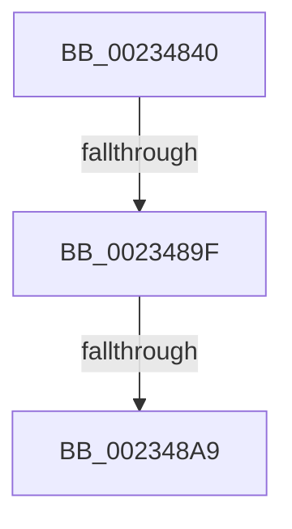

# KiTimerExpiration

- RVA: `0x00234840`–`0x002348B0` (길이 `112` bytes)
- VA: `0x0000000140234840`
- 실행 섹션: `.text`
- PDB 이름 있음: `예`; PDB Function 태그: `아니요`
- unwind 정보 RVA: `0x000605A4`
- 디코드: `22`개 명령, `112/112` bytes 표시
- 미해석 바이트: `0` (있으면 어셈블리에 `.byte`로 보존)

> 이 문서는 커널 이미지의 기계어와 PDB 기호를 분석해 생성했습니다. 4번과 5번은 함수 원형과 자료형을 바이너리 사용 방식에서 추정한 C 해석이며 원본 소스 복구 결과는 아닙니다.

## 1. Dependencies

- 직접 호출 지점: **0**; 고유 호출 대상: **0**
- 직접 호출자로 확인된 함수: **2**
- RIP 상대 이미지 참조: **3**

### Outgoing calls
- 직접 디코드된 call 명령이 없습니다.

### Direct callers
- [KiRetireDpcList](../21/KiRetireDpcList_function_0021A0B0.md) at `0x0021AD54`
- [KiTimerExpirationDpc](../5C/KiTimerExpirationDpc_function_005C86D0.md) at `0x005C8805`

### Static image references
- `0x0023484F` → RVA `0x00E0A740` (`.data`; read)
- `0x00234861` → RVA `0x00FC5030` (`ALMOSTRO`; read)
- `0x002348A9` → RVA `0x00FC8C40` (`ALMOSTRO`; read)

## 2. Other-region calls and transfers

- 다른 실행 섹션으로 향하는 call: **0**
- call이 아닌 외부 분기/꼬리 이동: **2**
  - `0x00234899` → [sub_00234FE0](Unknown_function_00234FE0.md) (`tail-transfer`)
  - `0x002348A3` → [sub_00234B4E](Unknown_function_00234B4E.md) (`tail-transfer`)

## 3. Assembly (complete function range)

```asm
00234840  40 55                           push rbp
00234842  41 55                           push r13
00234844  41 56                           push r14
00234846  41 57                           push r15
00234848  48 81 EC 08 01 00 00            sub rsp, 0x108
0023484F  48 8B 05 EA 5E BD 00            mov rax, qword ptr [rip + 0xbd5eea]
00234856  48 33 C4                        xor rax, rsp
00234859  48 89 84 24 E8 00 00 00         mov qword ptr [rsp + 0xe8], rax
00234861  83 3D C8 07 D9 00 00            cmp dword ptr [rip + 0xd907c8], 0
00234868  0F 57 C0                        xorps xmm0, xmm0
0023486B  4C 8B AC 24 50 01 00 00         mov r13, qword ptr [rsp + 0x150]
00234873  49 8B E8                        mov rbp, r8
00234876  4C 89 AC 24 80 00 00 00         mov qword ptr [rsp + 0x80], r13
0023487E  44 8B FA                        mov r15d, edx
00234881  0F 11 84 24 C8 00 00 00         movups xmmword ptr [rsp + 0xc8], xmm0
00234889  44 88 4C 24 3C                  mov byte ptr [rsp + 0x3c], r9b
0023488E  4C 8B F1                        mov r14, rcx
00234891  4C 89 84 24 90 00 00 00         mov qword ptr [rsp + 0x90], r8
00234899  0F 84 41 07 00 00               je 0x140234fe0
0023489F  80 79 21 00                     cmp byte ptr [rcx + 0x21], 0
002348A3  0F 84 A5 02 00 00               je 0x140234b4e
002348A9  48 8B 05 90 43 D9 00            mov rax, qword ptr [rip + 0xd94390]
```

## 4. C-style interpretation (structured pseudocode)

```c
__int64 __fastcall KiTimerExpiration(__int64 a1, int a2, __int64 a3, unsigned __int8 a4, __int64 a5)
{
    __int64 result;
    __int64 v_rsp;
    unsigned __int64 v_stack_m40;
    unsigned __int64 v_stack_m60;
    unsigned __int64 v_stack_m98;
    unsigned __int64 v_stack_mA8;
    unsigned __int8 v_stack_mEC;

    v_rsp = (v_rsp) - (264);
    result = (*(unsigned __int64 *)(v_rip + 12410602)) ^ (v_rsp);
    v_stack_m40 = result;
    v_stack_mA8 = a5;
    v_stack_m60 = v_xmm0;
    v_stack_mEC = a4;
    v_stack_m98 = a3;
    return *(unsigned __int64 *)(v_rip + 14238608);
}
```

## 5. (Beta) C Style

```c
int64_t KiTimerExpiration(void *Arg1, int32_t Arg2, int64_t Arg3, uint8_t Arg4, int64_t Arg5)
{
    uint8_t *arg1 = (uint8_t *)Arg1;

    int64_t result;
    int64_t local_rsp;
    uint64_t v_stack_m40;
    uint64_t v_stack_m60;
    uint64_t v_stack_m98;
    uint64_t v_stack_mA8;
    uint8_t v_stack_mEC;

    local_rsp = (local_rsp) - (264);
    result = (*(uint64_t *)(v_rip + 0xBD5EEA)) ^ (local_rsp);
    v_stack_m40 = result;
    v_stack_mA8 = Arg5;
    v_stack_m60 = v_xmm0;
    v_stack_mEC = Arg4;
    v_stack_m98 = Arg3;
    return *(uint64_t *)(v_rip + 0xD94390);
}
```

### 관측된 메모리 오프셋

구조체 형식이 확인되지 않은 접근은 인자 기준의 오프셋으로만 기록했습니다.

| 기준 인자 | 오프셋 표현 | 폭 (bit) | 접근 |
|---|---:|---:|---|
| `Arg1` | `+ 0x21` | `8` | `R` |

## 6. Execution-region graph

[열기: 2D/3D 그래프와 함수 탐색 컨트롤 패널](../../../control-panel.html?section=text&rva=0x00234840&view=graph)

- 2D 그래프는 위에서 아래로 흐르고, 3D 그래프는 빈 공간을 드래그해 회전합니다. Shift+드래그는 이동, 휠은 확대·축소, 함수 노드 선택은 대상 보고서 이동입니다.

### Static fallback


