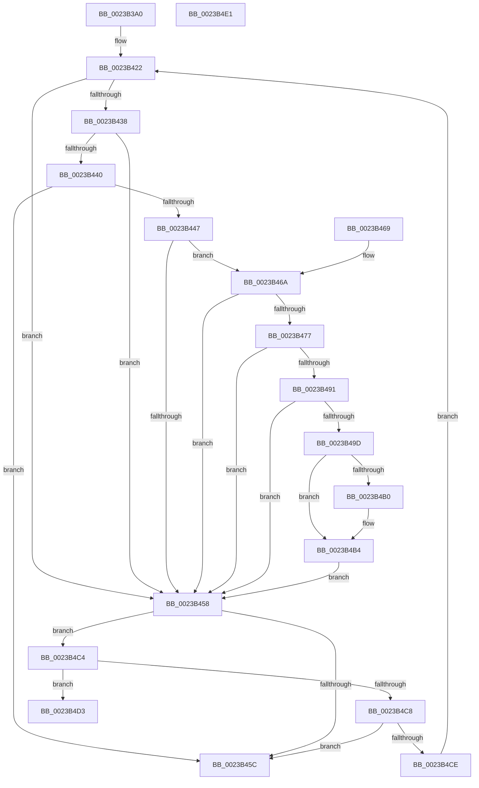

# MI_IS_PHYSICAL_ADDRESS

- RVA: `0x0023B3A0`–`0x0023B4E2` (길이 `322` bytes)
- VA: `0x000000014023B3A0`
- 실행 섹션: `.text`
- PDB 이름 있음: `예`; PDB Function 태그: `아니요`
- unwind 정보 RVA: `0x00060D80`
- 디코드: `87`개 명령, `322/322` bytes 표시
- 미해석 바이트: `0` (있으면 어셈블리에 `.byte`로 보존)

> 이 문서는 커널 이미지의 기계어와 PDB 기호를 분석해 생성했습니다. 4번과 5번은 함수 원형과 자료형을 바이너리 사용 방식에서 추정한 C 해석이며 원본 소스 복구 결과는 아닙니다.

## 1. Dependencies

- 직접 호출 지점: **0**; 고유 호출 대상: **0**
- 직접 호출자로 확인된 함수: **45**
- RIP 상대 이미지 참조: **1**

### Outgoing calls
- 직접 디코드된 call 명령이 없습니다.

### Direct callers
- [MmProtectMdlSystemAddress](../22/MmProtectMdlSystemAddress_function_00227B50.md) at `0x00227BA6`
- [MiGetPhysicalAddress](MiGetPhysicalAddress_function_0023B120.md) at `0x0023B1A3`
- [sub_0023C5C6](Unknown_function_0023C5C6.md) at `0x0023C5CA`
- [MiClearMappingAndDereferenceIoSpace](../24/MiClearMappingAndDereferenceIoSpace_function_00247DF0.md) at `0x00247E60`
- [MiLockCode](../36/MiLockCode_function_0036F91C.md) at `0x0036F96F`
- [MiSetSystemCodeProtection](../38/MiSetSystemCodeProtection_function_00384420.md) at `0x00384490`
- [MiUnmapContiguousMemory](../3F/MiUnmapContiguousMemory_function_003F7908.md) at `0x003F7951`
- [MiMappingHasIoReferences](../46/MiMappingHasIoReferences_function_00460934.md) at `0x0046096C`
- [MmSetPageProtection](../4E/MmSetPageProtection_function_004E1580.md) at `0x004E1598`
- [MmProtectDriverSection](../67/MmProtectDriverSection_function_00670A80.md) at `0x00670B5A`
- [MiReplaceImportEntry](../67/MiReplaceImportEntry_function_00671440.md) at `0x006714B4`
- [MiPfnRangeIsZero](../67/MiPfnRangeIsZero_function_006735C0.md) at `0x00673651`
- [MiAddTriageDumpPtes](../67/MiAddTriageDumpPtes_function_0067D308.md) at `0x0067D344`
- [MiDbgReleaseAddress](../68/MiDbgReleaseAddress_function_00685630.md) at `0x0068565A`
- [MiDbgWriteCheck](../68/MiDbgWriteCheck_function_00685BE4.md) at `0x00685C37`
- [MiDemoteValidLargePageOneLevel](../68/MiDemoteValidLargePageOneLevel_function_0068A3F4.md) at `0x0068A459`
- [MiBackSystemImageWithPagefile](../../page/7F/MiBackSystemImageWithPagefile_function_007F86E8.md) at `0x007F8735`
- [MiFreeInitializationCode](../../page/7F/MiFreeInitializationCode_function_007F88A0.md) at `0x007F898E`
- [MiFreeInitializationCode](../../page/7F/MiFreeInitializationCode_function_007F88A0.md) at `0x007F8B6F`
- [MiImagePagable](../../page/7F/MiImagePagable_function_007F8BD0.md) at `0x007F8BE6`
- [MiPrepareDriverPatchState](../../page/7F/MiPrepareDriverPatchState_function_007F8C8C.md) at `0x007F8CEC`
- [MiApplyHotPatchToLoadedDriver](../../page/80/MiApplyHotPatchToLoadedDriver_function_00802078.md) at `0x008020C8`
- [MiInitializeShadowPageTable](../../page/80/MiInitializeShadowPageTable_function_0080778C.md) at `0x008077E9`
- [MmAllocateIsrStack](../../page/80/MmAllocateIsrStack_function_00807ECC.md) at `0x00807F3F`
- [MmResetDriverPaging](../../page/A4/MmResetDriverPaging_function_00A4ADB0.md) at `0x00A4ADCB`
- [MiHandleDriverNonPagedSections](../../page/A4/MiHandleDriverNonPagedSections_function_00A4AEA8.md) at `0x00A4AED1`
- [MiDisablePagingOfDriver](../../page/A4/MiDisablePagingOfDriver_function_00A4B074.md) at `0x00A4B093`
- [MiFreeDriverInitialization](../../page/A4/MiFreeDriverInitialization_function_00A4B120.md) at `0x00A4B140`
- [MmPageEntireDriver](../../page/A4/MmPageEntireDriver_function_00A4BBB0.md) at `0x00A4BBCB`
- [MmLockPagableSectionByHandle](../../page/A4/MmLockPagableSectionByHandle_function_00A4D1E0.md) at `0x00A4D1F8`
- [MmChangeImageProtection](../../page/A5/MmChangeImageProtection_function_00A565F0.md) at `0x00A56766`
- [MmLockPagableDataSection](../../page/A7/MmLockPagableDataSection_function_00A73E80.md) at `0x00A73E9B`
- [MiUpdateForkMaps](../../page/A7/MiUpdateForkMaps_function_00A7DAF8.md) at `0x00A7DB4A`
- [MiUnlockDriverCode](../../page/A9/MiUnlockDriverCode_function_00A9FFEC.md) at `0x00AA0005`
- [MiProtectSystemImage](../../page/AA/MiProtectSystemImage_function_00AA7D74.md) at `0x00AA7DCD`
- [MiProtectKernelCfgData](../../init/C5/MiProtectKernelCfgData_function_00C5F5E0.md) at `0x00C5F658`
- [MiInitializeDriverPtes](../../init/C6/MiInitializeDriverPtes_function_00C61818.md) at `0x00C61882`
- [MiInitializeNonPagedPool](../../init/C6/MiInitializeNonPagedPool_function_00C64A24.md) at `0x00C64BA2`
- [MiApplyImportOptimizationToBootDriver](../../init/C6/MiApplyImportOptimizationToBootDriver_function_00C66108.md) at `0x00C66153`
- [MiCheckLargePageOk](../../init/C6/MiCheckLargePageOk_function_00C667E4.md) at `0x00C6680E`
- [MiCheckLargePageOk](../../init/C6/MiCheckLargePageOk_function_00C667E4.md) at `0x00C66907`
- [MiCheckLargePageOk](../../init/C6/MiCheckLargePageOk_function_00C667E4.md) at `0x00C66954`
- [MiHandleBootImage](../../init/C6/MiHandleBootImage_function_00C6B854.md) at `0x00C6B90B`
- [MiInitializeBootLoadedDriverPfns](../../init/C6/MiInitializeBootLoadedDriverPfns_function_00C6BB10.md) at `0x00C6BB75`
- [MiInitializeSystemImageRegion](../../init/C6/MiInitializeSystemImageRegion_function_00C6C05C.md) at `0x00C6C1D2`
- [MiReloadBootLoadedDrivers](../../init/C6/MiReloadBootLoadedDrivers_function_00C6C3F8.md) at `0x00C6C48D`
- [MmDiscardDriverSection](../../init/C6/MmDiscardDriverSection_function_00C6C8D0.md) at `0x00C6C901`
- [MiFreeBootDriverPages](../../init/C7/MiFreeBootDriverPages_function_00C7695C.md) at `0x00C769C4`

### Static image references
- `0x0023B46A` → RVA `0x00FC6A88` (`ALMOSTRO`; read)

## 2. Other-region calls and transfers

- 다른 실행 섹션으로 향하는 call: **0**
- 별도 외부 분기/꼬리 이동을 확인하지 못했습니다.

## 3. Assembly (complete function range)

```asm
0023B3A0  48 89 5C 24 08                  mov qword ptr [rsp + 8], rbx
0023B3A5  57                              push rdi
0023B3A6  48 83 EC 20                     sub rsp, 0x20
0023B3AA  48 C1 E9 09                     shr rcx, 9
0023B3AE  49 B8 F8 FF FF FF 7F 00 00 00   movabs r8, 0x7ffffffff8
0023B3B8  49 23 C8                        and rcx, r8
0023B3BB  48 BA 00 00 00 00 80 F6 FF FF   movabs rdx, 0xfffff68000000000
0023B3C5  41 BB 04 00 00 00               mov r11d, 4
0023B3CB  48 8B C2                        mov rax, rdx
0023B3CE  48 03 C8                        add rcx, rax
0023B3D1  48 89 0C 24                     mov qword ptr [rsp], rcx
0023B3D5  48 C1 E9 09                     shr rcx, 9
0023B3D9  49 23 C8                        and rcx, r8
0023B3DC  48 8B C2                        mov rax, rdx
0023B3DF  48 03 C8                        add rcx, rax
0023B3E2  48 89 4C 24 08                  mov qword ptr [rsp + 8], rcx
0023B3E7  48 C1 E9 09                     shr rcx, 9
0023B3EB  49 23 C8                        and rcx, r8
0023B3EE  48 8B C2                        mov rax, rdx
0023B3F1  48 03 C8                        add rcx, rax
0023B3F4  48 89 4C 24 10                  mov qword ptr [rsp + 0x10], rcx
0023B3F9  48 C1 E9 09                     shr rcx, 9
0023B3FD  49 23 C8                        and rcx, r8
0023B400  48 8B C2                        mov rax, rdx
0023B403  48 03 C8                        add rcx, rax
0023B406  48 BF 00 D0 BE 7D FB F6 FF FF   movabs rdi, 0xfffff6fb7dbed000
0023B410  48 89 4C 24 18                  mov qword ptr [rsp + 0x18], rcx
0023B415  45 8B D3                        mov r10d, r11d
0023B418  48 BB F8 D7 BE 7D FB F6 FF FF   movabs rbx, 0xfffff6fb7dbed7f8
0023B422  4A 8B 54 D4 F8                  mov rdx, qword ptr [rsp + r10*8 - 8]
0023B427  49 FF CA                        dec r10
0023B42A  41 FF CB                        dec r11d
0023B42D  48 8B 02                        mov rax, qword ptr [rdx]
0023B430  48 8B CF                        mov rcx, rdi
0023B433  48 3B D1                        cmp rdx, rcx
0023B436  72 20                           jb 0x14023b458
0023B438  48 8B CB                        mov rcx, rbx
0023B43B  48 3B D1                        cmp rdx, rcx
0023B43E  77 18                           ja 0x14023b458
0023B440  48 8B C8                        mov rcx, rax
0023B443  A8 01                           test al, 1
0023B445  74 15                           je 0x14023b45c
0023B447  A8 42                           test al, 0x42
0023B449  41 0F 95 C1                     setne r9b
0023B44D  A8 20                           test al, 0x20
0023B44F  41 0F 95 C0                     setne r8b
0023B453  45 84 C8                        test r8b, r9b
0023B456  74 12                           je 0x14023b46a
0023B458  A8 01                           test al, 1
0023B45A  75 68                           jne 0x14023b4c4
0023B45C  33 C0                           xor eax, eax
0023B45E  48 8B 5C 24 30                  mov rbx, qword ptr [rsp + 0x30]
0023B463  48 83 C4 20                     add rsp, 0x20
0023B467  5F                              pop rdi
0023B468  C3                              ret
0023B469  CC                              int3
0023B46A  48 F7 05 13 B6 D8 00 00 00 60 00  test qword ptr [rip + 0xd8b613], 0x600000
0023B475  74 E1                           je 0x14023b458
0023B477  65 4C 8B 04 25 88 01 00 00      mov r8, qword ptr gs:[0x188]
0023B480  4D 8B 88 B8 00 00 00            mov r9, qword ptr [r8 + 0xb8]
0023B487  41 80 B9 60 01 00 00 01         cmp byte ptr [r9 + 0x160], 1
0023B48F  74 C7                           je 0x14023b458
0023B491  4D 8B 81 08 05 00 00            mov r8, qword ptr [r9 + 0x508]
0023B498  4D 85 C0                        test r8, r8
0023B49B  74 BB                           je 0x14023b458
0023B49D  48 C1 EA 03                     shr rdx, 3
0023B4A1  81 E2 FF 01 00 00               and edx, 0x1ff
0023B4A7  49 8B 14 D0                     mov rdx, qword ptr [r8 + rdx*8]
0023B4AB  F6 C2 20                        test dl, 0x20
0023B4AE  74 04                           je 0x14023b4b4
0023B4B0  48 83 C9 20                     or rcx, 0x20
0023B4B4  48 8B C1                        mov rax, rcx
0023B4B7  48 83 C8 42                     or rax, 0x42
0023B4BB  F6 C2 42                        test dl, 0x42
0023B4BE  48 0F 44 C1                     cmove rax, rcx
0023B4C2  EB 94                           jmp 0x14023b458
0023B4C4  84 C0                           test al, al
0023B4C6  78 0B                           js 0x14023b4d3
0023B4C8  49 83 FA 01                     cmp r10, 1
0023B4CC  74 8E                           je 0x14023b45c
0023B4CE  E9 4F FF FF FF                  jmp 0x14023b422
0023B4D3  48 8B 5C 24 30                  mov rbx, qword ptr [rsp + 0x30]
0023B4D8  41 8B C3                        mov eax, r11d
0023B4DB  48 83 C4 20                     add rsp, 0x20
0023B4DF  5F                              pop rdi
0023B4E0  C3                              ret
0023B4E1  CC                              int3
```

## 4. C-style interpretation (structured pseudocode)

```c
__int64 __fastcall MI_IS_PHYSICAL_ADDRESS(__int64 a1)
{
    __int64 result;
    __int64 v_r10;
    __int64 v_r11;
    __int64 v_rsp;
    unsigned __int64 v_stack_m10;
    unsigned __int64 v_stack_m18;
    unsigned __int64 v_stack_m20;
    unsigned __int64 v_stack_m28;
    unsigned __int64 v_stack_p30;
    unsigned __int64 v_stack_p8;

    v_stack_p8 = v_rbx;
    v_rsp = (v_rsp) - (32);
    a1 = (a1) >> (9);
    a1 = (a1) & (a3);
    a1 = (a1) + (a2);
    v_stack_m28 = a1;
    a1 = (a1) >> (9);
    a1 = (a1) & (a3);
    a1 = (a1) + (a2);
    v_stack_m20 = a1;
    a1 = (a1) >> (9);
    a1 = (a1) & (a3);
    a1 = (a1) + (a2);
    v_stack_m18 = a1;
    a1 = (a1) >> (9);
    a1 = (a1) & (a3);
    a1 = (a1) + (a2);
    v_stack_m10 = a1;
loc_0023B422:
    v_r10 = (4) - 1;
    v_r11 = (unsigned int)((4) - 1);
    if ((*(unsigned __int64 *)(v_rsp + 4 * 8 - 8)) < v_rdi) goto loc_0023B458;
    if ((*(unsigned __int64 *)(v_rsp + 4 * 8 - 8)) > v_rbx) goto loc_0023B458;
    if ((((unsigned __int8)(*(unsigned __int64 *)(*(unsigned __int64 *)(v_rsp + 4 * 8 - 8)))) & (1)) == 0) goto loc_0023B45C;
    a4 = ((((unsigned __int8)(*(unsigned __int64 *)(*(unsigned __int64 *)(v_rsp + 4 * 8 - 8)))) & (66)) != 0) ? 1 : 0;
    a3 = ((((unsigned __int8)(*(unsigned __int64 *)(*(unsigned __int64 *)(v_rsp + 4 * 8 - 8)))) & (32)) != 0) ? 1 : 0;
    if ((((unsigned __int8)(a3)) & ((unsigned __int8)(a4))) == 0) goto loc_0023B46A;
loc_0023B458:
    if ((((unsigned __int8)(*(unsigned __int64 *)(*(unsigned __int64 *)(v_rsp + 4 * 8 - 8)))) & (1)) != 0) goto loc_0023B4C4;
loc_0023B45C:
    result = 0;
    v_rsp = (v_rsp) + (32);
    return result;
loc_0023B46A:
    if (((*(unsigned __int64 *)(v_rip + 14202387)) & (0x600000ULL)) == 0) goto loc_0023B458;
    if ((*(unsigned __int8 *)(*(unsigned __int64 *)(*(unsigned __int64 *)(gs_base + (0 + 392)) + 184) + 352)) == 1) goto loc_0023B458;
    if (*(unsigned __int64 *)(*(unsigned __int64 *)(*(unsigned __int64 *)(gs_base + (0 + 392)) + 184) + 1288) == 0) goto loc_0023B458;
    a2 = (*(unsigned __int64 *)(v_rsp + 4 * 8 - 8)) >> (3);
    a2 = (unsigned int)((a2) & (511));
    if ((((unsigned __int8)(*(unsigned __int64 *)(*(unsigned __int64 *)(*(unsigned __int64 *)(*(unsigned __int64 *)(gs_base + (0 + 392)) + 184) + 1288) + a2 * 8))) & (32)) != 0) {
        a1 = (*(unsigned __int64 *)(*(unsigned __int64 *)(v_rsp + 4 * 8 - 8))) | (32);
    }
    result = (a1) | (66);
    if ((((unsigned __int8)(*(unsigned __int64 *)(*(unsigned __int64 *)(*(unsigned __int64 *)(*(unsigned __int64 *)(gs_base + (0 + 392)) + 184) + 1288) + a2 * 8))) & (66)) == 0) { result = a1; }
    goto loc_0023B458;
loc_0023B4C4:
    if (sign_flag) goto loc_0023B4D3;
    if (v_r10 == 1) goto loc_0023B45C;
    goto loc_0023B422;
loc_0023B4D3:
    v_rsp = (v_rsp) + (32);
    return (unsigned int)((unsigned int)(v_r11));
}
```

## 5. (Beta) C Style

```c
int64_t MI_IS_PHYSICAL_ADDRESS(int64_t Arg1)
{
    int64_t result;
    int64_t local_r10;
    int64_t local_r11;
    int64_t local_rsp;
    uint64_t v_stack_m10;
    uint64_t v_stack_m18;
    uint64_t v_stack_m20;
    uint64_t v_stack_m28;
    uint64_t v_stack_p30;
    uint64_t v_stack_p8;

    v_stack_p8 = local_rbx;
    local_rsp = (local_rsp) - (32);
    Arg1 = (Arg1) >> (9);
    Arg1 = (Arg1) & (a3);
    Arg1 = (Arg1) + (a2);
    v_stack_m28 = Arg1;
    Arg1 = (Arg1) >> (9);
    Arg1 = (Arg1) & (a3);
    Arg1 = (Arg1) + (a2);
    v_stack_m20 = Arg1;
    Arg1 = (Arg1) >> (9);
    Arg1 = (Arg1) & (a3);
    Arg1 = (Arg1) + (a2);
    v_stack_m18 = Arg1;
    Arg1 = (Arg1) >> (9);
    Arg1 = (Arg1) & (a3);
    Arg1 = (Arg1) + (a2);
    v_stack_m10 = Arg1;
loc_0023B422:
    local_r10 = (4) - 1;
    local_r11 = (uint32_t)((4) - 1);
    if ((*(uint64_t *)(local_rsp + 0x4 * 8 - 0x8)) < local_rdi) goto loc_0023B458;
    if ((*(uint64_t *)(local_rsp + 0x4 * 8 - 0x8)) > local_rbx) goto loc_0023B458;
    if ((((uint8_t)(*(uint64_t *)(*(uint64_t *)(local_rsp + 0x4 * 8 - 0x8)))) & (1)) == 0) goto loc_0023B45C;
    a4 = ((((uint8_t)(*(uint64_t *)(*(uint64_t *)(local_rsp + 0x4 * 8 - 0x8)))) & (66)) != 0) ? 1 : 0;
    a3 = ((((uint8_t)(*(uint64_t *)(*(uint64_t *)(local_rsp + 0x4 * 8 - 0x8)))) & (32)) != 0) ? 1 : 0;
    if ((((uint8_t)(a3)) & ((uint8_t)(a4))) == 0) goto loc_0023B46A;
loc_0023B458:
    if ((((uint8_t)(*(uint64_t *)(*(uint64_t *)(local_rsp + 0x4 * 8 - 0x8)))) & (1)) != 0) goto loc_0023B4C4;
loc_0023B45C:
    result = 0;
    local_rsp = (local_rsp) + (32);
    return result;
loc_0023B46A:
    if (((*(uint64_t *)(v_rip + 0xD8B613)) & (0x600000ULL)) == 0) goto loc_0023B458;
    if ((*(uint8_t *)(*(uint64_t *)(*(uint64_t *)(gs_base + (0 + 0x188)) + 0xB8) + 0x160)) == 1) goto loc_0023B458;
    if (*(uint64_t *)(*(uint64_t *)(*(uint64_t *)(gs_base + (0 + 0x188)) + 0xB8) + 0x508) == 0) goto loc_0023B458;
    a2 = (*(uint64_t *)(local_rsp + 0x4 * 8 - 0x8)) >> (3);
    a2 = (uint32_t)((a2) & (511));
    if ((((uint8_t)(*(uint64_t *)(*(uint64_t *)(*(uint64_t *)(*(uint64_t *)(gs_base + (0 + 0x188)) + 0xB8) + 0x508) + a2 * 8))) & (32)) != 0) {
        Arg1 = (*(uint64_t *)(*(uint64_t *)(local_rsp + 0x4 * 8 - 0x8))) | (32);
    }
    result = (Arg1) | (66);
    if ((((uint8_t)(*(uint64_t *)(*(uint64_t *)(*(uint64_t *)(*(uint64_t *)(gs_base + (0 + 0x188)) + 0xB8) + 0x508) + a2 * 8))) & (66)) == 0) { result = Arg1; }
    goto loc_0023B458;
loc_0023B4C4:
    if (sign_flag) goto loc_0023B4D3;
    if (local_r10 == 1) goto loc_0023B45C;
    goto loc_0023B422;
loc_0023B4D3:
    local_rsp = (local_rsp) + (32);
    return (uint32_t)((uint32_t)(local_r11));
}
```

## 6. Execution-region graph

[열기: 2D/3D 그래프와 함수 탐색 컨트롤 패널](../../../control-panel.html?section=text&rva=0x0023B3A0&view=graph)

- 2D 그래프는 위에서 아래로 흐르고, 3D 그래프는 빈 공간을 드래그해 회전합니다. Shift+드래그는 이동, 휠은 확대·축소, 함수 노드 선택은 대상 보고서 이동입니다.

### Static fallback


