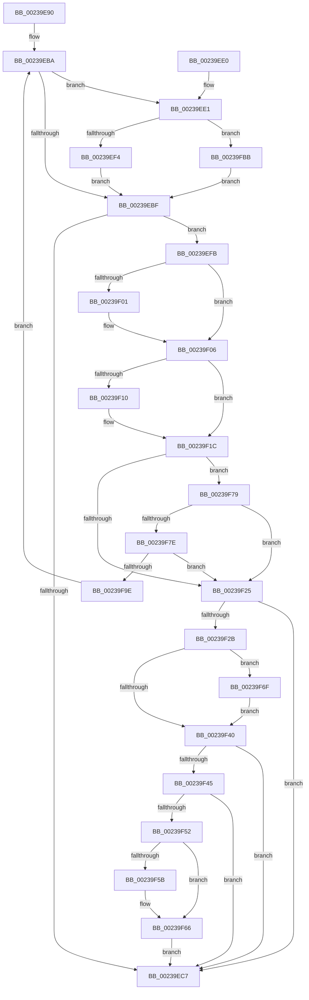

# MiAgeTrimListsTail

- RVA: `0x00239E90`–`0x00239FC8` (길이 `312` bytes)
- VA: `0x0000000140239E90`
- 실행 섹션: `.text`
- PDB 이름 있음: `예`; PDB Function 태그: `아니요`
- unwind 정보 RVA: `0x00060C2C`
- 디코드: `86`개 명령, `312/312` bytes 표시
- 미해석 바이트: `0` (있으면 어셈블리에 `.byte`로 보존)

> 이 문서는 커널 이미지의 기계어와 PDB 기호를 분석해 생성했습니다. 4번과 5번은 함수 원형과 자료형을 바이너리 사용 방식에서 추정한 C 해석이며 원본 소스 복구 결과는 아닙니다.

## 1. Dependencies

- 직접 호출 지점: **8**; 고유 호출 대상: **8**
- 직접 호출자로 확인된 함수: **5**
- RIP 상대 이미지 참조: **2**

### Outgoing calls
- `0x00239EF4` → [MiTrimWorkingSetTailHelper](../3E/MiTrimWorkingSetTailHelper_function_003E03B0.md) (function, `0x003E03B0`)
- `0x00239F01` → [MiFlushTbList](../31/MiFlushTbList_function_00311FC0.md) (function, `0x00311FC0`)
- `0x00239F17` → [MiFreeWsleList](../24/MiFreeWsleList_function_00241168.md) (function, `0x00241168`)
- `0x00239F2B` → [MiReleaseProcessorFlushList](../31/MiReleaseProcessorFlushList_function_00313C70.md) (function, `0x00313C70`)
- `0x00239F61` → [KiLowerIrqlProcessIrqlFlags](../4F/KiLowerIrqlProcessIrqlFlags_function_004F5698.md) (function, `0x004F5698`)
- `0x00239F8F` → [MiQueryVpabAccessedState](../42/MiQueryVpabAccessedState_function_00428E70.md) (function, `0x00428E70`)
- `0x00239FB1` → [MiProcessVpabAccessedInfo](../42/MiProcessVpabAccessedInfo_function_00428FD4.md) (function, `0x00428FD4`)
- `0x00239FBE` → [guard_dispatch_icall](../6B/guard_dispatch_icall_function_006BAAD0.md) (function, `0x006BAAD0`)

### Direct callers
- [MiReacquireHigherPageTableLock](MiReacquireHigherPageTableLock_function_00239650.md) at `0x00239A62`
- [MiReacquireHigherPageTableLock](MiReacquireHigherPageTableLock_function_00239650.md) at `0x00239B59`
- [MiYieldPageTableWalk](MiYieldPageTableWalk_function_00239D20.md) at `0x00239D7A`
- [MiYieldPageTableWalk](MiYieldPageTableWalk_function_00239D20.md) at `0x00239DDE`
- [MiWalkPageTablesRecursively](../27/MiWalkPageTablesRecursively_function_002796C0.md) at `0x002798F6`
- [MiWalkPageTablesRecursively](../27/MiWalkPageTablesRecursively_function_002796C0.md) at `0x00279E34`
- [MiWalkPageTablesRecursively](../27/MiWalkPageTablesRecursively_function_002796C0.md) at `0x0027A59C`
- [MiWalkPageTablesRecursively](../27/MiWalkPageTablesRecursively_function_002796C0.md) at `0x0027A716`
- [MiWalkPageTablesRecursively](../27/MiWalkPageTablesRecursively_function_002796C0.md) at `0x0027A891`
- [MiWalkPageTablesRecursively](../27/MiWalkPageTablesRecursively_function_002796C0.md) at `0x0027A943`
- [MiWalkPageTablesRecursively](../27/MiWalkPageTablesRecursively_function_002796C0.md) at `0x0027AA04`
- [MiWalkPageTablesRecursively](../27/MiWalkPageTablesRecursively_function_002796C0.md) at `0x0027B14B`
- [MiTrimWorkingSetTail](../2A/MiTrimWorkingSetTail_function_002AD970.md) at `0x002AD99E`
- [MiResetAccessBitsTail](../4A/MiResetAccessBitsTail_function_004A6820.md) at `0x004A6842`

### Static image references
- `0x00239EE1` → RVA `0x003E03B0` (`MiTrimWorkingSetTailHelper`; read)
- `0x00239F52` → RVA `0x00FC6D20` (`ALMOSTRO`; read)

## 2. Other-region calls and transfers

- 다른 실행 섹션으로 향하는 call: **0**
- 별도 외부 분기/꼬리 이동을 확인하지 못했습니다.

## 3. Assembly (complete function range)

```asm
00239E90  48 89 5C 24 08                  mov qword ptr [rsp + 8], rbx
00239E95  48 89 6C 24 10                  mov qword ptr [rsp + 0x10], rbp
00239E9A  48 89 74 24 18                  mov qword ptr [rsp + 0x18], rsi
00239E9F  57                              push rdi
00239EA0  41 56                           push r14
00239EA2  41 57                           push r15
00239EA4  48 83 EC 20                     sub rsp, 0x20
00239EA8  45 8B F9                        mov r15d, r9d
00239EAB  49 8B E8                        mov rbp, r8
00239EAE  48 8B FA                        mov rdi, rdx
00239EB1  48 8B F1                        mov rsi, rcx
00239EB4  41 BE 01 00 00 00               mov r14d, 1
00239EBA  48 85 ED                        test rbp, rbp
00239EBD  75 22                           jne 0x140239ee1
00239EBF  48 8B 0F                        mov rcx, qword ptr [rdi]
00239EC2  48 85 C9                        test rcx, rcx
00239EC5  75 34                           jne 0x140239efb
00239EC7  48 8B 5C 24 40                  mov rbx, qword ptr [rsp + 0x40]
00239ECC  48 8B 6C 24 48                  mov rbp, qword ptr [rsp + 0x48]
00239ED1  48 8B 74 24 50                  mov rsi, qword ptr [rsp + 0x50]
00239ED6  48 83 C4 20                     add rsp, 0x20
00239EDA  41 5F                           pop r15
00239EDC  41 5E                           pop r14
00239EDE  5F                              pop rdi
00239EDF  C3                              ret
00239EE0  CC                              int3
00239EE1  48 8D 05 C8 64 1A 00            lea rax, [rip + 0x1a64c8]
00239EE8  48 8B CE                        mov rcx, rsi
00239EEB  48 3B E8                        cmp rbp, rax
00239EEE  0F 85 C7 00 00 00               jne 0x140239fbb
00239EF4  E8 B7 64 1A 00                  call 0x1403e03b0
00239EF9  EB C4                           jmp 0x140239ebf
00239EFB  83 79 1C 00                     cmp dword ptr [rcx + 0x1c], 0
00239EFF  74 05                           je 0x140239f06
00239F01  E8 BA 80 0D 00                  call 0x140311fc0
00239F06  48 8B 57 08                     mov rdx, qword ptr [rdi + 8]
00239F0A  83 7A 1C 00                     cmp dword ptr [rdx + 0x1c], 0
00239F0E  74 0C                           je 0x140239f1c
00239F10  48 8B 4E 20                     mov rcx, qword ptr [rsi + 0x20]
00239F14  45 33 C0                        xor r8d, r8d
00239F17  E8 4C 72 00 00                  call 0x140241168
00239F1C  48 8B 47 10                     mov rax, qword ptr [rdi + 0x10]
00239F20  48 85 C0                        test rax, rax
00239F23  75 54                           jne 0x140239f79
00239F25  48 83 3F 00                     cmp qword ptr [rdi], 0
00239F29  74 9C                           je 0x140239ec7
00239F2B  E8 40 9D 0D 00                  call 0x140313c70
00239F30  48 83 27 00                     and qword ptr [rdi], 0
00239F34  48 83 67 08 00                  and qword ptr [rdi + 8], 0
00239F39  48 83 7F 10 00                  cmp qword ptr [rdi + 0x10], 0
00239F3E  75 2F                           jne 0x140239f6f
00239F40  45 85 F6                        test r14d, r14d
00239F43  75 82                           jne 0x140239ec7
00239F45  0F B6 5E 09                     movzx ebx, byte ptr [rsi + 9]
00239F49  80 FB 11                        cmp bl, 0x11
00239F4C  0F 84 75 FF FF FF               je 0x140239ec7
00239F52  44 39 35 C7 CD D8 00            cmp dword ptr [rip + 0xd8cdc7], r14d
00239F59  74 0B                           je 0x140239f66
00239F5B  44 0F 20 C1                     mov rcx, cr8
00239F5F  8A D3                           mov dl, bl
00239F61  E8 32 B7 2B 00                  call 0x1404f5698
00239F66  44 0F 22 C3                     mov cr8, rbx
00239F6A  E9 58 FF FF FF                  jmp 0x140239ec7
00239F6F  48 C7 47 10 01 00 00 00         mov qword ptr [rdi + 0x10], 1
00239F77  EB C7                           jmp 0x140239f40
00239F79  83 38 00                        cmp dword ptr [rax], 0
00239F7C  74 A7                           je 0x140239f25
00239F7E  8A 5E 09                        mov bl, byte ptr [rsi + 9]
00239F81  45 8B C7                        mov r8d, r15d
00239F84  C6 46 09 11                     mov byte ptr [rsi + 9], 0x11
00239F88  48 8B CE                        mov rcx, rsi
00239F8B  48 8B 57 10                     mov rdx, qword ptr [rdi + 0x10]
00239F8F  E8 DC EE 1E 00                  call 0x140428e70
00239F94  88 5E 09                        mov byte ptr [rsi + 9], bl
00239F97  44 8B F0                        mov r14d, eax
00239F9A  85 C0                           test eax, eax
00239F9C  74 87                           je 0x140239f25
00239F9E  4C 8B 8E B8 00 00 00            mov r9, qword ptr [rsi + 0xb8]
00239FA5  48 8B CE                        mov rcx, rsi
00239FA8  4C 8B 44 24 60                  mov r8, qword ptr [rsp + 0x60]
00239FAD  48 8B 57 10                     mov rdx, qword ptr [rdi + 0x10]
00239FB1  E8 1E F0 1E 00                  call 0x140428fd4
00239FB6  E9 FF FE FF FF                  jmp 0x140239eba
00239FBB  48 8B C5                        mov rax, rbp
00239FBE  E8 0D 0B 48 00                  call 0x1406baad0
00239FC3  E9 F7 FE FF FF                  jmp 0x140239ebf
```

## 4. C-style interpretation (structured pseudocode)

```c
__int64 __fastcall MiAgeTrimListsTail(__int64 a1, __int64 a2, __int64 a3, int a4, __int64 a5)
{
    __int64 result;
    __int64 v_rsp;
    unsigned __int64 v_stack_p10;
    unsigned __int64 v_stack_p18;
    unsigned __int64 v_stack_p8;

    v_stack_p8 = v_rbx;
    v_stack_p10 = v_rbp;
    v_stack_p18 = v_rsi;
    v_rsp = (v_rsp) - (32);
loc_00239EBA:
    if (a3 != 0) goto loc_00239EE1;
loc_00239EBF:
    if (*(unsigned __int64 *)(a2) != 0) goto loc_00239EFB;
loc_00239EC7:
    v_rsp = (v_rsp) + (32);
    return result;
loc_00239EE1:
    if (v_stack_p10 != (v_rip + 1729736)) goto loc_00239FBB;
    result = MiTrimWorkingSetTailHelper(v_stack_p18, a2, a3, a4);
    goto loc_00239EBF;
loc_00239EFB:
    if ((*(unsigned int *)(v_stack_p18 + 28)) != 0) {
        result = MiFlushTbList(v_stack_p18, a2, a3, a4);
    }
    if ((*(unsigned int *)(*(unsigned __int64 *)(a2 + 8) + 28)) != 0) {
        a1 = *(unsigned __int64 *)(v_stack_p18 + 32);
        a3 = 0;
        result = MiFreeWsleList(a1, *(unsigned __int64 *)(a2 + 8), a3, a4);
    }
    if (*(unsigned __int64 *)(a2 + 16) != 0) goto loc_00239F79;
loc_00239F25:
    if ((*(unsigned __int64 *)(a2)) == 0) goto loc_00239EC7;
    result = MiReleaseProcessorFlushList(a1, *(unsigned __int64 *)(a2 + 8), a3, a4);
    if ((*(unsigned __int64 *)(a2 + 16)) != 0) goto loc_00239F6F;
loc_00239F40:
    if (1 != 0) goto loc_00239EC7;
    if (((unsigned __int8)(*(unsigned __int8 *)(v_stack_p18 + 9))) == 17) goto loc_00239EC7;
    if ((*(unsigned int *)(v_rip + 14208455)) != 1) {
        a1 = v_cr8;
        a2 = (unsigned __int8)(*(unsigned __int8 *)(v_stack_p18 + 9));
        result = KiLowerIrqlProcessIrqlFlags(a1, a2, a3, a4);
    }
    goto loc_00239EC7;
loc_00239F6F:
    *(unsigned __int64 *)(a2 + 16) = 1;
    goto loc_00239F40;
loc_00239F79:
    if ((*(unsigned int *)(result)) == 0) goto loc_00239F25;
    *(unsigned __int8 *)(v_stack_p18 + 9) = 17;
    result = MiQueryVpabAccessedState(v_stack_p18, *(unsigned __int64 *)(a2 + 16), (unsigned int)((unsigned int)((unsigned int)(a4))), a4);
    *(unsigned __int8 *)(v_stack_p18 + 9) = (unsigned __int8)(*(unsigned __int8 *)(v_stack_p18 + 9));
    if ((unsigned int)(result) == 0) goto loc_00239F25;
    result = MiProcessVpabAccessedInfo(v_stack_p18, *(unsigned __int64 *)(a2 + 16), a5, *(unsigned __int64 *)(v_stack_p18 + 184));
    goto loc_00239EBA;
loc_00239FBB:
    result = guard_dispatch_icall(v_stack_p18, *(unsigned __int64 *)(a2 + 16), a5, *(unsigned __int64 *)(v_stack_p18 + 184));
    goto loc_00239EBF;
}
```

## 5. (Beta) C Style

```c
int64_t MiAgeTrimListsTail(void *Arg1, void *Arg2, int64_t Arg3, int32_t Arg4, int64_t Arg5)
{
    uint8_t *arg1 = (uint8_t *)Arg1;
    uint8_t *arg2 = (uint8_t *)Arg2;

    int64_t result;
    int64_t local_rsp;
    uint64_t v_stack_p10;
    uint64_t v_stack_p18;
    uint64_t v_stack_p8;

    v_stack_p8 = local_rbx;
    v_stack_p10 = local_rbp;
    v_stack_p18 = local_rsi;
    local_rsp = (local_rsp) - (32);
loc_00239EBA:
    if (Arg3 != 0) goto loc_00239EE1;
loc_00239EBF:
    if (*(uint64_t *)(arg2) != 0) goto loc_00239EFB;
loc_00239EC7:
    local_rsp = (local_rsp) + (32);
    return result;
loc_00239EE1:
    if (v_stack_p10 != (v_rip + 1729736)) goto loc_00239FBB;
    result = MiTrimWorkingSetTailHelper(v_stack_p18, Arg2, Arg3, Arg4);
    goto loc_00239EBF;
loc_00239EFB:
    if ((*(uint32_t *)(v_stack_p18 + 0x1C)) != 0) {
        result = MiFlushTbList(v_stack_p18, Arg2, Arg3, Arg4);
    }
    if ((*(uint32_t *)(*(uint64_t *)(arg2 + 0x8) + 0x1C)) != 0) {
        Arg1 = *(uint64_t *)(v_stack_p18 + 0x20);
        Arg3 = 0;
        result = MiFreeWsleList(Arg1, *(uint64_t *)(arg2 + 0x8), Arg3, Arg4);
    }
    if (*(uint64_t *)(arg2 + 0x10) != 0) goto loc_00239F79;
loc_00239F25:
    if ((*(uint64_t *)(arg2)) == 0) goto loc_00239EC7;
    result = MiReleaseProcessorFlushList(Arg1, *(uint64_t *)(arg2 + 0x8), Arg3, Arg4);
    if ((*(uint64_t *)(arg2 + 0x10)) != 0) goto loc_00239F6F;
loc_00239F40:
    if (1 != 0) goto loc_00239EC7;
    if (((uint8_t)(*(uint8_t *)(v_stack_p18 + 0x9))) == 17) goto loc_00239EC7;
    if ((*(uint32_t *)(v_rip + 0xD8CDC7)) != 1) {
        Arg1 = v_cr8;
        Arg2 = (uint8_t)(*(uint8_t *)(v_stack_p18 + 0x9));
        result = KiLowerIrqlProcessIrqlFlags(Arg1, Arg2, Arg3, Arg4);
    }
    goto loc_00239EC7;
loc_00239F6F:
    *(uint64_t *)(arg2 + 0x10) = 1;
    goto loc_00239F40;
loc_00239F79:
    if ((*(uint32_t *)(result)) == 0) goto loc_00239F25;
    *(uint8_t *)(v_stack_p18 + 0x9) = 17;
    result = MiQueryVpabAccessedState(v_stack_p18, *(uint64_t *)(arg2 + 0x10), (uint32_t)((uint32_t)((uint32_t)(Arg4))), Arg4);
    *(uint8_t *)(v_stack_p18 + 0x9) = (uint8_t)(*(uint8_t *)(v_stack_p18 + 0x9));
    if ((uint32_t)(result) == 0) goto loc_00239F25;
    result = MiProcessVpabAccessedInfo(v_stack_p18, *(uint64_t *)(arg2 + 0x10), Arg5, *(uint64_t *)(v_stack_p18 + 0xB8));
    goto loc_00239EBA;
loc_00239FBB:
    result = guard_dispatch_icall(v_stack_p18, *(uint64_t *)(arg2 + 0x10), Arg5, *(uint64_t *)(v_stack_p18 + 0xB8));
    goto loc_00239EBF;
}
```

### 관측된 메모리 오프셋

구조체 형식이 확인되지 않은 접근은 인자 기준의 오프셋으로만 기록했습니다.

| 기준 인자 | 오프셋 표현 | 폭 (bit) | 접근 |
|---|---:|---:|---|
| `Arg1` | `+ 0x9` | `8` | `R` |
| `Arg1` | `+ 0x9` | `8` | `W` |
| `Arg1` | `+ 0x20` | `64` | `R` |
| `Arg1` | `+ 0xB8` | `64` | `R` |
| `Arg2` | `+ 0x0` | `64` | `R` |
| `Arg2` | `+ 0x0` | `64` | `R/W` |
| `Arg2` | `+ 0x8` | `64` | `R` |
| `Arg2` | `+ 0x8` | `64` | `R/W` |
| `Arg2` | `+ 0x10` | `64` | `R` |
| `Arg2` | `+ 0x10` | `64` | `W` |

## 6. Execution-region graph

[열기: 2D/3D 그래프와 함수 탐색 컨트롤 패널](../../../control-panel.html?section=text&rva=0x00239E90&view=graph)

- 2D 그래프는 위에서 아래로 흐르고, 3D 그래프는 빈 공간을 드래그해 회전합니다. Shift+드래그는 이동, 휠은 확대·축소, 함수 노드 선택은 대상 보고서 이동입니다.

### Static fallback


