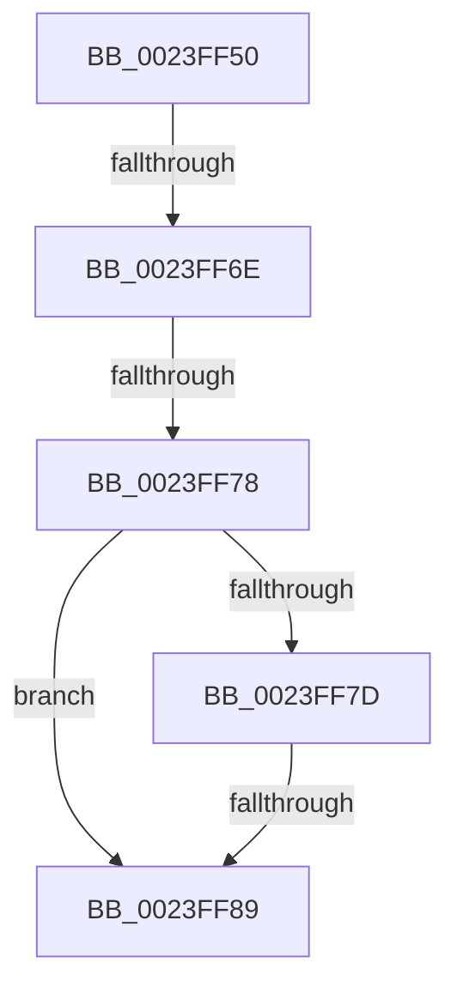

# MiCheckReservePageFileSpace

- RVA: `0x0023FF50`–`0x0023FF9D` (길이 `77` bytes)
- VA: `0x000000014023FF50`
- 실행 섹션: `.text`
- PDB 이름 있음: `예`; PDB Function 태그: `아니요`
- unwind 정보 RVA: `0x00061688`
- 디코드: `22`개 명령, `77/77` bytes 표시
- 미해석 바이트: `0` (있으면 어셈블리에 `.byte`로 보존)

> 이 문서는 커널 이미지의 기계어와 PDB 기호를 분석해 생성했습니다. 4번과 5번은 함수 원형과 자료형을 바이너리 사용 방식에서 추정한 C 해석이며 원본 소스 복구 결과는 아닙니다.

## 1. Dependencies

- 직접 호출 지점: **0**; 고유 호출 대상: **0**
- 직접 호출자로 확인된 함수: **1**
- RIP 상대 이미지 참조: **2**

### Outgoing calls
- 직접 디코드된 call 명령이 없습니다.

### Direct callers
- [MiWsleFlush](MiWsleFlush_function_0023FB30.md) at `0x0023FCE0`

### Static image references
- `0x0023FF7D` → RVA `0x00E2DC80` (`.data`; read)
- `0x0023FF8D` → RVA `0x00E30088` (`.data`; read)

## 2. Other-region calls and transfers

- 다른 실행 섹션으로 향하는 call: **0**
- call이 아닌 외부 분기/꼬리 이동: **3**
  - `0x0023FF6C` → [sub_0023FFB5](Unknown_function_0023FFB5.md) (`tail-transfer`)
  - `0x0023FF76` → [sub_0023FFB5](Unknown_function_0023FFB5.md) (`tail-transfer`)
  - `0x0023FF87` → [sub_0023FFB5 + 0xC](Unknown_function_0023FFB5.md) (`tail-transfer`)

## 3. Assembly (complete function range)

```asm
0023FF50  48 89 5C 24 10                  mov qword ptr [rsp + 0x10], rbx
0023FF55  56                              push rsi
0023FF56  48 83 EC 20                     sub rsp, 0x20
0023FF5A  48 8B 41 28                     mov rax, qword ptr [rcx + 0x28]
0023FF5E  49 8B D8                        mov rbx, r8
0023FF61  48 C1 E8 3C                     shr rax, 0x3c
0023FF65  48 8B F2                        mov rsi, rdx
0023FF68  24 07                           and al, 7
0023FF6A  3C 04                           cmp al, 4
0023FF6C  74 47                           je 0x14023ffb5
0023FF6E  4C 8B 49 10                     mov r9, qword ptr [rcx + 0x10]
0023FF72  41 F6 C1 01                     test r9b, 1
0023FF76  75 3D                           jne 0x14023ffb5
0023FF78  4D 85 C9                        test r9, r9
0023FF7B  74 0C                           je 0x14023ff89
0023FF7D  48 8B 05 FC DC BE 00            mov rax, qword ptr [rip + 0xbedcfc]
0023FF84  48 85 C0                        test rax, rax
0023FF87  75 38                           jne 0x14023ffc1
0023FF89  48 8B 41 28                     mov rax, qword ptr [rcx + 0x28]
0023FF8D  48 8B 15 F4 00 BF 00            mov rdx, qword ptr [rip + 0xbf00f4]
0023FF94  48 C1 E8 2B                     shr rax, 0x2b
0023FF98  25 FF 03 00 00                  and eax, 0x3ff
```

## 4. C-style interpretation (structured pseudocode)

```c
__int64 __fastcall MiCheckReservePageFileSpace(__int64 a1, __int64 a2, __int64 a3)
{
    __int64 result;
    __int64 v_rsp;
    unsigned __int64 v_stack_p10;

    v_stack_p10 = v_rbx;
    v_rsp = (v_rsp) - (32);
    result = (*(unsigned __int64 *)(a1 + 40)) >> (60);
    result = (unsigned __int8)((result) & (7));
    if (*(unsigned __int64 *)(a1 + 16) == 0) goto loc_0023FF89;
loc_0023FF89:
    result = (*(unsigned __int64 *)(a1 + 40)) >> (43);
    result = (unsigned int)((result) & (0x3FFULL));
    return result;
}
```

## 5. (Beta) C Style

```c
int64_t MiCheckReservePageFileSpace(void *Arg1, int64_t Arg2, int64_t Arg3)
{
    uint8_t *arg1 = (uint8_t *)Arg1;

    int64_t result;
    int64_t local_rsp;
    uint64_t v_stack_p10;

    v_stack_p10 = local_rbx;
    local_rsp = (local_rsp) - (32);
    result = (*(uint64_t *)(arg1 + 0x28)) >> (60);
    result = (uint8_t)((result) & (7));
    if (*(uint64_t *)(arg1 + 0x10) == 0) goto loc_0023FF89;
loc_0023FF89:
    result = (*(uint64_t *)(arg1 + 0x28)) >> (43);
    result = (uint32_t)((result) & (0x3FFULL));
    return result;
}
```

### 관측된 메모리 오프셋

구조체 형식이 확인되지 않은 접근은 인자 기준의 오프셋으로만 기록했습니다.

| 기준 인자 | 오프셋 표현 | 폭 (bit) | 접근 |
|---|---:|---:|---|
| `Arg1` | `+ 0x10` | `64` | `R` |
| `Arg1` | `+ 0x28` | `64` | `R` |

## 6. Execution-region graph

[열기: 2D/3D 그래프와 함수 탐색 컨트롤 패널](../../../control-panel.html?section=text&rva=0x0023FF50&view=graph)

- 2D 그래프는 위에서 아래로 흐르고, 3D 그래프는 빈 공간을 드래그해 회전합니다. Shift+드래그는 이동, 휠은 확대·축소, 함수 노드 선택은 대상 보고서 이동입니다.

### Static fallback


