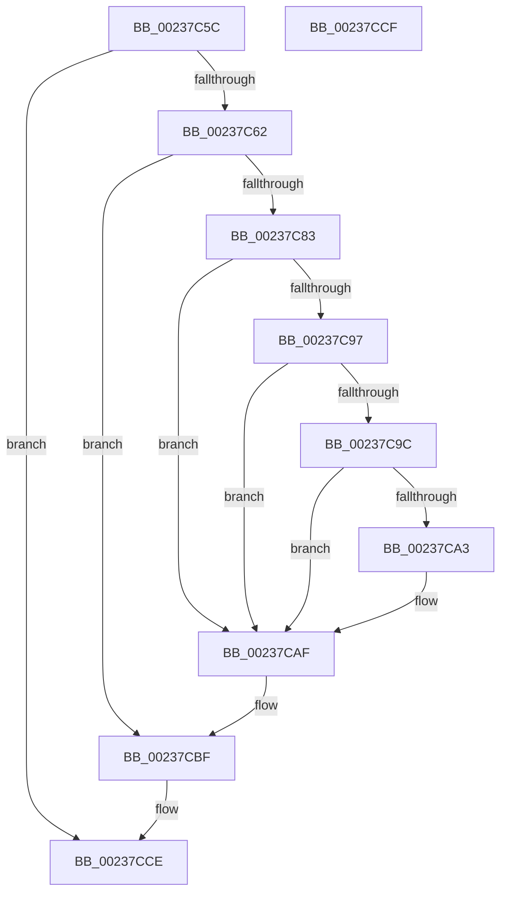

# MiDirtyPte

- RVA: `0x00237C5C`–`0x00237CD0` (길이 `116` bytes)
- VA: `0x0000000140237C5C`
- 실행 섹션: `.text`
- PDB 이름 있음: `예`; PDB Function 태그: `아니요`
- unwind 정보 RVA: `0x000609C0`
- 디코드: `35`개 명령, `116/116` bytes 표시
- 미해석 바이트: `0` (있으면 어셈블리에 `.byte`로 보존)

> 이 문서는 커널 이미지의 기계어와 PDB 기호를 분석해 생성했습니다. 4번과 5번은 함수 원형과 자료형을 바이너리 사용 방식에서 추정한 C 해석이며 원본 소스 복구 결과는 아닙니다.

## 1. Dependencies

- 직접 호출 지점: **3**; 고유 호출 대상: **3**
- 직접 호출자로 확인된 함수: **2**
- RIP 상대 이미지 참조: **0**

### Outgoing calls
- `0x00237C87` → [MiLockWorkingSetOptimal](MiLockWorkingSetOptimal_function_00238FC0.md) (function, `0x00238FC0`)
- `0x00237CAA` → [MiWriteValidPteNewProtection](../28/MiWriteValidPteNewProtection_function_00281810.md) (function, `0x00281810`)
- `0x00237CBA` → [MiUnlockWorkingSetOptimal](MiUnlockWorkingSetOptimal_function_00238DFC.md) (function, `0x00238DFC`)

### Direct callers
- [sub_002F6E32](../2F/Unknown_function_002F6E32.md) at `0x002F7461`
- [MmCopyToCachedPage](../34/MmCopyToCachedPage_function_00347B44.md) at `0x00347F44`

### Static image references
- 디코드된 RIP-relative 메모리 참조가 없습니다.

## 2. Other-region calls and transfers

- 다른 실행 섹션으로 향하는 call: **0**
- 별도 외부 분기/꼬리 이동을 확인하지 못했습니다.

## 3. Assembly (complete function range)

```asm
00237C5C  41 F6 C0 42                     test r8b, 0x42
00237C60  75 6C                           jne 0x140237cce
00237C62  48 8B C4                        mov rax, rsp
00237C65  48 89 58 08                     mov qword ptr [rax + 8], rbx
00237C69  48 89 70 10                     mov qword ptr [rax + 0x10], rsi
00237C6D  57                              push rdi
00237C6E  48 83 EC 20                     sub rsp, 0x20
00237C72  C6 40 18 00                     mov byte ptr [rax + 0x18], 0
00237C76  48 8B DA                        mov rbx, rdx
00237C79  48 8B F9                        mov rdi, rcx
00237C7C  49 0F BA E0 0B                  bt r8, 0xb
00237C81  73 3C                           jae 0x140237cbf
00237C83  4C 8D 40 18                     lea r8, [rax + 0x18]
00237C87  E8 34 13 00 00                  call 0x140238fc0
00237C8C  48 8B 13                        mov rdx, qword ptr [rbx]
00237C8F  48 8B F0                        mov rsi, rax
00237C92  F6 C2 01                        test dl, 1
00237C95  74 18                           je 0x140237caf
00237C97  F6 C2 42                        test dl, 0x42
00237C9A  75 13                           jne 0x140237caf
00237C9C  48 0F BA E2 0B                  bt rdx, 0xb
00237CA1  73 0C                           jae 0x140237caf
00237CA3  48 83 CA 62                     or rdx, 0x62
00237CA7  48 8B CB                        mov rcx, rbx
00237CAA  E8 61 9B 04 00                  call 0x140281810
00237CAF  44 8A 44 24 40                  mov r8b, byte ptr [rsp + 0x40]
00237CB4  48 8B D6                        mov rdx, rsi
00237CB7  48 8B CF                        mov rcx, rdi
00237CBA  E8 3D 11 00 00                  call 0x140238dfc
00237CBF  48 8B 5C 24 30                  mov rbx, qword ptr [rsp + 0x30]
00237CC4  48 8B 74 24 38                  mov rsi, qword ptr [rsp + 0x38]
00237CC9  48 83 C4 20                     add rsp, 0x20
00237CCD  5F                              pop rdi
00237CCE  C3                              ret
00237CCF  CC                              int3
```

## 4. C-style interpretation (structured pseudocode)

```c
__int64 __fastcall MiDirtyPte(__int64 a1, __int64 a2, __int64 a3)
{
    __int64 result;
    __int64 v_rsp;
    unsigned __int64 v_stack_p10;
    unsigned __int8 v_stack_p18;
    unsigned __int64 v_stack_p8;

    if ((((unsigned __int8)(a3)) & (66)) != 0) goto loc_00237CCE;
    *(unsigned __int64 *)(v_rsp + 8) = v_rbx;
    *(unsigned __int64 *)(v_rsp + 16) = v_rsi;
    v_rsp = (v_rsp) - (32);
    *(unsigned __int8 *)(v_rsp + 24) = 0;
    if (condition_is_above_or_equal) goto loc_00237CBF;
    result = MiLockWorkingSetOptimal(a1, a2, v_rsp + 24, a4);
    if ((((unsigned __int8)(*(unsigned __int64 *)(a2))) & (1)) == 0) goto loc_00237CAF;
    if ((((unsigned __int8)(*(unsigned __int64 *)(a2))) & (66)) != 0) goto loc_00237CAF;
    if (!(condition_is_above_or_equal)) {
        a2 = (*(unsigned __int64 *)(a2)) | (98);
        a1 = a2;
        result = MiWriteValidPteNewProtection(a1, a2, v_rsp + 24, a4);
    }
    result = MiUnlockWorkingSetOptimal(a1, result, v_stack_p18, a4);
loc_00237CBF:
    v_rsp = (v_rsp) + (32);
loc_00237CCE:
    return result;
}
```

## 5. (Beta) C Style

```c
int64_t MiDirtyPte(int64_t Arg1, void *Arg2, int64_t Arg3)
{
    uint8_t *arg2 = (uint8_t *)Arg2;

    int64_t result;
    int64_t local_rsp;
    uint64_t v_stack_p10;
    uint8_t v_stack_p18;
    uint64_t v_stack_p8;

    if ((((uint8_t)(Arg3)) & (66)) != 0) goto loc_00237CCE;
    *(uint64_t *)(local_rsp + 0x8) = local_rbx;
    *(uint64_t *)(local_rsp + 0x10) = local_rsi;
    local_rsp = (local_rsp) - (32);
    *(uint8_t *)(local_rsp + 0x18) = 0;
    if (condition_is_above_or_equal) goto loc_00237CBF;
    result = MiLockWorkingSetOptimal(Arg1, Arg2, local_rsp + 24, a4);
    if ((((uint8_t)(*(uint64_t *)(arg2))) & (1)) == 0) goto loc_00237CAF;
    if ((((uint8_t)(*(uint64_t *)(arg2))) & (66)) != 0) goto loc_00237CAF;
    if (!(condition_is_above_or_equal)) {
        Arg2 = (*(uint64_t *)(arg2)) | (98);
        Arg1 = Arg2;
        result = MiWriteValidPteNewProtection(Arg1, Arg2, local_rsp + 24, a4);
    }
    result = MiUnlockWorkingSetOptimal(Arg1, result, v_stack_p18, a4);
loc_00237CBF:
    local_rsp = (local_rsp) + (32);
loc_00237CCE:
    return result;
}
```

### 관측된 메모리 오프셋

구조체 형식이 확인되지 않은 접근은 인자 기준의 오프셋으로만 기록했습니다.

| 기준 인자 | 오프셋 표현 | 폭 (bit) | 접근 |
|---|---:|---:|---|
| `Arg2` | `+ 0x0` | `64` | `R` |

## 6. Execution-region graph

[열기: 2D/3D 그래프와 함수 탐색 컨트롤 패널](../../../control-panel.html?section=text&rva=0x00237C5C&view=graph)

- 2D 그래프는 위에서 아래로 흐르고, 3D 그래프는 빈 공간을 드래그해 회전합니다. Shift+드래그는 이동, 휠은 확대·축소, 함수 노드 선택은 대상 보고서 이동입니다.

### Static fallback


