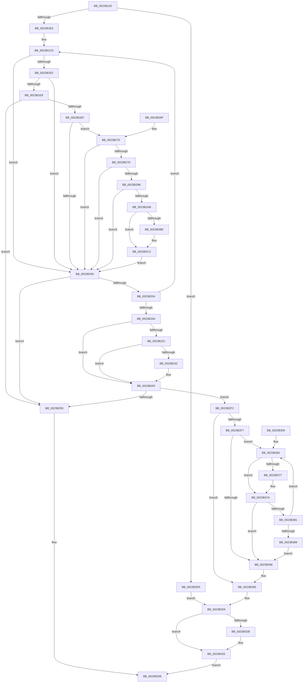

# MiGetPhysicalAddress

- RVA: `0x0023B120`–`0x0023B38D` (길이 `621` bytes)
- VA: `0x000000014023B120`
- 실행 섹션: `.text`
- PDB 이름 있음: `예`; PDB Function 태그: `아니요`
- unwind 정보 RVA: `0x00060D68`
- 디코드: `154`개 명령, `621/621` bytes 표시
- 미해석 바이트: `0` (있으면 어셈블리에 `.byte`로 보존)

> 이 문서는 커널 이미지의 기계어와 PDB 기호를 분석해 생성했습니다. 4번과 5번은 함수 원형과 자료형을 바이너리 사용 방식에서 추정한 C 해석이며 원본 소스 복구 결과는 아닙니다.

## 1. Dependencies

- 직접 호출 지점: **4**; 고유 호출 대상: **4**
- 직접 호출자로 확인된 함수: **1**
- RIP 상대 이미지 참조: **2**

### Outgoing calls
- `0x0023B1A3` → [MI_IS_PHYSICAL_ADDRESS](MI_IS_PHYSICAL_ADDRESS_function_0023B3A0.md) (function, `0x0023B3A0`)
- `0x0023B24B` → [MiQueuePinDriverAddressLog](MiQueuePinDriverAddressLog_function_0023ADA4.md) (function, `0x0023ADA4`)
- `0x0023B2D8` → [MiVaToPfnEx](MiVaToPfnEx_function_0023A1A0.md) (function, `0x0023A1A0`)
- `0x0023B2E5` → [MI_READ_PTE_LOCK_FREE](../28/MI_READ_PTE_LOCK_FREE_function_002828A0.md) (function, `0x002828A0`)

### Direct callers
- [MiDbgCopyPrivilegedData](../68/MiDbgCopyPrivilegedData_function_00685198.md) at `0x006851F2`

### Static image references
- `0x0023B224` → RVA `0x00E38AA8` (`.data`; read)
- `0x0023B270` → RVA `0x00FC6A88` (`ALMOSTRO`; read)

## 2. Other-region calls and transfers

- 다른 실행 섹션으로 향하는 call: **0**
- 별도 외부 분기/꼬리 이동을 확인하지 못했습니다.

## 3. Assembly (complete function range)

```asm
0023B120  48 89 5C 24 10                  mov qword ptr [rsp + 0x10], rbx
0023B125  48 89 74 24 18                  mov qword ptr [rsp + 0x18], rsi
0023B12A  57                              push rdi
0023B12B  41 56                           push r14
0023B12D  41 57                           push r15
0023B12F  48 83 EC 40                     sub rsp, 0x40
0023B133  4C 8B C9                        mov r9, rcx
0023B136  4C 8B FA                        mov r15, rdx
0023B139  49 C1 E9 09                     shr r9, 9
0023B13D  33 FF                           xor edi, edi
0023B13F  48 BA F8 FF FF FF 7F 00 00 00   movabs rdx, 0x7ffffffff8
0023B149  41 89 38                        mov dword ptr [r8], edi
0023B14C  48 8B F1                        mov rsi, rcx
0023B14F  4C 23 CA                        and r9, rdx
0023B152  4D 8B F0                        mov r14, r8
0023B155  48 B9 00 00 00 00 80 F6 FF FF   movabs rcx, 0xfffff68000000000
0023B15F  48 8B C1                        mov rax, rcx
0023B162  4C 03 C8                        add r9, rax
0023B165  4C 89 4C 24 20                  mov qword ptr [rsp + 0x20], r9
0023B16A  49 C1 E9 09                     shr r9, 9
0023B16E  4C 23 CA                        and r9, rdx
0023B171  48 8B C1                        mov rax, rcx
0023B174  4C 03 C8                        add r9, rax
0023B177  4C 89 4C 24 28                  mov qword ptr [rsp + 0x28], r9
0023B17C  49 C1 E9 09                     shr r9, 9
0023B180  4C 23 CA                        and r9, rdx
0023B183  48 8B C1                        mov rax, rcx
0023B186  4C 03 C8                        add r9, rax
0023B189  4C 89 4C 24 30                  mov qword ptr [rsp + 0x30], r9
0023B18E  49 C1 E9 09                     shr r9, 9
0023B192  4C 23 CA                        and r9, rdx
0023B195  48 8B C1                        mov rax, rcx
0023B198  4C 03 C8                        add r9, rax
0023B19B  48 8B CE                        mov rcx, rsi
0023B19E  4C 89 4C 24 38                  mov qword ptr [rsp + 0x38], r9
0023B1A3  E8 F8 01 00 00                  call 0x14023b3a0
0023B1A8  48 63 D8                        movsxd rbx, eax
0023B1AB  85 C0                           test eax, eax
0023B1AD  0F 85 22 01 00 00               jne 0x14023b2d5
0023B1B3  41 BA 04 00 00 00               mov r10d, 4
0023B1B9  49 BB 00 D0 BE 7D FB F6 FF FF   movabs r11, 0xfffff6fb7dbed000
0023B1C3  48 BB F8 D7 BE 7D FB F6 FF FF   movabs rbx, 0xfffff6fb7dbed7f8
0023B1CD  4A 8B 54 D4 18                  mov rdx, qword ptr [rsp + r10*8 + 0x18]
0023B1D2  49 FF CA                        dec r10
0023B1D5  48 8B 02                        mov rax, qword ptr [rdx]
0023B1D8  49 8B CB                        mov rcx, r11
0023B1DB  48 3B D1                        cmp rdx, rcx
0023B1DE  72 20                           jb 0x14023b200
0023B1E0  48 8B CB                        mov rcx, rbx
0023B1E3  48 3B D1                        cmp rdx, rcx
0023B1E6  77 18                           ja 0x14023b200
0023B1E8  48 8B C8                        mov rcx, rax
0023B1EB  A8 01                           test al, 1
0023B1ED  74 6A                           je 0x14023b259
0023B1EF  A8 42                           test al, 0x42
0023B1F1  41 0F 95 C1                     setne r9b
0023B1F5  A8 20                           test al, 0x20
0023B1F7  41 0F 95 C0                     setne r8b
0023B1FB  45 84 C8                        test r8b, r9b
0023B1FE  74 70                           je 0x14023b270
0023B200  A8 01                           test al, 1
0023B202  74 55                           je 0x14023b259
0023B204  49 83 FA 01                     cmp r10, 1
0023B208  75 C3                           jne 0x14023b1cd
0023B20A  48 8B 5C 24 20                  mov rbx, qword ptr [rsp + 0x20]
0023B20F  48 B8 00 00 00 00 00 80 FF FF   movabs rax, 0xffff800000000000
0023B219  48 8B 1B                        mov rbx, qword ptr [rbx]
0023B21C  48 3B F0                        cmp rsi, rax
0023B21F  72 2F                           jb 0x14023b250
0023B221  48 8B C6                        mov rax, rsi
0023B224  48 8D 0D 7D D8 BF 00            lea rcx, [rip + 0xbfd87d]
0023B22B  48 C1 E8 27                     shr rax, 0x27
0023B22F  25 FF 01 00 00                  and eax, 0x1ff
0023B234  2D 00 01 00 00                  sub eax, 0x100
0023B239  0F B6 3C 08                     movzx edi, byte ptr [rax + rcx]
0023B23D  83 FF 0B                        cmp edi, 0xb
0023B240  75 0E                           jne 0x14023b250
0023B242  45 33 C0                        xor r8d, r8d
0023B245  48 8B D3                        mov rdx, rbx
0023B248  48 8B CE                        mov rcx, rsi
0023B24B  E8 54 FB FF FF                  call 0x14023ada4
0023B250  F6 C3 01                        test bl, 1
0023B253  0F 85 99 00 00 00               jne 0x14023b2f2
0023B259  33 C0                           xor eax, eax
0023B25B  48 8B 5C 24 68                  mov rbx, qword ptr [rsp + 0x68]
0023B260  48 8B 74 24 70                  mov rsi, qword ptr [rsp + 0x70]
0023B265  48 83 C4 40                     add rsp, 0x40
0023B269  41 5F                           pop r15
0023B26B  41 5E                           pop r14
0023B26D  5F                              pop rdi
0023B26E  C3                              ret
0023B26F  CC                              int3
0023B270  48 F7 05 0D B8 D8 00 00 00 60 00  test qword ptr [rip + 0xd8b80d], 0x600000
0023B27B  74 83                           je 0x14023b200
0023B27D  65 4C 8B 04 25 88 01 00 00      mov r8, qword ptr gs:[0x188]
0023B286  4D 8B 88 B8 00 00 00            mov r9, qword ptr [r8 + 0xb8]
0023B28D  41 80 B9 60 01 00 00 01         cmp byte ptr [r9 + 0x160], 1
0023B295  0F 84 65 FF FF FF               je 0x14023b200
0023B29B  4D 8B 81 08 05 00 00            mov r8, qword ptr [r9 + 0x508]
0023B2A2  4D 85 C0                        test r8, r8
0023B2A5  0F 84 55 FF FF FF               je 0x14023b200
0023B2AB  48 C1 EA 03                     shr rdx, 3
0023B2AF  81 E2 FF 01 00 00               and edx, 0x1ff
0023B2B5  49 8B 14 D0                     mov rdx, qword ptr [r8 + rdx*8]
0023B2B9  F6 C2 20                        test dl, 0x20
0023B2BC  74 04                           je 0x14023b2c2
0023B2BE  48 83 C9 20                     or rcx, 0x20
0023B2C2  48 8B C1                        mov rax, rcx
0023B2C5  48 83 C8 42                     or rax, 0x42
0023B2C9  F6 C2 42                        test dl, 0x42
0023B2CC  48 0F 44 C1                     cmove rax, rcx
0023B2D0  E9 2B FF FF FF                  jmp 0x14023b200
0023B2D5  48 8B CE                        mov rcx, rsi
0023B2D8  E8 C3 EE FF FF                  call 0x14023a1a0
0023B2DD  48 8B 4C DC 20                  mov rcx, qword ptr [rsp + rbx*8 + 0x20]
0023B2E2  48 8B F8                        mov rdi, rax
0023B2E5  E8 B6 75 04 00                  call 0x1402828a0
0023B2EA  48 A9 00 08 00 00               test rax, 0x800
0023B2F0  EB 37                           jmp 0x14023b329
0023B2F2  83 FF 04                        cmp edi, 4
0023B2F5  75 17                           jne 0x14023b30e
0023B2F7  4C 8B 44 24 20                  mov r8, qword ptr [rsp + 0x20]
0023B2FC  49 8B 00                        mov rax, qword ptr [r8]
0023B2FF  48 0F BA E0 09                  bt rax, 9
0023B304  73 5A                           jae 0x14023b360
0023B306  48 8B 5C 24 20                  mov rbx, qword ptr [rsp + 0x20]
0023B30B  48 8B 1B                        mov rbx, qword ptr [rbx]
0023B30E  48 8B FB                        mov rdi, rbx
0023B311  48 B8 FF FF FF FF FF 00 00 00   movabs rax, 0xffffffffff
0023B31B  48 C1 EF 0C                     shr rdi, 0xc
0023B31F  48 23 F8                        and rdi, rax
0023B322  48 F7 C3 00 08 00 00            test rbx, 0x800
0023B329  74 07                           je 0x14023b332
0023B32B  41 C7 06 01 00 00 00            mov dword ptr [r14], 1
0023B332  48 C1 E7 0C                     shl rdi, 0xc
0023B336  81 E6 FF 0F 00 00               and esi, 0xfff
0023B33C  48 89 7C 24 60                  mov qword ptr [rsp + 0x60], rdi
0023B341  03 F7                           add esi, edi
0023B343  89 74 24 60                     mov dword ptr [rsp + 0x60], esi
0023B347  B8 01 00 00 00                  mov eax, 1
0023B34C  48 8B 4C 24 60                  mov rcx, qword ptr [rsp + 0x60]
0023B351  49 89 0F                        mov qword ptr [r15], rcx
0023B354  E9 02 FF FF FF                  jmp 0x14023b25b
0023B359  0F 1F 80 00 00 00 00            nop dword ptr [rax]
0023B360  48 8B C8                        mov rcx, rax
0023B363  48 81 C9 20 02 00 00            or rcx, 0x220
0023B36A  48 F7 05 13 B7 D8 00 00 00 00 02  test qword ptr [rip + 0xd8b713], 0x2000000
0023B375  74 03                           je 0x14023b37a
0023B377  0F AE E8                        lfence
0023B37A  F0 49 0F B1 08                  lock cmpxchg qword ptr [r8], rcx
0023B37F  74 85                           je 0x14023b306
0023B381  48 0F BA E0 09                  bt rax, 9
0023B386  73 D8                           jae 0x14023b360
0023B388  E9 79 FF FF FF                  jmp 0x14023b306
```

## 4. C-style interpretation (structured pseudocode)

```c
__int64 __fastcall MiGetPhysicalAddress(__int64 a1, __int64 a2, __int64 a3)
{
    __int64 result;
    __int64 v_r10;
    __int64 v_rdi;
    __int64 v_rsi;
    __int64 v_rsp;
    unsigned __int64 v_stack_m20;
    unsigned __int64 v_stack_m28;
    unsigned __int64 v_stack_m30;
    unsigned __int64 v_stack_m38;
    unsigned __int64 v_stack_p10;
    unsigned __int64 v_stack_p18;
    unsigned __int64 v_stack_p20;
    unsigned __int64 v_stack_p60;

    v_stack_p10 = v_rbx;
    v_stack_p18 = v_rsi;
    v_rsp = (v_rsp) - (64);
    a4 = (a1) >> (9);
    v_rdi = 0;
    *(unsigned int *)(a3) = 0;
    a4 = (a4) & (a2);
    a4 = (a4) + (a1);
    v_stack_m38 = a4;
    a4 = (a4) >> (9);
    a4 = (a4) & (a2);
    a4 = (a4) + (a1);
    v_stack_m30 = a4;
    a4 = (a4) >> (9);
    a4 = (a4) & (a2);
    a4 = (a4) + (a1);
    v_stack_m28 = a4;
    a4 = (a4) >> (9);
    a4 = (a4) & (a2);
    a4 = (a4) + (a1);
    v_stack_m20 = a4;
    result = MI_IS_PHYSICAL_ADDRESS(a1, a2, a3, a4);
    if ((unsigned int)(result) != 0) goto loc_0023B2D5;
loc_0023B1CD:
    v_r10 = (4) - 1;
    if ((*(unsigned __int64 *)(v_rsp + 4 * 8 + 24)) < v_r11) goto loc_0023B200;
    if ((*(unsigned __int64 *)(v_rsp + 4 * 8 + 24)) > ((int)((unsigned int)(result)))) goto loc_0023B200;
    if ((((unsigned __int8)(*(unsigned __int64 *)(*(unsigned __int64 *)(v_rsp + 4 * 8 + 24)))) & (1)) == 0) goto loc_0023B259;
    a4 = ((((unsigned __int8)(*(unsigned __int64 *)(*(unsigned __int64 *)(v_rsp + 4 * 8 + 24)))) & (66)) != 0) ? 1 : 0;
    a3 = ((((unsigned __int8)(*(unsigned __int64 *)(*(unsigned __int64 *)(v_rsp + 4 * 8 + 24)))) & (32)) != 0) ? 1 : 0;
    if ((((unsigned __int8)(a3)) & ((unsigned __int8)(a4))) == 0) goto loc_0023B270;
loc_0023B200:
    if ((((unsigned __int8)(*(unsigned __int64 *)(*(unsigned __int64 *)(v_rsp + 4 * 8 + 24)))) & (1)) == 0) goto loc_0023B259;
    if (v_r10 != 1) goto loc_0023B1CD;
    if (a1 < (*(unsigned __int64 *)(*(unsigned __int64 *)(v_rsp + 4 * 8 + 24)))) goto loc_0023B250;
    result = (a1) >> (39);
    result = (unsigned int)((result) & (511));
    result = (unsigned int)((result) - (256));
    if (((unsigned int)(*(unsigned __int8 *)(result + v_rip + 12572797 * 1))) == 11) {
        a3 = 0;
        a2 = *(unsigned __int64 *)(v_stack_m38);
        a1 = a1;
        result = MiQueuePinDriverAddressLog(a1, a2, a3, a4);
    }
    if ((((unsigned __int8)(*(unsigned __int64 *)(v_stack_m38))) & (1)) != 0) goto loc_0023B2F2;
loc_0023B259:
    result = 0;
loc_0023B25B:
    v_rsp = (v_rsp) + (64);
    return result;
loc_0023B270:
    if (((*(unsigned __int64 *)(v_rip + 14202893)) & (0x600000ULL)) == 0) goto loc_0023B200;
    if ((*(unsigned __int8 *)(*(unsigned __int64 *)(*(unsigned __int64 *)(gs_base + (0 + 392)) + 184) + 352)) == 1) goto loc_0023B200;
    if (*(unsigned __int64 *)(*(unsigned __int64 *)(*(unsigned __int64 *)(gs_base + (0 + 392)) + 184) + 1288) == 0) goto loc_0023B200;
    a2 = (a2) >> (3);
    a2 = (unsigned int)((a2) & (511));
    if ((((unsigned __int8)(*(unsigned __int64 *)(*(unsigned __int64 *)(*(unsigned __int64 *)(*(unsigned __int64 *)(gs_base + (0 + 392)) + 184) + 1288) + a2 * 8))) & (32)) != 0) {
        a1 = (a1) | (32);
    }
    result = (a1) | (66);
    if ((((unsigned __int8)(*(unsigned __int64 *)(*(unsigned __int64 *)(*(unsigned __int64 *)(*(unsigned __int64 *)(gs_base + (0 + 392)) + 184) + 1288) + a2 * 8))) & (66)) == 0) { result = a1; }
    goto loc_0023B200;
loc_0023B2D5:
    result = MiVaToPfnEx(v_stack_p18, *(unsigned __int64 *)(*(unsigned __int64 *)(*(unsigned __int64 *)(*(unsigned __int64 *)(gs_base + (0 + 392)) + 184) + 1288) + a2 * 8), *(unsigned __int64 *)(*(unsigned __int64 *)(*(unsigned __int64 *)(gs_base + (0 + 392)) + 184) + 1288), *(unsigned __int64 *)(*(unsigned __int64 *)(gs_base + (0 + 392)) + 184));
    result = MI_READ_PTE_LOCK_FREE(*(unsigned __int64 *)(v_rsp + v_stack_p10 * 8 + 32), *(unsigned __int64 *)(*(unsigned __int64 *)(*(unsigned __int64 *)(*(unsigned __int64 *)(gs_base + (0 + 392)) + 184) + 1288) + a2 * 8), *(unsigned __int64 *)(*(unsigned __int64 *)(*(unsigned __int64 *)(gs_base + (0 + 392)) + 184) + 1288), *(unsigned __int64 *)(*(unsigned __int64 *)(gs_base + (0 + 392)) + 184));
    goto loc_0023B329;
loc_0023B2F2:
    if (((unsigned int)(result)) != 4) goto loc_0023B30E;
    if (((unsigned int)(result)) >= 4) goto loc_0023B360;
loc_0023B306:
loc_0023B30E:
    v_rdi = (*(unsigned __int64 *)(v_stack_p20)) >> (12);
    v_rdi = (v_rdi) & (*(unsigned __int64 *)(v_stack_p20));
loc_0023B329:
    if (((*(unsigned __int64 *)(v_stack_p20)) & (0x800ULL)) != 0) {
        *(unsigned int *)(a3) = 1;
    }
    v_rdi = (v_rdi) << (12);
    v_rsi = (unsigned int)((v_stack_p18) & (0xFFFULL));
    v_stack_p60 = v_rdi;
    v_rsi = (unsigned int)((v_rsi) + ((unsigned int)(v_rdi)));
    v_stack_p60 = (unsigned int)(v_rsi);
    *(unsigned __int64 *)(a2) = v_stack_p60;
    goto loc_0023B25B;
loc_0023B360:
    a1 = (1) | (544);
    if (((*(unsigned __int64 *)(v_rip + 14202643)) & (0x2000000ULL)) != 0) {
    }
    if (((*(unsigned __int64 *)(v_rip + 14202643)) & (0x2000000ULL)) == 0) goto loc_0023B306;
    if (condition_is_above_or_equal) goto loc_0023B360;
    goto loc_0023B306;
}
```

## 5. (Beta) C Style

```c
int64_t MiGetPhysicalAddress(int64_t Arg1, void *Arg2, void *Arg3)
{
    uint8_t *arg2 = (uint8_t *)Arg2;
    uint8_t *arg3 = (uint8_t *)Arg3;

    int64_t result;
    int64_t local_r10;
    int64_t local_rdi;
    int64_t local_rsi;
    int64_t local_rsp;
    uint64_t v_stack_m20;
    uint64_t v_stack_m28;
    uint64_t v_stack_m30;
    uint64_t v_stack_m38;
    uint64_t v_stack_p10;
    uint64_t v_stack_p18;
    uint64_t v_stack_p20;
    uint64_t v_stack_p60;

    v_stack_p10 = local_rbx;
    v_stack_p18 = local_rsi;
    local_rsp = (local_rsp) - (64);
    a4 = (Arg1) >> (9);
    local_rdi = 0;
    *(uint32_t *)(arg3) = 0;
    a4 = (a4) & (Arg2);
    a4 = (a4) + (Arg1);
    v_stack_m38 = a4;
    a4 = (a4) >> (9);
    a4 = (a4) & (Arg2);
    a4 = (a4) + (Arg1);
    v_stack_m30 = a4;
    a4 = (a4) >> (9);
    a4 = (a4) & (Arg2);
    a4 = (a4) + (Arg1);
    v_stack_m28 = a4;
    a4 = (a4) >> (9);
    a4 = (a4) & (Arg2);
    a4 = (a4) + (Arg1);
    v_stack_m20 = a4;
    result = MI_IS_PHYSICAL_ADDRESS(Arg1, Arg2, Arg3, a4);
    if ((uint32_t)(result) != 0) goto loc_0023B2D5;
loc_0023B1CD:
    local_r10 = (4) - 1;
    if ((*(uint64_t *)(local_rsp + 0x4 * 8 + 0x18)) < local_r11) goto loc_0023B200;
    if ((*(uint64_t *)(local_rsp + 0x4 * 8 + 0x18)) > ((int32_t)((uint32_t)(result)))) goto loc_0023B200;
    if ((((uint8_t)(*(uint64_t *)(*(uint64_t *)(local_rsp + 0x4 * 8 + 0x18)))) & (1)) == 0) goto loc_0023B259;
    a4 = ((((uint8_t)(*(uint64_t *)(*(uint64_t *)(local_rsp + 0x4 * 8 + 0x18)))) & (66)) != 0) ? 1 : 0;
    Arg3 = ((((uint8_t)(*(uint64_t *)(*(uint64_t *)(local_rsp + 0x4 * 8 + 0x18)))) & (32)) != 0) ? 1 : 0;
    if ((((uint8_t)(Arg3)) & ((uint8_t)(a4))) == 0) goto loc_0023B270;
loc_0023B200:
    if ((((uint8_t)(*(uint64_t *)(*(uint64_t *)(local_rsp + 0x4 * 8 + 0x18)))) & (1)) == 0) goto loc_0023B259;
    if (local_r10 != 1) goto loc_0023B1CD;
    if (Arg1 < (*(uint64_t *)(*(uint64_t *)(local_rsp + 0x4 * 8 + 0x18)))) goto loc_0023B250;
    result = (Arg1) >> (39);
    result = (uint32_t)((result) & (511));
    result = (uint32_t)((result) - (256));
    if (((uint32_t)(*(uint8_t *)(result + v_rip + 0xBFD87D * 1))) == 11) {
        Arg3 = 0;
        Arg2 = *(uint64_t *)(v_stack_m38);
        Arg1 = Arg1;
        result = MiQueuePinDriverAddressLog(Arg1, Arg2, Arg3, a4);
    }
    if ((((uint8_t)(*(uint64_t *)(v_stack_m38))) & (1)) != 0) goto loc_0023B2F2;
loc_0023B259:
    result = 0;
loc_0023B25B:
    local_rsp = (local_rsp) + (64);
    return result;
loc_0023B270:
    if (((*(uint64_t *)(v_rip + 0xD8B80D)) & (0x600000ULL)) == 0) goto loc_0023B200;
    if ((*(uint8_t *)(*(uint64_t *)(*(uint64_t *)(gs_base + (0 + 0x188)) + 0xB8) + 0x160)) == 1) goto loc_0023B200;
    if (*(uint64_t *)(*(uint64_t *)(*(uint64_t *)(gs_base + (0 + 0x188)) + 0xB8) + 0x508) == 0) goto loc_0023B200;
    Arg2 = (Arg2) >> (3);
    Arg2 = (uint32_t)((Arg2) & (511));
    if ((((uint8_t)(*(uint64_t *)(*(uint64_t *)(*(uint64_t *)(*(uint64_t *)(gs_base + (0 + 0x188)) + 0xB8) + 0x508) + arg2 * 8))) & (32)) != 0) {
        Arg1 = (Arg1) | (32);
    }
    result = (Arg1) | (66);
    if ((((uint8_t)(*(uint64_t *)(*(uint64_t *)(*(uint64_t *)(*(uint64_t *)(gs_base + (0 + 0x188)) + 0xB8) + 0x508) + arg2 * 8))) & (66)) == 0) { result = Arg1; }
    goto loc_0023B200;
loc_0023B2D5:
    result = MiVaToPfnEx(v_stack_p18, *(uint64_t *)(*(uint64_t *)(*(uint64_t *)(*(uint64_t *)(gs_base + (0 + 0x188)) + 0xB8) + 0x508) + arg2 * 8), *(uint64_t *)(*(uint64_t *)(*(uint64_t *)(gs_base + (0 + 0x188)) + 0xB8) + 0x508), *(uint64_t *)(*(uint64_t *)(gs_base + (0 + 0x188)) + 0xB8));
    result = MI_READ_PTE_LOCK_FREE(*(uint64_t *)(local_rsp + v_stack_p10 * 8 + 0x20), *(uint64_t *)(*(uint64_t *)(*(uint64_t *)(*(uint64_t *)(gs_base + (0 + 0x188)) + 0xB8) + 0x508) + arg2 * 8), *(uint64_t *)(*(uint64_t *)(*(uint64_t *)(gs_base + (0 + 0x188)) + 0xB8) + 0x508), *(uint64_t *)(*(uint64_t *)(gs_base + (0 + 0x188)) + 0xB8));
    goto loc_0023B329;
loc_0023B2F2:
    if (((uint32_t)(result)) != 4) goto loc_0023B30E;
    if (((uint32_t)(result)) >= 4) goto loc_0023B360;
loc_0023B306:
loc_0023B30E:
    local_rdi = (*(uint64_t *)(v_stack_p20)) >> (12);
    local_rdi = (local_rdi) & (*(uint64_t *)(v_stack_p20));
loc_0023B329:
    if (((*(uint64_t *)(v_stack_p20)) & (0x800ULL)) != 0) {
        *(uint32_t *)(arg3) = 1;
    }
    local_rdi = (local_rdi) << (12);
    local_rsi = (uint32_t)((v_stack_p18) & (0xFFFULL));
    v_stack_p60 = local_rdi;
    local_rsi = (uint32_t)((local_rsi) + ((uint32_t)(local_rdi)));
    v_stack_p60 = (uint32_t)(local_rsi);
    *(uint64_t *)(arg2) = v_stack_p60;
    goto loc_0023B25B;
loc_0023B360:
    Arg1 = (1) | (544);
    if (((*(uint64_t *)(v_rip + 0xD8B713)) & (0x2000000ULL)) != 0) {
    }
    if (((*(uint64_t *)(v_rip + 0xD8B713)) & (0x2000000ULL)) == 0) goto loc_0023B306;
    if (condition_is_above_or_equal) goto loc_0023B360;
    goto loc_0023B306;
}
```

### 관측된 메모리 오프셋

구조체 형식이 확인되지 않은 접근은 인자 기준의 오프셋으로만 기록했습니다.

| 기준 인자 | 오프셋 표현 | 폭 (bit) | 접근 |
|---|---:|---:|---|
| `Arg2` | `+ 0x0` | `64` | `W` |
| `Arg3` | `+ 0x0` | `32` | `W` |

## 6. Execution-region graph

[열기: 2D/3D 그래프와 함수 탐색 컨트롤 패널](../../../control-panel.html?section=text&rva=0x0023B120&view=graph)

- 2D 그래프는 위에서 아래로 흐르고, 3D 그래프는 빈 공간을 드래그해 회전합니다. Shift+드래그는 이동, 휠은 확대·축소, 함수 노드 선택은 대상 보고서 이동입니다.

### Static fallback


