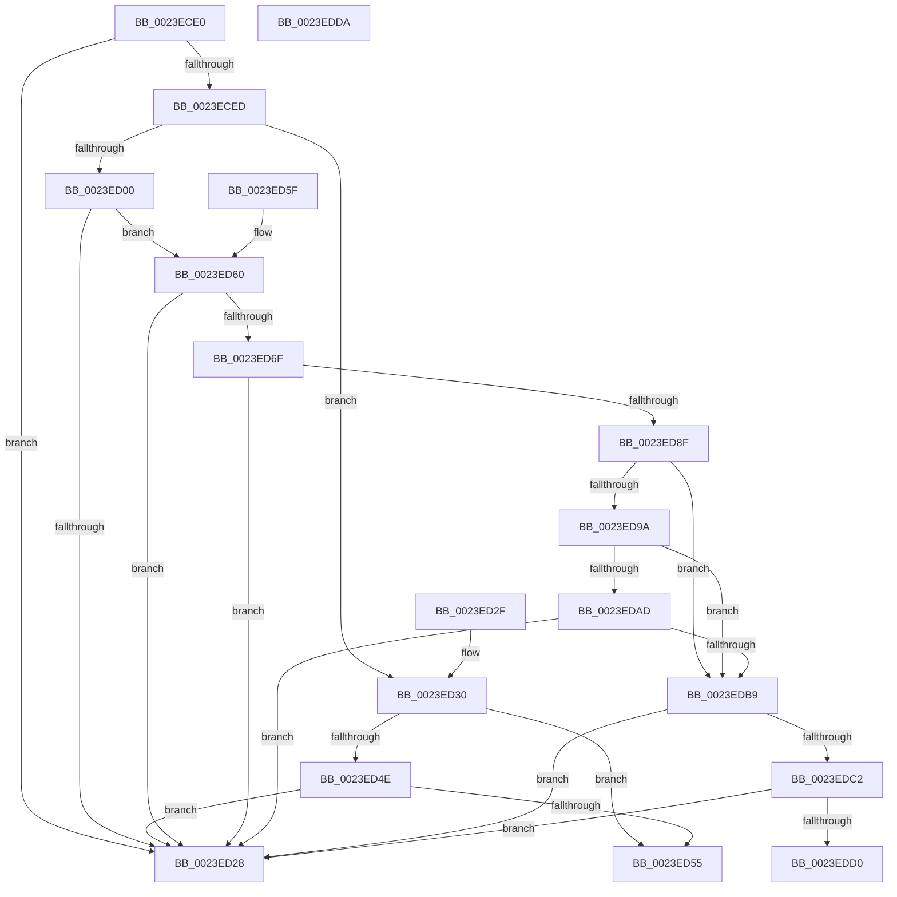

# MiLegitimatePageForDriversToMap

- RVA: `0x0023ECE0`–`0x0023EDDB` (길이 `251` bytes)
- VA: `0x000000014023ECE0`
- 실행 섹션: `.text`
- PDB 이름 있음: `예`; PDB Function 태그: `아니요`
- unwind 정보 RVA: `0x00061548`
- 디코드: `65`개 명령, `251/251` bytes 표시
- 미해석 바이트: `0` (있으면 어셈블리에 `.byte`로 보존)

> 이 문서는 커널 이미지의 기계어와 PDB 기호를 분석해 생성했습니다. 4번과 5번은 함수 원형과 자료형을 바이너리 사용 방식에서 추정한 C 해석이며 원본 소스 복구 결과는 아닙니다.

## 1. Dependencies

- 직접 호출 지점: **2**; 고유 호출 대상: **2**
- 직접 호출자로 확인된 함수: **5**
- RIP 상대 이미지 참조: **0**

### Outgoing calls
- `0x0023ED44` → [MiGetPfnPageSizeIndexUnsynchronized](../46/MiGetPfnPageSizeIndexUnsynchronized_function_0046C008.md) (function, `0x0046C008`)
- `0x0023EDC2` → [MiGetPageTablePfnBuddyRaw](../2B/MiGetPageTablePfnBuddyRaw_function_002B4470.md) (function, `0x002B4470`)

### Direct callers
- [sub_0023D74B](Unknown_function_0023D74B.md) at `0x0023D757`
- [MmMapLockedPagesWithReservedMapping](../3E/MmMapLockedPagesWithReservedMapping_function_003E8910.md) at `0x003E8AE8`
- [MiMapLockedPagesInUserSpace](../../page/97/MiMapLockedPagesInUserSpace_function_0097FE04.md) at `0x00980014`
- [MiRotateToFrameBuffer](../../page/A3/MiRotateToFrameBuffer_function_00A38214.md) at `0x00A38397`
- [MiRotateToFrameBufferNoCopy](../../page/A3/MiRotateToFrameBufferNoCopy_function_00A38530.md) at `0x00A38729`

### Static image references
- 디코드된 RIP-relative 메모리 참조가 없습니다.

## 2. Other-region calls and transfers

- 다른 실행 섹션으로 향하는 call: **0**
- 별도 외부 분기/꼬리 이동을 확인하지 못했습니다.

## 3. Assembly (complete function range)

```asm
0023ECE0  48 83 EC 28                     sub rsp, 0x28
0023ECE4  48 8B 41 28                     mov rax, qword ptr [rcx + 0x28]
0023ECE8  48 85 C0                        test rax, rax
0023ECEB  78 3B                           js 0x14023ed28
0023ECED  48 8B 41 28                     mov rax, qword ptr [rcx + 0x28]
0023ECF1  49 B9 00 00 00 00 00 01 00 00   movabs r9, 0x10000000000
0023ECFB  49 85 C1                        test r9, rax
0023ECFE  75 30                           jne 0x14023ed30
0023ED00  48 8B 51 08                     mov rdx, qword ptr [rcx + 8]
0023ED04  48 C1 E2 19                     shl rdx, 0x19
0023ED08  49 B8 00 00 00 00 80 F6 FF FF   movabs r8, 0xfffff68000000000
0023ED12  49 8B C0                        mov rax, r8
0023ED15  48 C1 E0 19                     shl rax, 0x19
0023ED19  48 2B D0                        sub rdx, rax
0023ED1C  48 C1 FA 10                     sar rdx, 0x10
0023ED20  49 8B C0                        mov rax, r8
0023ED23  48 3B D0                        cmp rdx, rax
0023ED26  73 38                           jae 0x14023ed60
0023ED28  33 C0                           xor eax, eax
0023ED2A  48 83 C4 28                     add rsp, 0x28
0023ED2E  C3                              ret
0023ED2F  CC                              int3
0023ED30  33 C0                           xor eax, eax
0023ED32  4C 8D 44 24 38                  lea r8, [rsp + 0x38]
0023ED37  48 8D 54 24 30                  lea rdx, [rsp + 0x30]
0023ED3C  89 44 24 30                     mov dword ptr [rsp + 0x30], eax
0023ED40  89 44 24 38                     mov dword ptr [rsp + 0x38], eax
0023ED44  E8 BF D2 22 00                  call 0x14046c008
0023ED49  83 F8 03                        cmp eax, 3
0023ED4C  74 07                           je 0x14023ed55
0023ED4E  83 7C 24 30 06                  cmp dword ptr [rsp + 0x30], 6
0023ED53  74 D3                           je 0x14023ed28
0023ED55  B8 18 00 00 C0                  mov eax, 0xc0000018
0023ED5A  48 83 C4 28                     add rsp, 0x28
0023ED5E  C3                              ret
0023ED5F  CC                              int3
0023ED60  48 B8 FF FF FF FF FF F6 FF FF   movabs rax, 0xfffff6ffffffffff
0023ED6A  48 3B D0                        cmp rdx, rax
0023ED6D  77 B9                           ja 0x14023ed28
0023ED6F  48 8B 41 28                     mov rax, qword ptr [rcx + 0x28]
0023ED73  48 BA FF FF FF FF FF 00 00 00   movabs rdx, 0xffffffffff
0023ED7D  48 23 C2                        and rax, rdx
0023ED80  48 BA FE FF FF FF 3F 00 00 00   movabs rdx, 0x3ffffffffe
0023ED8A  48 3B C2                        cmp rax, rdx
0023ED8D  74 99                           je 0x14023ed28
0023ED8F  8B 51 20                        mov edx, dword ptr [rcx + 0x20]
0023ED92  C1 EA 10                        shr edx, 0x10
0023ED95  F6 C2 20                        test dl, 0x20
0023ED98  74 1F                           je 0x14023edb9
0023ED9A  48 8B 41 18                     mov rax, qword ptr [rcx + 0x18]
0023ED9E  49 B8 FF FF FF FF FF FF FF 3F   movabs r8, 0x3fffffffffffffff
0023EDA8  49 85 C0                        test r8, rax
0023EDAB  75 0C                           jne 0x14023edb9
0023EDAD  8B 41 20                        mov eax, dword ptr [rcx + 0x20]
0023EDB0  66 85 C0                        test ax, ax
0023EDB3  0F 85 6F FF FF FF               jne 0x14023ed28
0023EDB9  F6 C2 08                        test dl, 8
0023EDBC  0F 85 66 FF FF FF               jne 0x14023ed28
0023EDC2  E8 A9 56 07 00                  call 0x1402b4470
0023EDC7  49 3B C1                        cmp rax, r9
0023EDCA  0F 84 58 FF FF FF               je 0x14023ed28
0023EDD0  B8 18 00 00 C0                  mov eax, 0xc0000018
0023EDD5  48 83 C4 28                     add rsp, 0x28
0023EDD9  C3                              ret
0023EDDA  CC                              int3
```

## 4. C-style interpretation (structured pseudocode)

```c
__int64 __fastcall MiLegitimatePageForDriversToMap(__int64 a1)
{
    __int64 result;
    __int64 v_rsp;
    unsigned __int64 v_stack_p30;
    unsigned __int64 v_stack_p38;

    v_rsp = (v_rsp) - (40);
    if (sign_flag) goto loc_0023ED28;
    if (((a4) & (*(unsigned __int64 *)(a1 + 40))) != 0) goto loc_0023ED30;
    a2 = (*(unsigned __int64 *)(a1 + 8)) << (25);
    result = (a3) << (25);
    a2 = (a2) - (result);
    a2 = (a2) >> (16);
    if (a2 >= a3) goto loc_0023ED60;
loc_0023ED28:
    result = 0;
    v_rsp = (v_rsp) + (40);
    return result;
loc_0023ED30:
    result = 0;
    v_stack_p30 = 0;
    v_stack_p38 = 0;
    result = MiGetPfnPageSizeIndexUnsynchronized(a1, v_stack_p30, v_stack_p38, a4);
    if (((unsigned int)(result)) == 3) goto loc_0023ED55;
    if (v_stack_p30 == 6) goto loc_0023ED28;
loc_0023ED55:
    v_rsp = (v_rsp) + (40);
    return (unsigned int)(0xC0000018ULL);
loc_0023ED60:
    if (v_stack_p30 > ((unsigned int)(0xC0000018ULL))) goto loc_0023ED28;
    result = (*(unsigned __int64 *)(a1 + 40)) & (v_stack_p30);
    if (result == v_stack_p30) goto loc_0023ED28;
    a2 = (unsigned int)(((unsigned int)(*(unsigned int *)(a1 + 32))) >> (16));
    if ((((unsigned __int8)(a2)) & (32)) == 0) goto loc_0023EDB9;
    if (((v_stack_p38) & (*(unsigned __int64 *)(a1 + 24))) != 0) goto loc_0023EDB9;
    if ((unsigned __int16)((unsigned int)(*(unsigned int *)(a1 + 32))) != 0) goto loc_0023ED28;
loc_0023EDB9:
    if ((((unsigned __int8)(a2)) & (8)) != 0) goto loc_0023ED28;
    result = MiGetPageTablePfnBuddyRaw(a1, a2, v_stack_p38, a4);
    if (result == a4) goto loc_0023ED28;
    v_rsp = (v_rsp) + (40);
    return (unsigned int)(0xC0000018ULL);
}
```

## 5. (Beta) C Style

```c
int64_t MiLegitimatePageForDriversToMap(void *Arg1)
{
    uint8_t *arg1 = (uint8_t *)Arg1;

    int64_t result;
    int64_t local_rsp;
    uint64_t v_stack_p30;
    uint64_t v_stack_p38;

    local_rsp = (local_rsp) - (40);
    if (sign_flag) goto loc_0023ED28;
    if (((a4) & (*(uint64_t *)(arg1 + 0x28))) != 0) goto loc_0023ED30;
    a2 = (*(uint64_t *)(arg1 + 0x8)) << (25);
    result = (a3) << (25);
    a2 = (a2) - (result);
    a2 = (a2) >> (16);
    if (a2 >= a3) goto loc_0023ED60;
loc_0023ED28:
    result = 0;
    local_rsp = (local_rsp) + (40);
    return result;
loc_0023ED30:
    result = 0;
    v_stack_p30 = 0;
    v_stack_p38 = 0;
    result = MiGetPfnPageSizeIndexUnsynchronized(Arg1, v_stack_p30, v_stack_p38, a4);
    if (((uint32_t)(result)) == 3) goto loc_0023ED55;
    if (v_stack_p30 == 6) goto loc_0023ED28;
loc_0023ED55:
    local_rsp = (local_rsp) + (40);
    return (uint32_t)(0xC0000018ULL);
loc_0023ED60:
    if (v_stack_p30 > ((uint32_t)(0xC0000018ULL))) goto loc_0023ED28;
    result = (*(uint64_t *)(arg1 + 0x28)) & (v_stack_p30);
    if (result == v_stack_p30) goto loc_0023ED28;
    a2 = (uint32_t)(((uint32_t)(*(uint32_t *)(arg1 + 0x20))) >> (16));
    if ((((uint8_t)(a2)) & (32)) == 0) goto loc_0023EDB9;
    if (((v_stack_p38) & (*(uint64_t *)(arg1 + 0x18))) != 0) goto loc_0023EDB9;
    if ((uint16_t)((uint32_t)(*(uint32_t *)(arg1 + 0x20))) != 0) goto loc_0023ED28;
loc_0023EDB9:
    if ((((uint8_t)(a2)) & (8)) != 0) goto loc_0023ED28;
    result = MiGetPageTablePfnBuddyRaw(Arg1, a2, v_stack_p38, a4);
    if (result == a4) goto loc_0023ED28;
    local_rsp = (local_rsp) + (40);
    return (uint32_t)(0xC0000018ULL);
}
```

### 관측된 메모리 오프셋

구조체 형식이 확인되지 않은 접근은 인자 기준의 오프셋으로만 기록했습니다.

| 기준 인자 | 오프셋 표현 | 폭 (bit) | 접근 |
|---|---:|---:|---|
| `Arg1` | `+ 0x8` | `64` | `R` |
| `Arg1` | `+ 0x18` | `64` | `R` |
| `Arg1` | `+ 0x20` | `32` | `R` |
| `Arg1` | `+ 0x28` | `64` | `R` |

## 6. Execution-region graph

[열기: 2D/3D 그래프와 함수 탐색 컨트롤 패널](../../../control-panel.html?section=text&rva=0x0023ECE0&view=graph)

- 2D 그래프는 위에서 아래로 흐르고, 3D 그래프는 빈 공간을 드래그해 회전합니다. Shift+드래그는 이동, 휠은 확대·축소, 함수 노드 선택은 대상 보고서 이동입니다.

### Static fallback


