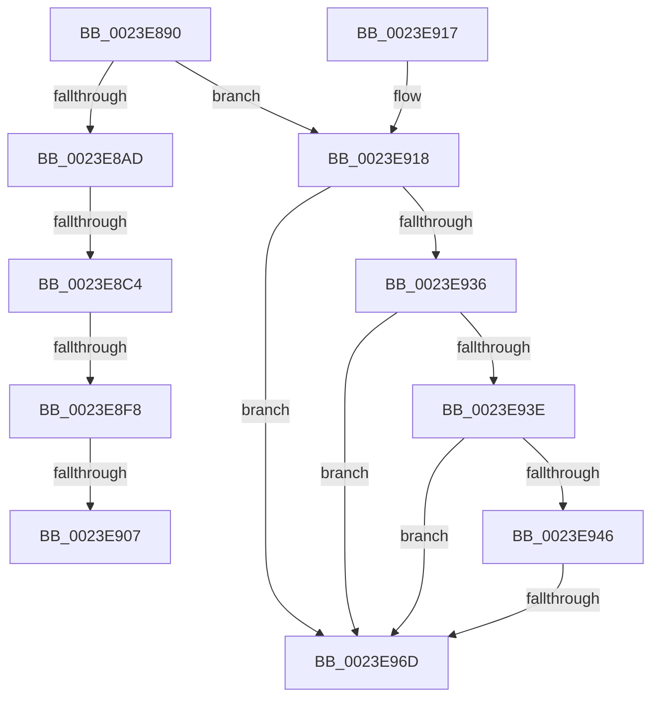

# MiLockNestedPageTable

- RVA: `0x0023E890`–`0x0023E973` (길이 `227` bytes)
- VA: `0x000000014023E890`
- 실행 섹션: `.text`
- PDB 이름 있음: `예`; PDB Function 태그: `아니요`
- unwind 정보 RVA: `0x000613A0`
- 디코드: `55`개 명령, `227/227` bytes 표시
- 미해석 바이트: `0` (있으면 어셈블리에 `.byte`로 보존)

> 이 문서는 커널 이미지의 기계어와 PDB 기호를 분석해 생성했습니다. 4번과 5번은 함수 원형과 자료형을 바이너리 사용 방식에서 추정한 C 해석이며 원본 소스 복구 결과는 아닙니다.

## 1. Dependencies

- 직접 호출 지점: **1**; 고유 호출 대상: **1**
- 직접 호출자로 확인된 함수: **56**
- RIP 상대 이미지 참조: **1**

### Outgoing calls
- `0x0023E90A` → [KxWaitForLockOwnerShip](../25/KxWaitForLockOwnerShip_function_00257EB0.md) (function, `0x00257EB0`)

### Direct callers
- [MiEncodeProtoFill](../22/MiEncodeProtoFill_function_0022F3B0.md) at `0x0022F4B1`
- [MiLockPageLeafPageTable](MiLockPageLeafPageTable_function_0023D160.md) at `0x0023D2C3`
- [MiLockPageLeafPageTable](MiLockPageLeafPageTable_function_0023D160.md) at `0x0023D3CA`
- [MiLockPageLeafPageTable](MiLockPageLeafPageTable_function_0023D160.md) at `0x0023D609`
- [MiLockPageLeafPageTable](MiLockPageLeafPageTable_function_0023D160.md) at `0x0023D62A`
- [sub_0023F124](Unknown_function_0023F124.md) at `0x0023F1FC`
- [MiWsleFlush](MiWsleFlush_function_0023FB30.md) at `0x0023FE27`
- [sub_00243448](../24/Unknown_function_00243448.md) at `0x00243498`
- [MiClearMappingAndDereferenceIoSpace](../24/MiClearMappingAndDereferenceIoSpace_function_00247DF0.md) at `0x00248171`
- [MmProtectPool](../26/MmProtectPool_function_002697AC.md) at `0x00269AAE`
- [MmProtectPool](../26/MmProtectPool_function_002697AC.md) at `0x00269E66`
- [MiDeleteVa](../27/MiDeleteVa_function_002789E0.md) at `0x00278DD3`
- [sub_0027BF19](../27/Unknown_function_0027BF19.md) at `0x0027BF68`
- [sub_0027E822](../27/Unknown_function_0027E822.md) at `0x0027E832`
- [MiClearPteAccessed](../29/MiClearPteAccessed_function_00290630.md) at `0x00290701`
- [MiSetVaAgeList](../29/MiSetVaAgeList_function_00290A20.md) at `0x002916A6`
- [MiOutPageSingleKernelStack](../2A/MiOutPageSingleKernelStack_function_002A1790.md) at `0x002A18D1`
- [MiOutPageSingleKernelStack](../2A/MiOutPageSingleKernelStack_function_002A1790.md) at `0x002A1BCF`
- [MiAllocateKernelStackPages](../2A/MiAllocateKernelStackPages_function_002A1BEC.md) at `0x002A2063`
- [MiUnlockCodePage](../2A/MiUnlockCodePage_function_002A2AB8.md) at `0x002A2C4A`
- [MiUnlockOpportunisticPagesInPageTable](../2A/MiUnlockOpportunisticPagesInPageTable_function_002AA88C.md) at `0x002AAAF2`
- [MiReplaceRotateWithDemandZeroNoCopy](../2A/MiReplaceRotateWithDemandZeroNoCopy_function_002AAB04.md) at `0x002AADEB`
- [MiEvictPageTableLock](../2C/MiEvictPageTableLock_function_002C1FBC.md) at `0x002C2022`
- [MiRewritePteWithLockBit](../32/MiRewritePteWithLockBit_function_00322FEC.md) at `0x00323106`
- [MiValidFault](../32/MiValidFault_function_003280B4.md) at `0x0032853A`
- [MiLockCode](../36/MiLockCode_function_0036F91C.md) at `0x0036FD63`
- [MiSetSystemCodeProtection](../38/MiSetSystemCodeProtection_function_00384420.md) at `0x003847A4`
- [MiSetSystemCodeProtection](../38/MiSetSystemCodeProtection_function_00384420.md) at `0x0038484A`
- [MiMakeDriverPagesPrivate](../38/MiMakeDriverPagesPrivate_function_00384C60.md) at `0x00384DFD`
- [MiMakeDriverPagesPrivate](../38/MiMakeDriverPagesPrivate_function_00384C60.md) at `0x00384F3B`
- [MiMakeDriverPagesPrivate](../38/MiMakeDriverPagesPrivate_function_00384C60.md) at `0x00384F94`
- [MiMapWithLargePages](../3B/MiMapWithLargePages_function_003B6624.md) at `0x003B6887`
- [MiUnmapMdlCommon](../3E/MiUnmapMdlCommon_function_003E7DF0.md) at `0x003E8003`
- [MiUnmapMdlCommon](../3E/MiUnmapMdlCommon_function_003E7DF0.md) at `0x003E8340`
- [MiUnlockPageTableRange](../40/MiUnlockPageTableRange_function_00407E44.md) at `0x00407ED2`
- [NtLockVirtualMemory](../40/NtLockVirtualMemory_function_004088A0.md) at `0x0040931A`
- [MiUpdateImportRelocationsOnDriverPrivatePages](../44/MiUpdateImportRelocationsOnDriverPrivatePages_function_00449BCC.md) at `0x00449DA5`
- [MiCreateSystemPageTable](../45/MiCreateSystemPageTable_function_004518D0.md) at `0x00451B9B`
- [MiInitializeSystemPageTable](../45/MiInitializeSystemPageTable_function_00451C88.md) at `0x00452070`
- [MiDeleteEmptyPageTableWorker](../47/MiDeleteEmptyPageTableWorker_function_0047FE18.md) at `0x0047FE95`
- [MiDeleteShadowStackPtes](../49/MiDeleteShadowStackPtes_function_00493AE4.md) at `0x00493B8F`
- [MiGetWsAndMakePageTablesNx](../49/MiGetWsAndMakePageTablesNx_function_00494240.md) at `0x004942A6`
- [MiReleaseLargePdeMappings](../49/MiReleaseLargePdeMappings_function_0049D0B0.md) at `0x0049D33E`
- [MiSetPagingOfDriver](../4A/MiSetPagingOfDriver_function_004A76C4.md) at `0x004A791A`
- [MiUnmapKernelScp](../4A/MiUnmapKernelScp_function_004A82E8.md) at `0x004A850F`
- [MiInitializeWorkingSetList](../4A/MiInitializeWorkingSetList_function_004AE640.md) at `0x004AE717`
- [MiFaultInPagedPool](../4B/MiFaultInPagedPool_function_004B3BC0.md) at `0x004B3C24`
- [MiAdjustSecureDriverStateForIatCapture](../4B/MiAdjustSecureDriverStateForIatCapture_function_004BE864.md) at `0x004BE9B9`
- [MiSwitchToTransition](../4C/MiSwitchToTransition_function_004C0F5C.md) at `0x004C1259`
- [MiMapMdlWithLargePages](../4D/MiMapMdlWithLargePages_function_004D10B8.md) at `0x004D1221`
- [MiMapKernelScp](../4D/MiMapKernelScp_function_004DCAD4.md) at `0x004DCC1C`
- [MiMakeSystemLeavesNonZero](../4E/MiMakeSystemLeavesNonZero_function_004E26C0.md) at `0x004E26F1`
- [MiDeleteBootRange](../66/MiDeleteBootRange_function_0066E450.md) at `0x0066E5AA`
- [MiPageBootRegistry](../66/MiPageBootRegistry_function_0066E82C.md) at `0x0066E9CC`
- [MiLockDriverPageRange](../67/MiLockDriverPageRange_function_00670160.md) at `0x006702B8`
- [MiLockDriverPageRange](../67/MiLockDriverPageRange_function_00670160.md) at `0x006704FB`
- [MiLockDriverPageRange](../67/MiLockDriverPageRange_function_00670160.md) at `0x00670553`
- [MiLockDriverPageRange](../67/MiLockDriverPageRange_function_00670160.md) at `0x006705D7`
- [MiReplaceImportEntry](../67/MiReplaceImportEntry_function_00671440.md) at `0x00671553`
- [MiReplaceImportEntry](../67/MiReplaceImportEntry_function_00671440.md) at `0x006715ED`
- [MiReplaceImportEntry](../67/MiReplaceImportEntry_function_00671440.md) at `0x0067161E`
- [MiMapMdlCommon](../67/MiMapMdlCommon_function_00674524.md) at `0x00674970`
- [MiSetPageProtection](../67/MiSetPageProtection_function_00674BDC.md) at `0x00674CF9`
- [MiClearDriverTablePtes](../68/MiClearDriverTablePtes_function_00683024.md) at `0x0068311D`
- [MmMapDriverTablePage](../68/MmMapDriverTablePage_function_00683EAC.md) at `0x00683F44`
- [MiUnmapLegacyAwePage](../68/MiUnmapLegacyAwePage_function_0068993C.md) at `0x006899D7`
- [sub_006D9212](../6D/Unknown_function_006D9212.md) at `0x006D94EB`
- [sub_006DB1E0](../6D/Unknown_function_006DB1E0.md) at `0x006DB284`
- [MiProtectLargeKernelHalRange](../../page/7F/MiProtectLargeKernelHalRange_function_007F8D20.md) at `0x007F8DD6`
- [MiMarkBootKernelStack](../../init/C6/MiMarkBootKernelStack_function_00C68244.md) at `0x00C682DE`

### Static image references
- `0x0023E8EB` → RVA `0x00FC6B06` (`ALMOSTRO`; read)

## 2. Other-region calls and transfers

- 다른 실행 섹션으로 향하는 call: **0**
- call이 아닌 외부 분기/꼬리 이동: **4**
  - `0x0023E8BE` → [sub_0023EA5E + 0x9](Unknown_function_0023EA5E.md) (`tail-transfer`)
  - `0x0023E8F2` → [sub_0023EAFC](Unknown_function_0023EAFC.md) (`tail-transfer`)
  - `0x0023E901` → [sub_0023EA5E](Unknown_function_0023EA5E.md) (`tail-transfer`)
  - `0x0023E967` → [sub_0023EC7F](Unknown_function_0023EC7F.md) (`tail-transfer`)

## 3. Assembly (complete function range)

```asm
0023E890  40 53                           push rbx
0023E892  55                              push rbp
0023E893  56                              push rsi
0023E894  48 83 EC 30                     sub rsp, 0x30
0023E898  48 8B F2                        mov rsi, rdx
0023E89B  48 8B D1                        mov rdx, rcx
0023E89E  48 B8 68 DF BE 7D FB F6 FF FF   movabs rax, 0xfffff6fb7dbedf68
0023E8A8  48 3B F0                        cmp rsi, rax
0023E8AB  75 6B                           jne 0x14023e918
0023E8AD  65 4C 8B 04 25 20 00 00 00      mov r8, qword ptr gs:[0x20]
0023E8B6  8B 81 B8 00 00 00               mov eax, dword ptr [rcx + 0xb8]
0023E8BC  24 0F                           and al, 0xf
0023E8BE  0F 85 A3 01 00 00               jne 0x14023ea67
0023E8C4  48 81 C2 B0 00 00 00            add rdx, 0xb0
0023E8CB  BB 02 00 00 00                  mov ebx, 2
0023E8D0  33 ED                           xor ebp, ebp
0023E8D2  8B C3                           mov eax, ebx
0023E8D4  48 8D 88 C4 09 00 00            lea rcx, [rax + 0x9c4]
0023E8DB  48 8D 0C 48                     lea rcx, [rax + rcx*2]
0023E8DF  49 8D 0C C8                     lea rcx, [r8 + rcx*8]
0023E8E3  48 89 51 08                     mov qword ptr [rcx + 8], rdx
0023E8E7  48 89 29                        mov qword ptr [rcx], rbp
0023E8EA  90                              nop
0023E8EB  F6 05 14 82 D8 00 21            test byte ptr [rip + 0xd88214], 0x21
0023E8F2  0F 85 04 02 00 00               jne 0x14023eafc
0023E8F8  48 8B C1                        mov rax, rcx
0023E8FB  48 87 02                        xchg qword ptr [rdx], rax
0023E8FE  48 85 C0                        test rax, rax
0023E901  0F 84 57 01 00 00               je 0x14023ea5e
0023E907  48 8B D0                        mov rdx, rax
0023E90A  E8 A1 95 01 00                  call 0x140257eb0
0023E90F  48 83 C4 30                     add rsp, 0x30
0023E913  5E                              pop rsi
0023E914  5D                              pop rbp
0023E915  5B                              pop rbx
0023E916  C3                              ret
0023E917  CC                              int3
0023E918  8B 81 B8 00 00 00               mov eax, dword ptr [rcx + 0xb8]
0023E91E  49 B8 00 D0 BE 7D FB F6 FF FF   movabs r8, 0xfffff6fb7dbed000
0023E928  49 B9 FF DF BE 7D FB F6 FF FF   movabs r9, 0xfffff6fb7dbedfff
0023E932  A8 0F                           test al, 0xf
0023E934  75 37                           jne 0x14023e96d
0023E936  49 8B C0                        mov rax, r8
0023E939  48 3B F0                        cmp rsi, rax
0023E93C  72 2F                           jb 0x14023e96d
0023E93E  49 8B C1                        mov rax, r9
0023E941  48 3B F0                        cmp rsi, rax
0023E944  77 27                           ja 0x14023e96d
0023E946  65 48 8B 04 25 88 01 00 00      mov rax, qword ptr gs:[0x188]
0023E94F  48 8B 88 B8 00 00 00            mov rcx, qword ptr [rax + 0xb8]
0023E956  48 8B 81 10 04 00 00            mov rax, qword ptr [rcx + 0x410]
0023E95D  48 8B 88 68 05 00 00            mov rcx, qword ptr [rax + 0x568]
0023E964  48 85 C9                        test rcx, rcx
0023E967  0F 85 12 03 00 00               jne 0x14023ec7f
0023E96D  8B 82 B8 00 00 00               mov eax, dword ptr [rdx + 0xb8]
```

## 4. C-style interpretation (structured pseudocode)

```c
__int64 __fastcall MiLockNestedPageTable(__int64 a1, __int64 a2)
{
    __int64 result;
    __int64 v_rbp;
    __int64 v_rsp;

    v_rsp = (v_rsp) - (48);
    if (a2 != result) goto loc_0023E918;
    result = (unsigned __int8)(((unsigned int)(*(unsigned int *)(a1 + 184))) & (15));
    a2 = (a1) + (176);
    v_rbp = 0;
    *(unsigned __int64 *)(*(unsigned __int64 *)(gs_base + (0 + 32)) + 2 + 2 + 2500 * 2 * 8 + 8) = a2;
    *(unsigned __int64 *)(*(unsigned __int64 *)(gs_base + (0 + 32)) + 2 + 2 + 2500 * 2 * 8) = 0;
    result = KxWaitForLockOwnerShip(*(unsigned __int64 *)(gs_base + (0 + 32)) + 2 + 2 + 2500 * 2 * 8, *(unsigned __int64 *)(gs_base + (0 + 32)) + 2 + 2 + 2500 * 2 * 8, *(unsigned __int64 *)(gs_base + (0 + 32)), a4);
    v_rsp = (v_rsp) + (48);
    return result;
loc_0023E918:
    if ((((unsigned __int8)((unsigned int)(*(unsigned int *)(*(unsigned __int64 *)(gs_base + (0 + 32)) + 2 + 2 + 2500 * 2 * 8 + 184)))) & (15)) != 0) goto loc_0023E96D;
    if (a2 < (*(unsigned __int64 *)(gs_base + (0 + 32)))) goto loc_0023E96D;
    if (a2 > a4) goto loc_0023E96D;
loc_0023E96D:
    return (unsigned int)(*(unsigned int *)(*(unsigned __int64 *)(gs_base + (0 + 32)) + 2 + 2 + 2500 * 2 * 8 + 184));
}
```

## 5. (Beta) C Style

```c
int64_t MiLockNestedPageTable(void *Arg1, int64_t Arg2)
{
    uint8_t *arg1 = (uint8_t *)Arg1;

    int64_t result;
    int64_t local_rbp;
    int64_t local_rsp;

    local_rsp = (local_rsp) - (48);
    if (Arg2 != result) goto loc_0023E918;
    result = (uint8_t)(((uint32_t)(*(uint32_t *)(arg1 + 0xB8))) & (15));
    Arg2 = (Arg1) + (176);
    local_rbp = 0;
    *(uint64_t *)(*(uint64_t *)(gs_base + (0 + 0x20)) + 0x2 + 0x2 + 0x9C4 * 2 * 8 + 0x8) = Arg2;
    *(uint64_t *)(*(uint64_t *)(gs_base + (0 + 0x20)) + 0x2 + 0x2 + 0x9C4 * 2 * 8) = 0;
    result = KxWaitForLockOwnerShip(*(uint64_t *)(gs_base + (0 + 0x20)) + 2 + 2 + 2500 * 2 * 8, *(uint64_t *)(gs_base + (0 + 0x20)) + 2 + 2 + 2500 * 2 * 8, *(uint64_t *)(gs_base + (0 + 0x20)), a4);
    local_rsp = (local_rsp) + (48);
    return result;
loc_0023E918:
    if ((((uint8_t)((uint32_t)(*(uint32_t *)(*(uint64_t *)(gs_base + (0 + 0x20)) + 0x2 + 0x2 + 0x9C4 * 2 * 8 + 0xB8)))) & (15)) != 0) goto loc_0023E96D;
    if (Arg2 < (*(uint64_t *)(gs_base + (0 + 0x20)))) goto loc_0023E96D;
    if (Arg2 > a4) goto loc_0023E96D;
loc_0023E96D:
    return (uint32_t)(*(uint32_t *)(*(uint64_t *)(gs_base + (0 + 0x20)) + 0x2 + 0x2 + 0x9C4 * 2 * 8 + 0xB8));
}
```

### 관측된 메모리 오프셋

구조체 형식이 확인되지 않은 접근은 인자 기준의 오프셋으로만 기록했습니다.

| 기준 인자 | 오프셋 표현 | 폭 (bit) | 접근 |
|---|---:|---:|---|
| `Arg1` | `+ 0x0` | `64` | `R/W` |
| `Arg1` | `+ 0xB8` | `32` | `R` |

## 6. Execution-region graph

[열기: 2D/3D 그래프와 함수 탐색 컨트롤 패널](../../../control-panel.html?section=text&rva=0x0023E890&view=graph)

- 2D 그래프는 위에서 아래로 흐르고, 3D 그래프는 빈 공간을 드래그해 회전합니다. Shift+드래그는 이동, 휠은 확대·축소, 함수 노드 선택은 대상 보고서 이동입니다.

### Static fallback


