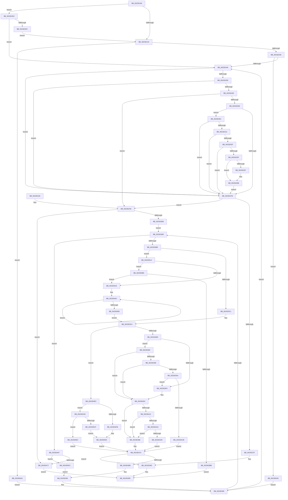

# MiLockPageLeafPageTable

- RVA: `0x0023D160`–`0x0023D634` (길이 `1,236` bytes)
- VA: `0x000000014023D160`
- 실행 섹션: `.text`
- PDB 이름 있음: `예`; PDB Function 태그: `아니요`
- unwind 정보 RVA: `0x00061038`
- 디코드: `289`개 명령, `1,236/1,236` bytes 표시
- 미해석 바이트: `0` (있으면 어셈블리에 `.byte`로 보존)

> 이 문서는 커널 이미지의 기계어와 PDB 기호를 분석해 생성했습니다. 4번과 5번은 함수 원형과 자료형을 바이너리 사용 방식에서 추정한 C 해석이며 원본 소스 복구 결과는 아닙니다.

## 1. Dependencies

- 직접 호출 지점: **12**; 고유 호출 대상: **7**
- 직접 호출자로 확인된 함수: **3**
- RIP 상대 이미지 참조: **5**

### Outgoing calls
- `0x0023D226` → [MiFastLockLeafPageTable](../27/MiFastLockLeafPageTable_function_00276340.md) (function, `0x00276340`)
- `0x0023D2A9` → [MiFaultInProbeAddress](../40/MiFaultInProbeAddress_function_0040E108.md) (function, `0x0040E108`)
- `0x0023D2C3` → [MiLockNestedPageTable](MiLockNestedPageTable_function_0023E890.md) (function, `0x0023E890`)
- `0x0023D2EF` → [MiUnlockPageTable](../21/MiUnlockPageTable_function_00216EC0.md) (function, `0x00216EC0`)
- `0x0023D3A8` → [MI_READ_PTE_LOCK_FREE](../28/MI_READ_PTE_LOCK_FREE_function_002828A0.md) (function, `0x002828A0`)
- `0x0023D3CA` → [MiLockNestedPageTable](MiLockNestedPageTable_function_0023E890.md) (function, `0x0023E890`)
- `0x0023D46A` → [MiFaultInProbeAddress](../40/MiFaultInProbeAddress_function_0040E108.md) (function, `0x0040E108`)
- `0x0023D4D9` → [ExReleaseSpinLockRegardlessFromDpcLevel](ExReleaseSpinLockRegardlessFromDpcLevel_function_0023A330.md) (function, `0x0023A330`)
- `0x0023D50A` → [KeReleaseInStackQueuedSpinLockFromDpcLevel](../21/KeReleaseInStackQueuedSpinLockFromDpcLevel_function_002171B0.md) (function, `0x002171B0`)
- `0x0023D5F2` → [KeReleaseInStackQueuedSpinLockFromDpcLevel](../21/KeReleaseInStackQueuedSpinLockFromDpcLevel_function_002171B0.md) (function, `0x002171B0`)
- `0x0023D609` → [MiLockNestedPageTable](MiLockNestedPageTable_function_0023E890.md) (function, `0x0023E890`)
- `0x0023D62A` → [MiLockNestedPageTable](MiLockNestedPageTable_function_0023E890.md) (function, `0x0023E890`)

### Direct callers
- [MiProbeAndLockPacket](MiProbeAndLockPacket_function_0023BE20.md) at `0x0023BFD1`
- [MmStoreProbeAndLockPages](MmStoreProbeAndLockPages_function_0023E570.md) at `0x0023E620`
- [sub_0023F815](Unknown_function_0023F815.md) at `0x0023F8FB`

### Static image references
- `0x0023D18A` → RVA `0x00010880` (`.rdata`; read)
- `0x0023D301` → RVA `0x00FC6A88` (`ALMOSTRO`; read)
- `0x0023D457` → RVA `0x00E2F1AC` (`.data`; read)
- `0x0023D477` → RVA `0x00E30204` (`.data`; read/write)
- `0x0023D5BB` → RVA `0x00E3020C` (`.data`; read/write)

## 2. Other-region calls and transfers

- 다른 실행 섹션으로 향하는 call: **0**
- 별도 외부 분기/꼬리 이동을 확인하지 못했습니다.

## 3. Assembly (complete function range)

```asm
0023D160  4C 8B DC                        mov r11, rsp
0023D163  49 89 5B 08                     mov qword ptr [r11 + 8], rbx
0023D167  49 89 6B 10                     mov qword ptr [r11 + 0x10], rbp
0023D16B  49 89 73 18                     mov qword ptr [r11 + 0x18], rsi
0023D16F  57                              push rdi
0023D170  41 54                           push r12
0023D172  41 55                           push r13
0023D174  41 56                           push r14
0023D176  41 57                           push r15
0023D178  48 83 EC 40                     sub rsp, 0x40
0023D17C  4C 8B 79 08                     mov r15, qword ptr [rcx + 8]
0023D180  49 B9 F8 FF FF FF 7F 00 00 00   movabs r9, 0x7ffffffff8
0023D18A  48 8B 05 EF 36 DD FF            mov rax, qword ptr [rip - 0x22c911]
0023D191  49 8B D7                        mov rdx, r15
0023D194  4C 8B 71 68                     mov r14, qword ptr [rcx + 0x68]
0023D198  48 8B F9                        mov rdi, rcx
0023D19B  48 C1 EA 09                     shr rdx, 9
0023D19F  49 23 D1                        and rdx, r9
0023D1A2  48 89 41 30                     mov qword ptr [rcx + 0x30], rax
0023D1A6  49 B8 00 00 00 00 80 F6 FF FF   movabs r8, 0xfffff68000000000
0023D1B0  49 8B C0                        mov rax, r8
0023D1B3  48 03 D0                        add rdx, rax
0023D1B6  49 89 53 B8                     mov qword ptr [r11 - 0x48], rdx
0023D1BA  48 C1 EA 09                     shr rdx, 9
0023D1BE  49 23 D1                        and rdx, r9
0023D1C1  49 8B C0                        mov rax, r8
0023D1C4  48 03 D0                        add rdx, rax
0023D1C7  49 89 53 C0                     mov qword ptr [r11 - 0x40], rdx
0023D1CB  48 C1 EA 09                     shr rdx, 9
0023D1CF  49 23 D1                        and rdx, r9
0023D1D2  49 8B C0                        mov rax, r8
0023D1D5  48 03 D0                        add rdx, rax
0023D1D8  49 89 53 C8                     mov qword ptr [r11 - 0x38], rdx
0023D1DC  48 C1 EA 09                     shr rdx, 9
0023D1E0  49 23 D1                        and rdx, r9
0023D1E3  49 8B C0                        mov rax, r8
0023D1E6  48 03 D0                        add rdx, rax
0023D1E9  48 BD 68 DF BE 7D FB F6 FF FF   movabs rbp, 0xfffff6fb7dbedf68
0023D1F3  49 89 53 D0                     mov qword ptr [r11 - 0x30], rdx
0023D1F7  33 DB                           xor ebx, ebx
0023D1F9  48 8B 51 28                     mov rdx, qword ptr [rcx + 0x28]
0023D1FD  49 BC 00 D0 BE 7D FB F6 FF FF   movabs r12, 0xfffff6fb7dbed000
0023D207  49 BD F8 D7 BE 7D FB F6 FF FF   movabs r13, 0xfffff6fb7dbed7f8
0023D211  48 85 D2                        test rdx, rdx
0023D214  0F 85 B8 00 00 00               jne 0x14023d2d2
0023D21A  41 B8 04 00 00 00               mov r8d, 4
0023D220  49 8B D7                        mov rdx, r15
0023D223  49 8B CE                        mov rcx, r14
0023D226  E8 15 91 03 00                  call 0x140276340
0023D22B  48 63 D8                        movsxd rbx, eax
0023D22E  85 C0                           test eax, eax
0023D230  0F 84 E2 03 00 00               je 0x14023d618
0023D236  48 8B 4C DC 20                  mov rcx, qword ptr [rsp + rbx*8 + 0x20]
0023D23B  48 89 4F 28                     mov qword ptr [rdi + 0x28], rcx
0023D23F  83 FB 01                        cmp ebx, 1
0023D242  0F 85 61 03 00 00               jne 0x14023d5a9
0023D248  48 8B 44 24 20                  mov rax, qword ptr [rsp + 0x20]
0023D24D  48 8B 00                        mov rax, qword ptr [rax]
0023D250  49 8B CC                        mov rcx, r12
0023D253  48 8B 54 24 20                  mov rdx, qword ptr [rsp + 0x20]
0023D258  48 3B D1                        cmp rdx, rcx
0023D25B  72 1E                           jb 0x14023d27b
0023D25D  49 8B CD                        mov rcx, r13
0023D260  48 3B D1                        cmp rdx, rcx
0023D263  77 16                           ja 0x14023d27b
0023D265  A8 01                           test al, 1
0023D267  74 3D                           je 0x14023d2a6
0023D269  A8 42                           test al, 0x42
0023D26B  0F 95 C2                        setne dl
0023D26E  A8 20                           test al, 0x20
0023D270  0F 95 C1                        setne cl
0023D273  84 D1                           test cl, dl
0023D275  0F 84 86 00 00 00               je 0x14023d301
0023D27B  A8 01                           test al, 1
0023D27D  74 27                           je 0x14023d2a6
0023D27F  48 89 47 30                     mov qword ptr [rdi + 0x30], rax
0023D283  33 C0                           xor eax, eax
0023D285  48 8B 5C 24 70                  mov rbx, qword ptr [rsp + 0x70]
0023D28A  48 8B 6C 24 78                  mov rbp, qword ptr [rsp + 0x78]
0023D28F  48 8B B4 24 80 00 00 00         mov rsi, qword ptr [rsp + 0x80]
0023D297  48 83 C4 40                     add rsp, 0x40
0023D29B  41 5F                           pop r15
0023D29D  41 5E                           pop r14
0023D29F  41 5D                           pop r13
0023D2A1  41 5C                           pop r12
0023D2A3  5F                              pop rdi
0023D2A4  C3                              ret
0023D2A5  CC                              int3
0023D2A6  48 8B CF                        mov rcx, rdi
0023D2A9  E8 5A 0E 1D 00                  call 0x14040e108
0023D2AE  85 C0                           test eax, eax
0023D2B0  0F 88 C1 01 00 00               js 0x14023d477
0023D2B6  48 8B C5                        mov rax, rbp
0023D2B9  48 89 47 28                     mov qword ptr [rdi + 0x28], rax
0023D2BD  48 8B D5                        mov rdx, rbp
0023D2C0  49 8B CE                        mov rcx, r14
0023D2C3  E8 C8 15 00 00                  call 0x14023e890
0023D2C8  BB 03 00 00 00                  mov ebx, 3
0023D2CD  E9 CB 00 00 00                  jmp 0x14023d39d
0023D2D2  48 8B 49 18                     mov rcx, qword ptr [rcx + 0x18]
0023D2D6  48 C1 E9 09                     shr rcx, 9
0023D2DA  49 23 C9                        and rcx, r9
0023D2DD  49 8B C0                        mov rax, r8
0023D2E0  48 03 C8                        add rcx, rax
0023D2E3  48 3B D1                        cmp rdx, rcx
0023D2E6  0F 84 5C FF FF FF               je 0x14023d248
0023D2EC  49 8B CE                        mov rcx, r14
0023D2EF  E8 CC 9B FD FF                  call 0x140216ec0
0023D2F4  83 67 48 DF                     and dword ptr [rdi + 0x48], 0xffffffdf
0023D2F8  48 89 5F 28                     mov qword ptr [rdi + 0x28], rbx
0023D2FC  E9 19 FF FF FF                  jmp 0x14023d21a
0023D301  48 F7 05 7C 97 D8 00 00 00 60 00  test qword ptr [rip + 0xd8977c], 0x600000
0023D30C  0F 84 69 FF FF FF               je 0x14023d27b
0023D312  65 48 8B 0C 25 88 01 00 00      mov rcx, qword ptr gs:[0x188]
0023D31B  48 8B 91 B8 00 00 00            mov rdx, qword ptr [rcx + 0xb8]
0023D322  80 BA 60 01 00 00 01            cmp byte ptr [rdx + 0x160], 1
0023D329  0F 84 4C FF FF FF               je 0x14023d27b
0023D32F  4C 8B 82 08 05 00 00            mov r8, qword ptr [rdx + 0x508]
0023D336  4D 85 C0                        test r8, r8
0023D339  0F 84 3C FF FF FF               je 0x14023d27b
0023D33F  48 8B 4C 24 20                  mov rcx, qword ptr [rsp + 0x20]
0023D344  48 C1 E9 03                     shr rcx, 3
0023D348  81 E1 FF 01 00 00               and ecx, 0x1ff
0023D34E  49 8B 0C C8                     mov rcx, qword ptr [r8 + rcx*8]
0023D352  F6 C1 20                        test cl, 0x20
0023D355  74 04                           je 0x14023d35b
0023D357  48 83 C8 20                     or rax, 0x20
0023D35B  48 8B D0                        mov rdx, rax
0023D35E  48 83 C8 42                     or rax, 0x42
0023D362  F6 C1 42                        test cl, 0x42
0023D365  48 0F 44 C2                     cmove rax, rdx
0023D369  E9 0D FF FF FF                  jmp 0x14023d27b
0023D36E  48 B8 FF FF FF FF FF FF FF CF   movabs rax, 0xcfffffffffffffff
0023D378  F0 48 21 02                     lock and qword ptr [rdx], rax
0023D37C  48 89 77 28                     mov qword ptr [rdi + 0x28], rsi
0023D380  40 84 ED                        test bpl, bpl
0023D383  0F 85 FA FE FF FF               jne 0x14023d283
0023D389  48 BD 68 DF BE 7D FB F6 FF FF   movabs rbp, 0xfffff6fb7dbedf68
0023D393  FF CB                           dec ebx
0023D395  85 DB                           test ebx, ebx
0023D397  0F 84 AB FE FF FF               je 0x14023d248
0023D39D  48 63 C3                        movsxd rax, ebx
0023D3A0  48 8B 74 C4 20                  mov rsi, qword ptr [rsp + rax*8 + 0x20]
0023D3A5  48 8B CE                        mov rcx, rsi
0023D3A8  E8 F3 54 04 00                  call 0x1402828a0
0023D3AD  4C 8B C8                        mov r9, rax
0023D3B0  A8 01                           test al, 1
0023D3B2  0F 84 AF 00 00 00               je 0x14023d467
0023D3B8  45 84 C9                        test r9b, r9b
0023D3BB  0F 88 53 01 00 00               js 0x14023d514
0023D3C1  40 32 ED                        xor bpl, bpl
0023D3C4  48 8B D6                        mov rdx, rsi
0023D3C7  49 8B CE                        mov rcx, r14
0023D3CA  E8 C1 14 00 00                  call 0x14023e890
0023D3CF  48 8B 57 28                     mov rdx, qword ptr [rdi + 0x28]
0023D3D3  48 B8 68 DF BE 7D FB F6 FF FF   movabs rax, 0xfffff6fb7dbedf68
0023D3DD  48 8B C0                        mov rax, rax
0023D3E0  48 3B D0                        cmp rdx, rax
0023D3E3  0F 84 FA 00 00 00               je 0x14023d4e3
0023D3E9  41 8B 86 B8 00 00 00            mov eax, dword ptr [r14 + 0xb8]
0023D3F0  A8 0F                           test al, 0xf
0023D3F2  0F 84 8A 00 00 00               je 0x14023d482
0023D3F8  48 B9 FF DF BE 7D FB F6 FF FF   movabs rcx, 0xfffff6fb7dbedfff
0023D402  41 8B 86 B8 00 00 00            mov eax, dword ptr [r14 + 0xb8]
0023D409  A8 0F                           test al, 0xf
0023D40B  0F 84 5D FF FF FF               je 0x14023d36e
0023D411  49 8B C4                        mov rax, r12
0023D414  48 3B D0                        cmp rdx, rax
0023D417  0F 82 51 FF FF FF               jb 0x14023d36e
0023D41D  48 8B C1                        mov rax, rcx
0023D420  48 3B D0                        cmp rdx, rax
0023D423  0F 87 45 FF FF FF               ja 0x14023d36e
0023D429  49 8B C4                        mov rax, r12
0023D42C  48 2B D0                        sub rdx, rax
0023D42F  41 8B 86 B8 00 00 00            mov eax, dword ptr [r14 + 0xb8]
0023D436  48 C1 FA 03                     sar rdx, 3
0023D43A  44 8D 04 12                     lea r8d, [rdx + rdx]
0023D43E  BA 02 00 00 00                  mov edx, 2
0023D443  41 8B C8                        mov ecx, r8d
0023D446  41 8B C0                        mov eax, r8d
0023D449  83 E1 1F                        and ecx, 0x1f
0023D44C  D3 E2                           shl edx, cl
0023D44E  F7 D2                           not edx
0023D450  0F B3 CA                        btr edx, ecx
0023D453  48 C1 E8 05                     shr rax, 5
0023D457  48 8D 0D 4E 1D BF 00            lea rcx, [rip + 0xbf1d4e]
0023D45E  F0 21 14 81                     lock and dword ptr [rcx + rax*4], edx
0023D462  E9 15 FF FF FF                  jmp 0x14023d37c
0023D467  48 8B CF                        mov rcx, rdi
0023D46A  E8 99 0C 1D 00                  call 0x14040e108
0023D46F  85 C0                           test eax, eax
0023D471  0F 89 85 01 00 00               jns 0x14023d5fc
0023D477  FF 05 87 2D BF 00               inc dword ptr [rip + 0xbf2d87]
0023D47D  E9 03 FE FF FF                  jmp 0x14023d285
0023D482  49 8B C4                        mov rax, r12
0023D485  48 B9 FF DF BE 7D FB F6 FF FF   movabs rcx, 0xfffff6fb7dbedfff
0023D48F  48 3B D0                        cmp rdx, rax
0023D492  0F 82 6A FF FF FF               jb 0x14023d402
0023D498  48 8B C1                        mov rax, rcx
0023D49B  48 3B D0                        cmp rdx, rax
0023D49E  0F 87 5E FF FF FF               ja 0x14023d402
0023D4A4  65 48 8B 04 25 88 01 00 00      mov rax, qword ptr gs:[0x188]
0023D4AD  48 8B 88 B8 00 00 00            mov rcx, qword ptr [rax + 0xb8]
0023D4B4  48 8B 81 10 04 00 00            mov rax, qword ptr [rcx + 0x410]
0023D4BB  48 8B 88 68 05 00 00            mov rcx, qword ptr [rax + 0x568]
0023D4C2  48 85 C9                        test rcx, rcx
0023D4C5  0F 84 2D FF FF FF               je 0x14023d3f8
0023D4CB  48 C1 EA 03                     shr rdx, 3
0023D4CF  81 E2 FF 01 00 00               and edx, 0x1ff
0023D4D5  48 8D 0C 91                     lea rcx, [rcx + rdx*4]
0023D4D9  E8 52 CE FF FF                  call 0x14023a330
0023D4DE  E9 99 FE FF FF                  jmp 0x14023d37c
0023D4E3  65 48 8B 14 25 20 00 00 00      mov rdx, qword ptr gs:[0x20]
0023D4EC  41 8B 86 B8 00 00 00            mov eax, dword ptr [r14 + 0xb8]
0023D4F3  24 0F                           and al, 0xf
0023D4F5  0F 85 D0 00 00 00               jne 0x14023d5cb
0023D4FB  B9 30 00 00 00                  mov ecx, 0x30
0023D500  48 81 C2 40 9C 00 00            add rdx, 0x9c40
0023D507  48 03 CA                        add rcx, rdx
0023D50A  E8 A1 9C FD FF                  call 0x1402171b0
0023D50F  E9 68 FE FF FF                  jmp 0x14023d37c
0023D514  83 7F 60 01                     cmp dword ptr [rdi + 0x60], 1
0023D518  0F 84 92 00 00 00               je 0x14023d5b0
0023D51E  49 C1 E9 0C                     shr r9, 0xc
0023D522  48 B8 FF FF FF FF FF 00 00 00   movabs rax, 0xffffffffff
0023D52C  4C 23 C8                        and r9, rax
0023D52F  40 B5 01                        mov bpl, 1
0023D532  49 C1 EF 0C                     shr r15, 0xc
0023D536  41 BA 01 00 00 00               mov r10d, 1
0023D53C  49 8B C7                        mov rax, r15
0023D53F  49 C1 EF 09                     shr r15, 9
0023D543  25 FF 01 00 00                  and eax, 0x1ff
0023D548  49 0F AF C2                     imul rax, r10
0023D54C  49 C1 E2 09                     shl r10, 9
0023D550  4C 03 C8                        add r9, rax
0023D553  83 EB 01                        sub ebx, 1
0023D556  75 E4                           jne 0x14023d53c
0023D558  48 8B 4F 08                     mov rcx, qword ptr [rdi + 8]
0023D55C  4D 8B C2                        mov r8, r10
0023D55F  49 C1 E0 0C                     shl r8, 0xc
0023D563  4C 89 8F 88 00 00 00            mov qword ptr [rdi + 0x88], r9
0023D56A  49 8D 50 FF                     lea rdx, [r8 - 1]
0023D56E  48 F7 D2                        not rdx
0023D571  48 8B C2                        mov rax, rdx
0023D574  48 23 C1                        and rax, rcx
0023D577  48 89 87 98 00 00 00            mov qword ptr [rdi + 0x98], rax
0023D57E  49 8D 04 08                     lea rax, [r8 + rcx]
0023D582  48 23 C2                        and rax, rdx
0023D585  48 FF C8                        dec rax
0023D588  48 89 87 A0 00 00 00            mov qword ptr [rdi + 0xa0], rax
0023D58F  49 8D 42 FF                     lea rax, [r10 - 1]
0023D593  48 F7 D0                        not rax
0023D596  49 23 C1                        and rax, r9
0023D599  83 4F 48 20                     or dword ptr [rdi + 0x48], 0x20
0023D59D  48 89 87 A8 00 00 00            mov qword ptr [rdi + 0xa8], rax
0023D5A4  E9 1B FE FF FF                  jmp 0x14023d3c4
0023D5A9  FF CB                           dec ebx
0023D5AB  E9 E5 FD FF FF                  jmp 0x14023d395
0023D5B0  49 0F BA E1 0B                  bt r9, 0xb
0023D5B5  0F 82 63 FF FF FF               jb 0x14023d51e
0023D5BB  FF 05 4B 2C BF 00               inc dword ptr [rip + 0xbf2c4b]
0023D5C1  B8 05 00 00 C0                  mov eax, 0xc0000005
0023D5C6  E9 BA FC FF FF                  jmp 0x14023d285
0023D5CB  3C 07                           cmp al, 7
0023D5CD  74 14                           je 0x14023d5e3
0023D5CF  3C 05                           cmp al, 5
0023D5D1  B9 48 00 00 00                  mov ecx, 0x48
0023D5D6  B8 00 00 00 00                  mov eax, 0
0023D5DB  0F 44 C8                        cmove ecx, eax
0023D5DE  E9 1D FF FF FF                  jmp 0x14023d500
0023D5E3  48 81 C2 40 9C 00 00            add rdx, 0x9c40
0023D5EA  B9 18 00 00 00                  mov ecx, 0x18
0023D5EF  48 03 CA                        add rcx, rdx
0023D5F2  E8 B9 9B FD FF                  call 0x1402171b0
0023D5F7  E9 80 FD FF FF                  jmp 0x14023d37c
0023D5FC  48 8B C5                        mov rax, rbp
0023D5FF  48 89 47 28                     mov qword ptr [rdi + 0x28], rax
0023D603  48 8B D5                        mov rdx, rbp
0023D606  49 8B CE                        mov rcx, r14
0023D609  E8 82 12 00 00                  call 0x14023e890
0023D60E  BB 04 00 00 00                  mov ebx, 4
0023D613  E9 7B FD FF FF                  jmp 0x14023d393
0023D618  BB 03 00 00 00                  mov ebx, 3
0023D61D  48 8B C5                        mov rax, rbp
0023D620  48 89 47 28                     mov qword ptr [rdi + 0x28], rax
0023D624  48 8B D5                        mov rdx, rbp
0023D627  49 8B CE                        mov rcx, r14
0023D62A  E8 61 12 00 00                  call 0x14023e890
0023D62F  E9 61 FD FF FF                  jmp 0x14023d395
```

## 4. C-style interpretation (structured pseudocode)

```c
__int64 __fastcall MiLockPageLeafPageTable(__int64 a1)
{
    __int64 result;
    __int64 v_r10;
    __int64 v_r15;
    __int64 v_rbp;
    __int64 v_rbx;
    __int64 v_rsp;
    unsigned __int64 v_stack_m48;
    unsigned __int64 v_stack_p10;
    unsigned __int64 v_stack_p18;
    unsigned __int64 v_stack_p20;
    unsigned __int64 v_stack_p8;

    *(unsigned __int64 *)(v_rsp + 8) = v_rbx;
    *(unsigned __int64 *)(v_rsp + 16) = v_rbp;
    *(unsigned __int64 *)(v_rsp + 24) = v_rsi;
    v_rsp = (v_rsp) - (64);
    a2 = (*(unsigned __int64 *)(a1 + 8)) >> (9);
    a2 = (a2) & (a4);
    *(unsigned __int64 *)(a1 + 48) = *(unsigned __int64 *)(v_rip - 2279697);
    a2 = (a2) + (a3);
    *(unsigned __int64 *)(v_rsp - 72) = a2;
    a2 = (a2) >> (9);
    a2 = (a2) & (a4);
    a2 = (a2) + (a3);
    *(unsigned __int64 *)(v_rsp - 64) = a2;
    a2 = (a2) >> (9);
    a2 = (a2) & (a4);
    a2 = (a2) + (a3);
    *(unsigned __int64 *)(v_rsp - 56) = a2;
    a2 = (a2) >> (9);
    a2 = (a2) & (a4);
    a2 = (a2) + (a3);
    *(unsigned __int64 *)(v_rsp - 48) = a2;
    v_rbx = 0;
    if (*(unsigned __int64 *)(a1 + 40) != 0) goto loc_0023D2D2;
loc_0023D21A:
    result = MiFastLockLeafPageTable(*(unsigned __int64 *)(a1 + 104), *(unsigned __int64 *)(a1 + 8), 4, a4);
    if ((unsigned int)(result) == 0) goto loc_0023D618;
    *(unsigned __int64 *)(a1 + 40) = *(unsigned __int64 *)(v_rsp + (int)((unsigned int)(result)) * 8 + 32);
    if (((unsigned int)((int)((unsigned int)(result)))) != 1) goto loc_0023D5A9;
loc_0023D248:
    if (v_stack_m48 < v_r12) goto loc_0023D27B;
    if (v_stack_m48 > v_r13) goto loc_0023D27B;
    if ((((unsigned __int8)(*(unsigned __int64 *)(v_stack_m48))) & (1)) == 0) goto loc_0023D2A6;
    a2 = ((((unsigned __int8)(*(unsigned __int64 *)(v_stack_m48))) & (66)) != 0) ? 1 : 0;
    a1 = ((((unsigned __int8)(*(unsigned __int64 *)(v_stack_m48))) & (32)) != 0) ? 1 : 0;
    if ((((unsigned __int8)(a1)) & ((unsigned __int8)(a2))) == 0) goto loc_0023D301;
loc_0023D27B:
    if ((((unsigned __int8)(*(unsigned __int64 *)(v_stack_m48))) & (1)) == 0) goto loc_0023D2A6;
    *(unsigned __int64 *)(a1 + 48) = *(unsigned __int64 *)(v_stack_m48);
loc_0023D283:
    result = 0;
loc_0023D285:
    v_rsp = (v_rsp) + (64);
    return result;
loc_0023D2A6:
    result = MiFaultInProbeAddress(a1, a2, 4, a4);
    if (sign_flag) goto loc_0023D477;
    *(unsigned __int64 *)(a1 + 40) = v_stack_p10;
    result = MiLockNestedPageTable(*(unsigned __int64 *)(a1 + 104), v_stack_p10, 4, a4);
    goto loc_0023D39D;
loc_0023D2D2:
    a1 = (*(unsigned __int64 *)(*(unsigned __int64 *)(a1 + 104) + 24)) >> (9);
    a1 = (a1) & (a4);
    a1 = (a1) + (4);
    if (v_stack_p10 == a1) goto loc_0023D248;
    result = MiUnlockPageTable(*(unsigned __int64 *)(a1 + 104), v_stack_p10, 4, a4);
    *(unsigned __int64 *)(a1 + 40) = 3;
    goto loc_0023D21A;
loc_0023D301:
    if (((*(unsigned __int64 *)(v_rip + 14194556)) & (0x600000ULL)) == 0) goto loc_0023D27B;
    if ((*(unsigned __int8 *)(*(unsigned __int64 *)(*(unsigned __int64 *)(gs_base + (0 + 392)) + 184) + 352)) == 1) goto loc_0023D27B;
    if (*(unsigned __int64 *)(*(unsigned __int64 *)(*(unsigned __int64 *)(gs_base + (0 + 392)) + 184) + 1288) == 0) goto loc_0023D27B;
    a1 = (v_stack_p20) >> (3);
    a1 = (unsigned int)((a1) & (511));
    if ((((unsigned __int8)(*(unsigned __int64 *)(*(unsigned __int64 *)(*(unsigned __int64 *)(*(unsigned __int64 *)(gs_base + (0 + 392)) + 184) + 1288) + a1 * 8))) & (32)) != 0) {
        result = (result) | (32);
    }
    result = (result) | (66);
    if ((((unsigned __int8)(*(unsigned __int64 *)(*(unsigned __int64 *)(*(unsigned __int64 *)(*(unsigned __int64 *)(gs_base + (0 + 392)) + 184) + 1288) + a1 * 8))) & (66)) == 0) { result = result; }
    goto loc_0023D27B;
loc_0023D36E:
loc_0023D37C:
    *(unsigned __int64 *)(a1 + 40) = v_stack_p18;
    if ((unsigned __int8)(v_stack_p10) != 0) goto loc_0023D283;
loc_0023D393:
    v_rbx = (unsigned int)((3) - 1);
loc_0023D395:
    if ((unsigned int)(v_rbx) == 0) goto loc_0023D248;
loc_0023D39D:
    result = MI_READ_PTE_LOCK_FREE(*(unsigned __int64 *)(v_rsp + (int)((unsigned int)(v_rbx)) * 8 + 32), result, *(unsigned __int64 *)(*(unsigned __int64 *)(*(unsigned __int64 *)(gs_base + (0 + 392)) + 184) + 1288), a4);
    if ((((unsigned __int8)(result)) & (1)) == 0) goto loc_0023D467;
    if (sign_flag) goto loc_0023D514;
    v_rbp = 0;
loc_0023D3C4:
    result = MiLockNestedPageTable(*(unsigned __int64 *)(a1 + 104), *(unsigned __int64 *)(v_rsp + (int)((unsigned int)(v_rbx)) * 8 + 32), *(unsigned __int64 *)(*(unsigned __int64 *)(*(unsigned __int64 *)(gs_base + (0 + 392)) + 184) + 1288), result);
    if ((*(unsigned __int64 *)(a1 + 40)) == result) goto loc_0023D4E3;
    if ((((unsigned __int8)((unsigned int)(*(unsigned int *)(*(unsigned __int64 *)(a1 + 104) + 184)))) & (15)) == 0) goto loc_0023D482;
loc_0023D3F8:
loc_0023D402:
    if ((((unsigned __int8)((unsigned int)(*(unsigned int *)(*(unsigned __int64 *)(a1 + 104) + 184)))) & (15)) == 0) goto loc_0023D36E;
    if ((*(unsigned __int64 *)(a1 + 40)) < v_r12) goto loc_0023D36E;
    if ((*(unsigned __int64 *)(a1 + 40)) > (*(unsigned __int64 *)(a1 + 104))) goto loc_0023D36E;
    a2 = (*(unsigned __int64 *)(a1 + 40)) - (v_r12);
    a2 = (a2) >> (3);
    a1 = (unsigned int)(((unsigned int)((unsigned int)(a2 + a2 * 1))) & (31));
    a2 = (unsigned int)((2) << ((unsigned __int8)(a1)));
    a2 = (unsigned int)(~(a2));
    result = ((unsigned int)((unsigned int)(a2 + a2 * 1))) >> (5);
    goto loc_0023D37C;
loc_0023D467:
    result = MiFaultInProbeAddress(a1, a2, a2 + a2 * 1, result);
    if (!sign_flag) goto loc_0023D5FC;
loc_0023D477:
    goto loc_0023D285;
loc_0023D482:
    if (a2 < v_r12) goto loc_0023D402;
    if (a2 > a1) goto loc_0023D402;
    if (*(unsigned __int64 *)(*(unsigned __int64 *)(*(unsigned __int64 *)(*(unsigned __int64 *)(gs_base + (0 + 392)) + 184) + 1040) + 1384) == 0) goto loc_0023D3F8;
    a2 = (a2) >> (3);
    a2 = (unsigned int)((a2) & (511));
    result = ExReleaseSpinLockRegardlessFromDpcLevel(*(unsigned __int64 *)(*(unsigned __int64 *)(*(unsigned __int64 *)(*(unsigned __int64 *)(gs_base + (0 + 392)) + 184) + 1040) + 1384) + a2 * 4, a2, a2 + a2 * 1, result);
    goto loc_0023D37C;
loc_0023D4E3:
    result = (unsigned __int8)(((unsigned int)(*(unsigned int *)(*(unsigned __int64 *)(a1 + 104) + 184))) & (15));
    if (condition_is_not_equal) goto loc_0023D5CB;
loc_0023D500:
    a2 = (*(unsigned __int64 *)(gs_base + (0 + 32))) + (0x9C40ULL);
    a1 = (48) + (a2);
    result = KeReleaseInStackQueuedSpinLockFromDpcLevel(a1, a2, a2 + a2 * 1, result);
    goto loc_0023D37C;
loc_0023D514:
    if ((*(unsigned int *)(a1 + 96)) == 1) goto loc_0023D5B0;
loc_0023D51E:
    a4 = (result) >> (12);
    a4 = (a4) & (result);
    v_r15 = (*(unsigned __int64 *)(a1 + 8)) >> (12);
loc_0023D53C:
    v_r15 = (v_r15) >> (9);
    result = (unsigned int)((v_r15) & (511));
    result = (result) * (1);
    v_r10 = (1) << (9);
    a4 = (a4) + (result);
    v_rbx = (unsigned int)((v_rbx) - (1));
    if (condition_is_not_equal) goto loc_0023D53C;
    a3 = (v_r10) << (12);
    *(unsigned __int64 *)(a1 + 136) = a4;
    a2 = ~(a3 - 1);
    result = (a2) & (*(unsigned __int64 *)(a1 + 8));
    *(unsigned __int64 *)(a1 + 152) = result;
    result = (a3 + *(unsigned __int64 *)(a1 + 8) * 1) & (a2);
    result = (result) - 1;
    *(unsigned __int64 *)(a1 + 160) = result;
    result = ~(v_r10 - 1);
    result = (result) & (a4);
    *(unsigned __int64 *)(a1 + 168) = result;
    goto loc_0023D3C4;
loc_0023D5A9:
    v_rbx = (unsigned int)((v_rbx) - 1);
    goto loc_0023D395;
loc_0023D5B0:
    if (condition_is_below) goto loc_0023D51E;
    goto loc_0023D285;
loc_0023D5CB:
    if (((unsigned __int8)((unsigned int)(0xC0000005ULL))) == 7) goto loc_0023D5E3;
    a1 = 72;
    if (((unsigned __int8)((unsigned int)(0xC0000005ULL))) == 5) { a1 = 0; }
    goto loc_0023D500;
loc_0023D5E3:
    a2 = (a2) + (0x9C40ULL);
    a1 = (24) + (a2);
    result = KeReleaseInStackQueuedSpinLockFromDpcLevel(a1, a2, a3, a4);
    goto loc_0023D37C;
loc_0023D5FC:
    *(unsigned __int64 *)(a1 + 40) = 1;
    result = MiLockNestedPageTable(*(unsigned __int64 *)(a1 + 104), 1, a3, a4);
    goto loc_0023D393;
loc_0023D618:
    *(unsigned __int64 *)(a1 + 40) = 1;
    result = MiLockNestedPageTable(*(unsigned __int64 *)(a1 + 104), 1, a3, a4);
    goto loc_0023D395;
}
```

## 5. (Beta) C Style

```c
int64_t MiLockPageLeafPageTable(void *Arg1)
{
    uint8_t *arg1 = (uint8_t *)Arg1;

    int64_t result;
    int64_t local_r10;
    int64_t local_r15;
    int64_t local_rbp;
    int64_t local_rbx;
    int64_t local_rsp;
    uint64_t v_stack_m48;
    uint64_t v_stack_p10;
    uint64_t v_stack_p18;
    uint64_t v_stack_p20;
    uint64_t v_stack_p8;

    *(uint64_t *)(local_rsp + 0x8) = local_rbx;
    *(uint64_t *)(local_rsp + 0x10) = local_rbp;
    *(uint64_t *)(local_rsp + 0x18) = local_rsi;
    local_rsp = (local_rsp) - (64);
    a2 = (*(uint64_t *)(arg1 + 0x8)) >> (9);
    a2 = (a2) & (a4);
    *(uint64_t *)(arg1 + 0x30) = *(uint64_t *)(v_rip - 0x22C911);
    a2 = (a2) + (a3);
    *(uint64_t *)(local_rsp - 0x48) = a2;
    a2 = (a2) >> (9);
    a2 = (a2) & (a4);
    a2 = (a2) + (a3);
    *(uint64_t *)(local_rsp - 0x40) = a2;
    a2 = (a2) >> (9);
    a2 = (a2) & (a4);
    a2 = (a2) + (a3);
    *(uint64_t *)(local_rsp - 0x38) = a2;
    a2 = (a2) >> (9);
    a2 = (a2) & (a4);
    a2 = (a2) + (a3);
    *(uint64_t *)(local_rsp - 0x30) = a2;
    local_rbx = 0;
    if (*(uint64_t *)(arg1 + 0x28) != 0) goto loc_0023D2D2;
loc_0023D21A:
    result = MiFastLockLeafPageTable(*(uint64_t *)(arg1 + 0x68), *(uint64_t *)(arg1 + 0x8), 4, a4);
    if ((uint32_t)(result) == 0) goto loc_0023D618;
    *(uint64_t *)(arg1 + 0x28) = *(uint64_t *)(local_rsp + (int32_t)((uint32_t)(result)) * 8 + 0x20);
    if (((uint32_t)((int32_t)((uint32_t)(result)))) != 1) goto loc_0023D5A9;
loc_0023D248:
    if (v_stack_m48 < local_r12) goto loc_0023D27B;
    if (v_stack_m48 > local_r13) goto loc_0023D27B;
    if ((((uint8_t)(*(uint64_t *)(v_stack_m48))) & (1)) == 0) goto loc_0023D2A6;
    a2 = ((((uint8_t)(*(uint64_t *)(v_stack_m48))) & (66)) != 0) ? 1 : 0;
    Arg1 = ((((uint8_t)(*(uint64_t *)(v_stack_m48))) & (32)) != 0) ? 1 : 0;
    if ((((uint8_t)(Arg1)) & ((uint8_t)(a2))) == 0) goto loc_0023D301;
loc_0023D27B:
    if ((((uint8_t)(*(uint64_t *)(v_stack_m48))) & (1)) == 0) goto loc_0023D2A6;
    *(uint64_t *)(arg1 + 0x30) = *(uint64_t *)(v_stack_m48);
loc_0023D283:
    result = 0;
loc_0023D285:
    local_rsp = (local_rsp) + (64);
    return result;
loc_0023D2A6:
    result = MiFaultInProbeAddress(Arg1, a2, 4, a4);
    if (sign_flag) goto loc_0023D477;
    *(uint64_t *)(arg1 + 0x28) = v_stack_p10;
    result = MiLockNestedPageTable(*(uint64_t *)(arg1 + 0x68), v_stack_p10, 4, a4);
    goto loc_0023D39D;
loc_0023D2D2:
    Arg1 = (*(uint64_t *)(*(uint64_t *)(arg1 + 0x68) + 0x18)) >> (9);
    Arg1 = (Arg1) & (a4);
    Arg1 = (Arg1) + (4);
    if (v_stack_p10 == Arg1) goto loc_0023D248;
    result = MiUnlockPageTable(*(uint64_t *)(arg1 + 0x68), v_stack_p10, 4, a4);
    *(uint64_t *)(arg1 + 0x28) = 3;
    goto loc_0023D21A;
loc_0023D301:
    if (((*(uint64_t *)(v_rip + 0xD8977C)) & (0x600000ULL)) == 0) goto loc_0023D27B;
    if ((*(uint8_t *)(*(uint64_t *)(*(uint64_t *)(gs_base + (0 + 0x188)) + 0xB8) + 0x160)) == 1) goto loc_0023D27B;
    if (*(uint64_t *)(*(uint64_t *)(*(uint64_t *)(gs_base + (0 + 0x188)) + 0xB8) + 0x508) == 0) goto loc_0023D27B;
    Arg1 = (v_stack_p20) >> (3);
    Arg1 = (uint32_t)((Arg1) & (511));
    if ((((uint8_t)(*(uint64_t *)(*(uint64_t *)(*(uint64_t *)(*(uint64_t *)(gs_base + (0 + 0x188)) + 0xB8) + 0x508) + arg1 * 8))) & (32)) != 0) {
        result = (result) | (32);
    }
    result = (result) | (66);
    if ((((uint8_t)(*(uint64_t *)(*(uint64_t *)(*(uint64_t *)(*(uint64_t *)(gs_base + (0 + 0x188)) + 0xB8) + 0x508) + arg1 * 8))) & (66)) == 0) { result = result; }
    goto loc_0023D27B;
loc_0023D36E:
loc_0023D37C:
    *(uint64_t *)(arg1 + 0x28) = v_stack_p18;
    if ((uint8_t)(v_stack_p10) != 0) goto loc_0023D283;
loc_0023D393:
    local_rbx = (uint32_t)((3) - 1);
loc_0023D395:
    if ((uint32_t)(local_rbx) == 0) goto loc_0023D248;
loc_0023D39D:
    result = MI_READ_PTE_LOCK_FREE(*(uint64_t *)(local_rsp + (int32_t)((uint32_t)(local_rbx)) * 8 + 0x20), result, *(uint64_t *)(*(uint64_t *)(*(uint64_t *)(gs_base + (0 + 0x188)) + 0xB8) + 0x508), a4);
    if ((((uint8_t)(result)) & (1)) == 0) goto loc_0023D467;
    if (sign_flag) goto loc_0023D514;
    local_rbp = 0;
loc_0023D3C4:
    result = MiLockNestedPageTable(*(uint64_t *)(arg1 + 0x68), *(uint64_t *)(local_rsp + (int32_t)((uint32_t)(local_rbx)) * 8 + 0x20), *(uint64_t *)(*(uint64_t *)(*(uint64_t *)(gs_base + (0 + 0x188)) + 0xB8) + 0x508), result);
    if ((*(uint64_t *)(arg1 + 0x28)) == result) goto loc_0023D4E3;
    if ((((uint8_t)((uint32_t)(*(uint32_t *)(*(uint64_t *)(arg1 + 0x68) + 0xB8)))) & (15)) == 0) goto loc_0023D482;
loc_0023D3F8:
loc_0023D402:
    if ((((uint8_t)((uint32_t)(*(uint32_t *)(*(uint64_t *)(arg1 + 0x68) + 0xB8)))) & (15)) == 0) goto loc_0023D36E;
    if ((*(uint64_t *)(arg1 + 0x28)) < local_r12) goto loc_0023D36E;
    if ((*(uint64_t *)(arg1 + 0x28)) > (*(uint64_t *)(arg1 + 0x68))) goto loc_0023D36E;
    a2 = (*(uint64_t *)(arg1 + 0x28)) - (local_r12);
    a2 = (a2) >> (3);
    Arg1 = (uint32_t)(((uint32_t)((uint32_t)(a2 + a2 * 1))) & (31));
    a2 = (uint32_t)((2) << ((uint8_t)(Arg1)));
    a2 = (uint32_t)(~(a2));
    result = ((uint32_t)((uint32_t)(a2 + a2 * 1))) >> (5);
    goto loc_0023D37C;
loc_0023D467:
    result = MiFaultInProbeAddress(Arg1, a2, a2 + a2 * 1, result);
    if (!sign_flag) goto loc_0023D5FC;
loc_0023D477:
    goto loc_0023D285;
loc_0023D482:
    if (a2 < local_r12) goto loc_0023D402;
    if (a2 > Arg1) goto loc_0023D402;
    if (*(uint64_t *)(*(uint64_t *)(*(uint64_t *)(*(uint64_t *)(gs_base + (0 + 0x188)) + 0xB8) + 0x410) + 0x568) == 0) goto loc_0023D3F8;
    a2 = (a2) >> (3);
    a2 = (uint32_t)((a2) & (511));
    result = ExReleaseSpinLockRegardlessFromDpcLevel(*(uint64_t *)(*(uint64_t *)(*(uint64_t *)(*(uint64_t *)(gs_base + (0 + 0x188)) + 0xB8) + 0x410) + 0x568) + a2 * 4, a2, a2 + a2 * 1, result);
    goto loc_0023D37C;
loc_0023D4E3:
    result = (uint8_t)(((uint32_t)(*(uint32_t *)(*(uint64_t *)(arg1 + 0x68) + 0xB8))) & (15));
    if (condition_is_not_equal) goto loc_0023D5CB;
loc_0023D500:
    a2 = (*(uint64_t *)(gs_base + (0 + 0x20))) + (0x9C40ULL);
    Arg1 = (48) + (a2);
    result = KeReleaseInStackQueuedSpinLockFromDpcLevel(Arg1, a2, a2 + a2 * 1, result);
    goto loc_0023D37C;
loc_0023D514:
    if ((*(uint32_t *)(arg1 + 0x60)) == 1) goto loc_0023D5B0;
loc_0023D51E:
    a4 = (result) >> (12);
    a4 = (a4) & (result);
    local_r15 = (*(uint64_t *)(arg1 + 0x8)) >> (12);
loc_0023D53C:
    local_r15 = (local_r15) >> (9);
    result = (uint32_t)((local_r15) & (511));
    result = (result) * (1);
    local_r10 = (1) << (9);
    a4 = (a4) + (result);
    local_rbx = (uint32_t)((local_rbx) - (1));
    if (condition_is_not_equal) goto loc_0023D53C;
    a3 = (local_r10) << (12);
    *(uint64_t *)(arg1 + 0x88) = a4;
    a2 = ~(a3 - 1);
    result = (a2) & (*(uint64_t *)(arg1 + 0x8));
    *(uint64_t *)(arg1 + 0x98) = result;
    result = (a3 + *(uint64_t *)(arg1 + 0x8) * 1) & (a2);
    result = (result) - 1;
    *(uint64_t *)(arg1 + 0xA0) = result;
    result = ~(local_r10 - 1);
    result = (result) & (a4);
    *(uint64_t *)(arg1 + 0xA8) = result;
    goto loc_0023D3C4;
loc_0023D5A9:
    local_rbx = (uint32_t)((local_rbx) - 1);
    goto loc_0023D395;
loc_0023D5B0:
    if (condition_is_below) goto loc_0023D51E;
    goto loc_0023D285;
loc_0023D5CB:
    if (((uint8_t)((uint32_t)(0xC0000005ULL))) == 7) goto loc_0023D5E3;
    Arg1 = 72;
    if (((uint8_t)((uint32_t)(0xC0000005ULL))) == 5) { Arg1 = 0; }
    goto loc_0023D500;
loc_0023D5E3:
    a2 = (a2) + (0x9C40ULL);
    Arg1 = (24) + (a2);
    result = KeReleaseInStackQueuedSpinLockFromDpcLevel(Arg1, a2, a3, a4);
    goto loc_0023D37C;
loc_0023D5FC:
    *(uint64_t *)(arg1 + 0x28) = 1;
    result = MiLockNestedPageTable(*(uint64_t *)(arg1 + 0x68), 1, a3, a4);
    goto loc_0023D393;
loc_0023D618:
    *(uint64_t *)(arg1 + 0x28) = 1;
    result = MiLockNestedPageTable(*(uint64_t *)(arg1 + 0x68), 1, a3, a4);
    goto loc_0023D395;
}
```

### 관측된 메모리 오프셋

구조체 형식이 확인되지 않은 접근은 인자 기준의 오프셋으로만 기록했습니다.

| 기준 인자 | 오프셋 표현 | 폭 (bit) | 접근 |
|---|---:|---:|---|
| `Arg1` | `+ 0x8` | `64` | `R` |
| `Arg1` | `+ 0x18` | `64` | `R` |
| `Arg1` | `+ 0x28` | `64` | `R` |
| `Arg1` | `+ 0x28` | `64` | `W` |
| `Arg1` | `+ 0x30` | `64` | `W` |
| `Arg1` | `+ 0x48` | `32` | `R/W` |
| `Arg1` | `+ 0x60` | `32` | `R` |
| `Arg1` | `+ 0x68` | `64` | `R` |
| `Arg1` | `+ 0x88` | `64` | `W` |
| `Arg1` | `+ 0x98` | `64` | `W` |
| `Arg1` | `+ 0xA0` | `64` | `W` |
| `Arg1` | `+ 0xA8` | `64` | `W` |

## 6. Execution-region graph

[열기: 2D/3D 그래프와 함수 탐색 컨트롤 패널](../../../control-panel.html?section=text&rva=0x0023D160&view=graph)

- 2D 그래프는 위에서 아래로 흐르고, 3D 그래프는 빈 공간을 드래그해 회전합니다. Shift+드래그는 이동, 휠은 확대·축소, 함수 노드 선택은 대상 보고서 이동입니다.

### Static fallback


