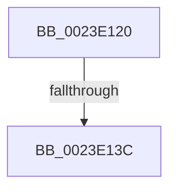

# MiLockPageTablePage

- RVA: `0x0023E120`–`0x0023E144` (길이 `36` bytes)
- VA: `0x000000014023E120`
- 실행 섹션: `.text`
- PDB 이름 있음: `예`; PDB Function 태그: `아니요`
- unwind 정보 RVA: `0x00061314`
- 디코드: `14`개 명령, `36/36` bytes 표시
- 미해석 바이트: `0` (있으면 어셈블리에 `.byte`로 보존)

> 이 문서는 커널 이미지의 기계어와 PDB 기호를 분석해 생성했습니다. 4번과 5번은 함수 원형과 자료형을 바이너리 사용 방식에서 추정한 C 해석이며 원본 소스 복구 결과는 아닙니다.

## 1. Dependencies

- 직접 호출 지점: **0**; 고유 호출 대상: **0**
- 직접 호출자로 확인된 함수: **4**
- RIP 상대 이미지 참조: **0**

### Outgoing calls
- 직접 디코드된 call 명령이 없습니다.

### Direct callers
- [MiBuildForkPte](../22/MiBuildForkPte_function_0022E32C.md) at `0x0022E556`
- [sub_0023C50F](Unknown_function_0023C50F.md) at `0x0023C570`
- [NtLockVirtualMemory](../40/NtLockVirtualMemory_function_004088A0.md) at `0x00408C0A`
- [NtLockVirtualMemory](../40/NtLockVirtualMemory_function_004088A0.md) at `0x00408F5C`
- [MiLockPageTableRange](../49/MiLockPageTableRange_function_0049A850.md) at `0x0049A950`

### Static image references
- 디코드된 RIP-relative 메모리 참조가 없습니다.

## 2. Other-region calls and transfers

- 다른 실행 섹션으로 향하는 call: **0**
- call이 아닌 외부 분기/꼬리 이동: **1**
  - `0x0023E136` → [sub_0023E26F](Unknown_function_0023E26F.md) (`tail-transfer`)

## 3. Assembly (complete function range)

```asm
0023E120  40 53                           push rbx
0023E122  56                              push rsi
0023E123  57                              push rdi
0023E124  41 54                           push r12
0023E126  41 55                           push r13
0023E128  48 83 EC 30                     sub rsp, 0x30
0023E12C  33 FF                           xor edi, edi
0023E12E  8B F2                           mov esi, edx
0023E130  48 8B D9                        mov rbx, rcx
0023E133  83 FA 01                        cmp edx, 1
0023E136  0F 84 33 01 00 00               je 0x14023e26f
0023E13C  85 D2                           test edx, edx
0023E13E  8B CF                           mov ecx, edi
0023E140  48 0F 44 CB                     cmove rcx, rbx
```

## 4. C-style interpretation (structured pseudocode)

```c
void __fastcall MiLockPageTablePage(__int64 a1, int a2)
{
    __int64 v_rdi;
    __int64 v_rsp;

    v_rsp = (v_rsp) - (48);
    v_rdi = 0;
    a1 = 0;
    if (a2 == 0) { a1 = a1; }
    return;
}
```

## 5. (Beta) C Style

```c
void MiLockPageTablePage(int64_t Arg1, int32_t Arg2)
{
    int64_t local_rdi;
    int64_t local_rsp;

    local_rsp = (local_rsp) - (48);
    local_rdi = 0;
    Arg1 = 0;
    if (Arg2 == 0) { Arg1 = Arg1; }
    return;
}
```

## 6. Execution-region graph

[열기: 2D/3D 그래프와 함수 탐색 컨트롤 패널](../../../control-panel.html?section=text&rva=0x0023E120&view=graph)

- 2D 그래프는 위에서 아래로 흐르고, 3D 그래프는 빈 공간을 드래그해 회전합니다. Shift+드래그는 이동, 휠은 확대·축소, 함수 노드 선택은 대상 보고서 이동입니다.

### Static fallback


