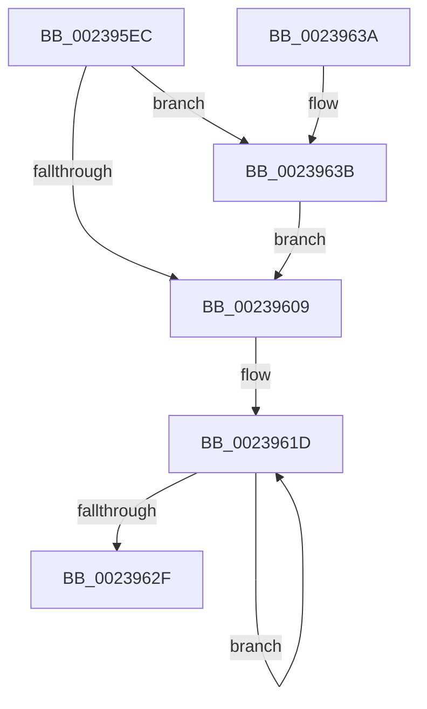

# MiLockWorkingSetExclusiveAtDpc

- RVA: `0x002395EC`–`0x00239644` (길이 `88` bytes)
- VA: `0x00000001402395EC`
- 실행 섹션: `.text`
- PDB 이름 있음: `예`; PDB Function 태그: `아니요`
- unwind 정보 RVA: `0x00060BE4`
- 디코드: `25`개 명령, `88/88` bytes 표시
- 미해석 바이트: `0` (있으면 어셈블리에 `.byte`로 보존)

> 이 문서는 커널 이미지의 기계어와 PDB 기호를 분석해 생성했습니다. 4번과 5번은 함수 원형과 자료형을 바이너리 사용 방식에서 추정한 C 해석이며 원본 소스 복구 결과는 아닙니다.

## 1. Dependencies

- 직접 호출 지점: **2**; 고유 호출 대상: **1**
- 직접 호출자로 확인된 함수: **4**
- RIP 상대 이미지 참조: **1**

### Outgoing calls
- `0x0023960F` → [ExAcquireSpinLockExclusiveAtDpcLevel](../24/ExAcquireSpinLockExclusiveAtDpcLevel_function_00248E80.md) (function, `0x00248E80`)
- `0x00239620` → [ExAcquireSpinLockExclusiveAtDpcLevel](../24/ExAcquireSpinLockExclusiveAtDpcLevel_function_00248E80.md) (function, `0x00248E80`)

### Direct callers
- [MmStealTopLevelPage](../22/MmStealTopLevelPage_function_002281E0.md) at `0x00228228`
- [MiWalkPageTablesRecursively](../27/MiWalkPageTablesRecursively_function_002796C0.md) at `0x0027A9C7`
- [MiMapWithLargePages](../3B/MiMapWithLargePages_function_003B6624.md) at `0x003B67FF`
- [MiFreedUnusedPfnPagesDpc](../67/MiFreedUnusedPfnPagesDpc_function_00672378.md) at `0x0067239F`

### Static image references
- `0x002395FC` → RVA `0x00E38840` (`.data`; read)

## 2. Other-region calls and transfers

- 다른 실행 섹션으로 향하는 call: **0**
- 별도 외부 분기/꼬리 이동을 확인하지 못했습니다.

## 3. Assembly (complete function range)

```asm
002395EC  48 89 5C 24 08                  mov qword ptr [rsp + 8], rbx
002395F1  57                              push rdi
002395F2  48 83 EC 20                     sub rsp, 0x20
002395F6  8B 81 B8 00 00 00               mov eax, dword ptr [rcx + 0xb8]
002395FC  48 8D 1D 3D F2 BF 00            lea rbx, [rip + 0xbff23d]
00239603  24 0F                           and al, 0xf
00239605  3C 01                           cmp al, 1
00239607  75 32                           jne 0x14023963b
00239609  48 8B 1B                        mov rbx, qword ptr [rbx]
0023960C  48 8B CB                        mov rcx, rbx
0023960F  E8 6C F8 00 00                  call 0x140248e80
00239614  48 83 C3 40                     add rbx, 0x40
00239618  BF 03 00 00 00                  mov edi, 3
0023961D  48 8B CB                        mov rcx, rbx
00239620  E8 5B F8 00 00                  call 0x140248e80
00239625  48 83 C3 40                     add rbx, 0x40
00239629  48 83 EF 01                     sub rdi, 1
0023962D  75 EE                           jne 0x14023961d
0023962F  48 8B 5C 24 30                  mov rbx, qword ptr [rsp + 0x30]
00239634  48 83 C4 20                     add rsp, 0x20
00239638  5F                              pop rdi
00239639  C3                              ret
0023963A  CC                              int3
0023963B  48 8D 99 C0 00 00 00            lea rbx, [rcx + 0xc0]
00239642  EB C5                           jmp 0x140239609
```

## 4. C-style interpretation (structured pseudocode)

```c
__int64 __fastcall MiLockWorkingSetExclusiveAtDpc(__int64 a1)
{
    __int64 result;
    __int64 v_rbx;
    __int64 v_rdi;
    __int64 v_rsp;
    unsigned __int64 v_stack_p8;

    v_stack_p8 = v_rbx;
    v_rsp = (v_rsp) - (32);
    result = (unsigned __int8)(((unsigned int)(*(unsigned int *)(a1 + 184))) & (15));
    if (((unsigned __int8)(result)) != 1) goto loc_0023963B;
loc_00239609:
    result = ExAcquireSpinLockExclusiveAtDpcLevel(*(unsigned __int64 *)(v_rip + 12579389), a2, a3, a4);
    v_rbx = (*(unsigned __int64 *)(v_rip + 12579389)) + (64);
loc_0023961D:
    result = ExAcquireSpinLockExclusiveAtDpcLevel(v_rbx, a2, a3, a4);
    v_rbx = (v_rbx) + (64);
    v_rdi = (3) - (1);
    if (condition_is_not_equal) goto loc_0023961D;
    v_rsp = (v_rsp) + (32);
    return result;
loc_0023963B:
    goto loc_00239609;
}
```

## 5. (Beta) C Style

```c
int64_t MiLockWorkingSetExclusiveAtDpc(void *Arg1)
{
    uint8_t *arg1 = (uint8_t *)Arg1;

    int64_t result;
    int64_t local_rbx;
    int64_t local_rdi;
    int64_t local_rsp;
    uint64_t v_stack_p8;

    v_stack_p8 = local_rbx;
    local_rsp = (local_rsp) - (32);
    result = (uint8_t)(((uint32_t)(*(uint32_t *)(arg1 + 0xB8))) & (15));
    if (((uint8_t)(result)) != 1) goto loc_0023963B;
loc_00239609:
    result = ExAcquireSpinLockExclusiveAtDpcLevel(*(uint64_t *)(v_rip + 0xBFF23D), a2, a3, a4);
    local_rbx = (*(uint64_t *)(v_rip + 0xBFF23D)) + (64);
loc_0023961D:
    result = ExAcquireSpinLockExclusiveAtDpcLevel(local_rbx, a2, a3, a4);
    local_rbx = (local_rbx) + (64);
    local_rdi = (3) - (1);
    if (condition_is_not_equal) goto loc_0023961D;
    local_rsp = (local_rsp) + (32);
    return result;
loc_0023963B:
    goto loc_00239609;
}
```

### 관측된 메모리 오프셋

구조체 형식이 확인되지 않은 접근은 인자 기준의 오프셋으로만 기록했습니다.

| 기준 인자 | 오프셋 표현 | 폭 (bit) | 접근 |
|---|---:|---:|---|
| `Arg1` | `+ 0xB8` | `32` | `R` |
| `Arg1` | `+ 0xC0` | `64` | `R` |

## 6. Execution-region graph

[열기: 2D/3D 그래프와 함수 탐색 컨트롤 패널](../../../control-panel.html?section=text&rva=0x002395EC&view=graph)

- 2D 그래프는 위에서 아래로 흐르고, 3D 그래프는 빈 공간을 드래그해 회전합니다. Shift+드래그는 이동, 휠은 확대·축소, 함수 노드 선택은 대상 보고서 이동입니다.

### Static fallback


