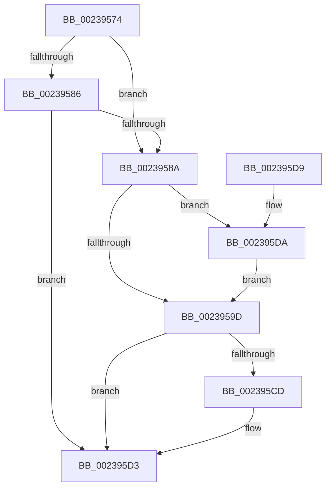

# MiLockWorkingSetSharedAtDpc

- RVA: `0x00239574`–`0x002395E3` (길이 `111` bytes)
- VA: `0x0000000140239574`
- 실행 섹션: `.text`
- PDB 이름 있음: `예`; PDB Function 태그: `아니요`
- unwind 정보 RVA: `0x00060BD8`
- 디코드: `31`개 명령, `111/111` bytes 표시
- 미해석 바이트: `0` (있으면 어셈블리에 `.byte`로 보존)

> 이 문서는 커널 이미지의 기계어와 PDB 기호를 분석해 생성했습니다. 4번과 5번은 함수 원형과 자료형을 바이너리 사용 방식에서 추정한 C 해석이며 원본 소스 복구 결과는 아닙니다.

## 1. Dependencies

- 직접 호출 지점: **1**; 고유 호출 대상: **1**
- 직접 호출자로 확인된 함수: **24**
- RIP 상대 이미지 참조: **1**

### Outgoing calls
- `0x002395B3` → [ExAcquireSpinLockSharedAtDpcLevel](../24/ExAcquireSpinLockSharedAtDpcLevel_function_00248E30.md) (function, `0x00248E30`)

### Direct callers
- [sub_00243617](../24/Unknown_function_00243617.md) at `0x0024361B`
- [MiClearMappingAndDereferenceIoSpace](../24/MiClearMappingAndDereferenceIoSpace_function_00247DF0.md) at `0x0024829B`
- [MiWalkPageTablesRecursively](../27/MiWalkPageTablesRecursively_function_002796C0.md) at `0x0027B166`
- [MiUnlockWorkingSetExclusive](../27/MiUnlockWorkingSetExclusive_function_0027EC70.md) at `0x0027EE53`
- [MiAllocateKernelStackPages](../2A/MiAllocateKernelStackPages_function_002A1BEC.md) at `0x002A20A6`
- [MiDeleteSystemPageTables](../2C/MiDeleteSystemPageTables_function_002C1110.md) at `0x002C11F3`
- [MiClearNonPagedPtes](../2C/MiClearNonPagedPtes_function_002C17A0.md) at `0x002C18C3`
- [MiMakeZeroedPageTablesEx](../3B/MiMakeZeroedPageTablesEx_function_003B59FC.md) at `0x003B5D1A`
- [MiMapWithLargePages](../3B/MiMapWithLargePages_function_003B6624.md) at `0x003B6816`
- [MiUnmapMdlCommon](../3E/MiUnmapMdlCommon_function_003E7DF0.md) at `0x003E7EFE`
- [MiUnmapMdlCommon](../3E/MiUnmapMdlCommon_function_003E7DF0.md) at `0x003E82CE`
- [sub_0040E659](../40/Unknown_function_0040E659.md) at `0x0040E65D`
- [MiUpdateImportRelocationsOnDriverPrivatePages](../44/MiUpdateImportRelocationsOnDriverPrivatePages_function_00449BCC.md) at `0x00449D51`
- [MiLockPoolCommitWs](../46/MiLockPoolCommitWs_function_00469EC0.md) at `0x00469EEB`
- [MiDeleteShadowStackPtes](../49/MiDeleteShadowStackPtes_function_00493AE4.md) at `0x00493D8B`
- [MiReleaseLargePdeMappings](../49/MiReleaseLargePdeMappings_function_0049D0B0.md) at `0x0049D350`
- [MiAdjustSecureDriverStateForIatCapture](../4B/MiAdjustSecureDriverStateForIatCapture_function_004BE864.md) at `0x004BE930`
- [MiZeroAndFlushGoodCitizen](../4D/MiZeroAndFlushGoodCitizen_function_004D0828.md) at `0x004D08FC`
- [MiMapMdlWithLargePages](../4D/MiMapMdlWithLargePages_function_004D10B8.md) at `0x004D11A7`
- [MiMapMdlCommon](../67/MiMapMdlCommon_function_00674524.md) at `0x006748E5`
- [MmAddRangeToCrashDump](../67/MmAddRangeToCrashDump_function_0067D8B0.md) at `0x0067D992`
- [MmRemoveSystemCacheFromDump](../67/MmRemoveSystemCacheFromDump_function_0067DD58.md) at `0x0067DDED`
- [MmMapDriverTablePage](../68/MmMapDriverTablePage_function_00683EAC.md) at `0x00683F39`
- [MiUnmapLegacyAwePage](../68/MiUnmapLegacyAwePage_function_0068993C.md) at `0x006899CC`
- [sub_006F60F8](../6F/Unknown_function_006F60F8.md) at `0x006F6148`

### Static image references
- `0x00239594` → RVA `0x00E38840` (`.data`; read)

## 2. Other-region calls and transfers

- 다른 실행 섹션으로 향하는 call: **0**
- 별도 외부 분기/꼬리 이동을 확인하지 못했습니다.

## 3. Assembly (complete function range)

```asm
00239574  40 53                           push rbx
00239576  48 83 EC 20                     sub rsp, 0x20
0023957A  8B 81 B8 00 00 00               mov eax, dword ptr [rcx + 0xb8]
00239580  24 0F                           and al, 0xf
00239582  3C 04                           cmp al, 4
00239584  76 04                           jbe 0x14023958a
00239586  3C 05                           cmp al, 5
00239588  75 49                           jne 0x1402395d3
0023958A  8B 81 B8 00 00 00               mov eax, dword ptr [rcx + 0xb8]
00239590  24 0F                           and al, 0xf
00239592  3C 01                           cmp al, 1
00239594  48 8D 05 A5 F2 BF 00            lea rax, [rip + 0xbff2a5]
0023959B  75 3D                           jne 0x1402395da
0023959D  65 8B 1C 25 A4 01 00 00         mov ebx, dword ptr gs:[0x1a4]
002395A5  D1 EB                           shr ebx, 1
002395A7  83 E3 03                        and ebx, 3
002395AA  8B CB                           mov ecx, ebx
002395AC  48 C1 E1 06                     shl rcx, 6
002395B0  48 03 08                        add rcx, qword ptr [rax]
002395B3  E8 78 F8 00 00                  call 0x140248e30
002395B8  65 48 8B 04 25 20 00 00 00      mov rax, qword ptr gs:[0x20]
002395C1  48 8B 88 38 88 00 00            mov rcx, qword ptr [rax + 0x8838]
002395C8  48 85 C9                        test rcx, rcx
002395CB  74 06                           je 0x1402395d3
002395CD  89 99 44 01 00 00               mov dword ptr [rcx + 0x144], ebx
002395D3  48 83 C4 20                     add rsp, 0x20
002395D7  5B                              pop rbx
002395D8  C3                              ret
002395D9  CC                              int3
002395DA  48 8D 81 C0 00 00 00            lea rax, [rcx + 0xc0]
002395E1  EB BA                           jmp 0x14023959d
```

## 4. C-style interpretation (structured pseudocode)

```c
__int64 __fastcall MiLockWorkingSetSharedAtDpc(__int64 a1)
{
    __int64 result;
    __int64 v_rbx;
    __int64 v_rsp;

    v_rsp = (v_rsp) - (32);
    result = (unsigned __int8)(((unsigned int)(*(unsigned int *)(a1 + 184))) & (15));
    if (((unsigned __int8)(result)) <= 4) goto loc_0023958A;
    if (((unsigned __int8)(result)) != 5) goto loc_002395D3;
loc_0023958A:
    result = (unsigned __int8)(((unsigned int)(*(unsigned int *)(a1 + 184))) & (15));
    if (((unsigned __int8)(result)) != 1) goto loc_002395DA;
loc_0023959D:
    v_rbx = (unsigned int)(((unsigned int)(*(unsigned int *)(gs_base + (0 + 420)))) >> (1));
    v_rbx = (unsigned int)((v_rbx) & (3));
    a1 = ((unsigned int)((unsigned int)(v_rbx))) << (6);
    a1 = (a1) + (*(unsigned __int64 *)(v_rip + 12579493));
    result = ExAcquireSpinLockSharedAtDpcLevel(a1, a2, a3, a4);
    if (*(unsigned __int64 *)(*(unsigned __int64 *)(gs_base + (0 + 32)) + 34872) != 0) {
        *(unsigned int *)(*(unsigned __int64 *)(*(unsigned __int64 *)(gs_base + (0 + 32)) + 34872) + 324) = (unsigned int)(v_rbx);
    }
    v_rsp = (v_rsp) + (32);
    return *(unsigned __int64 *)(gs_base + (0 + 32));
loc_002395DA:
    goto loc_0023959D;
}
```

## 5. (Beta) C Style

```c
int64_t MiLockWorkingSetSharedAtDpc(void *Arg1)
{
    uint8_t *arg1 = (uint8_t *)Arg1;

    int64_t result;
    int64_t local_rbx;
    int64_t local_rsp;

    local_rsp = (local_rsp) - (32);
    result = (uint8_t)(((uint32_t)(*(uint32_t *)(arg1 + 0xB8))) & (15));
    if (((uint8_t)(result)) <= 4) goto loc_0023958A;
    if (((uint8_t)(result)) != 5) goto loc_002395D3;
loc_0023958A:
    result = (uint8_t)(((uint32_t)(*(uint32_t *)(arg1 + 0xB8))) & (15));
    if (((uint8_t)(result)) != 1) goto loc_002395DA;
loc_0023959D:
    local_rbx = (uint32_t)(((uint32_t)(*(uint32_t *)(gs_base + (0 + 0x1A4)))) >> (1));
    local_rbx = (uint32_t)((local_rbx) & (3));
    Arg1 = ((uint32_t)((uint32_t)(local_rbx))) << (6);
    Arg1 = (Arg1) + (*(uint64_t *)(v_rip + 0xBFF2A5));
    result = ExAcquireSpinLockSharedAtDpcLevel(Arg1, a2, a3, a4);
    if (*(uint64_t *)(*(uint64_t *)(gs_base + (0 + 0x20)) + 0x8838) != 0) {
        *(uint32_t *)(*(uint64_t *)(*(uint64_t *)(gs_base + (0 + 0x20)) + 0x8838) + 0x144) = (uint32_t)(local_rbx);
    }
    local_rsp = (local_rsp) + (32);
    return *(uint64_t *)(gs_base + (0 + 0x20));
loc_002395DA:
    goto loc_0023959D;
}
```

### 관측된 메모리 오프셋

구조체 형식이 확인되지 않은 접근은 인자 기준의 오프셋으로만 기록했습니다.

| 기준 인자 | 오프셋 표현 | 폭 (bit) | 접근 |
|---|---:|---:|---|
| `Arg1` | `+ 0xB8` | `32` | `R` |
| `Arg1` | `+ 0xC0` | `64` | `R` |

## 6. Execution-region graph

[열기: 2D/3D 그래프와 함수 탐색 컨트롤 패널](../../../control-panel.html?section=text&rva=0x00239574&view=graph)

- 2D 그래프는 위에서 아래로 흐르고, 3D 그래프는 빈 공간을 드래그해 회전합니다. Shift+드래그는 이동, 휠은 확대·축소, 함수 노드 선택은 대상 보고서 이동입니다.

### Static fallback


