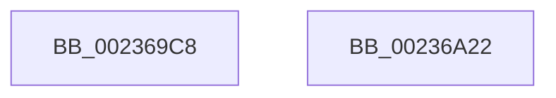

# MiLogPerfMemoryEvent

- RVA: `0x002369C8`–`0x00236A23` (길이 `91` bytes)
- VA: `0x00000001402369C8`
- 실행 섹션: `.text`
- PDB 이름 있음: `예`; PDB Function 태그: `아니요`
- unwind 정보 RVA: `0x00060904`
- 디코드: `21`개 명령, `91/91` bytes 표시
- 미해석 바이트: `0` (있으면 어셈블리에 `.byte`로 보존)

> 이 문서는 커널 이미지의 기계어와 PDB 기호를 분석해 생성했습니다. 4번과 5번은 함수 원형과 자료형을 바이너리 사용 방식에서 추정한 C 해석이며 원본 소스 복구 결과는 아닙니다.

## 1. Dependencies

- 직접 호출 지점: **2**; 고유 호출 대상: **2**
- 직접 호출자로 확인된 함수: **5**
- RIP 상대 이미지 참조: **1**

### Outgoing calls
- `0x00236A0B` → [EtwTraceKernelEvent](EtwTraceKernelEvent_function_00235350.md) (function, `0x00235350`)
- `0x00236A18` → [_security_check_cookie](../6A/_security_check_cookie_function_006AC640.md) (function, `0x006AC640`)

### Direct callers
- [MiLogSectionObjectEvent](../../page/7F/MiLogSectionObjectEvent_function_007FCF28.md) at `0x007FCF68`
- [MiLogVirtualRotateEvent](../../page/7F/MiLogVirtualRotateEvent_function_007FE704.md) at `0x007FE743`
- [sub_0088535F](../../page/88/Unknown_function_0088535F.md) at `0x0088551A`
- [MiLogMapFileEvent](../../page/97/MiLogMapFileEvent_function_0097E0FC.md) at `0x0097E14C`
- [MiLogMemResetInfo](../../page/A8/MiLogMemResetInfo_function_00A802F8.md) at `0x00A80337`

### Static image references
- `0x002369CC` → RVA `0x00E0A740` (`.data`; read)

## 2. Other-region calls and transfers

- 다른 실행 섹션으로 향하는 call: **0**
- 별도 외부 분기/꼬리 이동을 확인하지 못했습니다.

## 3. Assembly (complete function range)

```asm
002369C8  48 83 EC 58                     sub rsp, 0x58
002369CC  48 8B 05 6D 3D BD 00            mov rax, qword ptr [rip + 0xbd3d6d]
002369D3  48 33 C4                        xor rax, rsp
002369D6  48 89 44 24 40                  mov qword ptr [rsp + 0x40], rax
002369DB  8B 84 24 80 00 00 00            mov eax, dword ptr [rsp + 0x80]
002369E2  83 64 24 3C 00                  and dword ptr [rsp + 0x3c], 0
002369E7  0D 00 02 00 11                  or eax, 0x11000200
002369EC  4C 89 44 24 30                  mov qword ptr [rsp + 0x30], r8
002369F1  44 8B C2                        mov r8d, edx
002369F4  44 89 4C 24 38                  mov dword ptr [rsp + 0x38], r9d
002369F9  BA 01 00 00 00                  mov edx, 1
002369FE  44 0F B7 C9                     movzx r9d, cx
00236A02  89 44 24 20                     mov dword ptr [rsp + 0x20], eax
00236A06  48 8D 4C 24 30                  lea rcx, [rsp + 0x30]
00236A0B  E8 40 E9 FF FF                  call 0x140235350
00236A10  48 8B 4C 24 40                  mov rcx, qword ptr [rsp + 0x40]
00236A15  48 33 CC                        xor rcx, rsp
00236A18  E8 23 5C 47 00                  call 0x1406ac640
00236A1D  48 83 C4 58                     add rsp, 0x58
00236A21  C3                              ret
00236A22  CC                              int3
```

## 4. C-style interpretation (structured pseudocode)

```c
__int64 __fastcall MiLogPerfMemoryEvent(unsigned __int16 a1, int a2, __int64 a3, int a4, unsigned int a5)
{
    __int64 result;
    __int64 v_rsp;
    unsigned __int64 v_stack_m18;
    unsigned int v_stack_m1C;
    unsigned int v_stack_m20;
    unsigned __int64 v_stack_m28;
    unsigned int v_stack_m38;

    v_rsp = (v_rsp) - (88);
    result = (*(unsigned __int64 *)(v_rip + 12402029)) ^ (v_rsp);
    v_stack_m18 = result;
    result = (unsigned int)(((unsigned int)(a5)) | (0x11000200ULL));
    v_stack_m28 = a3;
    v_stack_m20 = a4;
    v_stack_m38 = (unsigned int)(result);
    result = EtwTraceKernelEvent(v_stack_m28, 1, (unsigned int)(a2), a1);
    a1 = (v_stack_m18) ^ (v_rsp);
    result = _security_check_cookie(a1, 1, (unsigned int)(a2), a1);
    v_rsp = (v_rsp) + (88);
    return result;
}
```

## 5. (Beta) C Style

```c
int64_t MiLogPerfMemoryEvent(uint16_t Arg1, int32_t Arg2, int64_t Arg3, int32_t Arg4, uint32_t Arg5)
{
    int64_t result;
    int64_t local_rsp;
    uint64_t v_stack_m18;
    uint32_t v_stack_m1C;
    uint32_t v_stack_m20;
    uint64_t v_stack_m28;
    uint32_t v_stack_m38;

    local_rsp = (local_rsp) - (88);
    result = (*(uint64_t *)(v_rip + 0xBD3D6D)) ^ (local_rsp);
    v_stack_m18 = result;
    result = (uint32_t)(((uint32_t)(Arg5)) | (0x11000200ULL));
    v_stack_m28 = Arg3;
    v_stack_m20 = Arg4;
    v_stack_m38 = (uint32_t)(result);
    result = EtwTraceKernelEvent(v_stack_m28, 1, (uint32_t)(Arg2), Arg1);
    Arg1 = (v_stack_m18) ^ (local_rsp);
    result = _security_check_cookie(Arg1, 1, (uint32_t)(Arg2), Arg1);
    local_rsp = (local_rsp) + (88);
    return result;
}
```

## 6. Execution-region graph

[열기: 2D/3D 그래프와 함수 탐색 컨트롤 패널](../../../control-panel.html?section=text&rva=0x002369C8&view=graph)

- 2D 그래프는 위에서 아래로 흐르고, 3D 그래프는 빈 공간을 드래그해 회전합니다. Shift+드래그는 이동, 휠은 확대·축소, 함수 노드 선택은 대상 보고서 이동입니다.

### Static fallback


